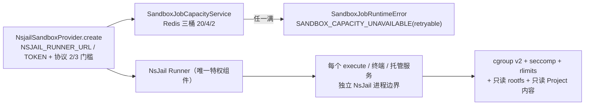

# 运行时·沙箱·产物专家 —— C1 能力契约

> 契约层 CR2 / CR5 / CR7。只写「对外可依赖的语义」：入口、参数行为、返回、异常与约束；路径均为仓库根相对 `file://` 引用。
> **资产基线**：`2026-10-16 · commit 80f5676fd`（批次 5 第 12 专家）。**逐端点明细**（完整字段、错误码全集）见 [implementation/05-接口.md](file://.module-experts/后端专题/运行时·沙箱·产物专家/implementation/05-接口.md)，本文不复制。

**本文引用的文件**（相对仓库根，链接均为 `file://`）

- [packages/server-ai/src/sandbox/sandbox.controller.ts](file://packages/server-ai/src/sandbox/sandbox.controller.ts)
- [packages/server-ai/src/sandbox/sandbox.module.ts](file://packages/server-ai/src/sandbox/sandbox.module.ts)
- [packages/server-ai/src/sandbox/sandbox-terminal.gateway.ts](file://packages/server-ai/src/sandbox/sandbox-terminal.gateway.ts)
- [packages/server-ai/src/sandbox/sandbox-terminal-auth.guard.ts](file://packages/server-ai/src/sandbox/sandbox-terminal-auth.guard.ts)
- [packages/server-ai/src/sandbox/sandbox-preview-auth.guard.ts](file://packages/server-ai/src/sandbox/sandbox-preview-auth.guard.ts)
- [packages/server-ai/src/sandbox/sandbox-preview-session.service.ts](file://packages/server-ai/src/sandbox/sandbox-preview-session.service.ts)
- [packages/server-ai/src/sandbox/sandbox-managed-service.service.ts](file://packages/server-ai/src/sandbox/sandbox-managed-service.service.ts)
- [packages/server-ai/src/sandbox/sandbox-conversation-context.service.ts](file://packages/server-ai/src/sandbox/sandbox-conversation-context.service.ts)
- [packages/server-ai/src/sandbox/sandbox.service.ts](file://packages/server-ai/src/sandbox/sandbox.service.ts)
- [packages/server-ai/src/sandbox/nsjail/nsjail-sandbox.provider.ts](file://packages/server-ai/src/sandbox/nsjail/nsjail-sandbox.provider.ts)
- [packages/server-ai/src/sandbox/nsjail/nsjail-sandbox.ts](file://packages/server-ai/src/sandbox/nsjail/nsjail-sandbox.ts)
- [packages/server-ai/src/sandbox/nsjail/nsjail-runner.client.ts](file://packages/server-ai/src/sandbox/nsjail/nsjail-runner.client.ts)
- [packages/server-ai/src/sandbox/sandbox-job/sandbox-job-runtime-capability.service.ts](file://packages/server-ai/src/sandbox/sandbox-job/sandbox-job-runtime-capability.service.ts)
- [packages/server-ai/src/sandbox/sandbox-job/sandbox-job-capacity.service.ts](file://packages/server-ai/src/sandbox/sandbox-job/sandbox-job-capacity.service.ts)
- [packages/server-ai/src/sandbox/sandbox-job/sandbox-runtime-binding-selector.service.ts](file://packages/server-ai/src/sandbox/sandbox-job/sandbox-runtime-binding-selector.service.ts)
- [packages/server-ai/src/sandbox/middlewares/sandbox-shell.middleware.ts](file://packages/server-ai/src/sandbox/middlewares/sandbox-shell.middleware.ts)
- [packages/server-ai/src/sandbox/middlewares/file-activity-storage.service.ts](file://packages/server-ai/src/sandbox/middlewares/file-activity-storage.service.ts)
- [packages/server/src/runtime-control/runtime-control.controller.ts](file://packages/server/src/runtime-control/runtime-control.controller.ts)
- [packages/server/src/runtime-control/runtime-control.service.ts](file://packages/server/src/runtime-control/runtime-control.service.ts)
- [packages/server/src/runtime-control/runtime-lifecycle.service.ts](file://packages/server/src/runtime-control/runtime-lifecycle.service.ts)
- [packages/server/src/runtime-control/runtime-drain.middleware.ts](file://packages/server/src/runtime-control/runtime-drain.middleware.ts)
- [packages/server/src/health/health.controller.ts](file://packages/server/src/health/health.controller.ts)
- [packages/server-ai/src/artifacts/artifacts.controller.ts](file://packages/server-ai/src/artifacts/artifacts.controller.ts)
- [packages/server-ai/src/artifacts/artifacts.service.ts](file://packages/server-ai/src/artifacts/artifacts.service.ts)
- [packages/server-ai/src/workspace-file-access/workspace-file-access.controller.ts](file://packages/server-ai/src/workspace-file-access/workspace-file-access.controller.ts)
- [packages/server-ai/src/workspace-file-access/workspace-file-content.controller.ts](file://packages/server-ai/src/workspace-file-access/workspace-file-content.controller.ts)
- [packages/server-ai/src/workspace-file-access/workspace-file-access.service.ts](file://packages/server-ai/src/workspace-file-access/workspace-file-access.service.ts)
- [packages/plugin-sdk/src/lib/runtime/capabilities/sandbox-jobs.ts](file://packages/plugin-sdk/src/lib/runtime/capabilities/sandbox-jobs.ts)
- [packages/plugin-sdk/src/lib/runtime/capabilities/artifacts.ts](file://packages/plugin-sdk/src/lib/runtime/capabilities/artifacts.ts)
- [packages/contracts/src/ai/sandbox-terminal.model.ts](file://packages/contracts/src/ai/sandbox-terminal.model.ts)
- [.deploy/nsjail-runner/README.md](file://.deploy/nsjail-runner/README.md)
- [.deploy/nsjail-runner/docker-compose.nsjail.yml](file://.deploy/nsjail-runner/docker-compose.nsjail.yml)

## 目录

1. [§1 HTTP 入口索引](#§1-http-入口索引)
2. [§2 服务能力契约](#§2-服务能力契约)
3. [§3 隔离与配额契约](#§3-隔离与配额契约)
4. [§4 代码示例（真实调用方）](#§4-代码示例真实调用方)
5. [§5 契约来源索引](#§5-契约来源索引)

## §1 HTTP 入口索引

全局 URL 前缀 `api`；`sandbox` 与 `workspace-file-access` 走 `RouterModule.register`，`runtime-control`/`artifacts`/`health` 把前缀写在 `@Controller(...)` 上（`runtime-control` **无 RouterModule**）。

| 方法 | 路径 | 鉴权 | 用途 |
|---|---|---|---|
| GET | `/api/sandbox/volume/project/:projectId/*path` | 全局 `AuthGuard` ＋ `XpertProjectAccessService.assertCanRead` | 项目卷只读投递；`tenant` query 必须等于项目持久化 tenant |
| GET | `/api/sandbox/volume/user/:userId/xpert/:xpertId/*path` | 同上 ＋ 当前用户必须等于 `:userId` | 用户隔离 Xpert 卷 |
| GET | `/api/sandbox/volume/xpert/:xpertId/user/:userId/*path` | 同上 | 旧版用户隔离布局兼容路由 |
| GET | `/api/sandbox/volume/*path` | **`@Public()`（匿名通配，仅路径黑名单护栏）** | 共享卷投递：预览静态资源、运行时作业产物等 |
| POST | `/api/sandbox/file` | 全局 `AuthGuard` | multipart（字段 `file`）＋ `workspace`/`conversationId`/`path` → `UploadFileCommand`（`mounted_workspace`） |
| POST | `/api/sandbox/terminal` | 全局 `AuthGuard` | `@Post` ＋ `@Sse()` 流式执行命令；非 0 退出码走流的 error 通道而非 HTTP 码 |
| GET/POST | `/api/sandbox/conversations/:conversationId/services[/:serviceId\|/start\|/logs\|/stop\|/restart\|/preview-session]` | 全局 `AuthGuard`（服务层解析沙箱上下文） | 会话托管服务 7 条：列表/详情/启动/日志/停止/重启/签发预览会话 |
| GET/POST | `/api/sandbox/threads/:threadId/services…`（同构 7 条） | 同上一行 | 线程面托管服务；服务端把 `threadId` 解析为会话后落同表；**线程面无 proxy** |
| ALL | `/api/sandbox/conversations/:conversationId/services/:serviceId/proxy[/\|/*path]`（3 条） | **`@Public()` ＋ `SandboxPreviewAuthGuard`** | 预览代理；票面 `conversationId`/`serviceId` 必须与路径一致，cookie path 限定到该前缀 |
| GET | `/api/system/runtime/instances` | `TenantPermissionGuard` ＋ `RoleGuard(SUPER_ADMIN)` ＋ 服务层断言 | 列出已注册 API 副本 |
| POST | `/api/system/runtime/instances/:instanceId/retire` | 同上（body 必须带 `expectedBootId`） | 下线指定副本并写结构化审计日志 |
| GET | `/api/system/runtime/restart-capability` | 类级 `TenantPermissionGuard`（**无 RoleGuard**，服务层断言） | 返回 `{ allowed, mode: 'rolling-self-signal', reason }`，发布前自检用 |
| GET | `/api/system/runtime/restart/:restartId` | 同上 | 读取一次滚动重启状态；缺失 404 `RUNTIME_RESTART_NOT_FOUND` |
| GET | `/api/system/runtime/plugin-convergence/:generation` | 同上 | 读取某代插件运行时收敛状态；缺失 404 `PLUGIN_RUNTIME_CONVERGENCE_NOT_FOUND` |
| POST | `/api/system/runtime/restart` | `RoleGuard(SUPER_ADMIN)` ＋ 服务层断言；**202** | 请求全量优雅重启；body 必须 `confirmation === RUNTIME_RESTART_CONFIRMATION` |
| GET | `/api/artifacts/share/:slug`、`/share/:slug/download`、`/share/:slug/descriptor` | **`@Public()`**（签名 token 或登录态或分享会话 cookie） | 产物公开打开/下载/描述；未登录需登录时 302 到前端登录页 |
| POST/DELETE | `/api/artifacts/share-session/:slug`、`/api/artifacts/share-session` | POST 走全局 `AuthGuard`；DELETE 为 `@Public()` | 建分享会话（cookie 15 分钟、`path=/artifacts/share`）/ 清 cookie |
| POST/GET | `/api/artifacts`、`/by-source`、`/:idOrSlug`、`/:artifactId/versions[/ensure\|/:artifactVersionId/content]` | 全局 `AuthGuard` ＋ 服务层作用域查询（越域按 404） | 登记与查询、版本创建/列出/幂等确保/内容投递 |
| POST/PATCH/DELETE | `/api/artifacts/:artifactId/links*`、`/links/:idOrSlug/access`、`/links/:idOrSlug`、`/shares/:shareKey`、`/shared-links/:slug/content`、`/:idOrSlug/archive`、`/:idOrSlug` | 同上 | 分享链接建/改策略/吊销、按登录身份取共享内容、归档与软删 |
| POST | `/api/workspace-files/view-sessions`、`+ /:sessionId/grants`、`DELETE /:sessionId` | 全局 `AuthGuard` | 建查看会话（写 cookie）、签发 grant、撤销会话并清 cookie |
| GET | `/api/workspace-files/view-sessions/:sessionId/grants/:grantId/content/:fileName` | 全局 `AuthGuard`（`StreamableFile`） | 认证下载（`private, no-store` ＋ `nosniff`） |
| GET/HEAD | `/api/workspace-files/content/:sessionId/:grantId/:fileName` | **类级 `@Public()` ＋ `WorkspaceFileAccessGuard`** | 内联内容流；另做 `assertRequestOrigin` 校验 |
| GET | `/api/health/ready` | **`@Public()`** | 就绪探针；非 `ready` 时 503 ＋ `Cache-Control: no-store` |
| GET | `/api/health` | **`@Public()`** | 依赖体检：DB / 磁盘 / 缓存 / Redis（仅 `REDIS_ENABLED=true`） |

**WS 终端（namespace `sandbox-terminal`，非 HTTP）**——每个 handler 都挂 `@UseGuards(SandboxTerminalAuthGuard)`：

| 消息 | 载荷要点 | 鉴权 / 语义 |
|---|---|---|
| `open` | `conversationId`（必填）＋ 可选 `projectId`、`requestId`、`cols`/`rows` | 握手 `handshake.auth.token`（`cs-x-` 前缀走 client-secret，否则 JWT）＋ `assertWorkbenchPrincipal` ＋ 会话可见性校验 |
| `input` | `sessionId`、`data` | 按内存会话表转发；会话已移除则回 `error{code:'session_not_found'}` |
| `resize` | `sessionId`、`cols`、`rows` | 转发到 PTY |
| `close` | `sessionId` **或** `requestId` 二选一 | 关闭已开会话，或取消仍在 pending 的 open |
| 服务端事件 | `opened` / `output` / `exit` / `error` / `closed`（6 种 `reason`） | 握手失败是 `WsException({status:403})`，业务失败只用事件，**不要用 HTTP 状态码断言** |

**逐端点明细见 [implementation/05-接口.md](file://.module-experts/后端专题/运行时·沙箱·产物专家/implementation/05-接口.md)**（含每条的权限点、主要错误与状态码）。

章节来源：[sandbox.controller.ts](file://packages/server-ai/src/sandbox/sandbox.controller.ts)（关键符号：getVolumeFile / uploadFile / terminal / proxyManagedServicePath）、[runtime-control.controller.ts](file://packages/server/src/runtime-control/runtime-control.controller.ts)（关键符号：RuntimeControlController）、[artifacts.controller.ts](file://packages/server-ai/src/artifacts/artifacts.controller.ts)（关键符号：ArtifactsManagementController）、[workspace-file-content.controller.ts](file://packages/server-ai/src/workspace-file-access/workspace-file-content.controller.ts)（关键符号：WorkspaceFileContentController.streamContent）、[sandbox-terminal.model.ts](file://packages/contracts/src/ai/sandbox-terminal.model.ts)（关键符号：SANDBOX_TERMINAL_NAMESPACE / SandboxTerminalClientEvent）

## §2 服务能力契约

| `类.方法(签名)` | 用途 | 参数行为语义 | 返回 | 异常 / 约束 |
|---|---|---|---|---|
| `NsjailSandboxProvider.create(options?: SandboxProviderCreateOptions)` | 生产执行后端建运行时 | 缺配置抛 `NsJailRunnerNotConfigured`；要求 `workspaceBinding.volumeRoot`；先探 Runner `/health`（5 秒缓存 + 并发合流）；项目态校验协议 2、所有运行时校验协议 3；`runtimeId = sha256(...)` 截 32 位后 `POST /v1/runtimes` | `NsjailSandbox` | 配置/协议不满足（永久）与健康探测失败（Runner 不可用）两类 |
| `NsjailSandbox.execute(command, options)` / `streamExecute(...)` | 进程边界内执行命令 | 两者都包在 `withRuntimeRecovery` 里（runtime not-found 则重建并递增 generation，不吞其它错误） | `ExecuteResponse` / 流式回调 | Runner 侧超时或销毁即终止子进程 |
| `NsjailRunnerClient.getHealth/createRuntime/destroyRuntime/execute/streamExecute` | 唯一特权组件的 HTTP 客户端 | 超时对齐为 `timeoutMs + RUNNER_GRACE_PERIOD_MS`；`408/429/5xx`、`TypeError`、超时判为**可重试**，其余永久 | Runner 响应 / 错误分类 | `NsjailRunnerTimeoutError`（可重试类） |
| `SandboxConversationContextService.authorizeConversation(params: ConversationSandboxParams)` | 会话级准入（**不申请**后端） | 会话必须存在、`tenantId` 匹配、助手 `features.sandbox.enabled`、`features.sandbox.provider` 非空；群会话另走 `ResolveGroupRuntimeAccessCommand` | `AuthorizedConversationSandboxContext` | 403/400（会话不存在、特性关闭、provider 不可用） |
| `SandboxConversationContextService.resolveConversationSandbox(params)` / `findExistingSandbox(context)` | 组装沙箱上下文 | `resolve*` 会派发 `SandboxAcquireBackendCommand` **真正申请**运行时；`findExisting*` 被动发现，**不复活**已停运行时 | `ResolvedConversationSandboxContext` / `… \| null` | 与准入同源 |
| `SandboxManagedServiceService.startByConversationId(conversationId, input, owner?)` 及 `listBy*/getBy*/getLogsBy*/stopBy*/restartBy*` | 托管服务台账与生命周期 | 先 `resolveConversationSandbox` 再取 `SandboxManagedServiceAdapter`；`owner` 写 `ownerExecutionId`/`ownerAgentKey`；列表类方法**绝不创建沙箱** | `ISandboxManagedService` | 404（服务不存在）、409（重名）、400（启动失败/不支持） |
| `SandboxManagedServiceService.proxyByConversationId(conversationId, serviceId, requestPath, request, response)` | 预览代理转发 | 先查服务与会话上下文（**每次请求解析一次沙箱**），再清洗请求头（平台凭证与预览 cookie 不得进入后端）、丢弃 `set-cookie`、重写 `location`，`finally` 还原 | `void` | 400 `unsupported_provider`；上游空闲 60 秒关闭；**不代理 WS 升级** |
| `SandboxPreviewSessionService.createSession(service, { secure })` / `verifySession(token)` | 预览 cookie 签发/校验 | 要求 `status==='running'` 且 `transportMode==='http'` 且有 `previewUrl`；JWT `aud='sandbox-preview'`、`sub='sandbox-preview-session'`、含 `conversationId`/`serviceId`；TTL 1 小时、`httpOnly`、`sameSite:'lax'` | `{ expiresAt, previewUrl }` / 票面 | 400 `PreviewUnavailable`；缺 `JWT_SECRET` 500（不降级放行） |
| `SandboxJobRuntimeCapabilityService.run(input: SandboxJobRunInput)` | 插件面沙箱作业（能力键 `platform.sandbox.jobs`） | `requireRunnableAction` → `findIdempotent`（`succeeded` 复用；`waiting/starting/running` 附着；`lost` 递归重跑）→ `requirePreviousAttemptCleanup` → `bindingSelector.require` → `prepareAttempt`（输入快照，单作业输入/输出上限 350 MB）→ `waitForCapacity` → `execute` → 输出校验与证据 → `finally capacity.release` | `SandboxJobRunResult`（`status:'succeeded'`） | `SandboxJobRuntimeError(code, message, retryable, jobId?)` |
| `SandboxJobRuntimeCapabilityService.cancel({jobId})` / `getJob({jobId})` / `getActionHealth({pluginName,action,actionVersion})` | 取消、回读与就绪聚合 | 全部**按当前租户**查询（无租户上下文返回 `null`）；`cancel` 先 `runtime.terminate()` 再置 `cancelled` ＋ `SANDBOX_CANCELLED` 并销毁运行时/卷 | `SandboxJobSnapshot` / `… \| null` / `SandboxJobActionHealth` | 取消不存在的作业抛 `SANDBOX_CANCELLED, retryable=false` |
| `SandboxJobCapacityService.acquire(...)` / `release(lease)`；`SandboxRuntimeBindingSelector.require(definition, jobId?, {readOnlyFileMounts})` | 容量租约与绑定选择 | Redis ZSET Lua 同时占 global/tenant/user 三槽；租约必须 `finally` 释放；绑定选择含只读文件挂载需求 | lease / `RuntimeBinding` | 超限 `SANDBOX_CAPACITY_UNAVAILABLE`（retryable） |
| `SandboxService`（provider 清单与可用性聚合） | provider 可见性与探测 | 可用性由 `NSJAIL_RUNNER_URL`/`NSJAIL_RUNNER_TOKEN` 决定；`@Cron` 清理方法是空壳（只打日志） | provider 列表 / 状态 | 未配置时 NsJail provider 不可见（fail-closed 关闭 Local Shell） |
| `RuntimeControlService.listInstances/retireInstance/restartCapability/requestRestart/restartStatus/pluginConvergenceStatus` ＋ `assertAuthorizedActor()` | API 副本生命周期 | 六个方法**全部**先过 `assertAuthorizedActor()`（交互式会话 / SUPER_ADMIN / 默认租户）；`requestRestart` 再校验 `confirmation`；重启实现是 `process.kill(process.pid, signal)` | 注册表 / 重启响应 / 状态 | 400 `RUNTIME_RESTART_CONFIRMATION_REQUIRED`；403 三兄弟；404 `RUNTIME_RESTART_NOT_FOUND` |
| `RuntimeLifecycleService.readiness()` / `beginDrain(restartId)` / `trackRequest()` / `waitForIdle(ms)`；`RuntimeDrainMiddleware.isHealthRequest` | 就绪、排水与在途计数 | `beginDrain` 是单例（重复进入返回 false）；排水期间非 `/health` 请求 503 ＋ `Retry-After: 5` ＋ `Connection: close`；关停前给 SSE 留 flush 时间 | `ready\|draining\|unready` / `void` | 非 ready 时 `/health/ready` 503 |
| `ArtifactsService.createArtifact/findArtifactBySource/createArtifactVersion/ensureArtifactVersion/listArtifacts/getArtifact/resolveForPublicAccess/createArtifactShareSession/archiveArtifact/deleteArtifact`（`ArtifactsApi`） | 产物登记、版本、分享与审计 | `createArtifact` 命中同源记录即复用并复位 `status='active'`；`ensureArtifactVersion` 强制 `idempotencyKey`（先查后写）；`resolveForPublicAccess` 先授权再取字节并 **sha256 复核**，不符记 `denied` 并 409；`listArtifacts` `pageSize` 上限 100 | `ArtifactRecord` / `EnsureArtifactVersionResult{version,outcome}` / `ArtifactResolvedVersion` | 404（未找到，含越域）、410（deleted/revoked/expired/校验和变化）、403（`Download is not allowed…`）、401（需登录） |
| `WorkspaceFileAccessService.createSession/createGrant/authorizeContent/resolveAuthorizedFile`；`HealthController.check/readiness` | 工作区文件短时授权 + 健康探针 | `createSession(input,request)` 解析视图上下文并写 Cache（TTL 1 小时）＋ JWT cookie；`createGrant` 要求租户/组织/用户/host/view/dataScope 与 session 完全一致且引用可移植，**到期随 session**；`authorizeContent` 校验票面与缓存一致；`HealthController.check` 聚合四项（开关硬编码 true） | `{sessionId,expiresAt}` / grant 结果 / 授权结果 / Terminus 聚合体 | 401（会话无效）、404（失效一律 404 避免探测）、403（origin 不符）；`/health/ready` 非 ready 503 |

章节来源：[sandbox-job-runtime-capability.service.ts](file://packages/server-ai/src/sandbox/sandbox-job/sandbox-job-runtime-capability.service.ts)（关键符号：run / cancel / getActionHealth / waitForCapacity）、[nsjail-sandbox.provider.ts](file://packages/server-ai/src/sandbox/nsjail/nsjail-sandbox.provider.ts)（关键符号：create）、[runtime-control.service.ts](file://packages/server/src/runtime-control/runtime-control.service.ts)（关键符号：restartCapability / requestRestart / assertAuthorizedActor）、[artifacts.service.ts](file://packages/server-ai/src/artifacts/artifacts.service.ts)（关键符号：ensureArtifactVersion / resolveForPublicAccess）、[workspace-file-access.service.ts](file://packages/server-ai/src/workspace-file-access/workspace-file-access.service.ts)（关键符号：createSession / createGrant / authorizeContent）

## §3 隔离与配额契约

**NsJail 边界（唯一特权面，RPC 不能自选挂载/宿主 PID/NsJail 参数/可执行文件）**：

| 维度 | 契约 |
|---|---|
| 挂载 | 卷根 `volume.hostRoot` → `/workspace`，越界即抛（`NsjailWorkspacePathMapper.mapVolumeToWorkspace`）；Project 内容只读（`protectProjectContent` 由 `options.protectProjectContent === true \|\| workFor.type === 'project'` 推导，Runner 以 `--bindmount_ro` 覆盖 `project.md`/`skills`）；`/workspace/.apps` 由镜像只读空目录掩码覆盖（协议 3），且掩码在首次应用写入之前就存在 |
| 网络 | 出网由 Runner 侧变量控制（`XPERT_NSJAIL_EGRESS_ENABLED`、DNS/CIDR）；预览代理只进入该服务的网络命名空间，上游 body 空闲 60 秒关闭 |
| 权限 | Runner 是唯一特权组件；每个 execute/终端/托管服务各得独立 NsJail 进程边界（命名空间 + 只读 rootfs + `NO_NEW_PRIVS` + capability dropping + seccomp 策略 + rlimits） |
| 身份 | API 与 Runner 必须看到相同数字属主（默认 `1000:1000`），否则 `sandbox_write_file` 新建文件在终端不可编辑 |
| 内核 | cgroup v2 是硬要求，不可写则 Runner **fail fast**；`XPERT_NSJAIL_USE_CGROUP_V2=false` 仅用于探针/开发（rlimit-only） |

**配额字段与超限语义**：

| 层 | 配额 | 超限表现 |
|---|---|---|
| API 作业并发 | `SANDBOX_JOB_GLOBAL_LIMIT` 20 / `TENANT_LIMIT` 4 / `USER_LIMIT` 2（Redis ZSET 三桶，匿名作业无 user 桶） | 抛 `SandboxJobRuntimeError('SANDBOX_CAPACITY_UNAVAILABLE', retryable=true)`；请求在拿到 lease 前 `waitForCapacity` 长时间挂住 |
| 作业时限 | 注册表强制 `timeoutMs ≤ hardDeadlineMs`；`hardDeadlineAt` 到期由 60 秒 `cleanupOrphans` 接管 | 超时/取消走作业状态与 `errorCode`，不是 HTTP 码 |
| Runner 运行时 | `MAX_RUNTIMES=100`、空闲 2 小时（含仍有托管服务的运行时）、24 小时硬租约、reaper 60 秒 | 打满后新 runtime 创建失败；被回收的托管服务记录标记 stopped/lost |
| 每 runtime 准入 | `MAX_EXECUTIONS_PER_RUNTIME=4`、`MAX_TERMINALS_PER_RUNTIME=8`（终端槽位 fork 前原子预留）、`MAX_SERVICES_PER_RUNTIME=16`、`MAX_PROXIES_PER_RUNTIME=16` | 新终端/执行/服务被拒 |
| 每 jail 资源 | 内存 2 GiB、swap 0、CPU 1000ms/s、PID 128、`RLIMIT_AS` 4096 MB、`RLIMIT_FSIZE` 256 MB、tmpfs 256 MB、`RLIMIT_NOFILE` 256 | Runner 强制；`readyPattern` 是**字面匹配 + 字节限量**，不是正则 |
| 有界 IO | 单作业输入/输出各 350 MB（API 侧）；`MAX_DOWNLOAD_BYTES`、`MAX_SERVICE_LOG_BYTES`、`MAX_READY_TEXT_BYTES`（Runner 侧） | 超限是**字面截断**而非报错（长度恰好等于上限即为它） |



图表来源：[nsjail-sandbox.provider.ts](file://packages/server-ai/src/sandbox/nsjail/nsjail-sandbox.provider.ts)（关键符号：create / readRunnerConfig）、[sandbox-job-capacity.service.ts](file://packages/server-ai/src/sandbox/sandbox-job/sandbox-job-capacity.service.ts)（关键符号：ACQUIRE_SCRIPT / acquire）、[.deploy/nsjail-runner/README.md](file://.deploy/nsjail-runner/README.md)（关键符号：Security and Linux validation / Global and per-runtime admission）

章节来源：[.deploy/nsjail-runner/README.md](file://.deploy/nsjail-runner/README.md)（关键符号：protectProjectContent / appDataProtection / fail fast）、[.deploy/nsjail-runner/docker-compose.nsjail.yml](file://.deploy/nsjail-runner/docker-compose.nsjail.yml)（关键符号：XPERT_NSJAIL_* 默认值）、[sandbox-job-capacity.service.ts](file://packages/server-ai/src/sandbox/sandbox-job/sandbox-job-capacity.service.ts)（关键符号：SandboxJobRuntimeError）

## §4 代码示例（真实调用方）

### ① 起一个沙箱执行（含配额）

```ts
// 真实调用方 A：packages/server-ai/src/sandbox/middlewares/sandbox-shell.middleware.ts（工具 sandbox_shell）
const backend = resolveSandboxBackend(configurable?.sandbox)
if (!backend) throw new Error('Sandbox backend is not available for SandboxShell.')
const timeoutSec = timeout_sec ?? DEFAULT_SANDBOX_SHELL_TIMEOUT_SEC   // 受 SANDBOX_SHELL_TIMEOUT_LIMITS_SEC 钳制
const result = await withStreamingToolMessage(toolCallId, SANDBOX_SHELL_TOOL_NAME, command, observedBackend, {
    timeoutMs: secondsToMilliseconds(timeoutSec),
    ...(config.signal ? { signal: config.signal } : {})
})
if (result.timedOut) return stringifyToolResult(result.output)       // 超时由沙箱终止命令并显式回报
```

```ts
// 真实调用方 B（同一能力的「执行 + 配额」两端）：sandbox-job/sandbox-job-runtime-capability.service.ts
async run(input: SandboxJobRunInput): Promise<SandboxJobRunResult> {
    const { action, definition } = await this.requireRunnableAction(input)              // 动作/定义校验
    let job = await this.findIdempotent(input.scope.tenantId, input.idempotencyKey)    // 幂等复用
    if (job?.status === 'succeeded') return this.toSucceeded(job)                      // 命中成功直接返回
    if (job?.cleanupPending) await this.requirePreviousAttemptCleanup(job)             // 先清理上一轮
    const resolution = await this.bindingSelector.require(definition, job?.id as string | undefined, {
        readOnlyFileMounts: hasReadOnlySeekableInputs(input)
    })
    const jobId = job.id as string
    const lease = await this.waitForCapacity(job, input, definition)                   // Redis 三桶租约
    try {
        return await this.execute(job, input, action, definition, resolution)
    } finally {
        await this.capacity.release(lease).catch((error) => {                          // 必须释放
            this.logger.warn(`Failed to release sandbox job capacity lease ${jobId}: ${messageOf(error)}`)
        })
    }
}
```

要点：插件侧只选 `action`/`actionVersion` 并给 `idempotencyKey`（含不可变输入校验和）、`scope`、`timeoutMs`（软上限，被定义硬截止钳制）；容量是**三档同时占位**，任一满即 `SANDBOX_CAPACITY_UNAVAILABLE`（retryable），客户端应退避重试而不是换 `idempotencyKey`。

### ② 连 WS 终端并收发

```ts
// 契约符号来自 packages/contracts/src/ai/sandbox-terminal.model.ts；握手/事件名与网关一致
const socket = io(SANDBOX_TERMINAL_NAMESPACE, { auth: { token: '<JWT 或 cs-x- 客户端密钥>', organizationId } })

socket.emit(SandboxTerminalClientEvent.Open, { conversationId, projectId, requestId, cols: 120, rows: 32 })
socket.on(SandboxTerminalServerEvent.Opened, ({ sessionId, provider, workingDirectory }) => {
    socket.emit(SandboxTerminalClientEvent.Input, { sessionId, data: 'ls\r' })
    socket.emit(SandboxTerminalClientEvent.Resize, { sessionId, cols: 140, rows: 40 })
})
socket.on(SandboxTerminalServerEvent.Output, ({ data }) => term.write(data))
socket.on(SandboxTerminalServerEvent.Exit, ({ exitCode, signal }) => term.writeln(`exit ${exitCode}`))
socket.on(SandboxTerminalServerEvent.Error, ({ code, message }) => showGuidance(code, message))
socket.emit(SandboxTerminalClientEvent.Close, { sessionId })     // 或 { requestId } 取消仍在 pending 的 open
```

```ts
// 服务端同一份语义（网关 spec 里的真实调用形态）：gateway 的 handler 都挂 @UseGuards(SandboxTerminalAuthGuard)
await gateway.open({ cols: 120, conversationId, projectId, requestId, rows: 32 }, socket)  // → opened{ provider, sessionId, workingDirectory }
await gateway.input({ data: 'ls\r', sessionId }, socket)
await gateway.resize({ cols: 140, rows: 40, sessionId }, socket)
```

要点：网关**没有空闲超时**（存活由 Runner 进程边界决定），会话表在进程内存、不跨副本；握手失败是 `WsException({ status: 403 })`，业务失败只用 `error`/`closed` 事件，因此客户端必须**两路都处理**。

### ③ 走一次预览 proxy

```ts
// 真实调用方：packages/server-ai/src/sandbox/sandbox.controller.ts
await this.http.post(`/api/sandbox/conversations/${conversationId}/services/${serviceId}/preview-session`)  // → Set-Cookie + { expiresAt, previewUrl }

// 服务端代理入口（三条路由都汇聚到同一个 private 方法）
@Public() @UseGuards(SandboxPreviewAuthGuard)
@All('conversations/:conversationId/services/:serviceId/proxy/*path')
async proxyManagedServicePath(@Param('conversationId') conversationId, @Param('serviceId') serviceId,
                             @Param('path') paths: string[], @Req() request, @Res() response) {
    const pathname = `/${(paths ?? []).join('/')}`
    return this.proxyManagedService(conversationId, serviceId, pathname, request, response)
}

private async proxyManagedService(conversationId, serviceId, pathname, request, response) {
    const queryIndex = request.originalUrl.indexOf('?')
    const query = queryIndex >= 0 ? request.originalUrl.slice(queryIndex) : ''
    const requestPath = `${pathname || '/'}${query}`
    try {
        await this.sandboxManagedServiceService.proxyByConversationId(
            conversationId, serviceId, requestPath, request, response    // 头清洗 + set-cookie 丢弃 + location 重写
        )
    } catch (error) { /* 归一为 400 unsupported_provider / 预览不可用 */ }
}
```

要点：先 `POST …/preview-session` 拿 cookie（票面绑定 `conversationId`/`serviceId`、路径限定到该服务的 proxy 前缀、TTL 1 小时），再由 iframe 直连 `.../proxy/*path`；同源 iframe 不带 `Authorization` 头，所以**签名 cookie 是唯一准入**；Vite HMR 类 WebSocket 升级当前不被代理。

### ④ 登记并读取一个产物

```ts
// 真实调用方 A（登记）：packages/server-ai/src/sandbox/middlewares/file-activity-storage.service.ts
const artifacts = context.runtime.capabilities?.get(ArtifactsRuntimeCapability)      // 能力键 platform.artifacts
const artifact = await artifacts.createArtifact({
    source: { pluginName: 'platform.file-activity', resourceType, resourceId }, kind: 'file', title: name
})
const previous = await artifacts.listArtifactVersions({ artifactId: artifact.id, idempotencyKey: sha256 })
if (previous[0]) return { artifactId: artifact.id, artifactVersionId: previous[0].id, sha256, size: buffer.length }
const file = await files.uploadBuffer({ /* … Workspace Files 卷，folder: `artifact-snapshots/${randomUUID()}` … */ })
const { version } = await artifacts.ensureArtifactVersion({
    artifactId: artifact.id, idempotencyKey: sha256, fileName: name, mimeType: archiveMimeType,
    size: buffer.length, sha256, workspaceFileRef: { source: 'platform.workspace.files', /* catalog/userId/filePath/… */ }
})
```

```ts
// 真实调用方 B（读取）：packages/server-ai/src/artifacts/artifacts.controller.ts
@Public() @Get(':artifactLinkSlug')
async open(@Param('artifactLinkSlug') slug: string, @Query('xpert_artifact_preview') previewToken: string,
           @Req() req: Request, @Res() res: Response) {
    await this.sendOrRedirect(slug, previewToken, req, res, false)     // 401 时 302 → /artifacts/auth/:slug
}

private async sendOrRedirect(slug, previewToken, req, res, download: boolean) {
    const access = await this.service.resolveAccessContextFromRequest(req)
    try {
        const artifact = await this.service.resolveForPublicAccess({
            slug, download, previewToken, principal: access.principal, authenticatedUser: access.authenticatedUser
        })                                                             // 取 workspaceFileRef → 读字节 → sha256 复核
        sendArtifactResponse(res, artifact)
    } catch (error) {
        if (!(error instanceof UnauthorizedException)) throw error
        res.redirect(302, `/artifacts/auth/${encodeURIComponent(slug)}${download ? '?download=1' : ''}`)
    }
}
```

要点：登记侧**字节先落 Workspace Files 卷**，表里只留 `workspaceFileRef` 与 `sha256`；`idempotencyKey`（这里是内容 sha256）让重复登记幂等（`outcome: created|reused`）；读取侧每次公开访问都重算 sha256 比对，不符记 `denied` 并 409；`text/html` 会额外下发 CSP，`image/svg+xml` 永不内联。

章节来源：[sandbox-shell.middleware.ts](file://packages/server-ai/src/sandbox/middlewares/sandbox-shell.middleware.ts)（关键符号：createMiddleware / withStreamingToolMessage）、[sandbox-job-runtime-capability.service.ts](file://packages/server-ai/src/sandbox/sandbox-job/sandbox-job-runtime-capability.service.ts)（关键符号：run / waitForCapacity / capacity.release）、[sandbox-terminal.gateway.ts](file://packages/server-ai/src/sandbox/sandbox-terminal.gateway.ts)（关键符号：open / input / resize）、[sandbox.controller.ts](file://packages/server-ai/src/sandbox/sandbox.controller.ts)（关键符号：proxyManagedServicePath / proxyManagedService）、[file-activity-storage.service.ts](file://packages/server-ai/src/sandbox/middlewares/file-activity-storage.service.ts)（关键符号：persist）、[artifacts.controller.ts](file://packages/server-ai/src/artifacts/artifacts.controller.ts)（关键符号：ArtifactsPublicController.sendOrRedirect）

## §5 契约来源索引

| 契约条目 | 来源 |
|---|---|
| 沙箱 HTTP 面（卷投递 / 上传 / SSE 终端 / 托管服务 14 条 / 预览会话 / 3 条 proxy） | `packages/server-ai/src/sandbox/sandbox.controller.ts`、`sandbox.module.ts` |
| WS 终端网关、逐消息鉴权与 pending open 取消 | `packages/server-ai/src/sandbox/sandbox-terminal.gateway.ts`、`sandbox-terminal-auth.guard.ts`、`packages/contracts/src/ai/sandbox-terminal.model.ts` |
| 预览 cookie 签发/校验与代理头清洗 | `packages/server-ai/src/sandbox/sandbox-preview-session.service.ts`、`sandbox-preview-auth.guard.ts`、`sandbox-managed-service.service.ts` |
| 会话级准入、沙箱上下文解析、托管服务台账与状态机 | `packages/server-ai/src/sandbox/sandbox-conversation-context.service.ts`、`sandbox-managed-service.entity.ts`、`sandbox.service.ts` |
| 执行后端（provider / Runner 客户端 / 路径映射 / 自愈） | `packages/server-ai/src/sandbox/nsjail/{nsjail-sandbox.provider.ts,nsjail-sandbox.ts,nsjail-runner.client.ts,nsjail.types.ts}` |
| 沙箱作业（幂等、容量、输入物化、输出校验、清理） | `packages/server-ai/src/sandbox/sandbox-job/{sandbox-job-runtime-capability.service.ts,sandbox-job-capacity.service.ts,sandbox-job.entity.ts,sandbox-runtime-binding-selector.service.ts,sandbox-runtime-health.service.ts}`、`packages/plugin-sdk/src/lib/runtime/capabilities/sandbox-jobs.ts` |
| 工具面（`sandbox_shell` 与特性开关） | `packages/server-ai/src/sandbox/middlewares/{sandbox-shell.middleware.ts,xpert-feature-gate.ts}` |
| 隔离边界、cgroup/权限模型、Runner 配额变量与升级顺序 | `.deploy/nsjail-runner/{README.md,Dockerfile,docker-compose.nsjail.yml,docker-compose.nsjail.dev.yml}` |
| 运行时控制 6 端点、三重断言与滚动重启 | `packages/server/src/runtime-control/{runtime-control.controller.ts,runtime-control.service.ts,runtime-lifecycle.service.ts,runtime-drain.middleware.ts,runtime-rollout-policy.ts}` |
| 健康探针（四项聚合、就绪与排水豁免） | `packages/server/src/health/{health.controller.ts,indicators/cache-health.indicator.ts,indicators/redis-health.indicator.ts}`、`.deploy/api/healthcheck.cjs` |
| 产物四表、登记/版本/分享/审计与 MIME 策略 | `packages/server-ai/src/artifacts/{artifacts.service.ts,artifacts.controller.ts,artifact-mime-policy.ts,entities/*.entity.ts}`、`packages/plugin-sdk/src/lib/runtime/capabilities/artifacts.ts`、`packages/contracts/src/artifact.model.ts` |
| 工作区文件访问（会话 + grant、cookie 守卫、origin 与路径解析） | `packages/server-ai/src/workspace-file-access/{workspace-file-access.controller.ts,workspace-file-content.controller.ts,workspace-file-access.guard.ts,workspace-file-access.service.ts}` |
| 逐端点明细与错误语义全集 | [implementation/05-接口.md](file://.module-experts/后端专题/运行时·沙箱·产物专家/implementation/05-接口.md)（本文不复制） |

章节来源：[sandbox.controller.ts](file://packages/server-ai/src/sandbox/sandbox.controller.ts)（关键符号：SandboxController 全量方法）、[nsjail-sandbox.ts](file://packages/server-ai/src/sandbox/nsjail/nsjail-sandbox.ts)（关键符号：withRuntimeRecovery / NsjailTerminalSession.poll）、[workspace-file-access.guard.ts](file://packages/server-ai/src/workspace-file-access/workspace-file-access.guard.ts)（关键符号：WorkspaceFileAccessGuard.canActivate）
