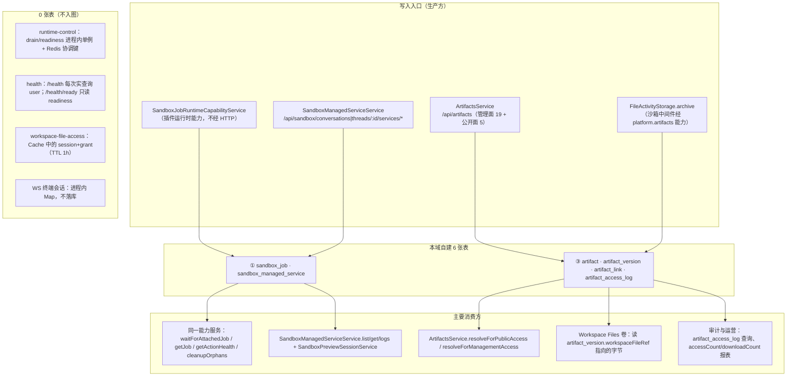
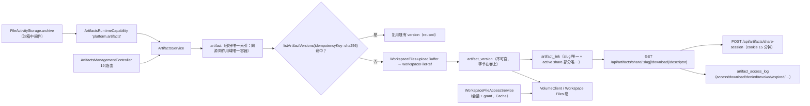

# C4 数据流向与消费（运行时·沙箱·产物专家）

> 口径：表结构与索引以实现层 [04-模型.md](file://.module-experts/后端专题/运行时·沙箱·产物专家/implementation/04-模型.md) 与源码实体为准；**逐条实测自建 6 张表** = `sandbox` 2 张（`sandbox_managed_service`、`sandbox_job`）＋ `artifacts` 4 张（`artifact`、`artifact_version`、`artifact_link`、`artifact_access_log`）。索引口径的「9 张」把 `TypeOrmModule.forFeature` 注册的**外部实体**（`chat_conversation`、`chat_conversation_thread`、`user`）也算进来了，**不属本域所有**，单列一节说明。`runtime-control`（22 非 spec）与 `health`（5 非 spec）与 `workspace-file-access`（8 非 spec）**0 张表**：状态在内存、Cache 与 JWT cookie 中。
> 消费方为模块级/类级概括，跨 3 个以上消费者时归纳为模块族；本域 **6 表无 `select:false` 列**（5 模块内命中 0），敏感字段（`artifact_link.tokenHash`、`artifact_access_log.ipHash`）靠服务层不出参；未能证实处标 `[推测]`。

**本文引用的文件**
- [sandbox/sandbox.module.ts](file://packages/server-ai/src/sandbox/sandbox.module.ts) · [sandbox/sandbox-managed-service.entity.ts](file://packages/server-ai/src/sandbox/sandbox-managed-service.entity.ts) · [sandbox/sandbox-managed-service.service.ts](file://packages/server-ai/src/sandbox/sandbox-managed-service.service.ts) · [sandbox/sandbox.controller.ts](file://packages/server-ai/src/sandbox/sandbox.controller.ts)
- [sandbox/sandbox-job/sandbox-job.entity.ts](file://packages/server-ai/src/sandbox/sandbox-job/sandbox-job.entity.ts) · [sandbox/sandbox-job/sandbox-job-runtime-capability.service.ts](file://packages/server-ai/src/sandbox/sandbox-job/sandbox-job-runtime-capability.service.ts) · [sandbox/sandbox-job/sandbox-runtime-health.service.ts](file://packages/server-ai/src/sandbox/sandbox-job/sandbox-runtime-health.service.ts)
- [artifacts/artifacts.module.ts](file://packages/server-ai/src/artifacts/artifacts.module.ts) · [artifacts/artifacts.service.ts](file://packages/server-ai/src/artifacts/artifacts.service.ts) · [artifacts/artifacts.controller.ts](file://packages/server-ai/src/artifacts/artifacts.controller.ts)
- [artifacts/entities/artifact.entity.ts](file://packages/server-ai/src/artifacts/entities/artifact.entity.ts) · [artifact-version.entity.ts](file://packages/server-ai/src/artifacts/entities/artifact-version.entity.ts) · [artifact-link.entity.ts](file://packages/server-ai/src/artifacts/entities/artifact-link.entity.ts) · [artifact-access-log.entity.ts](file://packages/server-ai/src/artifacts/entities/artifact-access-log.entity.ts)
- [sandbox/middlewares/file-activity-storage.service.ts](file://packages/server-ai/src/sandbox/middlewares/file-activity-storage.service.ts) · [workspace-file-access/workspace-file-access.service.ts](file://packages/server-ai/src/workspace-file-access/workspace-file-access.service.ts) · [workspace-file-access.module.ts](file://packages/server-ai/src/workspace-file-access/workspace-file-access.module.ts)
- [runtime-control/runtime-lifecycle.service.ts](file://packages/server/src/runtime-control/runtime-lifecycle.service.ts) · [health/health.module.ts](file://packages/server/src/health/health.module.ts) · [health/health.controller.ts](file://packages/server/src/health/health.controller.ts)
- [packages/contracts/src/artifact.model.ts](file://packages/contracts/src/artifact.model.ts) · [packages/contracts/src/ai/sandbox-service.model.ts](file://packages/contracts/src/ai/sandbox-service.model.ts) · [packages/plugin-sdk/src/lib/runtime/capabilities/sandbox-jobs.ts](file://packages/plugin-sdk/src/lib/runtime/capabilities/sandbox-jobs.ts)
- [packages/shared/volume/*](file://packages/server-ai/src/shared/volume) · [nsjail/nsjail-sandbox.ts](file://packages/server-ai/src/sandbox/nsjail/nsjail-sandbox.ts)

## 目录
1. [总览：写入入口 → 表 → 消费方](#总览写入入口--表--消费方)
2. [子域① 沙箱执行（2 张自建表）](#子域-沙箱执行2-张自建表)
3. [子域② 运行时控制与健康（0 张表）](#子域-运行时控制与健康0-张表)
4. [子域③ 产物与文件访问（4 张自建表）](#子域-产物与文件访问4-张自建表)
5. [外部实体（非本域表）](#外部实体非本域表)
6. [本域写 vs 跨域写](#本域写-vs-跨域写)
7. [口径核对与未确认项](#口径核对与未确认项)

## 总览：写入入口 → 表 → 消费方

图表来源：[sandbox.module.ts](file://packages/server-ai/src/sandbox/sandbox.module.ts)（关键符号：TypeOrmModule.forFeature / SandboxJobRuntimeCapabilityService）、[sandbox-job-runtime-capability.service.ts](file://packages/server-ai/src/sandbox/sandbox-job/sandbox-job-runtime-capability.service.ts)（关键符号：run / cleanupOrphans）、[artifacts.module.ts](file://packages/server-ai/src/artifacts/artifacts.module.ts)（关键符号：ArtifactsModule / forFeature 四实体）、[runtime-lifecycle.service.ts](file://packages/server/src/runtime-control/runtime-lifecycle.service.ts)（关键符号：readiness / drainState）

四类数据面并存：**执行账本**（`sandbox_job`）、**运行时快照**（`sandbox_managed_service`）、**产物四表**（容器/版本/链接/审计）、**短期状态**（WS 终端 Map、预览与文件访问会话，均在内存或 Cache）。字节统一落在 Workspace Files 卷，本域 6 表**不存文件内容**。

章节来源：[sandbox.module.ts](file://packages/server-ai/src/sandbox/sandbox.module.ts)（关键符号：RouterModule.register / forFeature）、[04-模型.md](file://.module-experts/后端专题/运行时·沙箱·产物专家/implementation/04-模型.md)（关键符号：持久台账 / 运行时快照 / 短期状态三分口径）

## 子域① 沙箱执行（2 张自建表）

| 实体 / 表名 | 结构（关键列 · 唯一索引） | 生产方 | 主要消费方 | 用途 |
|---|---|---|---|---|
| `SandboxJobEntity` / `sandbox_job` | 唯一 `['tenantId','idempotencyKey']`；索引 `['tenantId','status','hardDeadlineAt']`、`['tenantId','businessResourceType','businessResourceId']`；`runtimeProfile`/`sandboxRuntimeVersion`/`action`/`actionVersion`/`pluginName`/`businessResourceType`/`businessResourceId`/`provider`/`runtimeBindingId`/`runtimeArtifactKind`/`runtimeArtifactReference`(text)/`runtimeArtifactDigest`；`status`；`attempt`(int, 默认 0)；`cleanupPending`(bool 默认 false)/`cleanedAt`；`errorCode`/`errorMessage`(text)；`startedAt`/`finishedAt`/`hardDeadlineAt`；`runtimeRef`；**`containerRef` 已 `@deprecated`**；json `progress`/`outputs` | `SandboxJobRuntimeCapabilityService.run / cancel`（`prepareAttempt`、状态回写）、`cleanupOrphans`（60 秒）、容量租约 | 同一能力的 `getJob`/`getActionHealth`（插件按 `jobId` 回读）、`waitForAttachedJob`（重挂）、`requirePreviousAttemptCleanup` | 幂等、重挂、审计、取消与孤儿清理的唯一执行账本；插件业务状态仍在插件自己的表里 |
| `SandboxManagedServiceEntity` / `sandbox_managed_service` | 唯一 `['conversationId','name']`；索引 `['conversationId']`；FK `conversationId → ChatConversation` **onDelete: CASCADE**；`provider`/`name`/`command`(text)/`workingDirectory`(text)/`requestedPort`/`actualPort`/`previewPath`(text)；`status`；`transportMode`；`ownerExecutionId`/`ownerAgentKey`；`startedAt`/`stoppedAt`/`exitCode`/`signal`；json `runtimeRef`/`metadata` | `SandboxManagedServiceService.startByConversationId / startByThreadId`（经 `NsjailSandbox.startService` 的 `onStateChange` 写快照）、`stopBy*`、`restartBy*` | 同服务的 `listBy*`/`getBy*`/`getLogsBy*`/`proxyByConversationId`、`SandboxPreviewSessionService.createSession`（读 `previewUrl` ＋ `transportMode`） | dev server 类托管服务的台账与预览入口；`ownerExecutionId/ownerAgentKey` 把它挂到执行账本（**字符串弱引用，无 FK**） |

- **一表只增改、一行一服务**：`sandbox_job` 的 `progress`/`status`/`cleanup*` 全靠 `update` 回写，从不 `delete`；`sandbox_managed_service` 的 `status`/`runtimeRef`/`startedAt`/`actualPort` 会被 `onStateChange` 反复覆盖，语义是「最后一次观测」而非历史。
- **弱引用清单**：`sandbox_job.runtimeArtifactKind|Reference|Digest`（指向产物，纯字符串契约，**不共享外键**）、`sandbox_job.runtimeRef`、`sandbox_managed_service.ownerExecutionId`/`ownerAgentKey`、托管服务日志路径 `.xpert/managed-services/<id>/{stdout,stderr}.log`。
- **状态枚举无 DB 约束**：`status ∈ waiting|starting|running|succeeded|failed|cancelled|lost`（`sandbox_job`）、`status ∈ starting|running|stopping|stopped|failed|lost` ＋ `transportMode ∈ none|http`（托管服务），合法性靠 TS 联合类型与服务层校验。

章节来源：[sandbox-job.entity.ts](file://packages/server-ai/src/sandbox/sandbox-job/sandbox-job.entity.ts)（关键符号：SandboxJobEntity / idempotencyKey / cleanupPending / containerRef @deprecated）、[sandbox-managed-service.entity.ts](file://packages/server-ai/src/sandbox/sandbox-managed-service.entity.ts)（关键符号：conversationId+name unique / ownerExecutionId / runtimeRef）、[sandbox-job-runtime-capability.service.ts](file://packages/server-ai/src/sandbox/sandbox-job/sandbox-job-runtime-capability.service.ts)（关键符号：cleanupOrphans / requirePreviousAttemptCleanup）

## 子域② 运行时控制与健康（0 张表）

- `runtime-control` **无任何实体**：drain/readiness 是进程内单例（`RuntimeLifecycleService`），跨副本协调靠 Redis（活动重启键、插件代次 `PLUGIN_GENERATION_KEY`、重启目标表），实例清单来自 `managed-connection` 的 `InstanceRegistryService`。
- `health` **无任何实体**：`/health` 每次调用做真实查询（`userRepository.count()`）＋ 磁盘 stat ＋ 缓存 set/get 往返（＋可选 Redis），不落任何趋势数据；沙箱侧真正的健康时序写在 Redis hash（`sandbox_runtime:{health}:<profile>`，TTL = 心跳 TTL 的两倍），**未落库**。
- `workspace-file-access` **无任何实体**：session 与 grant 存 Cache（TTL 1 小时），cookie 由 `JWT_SECRET` 签名的 JWT 承载；进程重启即全部失效。
- `sandbox` 的 WS 终端会话同样**不落表**（进程内 `Map<socketId, Map<sessionId, entry>>`），多副本部署下不共享。
- 因此本子域不产出「表 → 消费方」链路，其数据面是**易失的**：唯一可观测的持久痕迹是 Redis 键、结构化日志（`runtime.instance.retirement`、`HealthCheckExecutionTimer-<uuid>`）与实例注册表。

章节来源：[runtime-lifecycle.service.ts](file://packages/server/src/runtime-control/runtime-lifecycle.service.ts)（关键符号：beginDrain / readiness / trackRequest）、[health.module.ts](file://packages/server/src/health/health.module.ts)（关键符号：TypeOrmModule.forFeature([User]) / imports RuntimeControlModule）、[sandbox-runtime-health.service.ts](file://packages/server-ai/src/sandbox/sandbox-job/sandbox-runtime-health.service.ts)（关键符号：HEALTH_KEY_PREFIX / publish）

## 子域③ 产物与文件访问（4 张自建表）

| 实体 / 表名 | 结构（关键列 · 唯一索引） | 生产方 | 主要消费方 | 用途 |
|---|---|---|---|---|
| `Artifact` / `artifact` | **4 条部分唯一索引**（按 `organizationId`/`userId` 是否 NULL 分列组合 `tenantId+[organizationId]+[userId]+pluginName+resourceType+resourceId`）＋ 1 条同名普通索引；`kind`(默认 `'file'`)/`status`(默认 `'active'`)/`title`/`description`(text)/`checksum`/`currentVersionId`(uuid)；作用域列 `workspaceId`/`projectId`/`xpertId`/`userId`；json `metadata` | `ArtifactsService.createArtifact`（管理端 `POST /artifacts`；插件侧 `createScopedApi()`，如 `FileActivityStorage.archive`） | `listArtifacts`/`getArtifact`/`findArtifactBySource`、`ArtifactVersion`/`ArtifactLink` 的 FK 目标、分享页与结果视图 | 以「插件名＋资源类型＋资源 ID」稳定标识的产物容器，只存元数据与当前版本指针 |
| `ArtifactVersion` / `artifact_version` | 唯一 `['tenantId','organizationId','artifactId','versionNumber']`、`['artifactId','idempotencyKey']`；索引 `['tenantId','organizationId','artifactId','sourceVersionId']`、`['sha256']`；FK `artifactId → Artifact` **CASCADE**；**`workspaceFileRef` json 非空**（字节不进表）；`versionNumber`(int)/`status`(默认 `'active'`)/`mimeType`/`fileName`/`title`/`description`/`size`(bigint＋number transformer)/`sha256`/`checksum`/`sourceVersionId`；json `metadata` | `createArtifactVersionWithDefaults` / `ensureArtifactVersionWithDefaults`（以 `idempotencyKey`（常为 sha256）去重）、`FileActivityStorage.archive` 先上传 Workspace Files 再登记 | `resolveForManagementAccess`/`resolveForPublicAccess`/`resolveDescriptor*`（读 `workspaceFileRef` 后经 VolumeClient 取字节）、下载响应头 `X-Xpert-Artifact-*` | 一次内容快照；配合 `artifact.currentVersionId` 支撑预览、下载与校验和验证（**不可变**） |
| `ArtifactLink` / `artifact_link` | 唯一 `['slug']`；部分唯一 `['artifactId','shareKey'] WHERE shareKey IS NOT NULL AND status='active'`；索引 `['tenantId','organizationId','artifactId']`、`['tenantId','organizationId','status']`；FK `artifactId → Artifact` **CASCADE**；`versionMode`(默认 `'latest'`)/`accessMode`/`status`(默认 `'active'`)/`slug`/`publicUrl`(text)/`tokenHash`；`expiresAt`/`revokedAt`；`accessCount`/`downloadCount`(int 默认 0)；`disposition`(默认 `'inline'`)/`allowDownload`(默认 true)/`safeHtmlProfile`；json `customPrincipals`/`metadata` | `createArtifactLink` / `ensureArtifactShare`（按 `shareKey` 幂等替换）/ `createSignedPreviewLink` / `updateArtifactLinkAccess` / `revokeArtifactLink` | `GET /artifacts/share/:slug[/download|/descriptor]`、`/artifacts/shared-links/:slug/content`、`createArtifactShareSession`（cookie TTL 15 分钟、上限 365 天） | 把「内容版本 ＋ 访问策略 ＋ 浏览器呈现」绑成一个可复制 URL 的入口 |
| `ArtifactAccessLog` / `artifact_access_log` | 索引 `['tenantId','organizationId','linkId']`、`['slug']`；FK `linkId → ArtifactLink`（可空）**onDelete: SET NULL**；`artifactId`(uuid，**无 FK**)/`slug`/`event`/`accessMode`/`principalUserId`/`ipHash`/`userAgent`(text)/`statusCode`(int)/`error`(text)；json `metadata` | `ArtifactsService` 在公开/认证访问与销毁动作后写审计（`access`/`download`/`denied`/`revoked`/`expired`/`archived`/`deleted`） | 管理端审计查询；**全仓仅本模块引用该实体**，外部无写入点 | 「谁在什么时候以什么方式访问过哪个链接」的证据；链接被删后仍保留（`linkId` 置空） |

图表来源：[artifacts.service.ts](file://packages/server-ai/src/artifacts/artifacts.service.ts)（关键符号：createArtifact / ensureArtifactVersionWithDefaults / resolveForPublicAccess）、[artifact-version.entity.ts](file://packages/server-ai/src/artifacts/entities/artifact-version.entity.ts)（关键符号：workspaceFileRef / idempotencyKey / sha256）、[artifact-link.entity.ts](file://packages/server-ai/src/artifacts/entities/artifact-link.entity.ts)（关键符号：IDX_artifact_link_active_share_unique / tokenHash）、[workspace-file-access.service.ts](file://packages/server-ai/src/workspace-file-access/workspace-file-access.service.ts)（关键符号：createGrant / resolveAuthorizedFile）

- **外键语义分化**：强级联 `artifact_version.artifactId`、`artifact_link.artifactId`（CASCADE）；保留证据 `artifact_access_log.linkId`（SET NULL）；**完全无 FK** 的两处为 `artifact_access_log.artifactId` 与 `workspaceFileRef`（指向 Workspace Files，本域只保存可移植引用）。
- **可重建投影 vs 只追加台账**：`artifact`/`artifact_version` 是可复用＋幂等新增（同源复用行、`ensureArtifactVersion` 先查后写），`artifact_access_log` 是只追加审计（未找到 TTL/清理任务，长期运行需自建归档）。
- **链接状态是逻辑状态**：`expired`/`revoked` 在读取时判定（命中即记 410 审计），`expiresAt`/`revokedAt`/`accessCount`/`downloadCount`/`disposition`/`allowDownload` 全部落库可做运营报表。

章节来源：[artifact.entity.ts](file://packages/server-ai/src/artifacts/entities/artifact.entity.ts)（关键符号：四条部分唯一索引 / kind / currentVersionId）、[artifact-access-log.entity.ts](file://packages/server-ai/src/artifacts/entities/artifact-access-log.entity.ts)（关键符号：SET NULL / ipHash / 审计内容约束）、[artifacts.controller.ts](file://packages/server-ai/src/artifacts/artifacts.controller.ts)（关键符号：ArtifactsPublicController / ArtifactsShareSessionController / ArtifactsManagementController）

## 外部实体（非本域表）

本域两处 `forFeature` 把**不属于本域**的实体注册进来，这正是「9 表」误记的来源。它们不是本域的建模对象，本域对其只有**只读/关联**权限：

| 外部实体 | 表名 | 注册位置 | 为何出现在本域 |
|---|---|---|---|
| `ChatConversation` | `chat_conversation` | `sandbox.module.ts` 的 `TypeOrmModule.forFeature` | `SandboxManagedServiceEntity` 的 `ManyToOne(ChatConversation, onDelete:'CASCADE')` 需要实体解析；`conversationId` 由此获得外键语义 |
| `ChatConversationThread` | `chat_conversation_thread` | 同上 | 线程级托管服务查询（`listByThreadId`/`getByThreadId`/`startByThreadId`）需要线程实体参与关联解析 |
| `User` | `user` | `health.module.ts` 的 `TypeOrmModule.forFeature([User])` | `HealthController` 注入 `Repository<User>`，用 `userRepository.count()` 作为 DB 存活的实操探针（Terminus ping 默认关闭） |

- **写入方向**：`chat_conversation` 的写入只在会话域，沙箱侧删除策略依赖 FK CASCADE（删会话 ⇒ 级联删托管服务行）；`sandbox_job` **不**挂会话外键，它是纯业务资源引用（`businessResourceType`/`businessResourceId` 字符串）。
- **`user` 表只被 `count()` 读**，没有反写点；因此本域与用户域是**只读**耦合。
- `artifacts` 与 `workspace-file-access` 的 forFeature 里没有外部实体（分别是 4 张自有表与 0 张表），三方注册位置必须分开看。

章节来源：[sandbox.module.ts](file://packages/server-ai/src/sandbox/sandbox.module.ts)（关键符号：forFeature([SandboxManagedServiceEntity, SandboxJobEntity, ChatConversation, ChatConversationThread])）、[health.module.ts](file://packages/server/src/health/health.module.ts)（关键符号：forFeature([User])）、[health.controller.ts](file://packages/server/src/health/health.controller.ts)（关键符号：userRepository.count）、[sandbox-managed-service.entity.ts](file://packages/server-ai/src/sandbox/sandbox-managed-service.entity.ts)（关键符号：ManyToOne(ChatConversation, onDelete:'CASCADE')）

## 本域写 vs 跨域写

| 方向 | 表 / 事实 | 写入者 | 说明与证据 |
|---|---|---|---|
| 本域写 | `sandbox_job` 全列（`status`/`attempt`/`progress`/`outputs`/`hardDeadlineAt`/`cleanup*`） | `SandboxJobRuntimeCapabilityService.run / cancel / cleanupOrphans` | 本域执行账本；`provider`/`runtimeBindingId`/`runtimeArtifact*` 由绑定与镜像 digest 回写 |
| 本域写 | `sandbox_managed_service` 全列 | `SandboxManagedServiceService`（`onStateChange` 快照） | 值来自 `NsjailSandbox.startService` 的状态回调，反复覆盖 |
| 跨域来源、本域落库 | `sandbox_managed_service.ownerExecutionId` / `ownerAgentKey` | 本域写入，值是 `xpert-agent-execution` 的 executionId/agentKey | **字符串弱引用，无 FK**；孤儿托管服务只能靠它反查 |
| 本域写 | `artifact` / `artifact_version` / `artifact_link` / `artifact_access_log` | `ArtifactsService`（含 `FileActivityStorage` 经 `platform.artifacts` 能力调用） | 管理面 19 路由作用域按 `tenantId/organizationId/userId` 查询，越域按 404 处理 |
| 跨域（字节归 Workspace Files） | `artifact_version.workspaceFileRef`（json 非空） | 由 Workspace Files 上传结果组装 | 本域只存可移植引用，不泄露宿主文件系统路径；公开读取前用 sha256 复核 |
| 跨域读 | `chat_conversation` / `chat_conversation_thread` | 会话域写；沙箱只 `forFeature` 注册用于 FK 与线程查询 | 本域对会话**只读**，并据此做托管服务/终端准入 |
| 跨域读 | `user` | 用户域写；health 仅 `count()` | 每次 `/health` 打一次真实查询，是本域唯一的用户域接触点 |
| 跨域读写（卷） | Workspace Files 卷（`shared/volume`） | `serveVolumeFile`（读）、`UploadFileCommand`（写，`mode:'mounted_workspace'`）、`WorkspaceFileAccessService`（读） | 本域做路径归一、越界拒绝与投递，**不拥有卷布局**（`resolveWorkspaceVolumeScope` 自 `file-understanding` 导入） |
| 本域短期状态（不落表） | WS 终端会话 / 预览 session（JWT cookie 1h）/ 文件访问 session+grant（Cache 1h）/ drain·readiness 单例 | `SandboxTerminalGateway`、`SandboxPreviewSessionService`、`WorkspaceFileAccessService`、`RuntimeLifecycleService` | 进程重启即失效；多副本不共享 |
| 跨域读（Redis 键） | `sandbox_jobs:{capacity}:global|tenant:*|user:*`、`sandbox_runtime:{health}:*`、`PLUGIN_GENERATION_KEY`、活动重启键 | `SandboxJobCapacityService`、`SandboxRuntimeHealthService`、`runtime-control` | 本域并发与协调的**唯一跨进程事实**，无表可查 |

- **冲突面收敛在一处**：沙箱侧唯一「谁拥有执行」的判据是 `sandbox_job`（幂等键 ＋ 容量租约 ＋ 硬截止），产物侧唯一「谁拥有内容」的判据是 `artifact_version.workspaceFileRef` ＋ `sha256`；**任何绕过这两处直接落盘的代码都会落进「无来源」灰区**。

章节来源：[sandbox-job-runtime-capability.service.ts](file://packages/server-ai/src/sandbox/sandbox-job/sandbox-job-runtime-capability.service.ts)（关键符号：SandboxJobRuntimeCapabilityService.run / waitForAttachedJob）、[artifacts.service.ts](file://packages/server-ai/src/artifacts/artifacts.service.ts)（关键符号：readWorkspaceArtifact / recordAccessLog）、[sandbox.controller.ts](file://packages/server-ai/src/sandbox/sandbox.controller.ts)（关键符号：uploadFile / serveVolumeFile）、[03-数据流转.md](file://.module-experts/后端专题/运行时·沙箱·产物专家/implementation/03-数据流转.md)（关键符号：本域写 vs 跨域写对照）

## 口径核对与未确认项

1. **表数口径 = 6**：逐条实测 `@Entity(...)` 为 `sandbox` 2（`SandboxManagedServiceEntity`、`SandboxJobEntity`）＋ `artifacts` 4；`runtime-control`/`health`/`workspace-file-access` 各 0。索引口径的「9 张」只差在 `chat_conversation`、`chat_conversation_thread`、`user` 三个**外部实体**。
2. **`forFeature` 长度 ≠ 自有表数**：`sandbox.module.ts` 注册 4 项（含 2 个外部实体）、`health.module.ts` 注册 1 项（外部实体）、`artifacts.module.ts` 注册 4 项自有实体——本文件一律以实体声明归属为准。
3. **本域 6 表无 `select:false` 列**（在 5 模块内未命中任何 `select: false`）：`artifact_link.tokenHash` 与 `artifact_access_log.ipHash` 在实体层无默认屏蔽，保护方式靠「不入表」（不落字节、不落 token、只落 `ipHash`）而非读侧过滤。
4. **枚举列全为 `varchar`，无 DB 级 enum/CHECK**：`status`/`kind`/`accessMode`/`versionMode`/`disposition`/`event`/`runtimeArtifactKind` 的合法性完全由 TS 联合类型与服务层校验承担。
5. **DDL 归属未核实**：本域 5 模块**无 `migrations/*.sql`**，6 张表的初建依赖外部 schema-sync 作业/插件 DDL 流程，生产环境实际 DDL 文本不在本仓。
6. **`artifact_access_log` 写入覆盖面未逐一核实**：实体仅被 `artifacts.service.ts` 引用，但「descriptor 预览是否写审计」「`denied` 是否每次 401 都写」未确认；该表也未找到 TTL/清理任务。
7. **`sandbox_job.outputs` 与卷的关系未确认**：列为 json（元素含 `destination.folder` 等路径元数据），但「输出文件本体如何从卷回收」未核实（配合 `cleanupVolume` 语义 `[推测]`）；`runtimeArtifactKind` 三值（`oci-image`/`filesystem`/`remote-runtime`）之外是否有第四种亦未确认。

章节来源：[04-模型.md](file://.module-experts/后端专题/运行时·沙箱·产物专家/implementation/04-模型.md)（关键符号：被注册的外部实体 / 索引与唯一约束口径 / 未确认项）、[sandbox.module.ts](file://packages/server-ai/src/sandbox/sandbox.module.ts)（关键符号：TypeOrmModule.forFeature）、[artifacts.module.ts](file://packages/server-ai/src/artifacts/artifacts.module.ts)（关键符号：forFeature 四实体）
