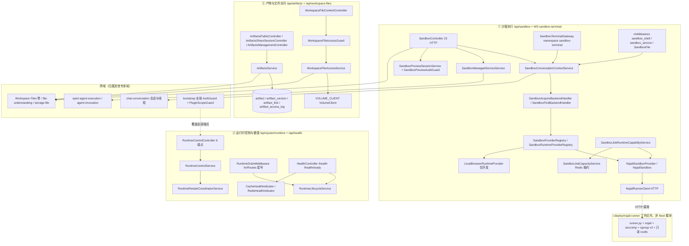

# 运行时·沙箱·产物域 · 架构（01-架构）

**本文引用的文件**
- [packages/server-ai/src/sandbox/sandbox.module.ts](file://packages/server-ai/src/sandbox/sandbox.module.ts)
- [packages/server-ai/src/sandbox/sandbox.controller.ts](file://packages/server-ai/src/sandbox/sandbox.controller.ts)
- [packages/server-ai/src/sandbox/sandbox-terminal.gateway.ts](file://packages/server-ai/src/sandbox/sandbox-terminal.gateway.ts)
- [packages/server-ai/src/sandbox/sandbox-terminal-auth.guard.ts](file://packages/server-ai/src/sandbox/sandbox-terminal-auth.guard.ts)
- [packages/server-ai/src/sandbox/sandbox-preview-auth.guard.ts](file://packages/server-ai/src/sandbox/sandbox-preview-auth.guard.ts)
- [packages/server-ai/src/sandbox/sandbox-preview-session.service.ts](file://packages/server-ai/src/sandbox/sandbox-preview-session.service.ts)
- [packages/server-ai/src/sandbox/sandbox-managed-service.service.ts](file://packages/server-ai/src/sandbox/sandbox-managed-service.service.ts)
- [packages/server-ai/src/sandbox/sandbox-managed-service.entity.ts](file://packages/server-ai/src/sandbox/sandbox-managed-service.entity.ts)
- [packages/server-ai/src/sandbox/sandbox-conversation-context.service.ts](file://packages/server-ai/src/sandbox/sandbox-conversation-context.service.ts)
- [packages/server-ai/src/sandbox/sandbox.service.ts](file://packages/server-ai/src/sandbox/sandbox.service.ts)
- [packages/server-ai/src/sandbox/nsjail/nsjail-sandbox.provider.ts](file://packages/server-ai/src/sandbox/nsjail/nsjail-sandbox.provider.ts)
- [packages/server-ai/src/sandbox/nsjail/nsjail-sandbox.ts](file://packages/server-ai/src/sandbox/nsjail/nsjail-sandbox.ts)
- [packages/server-ai/src/sandbox/nsjail/nsjail-runner.client.ts](file://packages/server-ai/src/sandbox/nsjail/nsjail-runner.client.ts)
- [packages/server-ai/src/sandbox/nsjail/nsjail.types.ts](file://packages/server-ai/src/sandbox/nsjail/nsjail.types.ts)
- [packages/server-ai/src/sandbox/sandbox-job/sandbox-job.entity.ts](file://packages/server-ai/src/sandbox/sandbox-job/sandbox-job.entity.ts)
- [packages/server-ai/src/sandbox/sandbox-job/sandbox-job-runtime-capability.service.ts](file://packages/server-ai/src/sandbox/sandbox-job/sandbox-job-runtime-capability.service.ts)
- [packages/server-ai/src/sandbox/sandbox-job/sandbox-job-capacity.service.ts](file://packages/server-ai/src/sandbox/sandbox-job/sandbox-job-capacity.service.ts)
- [packages/server-ai/src/sandbox/sandbox-job/local-browser-runtime.provider.ts](file://packages/server-ai/src/sandbox/sandbox-job/local-browser-runtime.provider.ts)
- [packages/server-ai/src/sandbox/sandbox-job/sandbox-runtime-definition.registry.ts](file://packages/server-ai/src/sandbox/sandbox-job/sandbox-runtime-definition.registry.ts)
- [packages/server-ai/src/sandbox/middlewares/sandbox-shell.middleware.ts](file://packages/server-ai/src/sandbox/middlewares/sandbox-shell.middleware.ts)
- [packages/server-ai/src/sandbox/middlewares/sandbox-service.middleware.ts](file://packages/server-ai/src/sandbox/middlewares/sandbox-service.middleware.ts)
- [packages/server-ai/src/sandbox/middlewares/sandbox-file.middleware.ts](file://packages/server-ai/src/sandbox/middlewares/sandbox-file.middleware.ts)
- [packages/server-ai/src/sandbox/commands/index.ts](file://packages/server-ai/src/sandbox/commands/index.ts)
- [packages/server-ai/src/sandbox/commands/handlers/index.ts](file://packages/server-ai/src/sandbox/commands/handlers/index.ts)
- [packages/server-ai/src/sandbox/queries/index.ts](file://packages/server-ai/src/sandbox/queries/index.ts)
- [packages/server-ai/src/sandbox/client.ts](file://packages/server-ai/src/sandbox/client.ts)
- [packages/server/src/runtime-control/runtime-control.module.ts](file://packages/server/src/runtime-control/runtime-control.module.ts)
- [packages/server/src/runtime-control/runtime-control.controller.ts](file://packages/server/src/runtime-control/runtime-control.controller.ts)
- [packages/server/src/runtime-control/runtime-control.service.ts](file://packages/server/src/runtime-control/runtime-control.service.ts)
- [packages/server/src/runtime-control/runtime-drain.middleware.ts](file://packages/server/src/runtime-control/runtime-drain.middleware.ts)
- [packages/server/src/runtime-control/runtime-lifecycle.service.ts](file://packages/server/src/runtime-control/runtime-lifecycle.service.ts)
- [packages/server/src/runtime-control/runtime-rollout-policy.ts](file://packages/server/src/runtime-control/runtime-rollout-policy.ts)
- [packages/server/src/runtime-control/runtime-queue-shutdown.service.ts](file://packages/server/src/runtime-control/runtime-queue-shutdown.service.ts)
- [packages/server/src/health/health.module.ts](file://packages/server/src/health/health.module.ts)
- [packages/server/src/health/health.controller.ts](file://packages/server/src/health/health.controller.ts)
- [packages/server/src/health/indicators/cache-health.indicator.ts](file://packages/server/src/health/indicators/cache-health.indicator.ts)
- [packages/server/src/health/indicators/redis-health.indicator.ts](file://packages/server/src/health/indicators/redis-health.indicator.ts)
- [packages/server/src/bootstrap/index.ts](file://packages/server/src/bootstrap/index.ts)
- [packages/server-ai/src/artifacts/artifacts.module.ts](file://packages/server-ai/src/artifacts/artifacts.module.ts)
- [packages/server-ai/src/artifacts/artifacts.controller.ts](file://packages/server-ai/src/artifacts/artifacts.controller.ts)
- [packages/server-ai/src/artifacts/artifacts.service.ts](file://packages/server-ai/src/artifacts/artifacts.service.ts)
- [packages/server-ai/src/artifacts/entities/artifact.entity.ts](file://packages/server-ai/src/artifacts/entities/artifact.entity.ts)
- [packages/server-ai/src/artifacts/entities/artifact-version.entity.ts](file://packages/server-ai/src/artifacts/entities/artifact-version.entity.ts)
- [packages/server-ai/src/artifacts/entities/artifact-link.entity.ts](file://packages/server-ai/src/artifacts/entities/artifact-link.entity.ts)
- [packages/server-ai/src/artifacts/entities/artifact-access-log.entity.ts](file://packages/server-ai/src/artifacts/entities/artifact-access-log.entity.ts)
- [packages/server-ai/src/artifacts/artifact-mime-policy.ts](file://packages/server-ai/src/artifacts/artifact-mime-policy.ts)
- [packages/server-ai/src/workspace-file-access/workspace-file-access.module.ts](file://packages/server-ai/src/workspace-file-access/workspace-file-access.module.ts)
- [packages/server-ai/src/workspace-file-access/workspace-file-access.controller.ts](file://packages/server-ai/src/workspace-file-access/workspace-file-access.controller.ts)
- [packages/server-ai/src/workspace-file-access/workspace-file-content.controller.ts](file://packages/server-ai/src/workspace-file-access/workspace-file-content.controller.ts)
- [packages/server-ai/src/workspace-file-access/workspace-file-access.guard.ts](file://packages/server-ai/src/workspace-file-access/workspace-file-access.guard.ts)
- [packages/server-ai/src/workspace-file-access/workspace-file-access.service.ts](file://packages/server-ai/src/workspace-file-access/workspace-file-access.service.ts)
- [packages/contracts/src/ai/sandbox-terminal.model.ts](file://packages/contracts/src/ai/sandbox-terminal.model.ts)
- [packages/contracts/src/ai/sandbox-service.model.ts](file://packages/contracts/src/ai/sandbox-service.model.ts)
- [packages/contracts/src/artifact.model.ts](file://packages/contracts/src/artifact.model.ts)
- [packages/plugin-sdk/src/lib/runtime/capabilities/sandbox-jobs.ts](file://packages/plugin-sdk/src/lib/runtime/capabilities/sandbox-jobs.ts)
- [.deploy/nsjail-runner/README.md](file://.deploy/nsjail-runner/README.md)
- [.deploy/nsjail-runner/Dockerfile](file://.deploy/nsjail-runner/Dockerfile)
- [packages/nsjail-runner/package.json](file://packages/nsjail-runner/package.json)

## 目录
1. [专家域职责边界](#专家域职责边界)
2. [子专家划分说明](#子专家划分说明)
3. [跨子域共享文件清单](#跨子域共享文件清单)
4. [子模块清单](#子模块清单)
5. [分层结构](#分层结构)
6. [依赖关系](#依赖关系)
7. [关键不变量](#关键不变量)
8. [架构总览](#架构总览)
9. [组件详细分析](#组件详细分析)
10. [结论](#结论)

## 专家域职责边界
**做什么**：本域是「把不可信代码放进隔离边界里跑、把跑出来的东西登记成可分享产物、并让 API 进程自身可安全重启」的运维面。三块能力：① 沙箱执行——provider/运行时注册表、会话级沙箱上下文解析、NsJail 运行时创建与命令执行、PTY 终端网关、后台托管服务（dev server）与 HTTP/SSE 预览 proxy、沙箱卷文件投递（`SandboxController`、`NsjailSandboxProvider`、`SandboxTerminalGateway`）；② 运行时控制与健康——API 副本的滚动自重启、排水（drain）、队列关停、插件收敛门禁与存活/就绪探针（`RuntimeControlModule`、`HealthModule`）；③ 产物与文件访问——Artifact 登记/版本/分享链接/公开访问审计，以及「会话 + 授权（grant）」式的工作区文件投递（`ArtifactsModule`、`WorkspaceFileAccessModule`）。

**不做什么**：不拥有字节。`artifact_version.workspaceFileRef` 注释逐字说明平台把 Artifact 字节放在 Workspace Files、只保留便携引用（「without leaking host filesystem paths」）；沙箱卷文件走 `VolumeClient`/`Workspace Files` 能力，本域只做路径归一、越界拒绝与投递。不实现模型推理、Agent 循环与执行账本（`xpert-agent-execution`/`agent-invocation` 拥有）；不拥有会话与消息持久化（`chat-conversation` 拥有，本域只按 `conversationId` 建外键与查会话做准入）；不做插件 DDL 与 schema 同步（本批 5 模块无 `migrations/*.sql`，依赖外部 schema-sync）。

**与 `file-understanding` / `storage-file` 的分工（批次 5 第 13 个专家域）**：**字节与卷归对方，本域管沙箱执行与产物登记**。`workspace-file-access` 只做**授权与投递**——它不解析路径、不拥有卷布局，`resolveWorkspaceVolumeScope` 是自 `../file-understanding` 导入的；`file-understanding` 拥有 `file_asset`/`file_artifact`/`file_chunk` 等实体与解析器；`packages/server/src/storage-file` 拥有 `storage_file` 实体与上传/流式控制器，即**上传字节的归属**在 storage-file/Workspace Files 卷，不在本批两张 sandbox 表或四张 artifact 表里。本域与对方只有三个接触点：`workspaceFileRef` 便携引用、`VOLUME_CLIENT` 卷句柄、Artifact 分享链接的 `workspaceFileRef` 读取。

章节来源：[artifacts.service.ts](file://packages/server-ai/src/artifacts/artifacts.service.ts)（关键符号：ArtifactsService.resolveForPublicAccess）、[workspace-file-access.service.ts](file://packages/server-ai/src/workspace-file-access/workspace-file-access.service.ts)（关键符号：WorkspaceFileAccessService.resolveAuthorizedFile）、[sandbox.controller.ts](file://packages/server-ai/src/sandbox/sandbox.controller.ts)（关键符号：SandboxController.serveVolumeFile）

## 子专家划分说明
① **沙箱执行**（`packages/server-ai/src/sandbox/**`，74 非 spec / 34 spec）：`nsjail/*`（provider、sandbox、runner client、types）、`sandbox-job/*`（作业能力、容量、定义注册表、绑定选择、本地浏览器运行时、健康）、`middlewares/*`（`sandbox_shell`、`sandbox_service_*`、`SandboxFile` 三策略）、`commands/**`（11 command / 10 handler）、`client.ts`（遗留 HTTP 客户端）、`sandbox.controller.ts`、`sandbox-terminal.{gateway,auth-guard}`、`sandbox-preview-{session,auth}`、`sandbox-managed-service.{service,entity,error}`、`sandbox-conversation-context.service.ts`、`sandbox-work-for.ts`、`sandbox.module.ts`。核心类：`NsjailSandboxProvider`、`NsjailSandbox`、`NsjailRunnerClient`、`SandboxJobRuntimeCapabilityService`、`SandboxConversationContextService`、`SandboxTerminalGateway`。
② **运行时控制与健康**（`packages/server/src/runtime-control/**` 22 非 spec / 10 spec ＋ `packages/server/src/health/**` 5 非 spec / 0 spec，合计 27）：滚动重启协调器（34.5 KB）、排水中间件、生命周期与就绪、队列关停、插件收敛存储与准入、两个健康指示器与控制器。**合并理由**：`health.module.ts` 已 `imports: [RuntimeControlModule]`，`HealthController` 直接调 `RuntimeLifecycleService.readiness()`——两者共享同一份「我准备好接流量了吗」的事实，拆开会让人为制造双份真相。
③ **产物与文件访问**（`packages/server-ai/src/artifacts/**` 10 非 spec / 2 spec ＋ `packages/server-ai/src/workspace-file-access/**` 8 非 spec / 2 spec，合计 18）：四张 artifact 表 + 服务 + 三个控制器（3＋2＋19＝24 端点）；workspace-file-access 两控制器（4＋2＝6 端点）+ guard + service + 响应工具。**边界外延**：`file-understanding` 与 `storage-file` 不入本子域，只作为依赖契约记录（见上节）。

**表数口径**：本批**自建表 6 张**——`sandbox_managed_service`、`sandbox_job`（沙箱执行）＋`artifact`、`artifact_version`、`artifact_link`、`artifact_access_log`（产物与文件访问）。索引的「9 张」口径包含 `TypeOrmModule.forFeature` 注册的**外部实体**（`ChatConversation`/`ChatConversationThread` 与 `User`），不属本域所有；**以 6 张为准**。

**交叉引用**：① 的表被 ③ 只经字符串引用（`sandbox_job.runtimeArtifactReference`），**不共享外键**；①③ 共享卷抽象（`shared/volume`）与契约源（`@xpert-ai/contracts` 的 `sandbox-*.model.ts`/`artifact.model.ts`）；② 通过 `packages/server/src/bootstrap/index.ts` 注册的全局 `AuthGuard`/`PluginScopeGuard` 影响①③所有端点。

章节来源：[sandbox.module.ts](file://packages/server-ai/src/sandbox/sandbox.module.ts)（关键符号：SandboxModule 的 forFeature/controllers/providers）、[health.module.ts](file://packages/server/src/health/health.module.ts)（关键符号：HealthModule 的 imports）、[sandbox-job.entity.ts](file://packages/server-ai/src/sandbox/sandbox-job/sandbox-job.entity.ts)（关键符号：SandboxJobEntity）

## 跨子域共享文件清单
1. `packages/server-ai/src/sandbox/sandbox.module.ts`：① 唯一装配点，但 ②③ 的模块同样被全局 `PluginScopeGuard` 覆盖——鉴权语义必须三边一致。
2. `packages/server-ai/src/sandbox/sandbox-managed-service.entity.ts`：托管服务台账，字段 `ownerExecutionId`/`ownerAgentKey` 直接指向 ①③ 与执行账本的挂接点。
3. `packages/server-ai/src/sandbox/sandbox-job/sandbox-job.entity.ts`：作业证据表，`runtimeArtifactKind|Reference|Digest` 是 ①→③ 的唯一产物通道（纯字符串契约）。
4. `packages/server-ai/src/sandbox/sandbox.controller.ts`：同一控制器同时承载卷投递（**由 ① 承载、③ 只消费产物引用**）、终端 SSE、托管服务与预览 proxy（①②）。
5. `packages/server-ai/src/shared/volume/*`（`VolumeClient`/`VolumeHandle`/`workspace-managed-path`）：① 的路径映射与 ③ 的字节读取共用同一套越界拒绝原语。
6. `packages/contracts/src/ai/sandbox-*.model.ts` 与 `packages/contracts/src/artifact.model.ts`：①③ 共同契约源，跨仓改动需同步。
7. `packages/plugin-sdk/src/lib/runtime/capabilities/sandbox-jobs.ts`：作业状态枚举（`waiting|starting|running|succeeded|failed|cancelled|lost`）的唯一声明处，被 ① 与插件消费方共享。
8. `packages/server/src/bootstrap/index.ts`：全局守卫注册，② 的所有权决定了①③ 的默认鉴权行为（`@Public()` 是唯一豁免手段）。
9. `packages/server-ai/src/artifacts/artifacts.module.ts` 与 `packages/server-ai/src/workspace-file-access/workspace-file-access.module.ts`：③ 内两个模块的 `exports` 面（`ArtifactsService`、`WorkspaceFileAccessService`）被域外（`agent-invocation`、视图扩展）直接注入。

章节来源：[sandbox.module.ts](file://packages/server-ai/src/sandbox/sandbox.module.ts)（关键符号：SandboxModule）、[artifacts.module.ts](file://packages/server-ai/src/artifacts/artifacts.module.ts)（关键符号：ArtifactsModule 的 exports）、[workspace-file-access.module.ts](file://packages/server-ai/src/workspace-file-access/workspace-file-access.module.ts)（关键符号：WorkspaceFileAccessModule）

## 子模块清单
| 目录 / 模块 | 模块类与入口 | 路由前缀 | 端点数 | 鉴权形态 |
|---|---|---|---|---|
| `sandbox/` | `SandboxModule` | `RouterModule.register` 的 `/sandbox` | 23 HTTP + WS 4 消息 | 类级仅 `@ApiBearerAuth`＋`TransformInterceptor`；全局 `AuthGuard` 兜底 |
| `sandbox/`（终端） | `SandboxTerminalGateway`（同模块） | WS namespace `sandbox-terminal` | 4 客户端消息 / 5 服务端事件 | `SandboxTerminalAuthGuard`（每条消息重校验） |
| `runtime-control/` | `RuntimeControlModule`（**无 RouterModule**） | `@Controller('system/runtime')` | 6 | 类级 `TenantPermissionGuard`；3 端点叠加 `RoleGuard`+`SUPER_ADMIN` |
| `health/` | `HealthModule`（无 RouterModule） | `@Controller('health')` | 2 | `@Public()`（两处方法级） |
| `artifacts/` | `ArtifactsModule`（无 RouterModule，前缀硬编码） | `artifacts/share`、`artifacts/share-session`、`artifacts` | 3 + 2 + 19 = 24 | 4 处 `@Public()`，其余靠全局 `AuthGuard` |
| `workspace-file-access/` | `WorkspaceFileAccessModule` | `RouterModule` 的 `/workspace-files` | 4 + 2 = 6 | `content` 控制器类级 `@Public()`＋`WorkspaceFileAccessGuard`（cookie 会话） |
**全站前缀**：`bootstrap` 设置全局 `api` 前缀，故实际路径为 `/api/sandbox/*`、`/api/system/runtime/*`、`/api/health*`、`/api/artifacts/*`、`/api/workspace-files/*`。

章节来源：[sandbox.controller.ts](file://packages/server-ai/src/sandbox/sandbox.controller.ts)（关键符号：SandboxController 的类级装饰器）、[runtime-control.controller.ts](file://packages/server/src/runtime-control/runtime-control.controller.ts)（关键符号：RuntimeControlController）、[artifacts.controller.ts](file://packages/server-ai/src/artifacts/artifacts.controller.ts)（关键符号：ArtifactsManagementController）、[bootstrap/index.ts](file://packages/server/src/bootstrap/index.ts)（关键符号：bootstrap 的全局守卫与前缀）

## 分层结构
- **HTTP 控制器层**：`SandboxController`（卷投递 / 文件上传 / SSE 终端 / 托管服务 12 条 / 预览会话 / 3 条 proxy）、`ArtifactsPublicController`＋`ArtifactsShareSessionController`＋`ArtifactsManagementController`、`WorkspaceFileAccessController`＋`WorkspaceFileContentController`、`RuntimeControlController`、`HealthController`。
- **WS 网关层**：`SandboxTerminalGateway`（namespace `sandbox-terminal`，CORS `origin: '*'`），会话表是**进程内内存**（`Map<socketId, Map<sessionId, entry>>`），不落库、不跨实例共享。
- **执行器层**：`SandboxProviderRegistry`/`SandboxRuntimeProviderRegistry`（插件 SDK 注册表）→ `NsjailSandboxProvider`（生产）/`LocalBrowserRuntimeProvider`（仅开发）→ `NsjailSandbox`（实现 `SandboxManagedServiceAdapter`/`SandboxServiceProxyAdapter`/`SandboxTerminalAdapter`）→ `NsjailRunnerClient`（纯 HTTP，唯一特权进程的客户端）。
- **作业与配额层**：`SandboxJobRuntimeCapabilityService`（幂等、容量、输入物化、输出校验、证据、清理）＋`SandboxRuntimeDefinitionRegistry`／`SandboxRuntimeBindingSelector`／`SandboxActionRegistry`／`SandboxJobCapacityService`（Redis Lua 租约）。
- **会话上下文层**：`SandboxConversationContextService`（`authorizeConversation` 只做准入，`resolveConversationSandbox` 会**申请**后端，`findExistingSandbox` 被动发现不复活已停运行时）。
- **运行时控制层**：`RuntimeControlService`→`RuntimeRestartCoordinatorService`（+`runtime-rollout-policy`/`plugin-runtime-generation.store`/`runtime-restart-target.store`）、`RuntimeDrainMiddleware`（`forRoutes('*')`）、`RuntimeLifecycleService`、`RuntimeQueueShutdownService`。
- **产物服务层**：`ArtifactsService`（`@RuntimeCapabilityProvider(ArtifactsRuntimeCapability)`＋`createScopedApi()`）、`WorkspaceFileAccessService`（会话与 grant 存 `Cache`，cookie 存 JWT）。
- **健康探针层**：`HealthController`（`/health` 聚合 4 项、`/health/ready` 读生命周期）＋`CacheHealthIndicator`／`RedisHealthIndicator`。

章节来源：[sandbox-terminal.gateway.ts](file://packages/server-ai/src/sandbox/sandbox-terminal.gateway.ts)（关键符号：SandboxTerminalGateway.open）、[sandbox-job-runtime-capability.service.ts](file://packages/server-ai/src/sandbox/sandbox-job/sandbox-job-runtime-capability.service.ts)（关键符号：SandboxJobRuntimeCapabilityService.run）、[workspace-file-access.service.ts](file://packages/server-ai/src/workspace-file-access/workspace-file-access.service.ts)（关键符号：WorkspaceFileAccessService.createSession）

## 依赖关系
**出向（本域依赖）**：`chat-conversation`（`ChatConversation`、`ChatConversationThread` 实体；沙箱/托管服务/终端准入都先查会话）、`user`（`health` 的 `TypeOrmModule.forFeature([User])` 与 `ArtifactsService` 的 `UserModule`）、`xpert-project`（`XpertProjectAccessModule`＋`XpertProjectAccessService.assertCanRead` 用于项目卷路由与项目只读判定）、`shared/volume`（`VOLUME_CLIENT`、`VolumeHandle`、`assertPublicWorkspacePath`）、`shared/runtime`（`RuntimeCapabilityModule`/`WorkspaceFilesRuntimeModule`）、`xpert-workspace`（`XpertWorkspaceModule`）、`file-understanding`（`resolveWorkspaceVolumeScope`）、`managed-connection`（`InstanceRegistryService` 供 runtime-control）、`core/redis`、`TerminusModule`。
**入向（依赖本域）**：`agent-invocation`（`imports: [ArtifactsModule]`，只取产物能力，不压沙箱）、`xpert-template`（`SandboxToolsCapabilityProvider`）、工具运行时侧经执行上下文注入（`tool-runtime` 的 `withExecutionContext({ sandbox }, …)` 消费本域沙箱对象）、视图扩展经 `ViewExtensionService` 调 `workspace-file-access`、`app.module` 装配三块。**未找到直接入向**：`xpert-agent-execution` 对 `sandbox` 无源码引用（关联只在 `ownerExecutionId`/`ownerAgentKey` 字符串列）。
**执行后端的真实归属（关键事实）**：`packages/nsjail-runner/package.json` 只是**发布元数据**（`private: true`，`description: "Release metadata for the Xpert NsJail runner Docker image"`）；**真实 runner 与 Dockerfile 在工作区 `/.deploy/nsjail-runner/`**，`README.md` 逐字写明「The runner and Dockerfile remain in [.deploy/nsjail-runner]」。API 侧只经 HTTP 调 Runner：`NSJAIL_RUNNER_URL`/`NSJAIL_RUNNER_TOKEN` 两个环境变量决定 provider 是否可见。

章节来源：[sandbox.module.ts](file://packages/server-ai/src/sandbox/sandbox.module.ts)（关键符号：SandboxModule 的 imports 与 forFeature）、[nsjail-sandbox.provider.ts](file://packages/server-ai/src/sandbox/nsjail/nsjail-sandbox.provider.ts)（关键符号：readRunnerConfig）、[packages/nsjail-runner/package.json](file://packages/nsjail-runner/package.json)（关键符号：package.json 的 private/description）

## 关键不变量
1. **NsJail 隔离边界是唯一特权面**：卷映射 `bindSource = volume.hostRoot` → `/workspace`，越界即抛错；Project 内容只读（`protectProjectContent` 由 `options.protectProjectContent === true || workFor.type === 'project'` 推导，Runner 以 `--bindmount_ro` 覆盖 `/workspace/project.md` 与 `/workspace/skills`）；托管应用数据永远由 Runner 协议 3 的 `/opt/xpert-app-data-mask` 只读掩码保护；`README.md` 明示镜像内启用 cgroup v2 内存/swap/CPU/PID + namespaces + 只读 rootfs + `NO_NEW_PRIVS` + capability dropping + seccomp（`seccomp.policy`）+ rlimits，并且「RPC 请求不能选择挂载、宿主 PID、NsJail 参数或可执行文件」。证据：`nsjail-sandbox.provider.ts`、`nsjail.types.ts`、`.deploy/nsjail-runner/{README.md,Dockerfile}`。
2. **沙箱生命周期有明确四段与两条 TTL**：创建只经 `NsjailSandboxProvider.create`（先看 Runner `/health` 与协议版本，再 `POST /v1/runtimes`，`runtimeId = sha256(tenant, workFor.type, workFor.id, environmentId, workspacePath, workingDirectory, protectProjectContent)`）；执行/流式/终端/托管服务各得**独立 NsJail 进程边界**；Runner 侧「无 API 活动 2 小时销毁，连续活跃 24 小时硬租约」；API 侧 `SandboxJobRuntimeCapabilityService` 每 60 秒 `cleanupOrphans`。证据：`nsjail-sandbox.provider.ts`、`sandbox-job-runtime-capability.service.ts`、`.deploy/nsjail-runner/README.md`。
3. **WS 终端会话的鉴权是「每条消息重校验 + 开终端额外校验会话」**：`SandboxTerminalAuthGuard` 支持 `cs-x-` 客户端密钥或 JWT，并要求 `assertWorkbenchPrincipal`；打开 PTY 时还要求请求体带 `conversationId` 且该会话存在、且工作台 principal 与会话匹配。会话本身**无 TTL**，靠 `close`/进程退出/错误/断连四种路径销毁。证据：`sandbox-terminal-auth.guard.ts`、`sandbox-terminal.gateway.ts`。
4. **volume 通配 `@Public()` 的真实含义**：`GET volume/*path` 用 `@Public()` **跳过全局 JWT**，因此**匿名可读容器沙箱卷的公共前缀**；它不提供租户隔离（tenant 可由 query 或默认租户推导）、不写审计、无速率限制/无鉴权；护栏只是路径层——`normalizeSandboxVolumeRequestSubpath`、两次 `isProtectedVolumeSubpath`（`project/*`、`user/*/xpert/*`、`xpert/*/user/*`、`runtime-jobs/*` 一律 403）、`serveVolumeFile` 里的 `assertPublicWorkspacePath` 与 `openFileSnapshot` 后的 `rejectProtectedPaths` 复检；dev 环境还会先做 `normalizeSandboxPublicVolumeSubpath` 路径改写。**风险如实记**：公共前缀的卷内容对未登录者可读，安全性完全依赖「公共区不含敏感数据」这一部署假设。
5. **预览 proxy 只有 3 条 `@Public()` 路由，且签名是唯一准入**：`@All` 分别匹配 `.../proxy`、`.../proxy/`、`.../proxy/*path`，三条都挂 `@Public()`＋`SandboxPreviewAuthGuard`；guard 校验 cookie `xpert_sandbox_preview` 的 JWT（`aud='sandbox-preview'`、`sub='sandbox-preview-session'`、`conversationId`/`serviceId` 必须与路由参数一致），cookie `path` 被限定到该服务的 proxy 前缀、`httpOnly`、`sameSite: 'lax'`、TTL 1 小时、`secure` 由请求推导；secret 取自 `JWT_SECRET`（缺失即 500，不降级放行）。证据：`sandbox.controller.ts`、`sandbox-preview-auth.guard.ts`、`sandbox-preview-session.service.ts`。
6. **`runtime-control` 的门禁是「类级租户权限 + 3 处 SUPER_ADMIN」，读写粒度不等**：类级 `@UseGuards(TenantPermissionGuard)`；`GET instances`、`POST instances/:instanceId/retire`、`POST restart` 额外 `RoleGuard`+`@Roles(SUPER_ADMIN)`；`restart-capability`、`restart/:restartId`、`plugin-convergence/:generation` 三个只读端点**没有** `RoleGuard`，任何通过租户权限的登录者可读能力位与重启/收敛状态。写路径另有三重业务断言 `assertAuthorizedActor()`（必须是交互式会话、必须 SUPER_ADMIN、必须是默认租户），实现是 `process.kill(process.pid, signal)` 的自信号。
7. **健康探针的检查项与失败语义**：`GET /health` 顺序跑「DB（`userRepository.count()`，Terminus `pingCheck` 默认关闭）→ 磁盘（阈值 `99.999999%`，路径为 `__dirname`）→ 缓存 set/get 往返 → Redis（仅 `REDIS_ENABLED === 'true'`）」，四个开关是**硬编码常量**；`GET /health/ready` 只读 `RuntimeLifecycleService.readiness()`，非 `ready` 返回 503 且 `Cache-Control: no-store`。排水期间 `RuntimeDrainMiddleware` 对**非 `/health`** 请求返回 503（`RUNTIME_DRAINING` / `RUNTIME_NOT_READY`，`Retry-After: 5`），健康路径被显式豁免所以排水不会让进程看起来死掉。
8. **产物登记的唯一性与幂等由数据库承担**：`artifact` 有 4 个**部分唯一索引**（按 `organizationId`/`userId` 是否 NULL 分列的组合），`artifact_version` 有 `(tenantId, organizationId, artifactId, versionNumber)` 与 `(artifactId, idempotencyKey)` 两个唯一索引；`ensureArtifactVersion` 强制 `idempotencyKey` 并先查后写，`createArtifact` 命中同源记录时复用并重置 `status='active'`。字节不进表：`workspaceFileRef` 非空 json，公开访问前用 `sha256` 复核，不符即拒绝并记 `denied`；访问日志实体注释禁止落 token、平台凭证与文件内容。

章节来源：[nsjail-sandbox.provider.ts](file://packages/server-ai/src/sandbox/nsjail/nsjail-sandbox.provider.ts)（关键符号：NsjailSandboxProvider.create）、[sandbox.controller.ts](file://packages/server-ai/src/sandbox/sandbox.controller.ts)（关键符号：SandboxController.getVolumeFile）、[sandbox-preview-session.service.ts](file://packages/server-ai/src/sandbox/sandbox-preview-session.service.ts)（关键符号：SandboxPreviewSessionService.verifySession）、[runtime-control.service.ts](file://packages/server/src/runtime-control/runtime-control.service.ts)（关键符号：RuntimeControlService.assertAuthorizedActor）、[health.controller.ts](file://packages/server/src/health/health.controller.ts)（关键符号：HealthController.check）、[artifact-version.entity.ts](file://packages/server-ai/src/artifacts/entities/artifact-version.entity.ts)（关键符号：ArtifactVersion）

## 架构总览

图表来源：[sandbox.module.ts](file://packages/server-ai/src/sandbox/sandbox.module.ts)（关键符号：SandboxModule）、[nsjail-sandbox.provider.ts](file://packages/server-ai/src/sandbox/nsjail/nsjail-sandbox.provider.ts)（关键符号：NsjailSandboxProvider.create）、[sandbox-job-runtime-capability.service.ts](file://packages/server-ai/src/sandbox/sandbox-job/sandbox-job-runtime-capability.service.ts)（关键符号：SandboxJobRuntimeCapabilityService.run）、[runtime-control.module.ts](file://packages/server/src/runtime-control/runtime-control.module.ts)（关键符号：RuntimeControlModule.configure）、[artifacts.controller.ts](file://packages/server-ai/src/artifacts/artifacts.controller.ts)（关键符号：ArtifactsPublicController）、[.deploy/nsjail-runner/README.md](file://.deploy/nsjail-runner/README.md)（关键符号：Runner 与 API 的职责划分）

## 组件详细分析
### 沙箱执行
沙箱执行的主线是「**上下文解析 → 后端获取 → 进程边界 → 结果回收**」。`SandboxConversationContextService.authorizeConversation` 只做准入（会话存在、租户匹配、助手 `features.sandbox.enabled`、provider 非空、群运行时另走 `ResolveGroupRuntimeAccessCommand`），而 `resolveConversationSandbox` 会真正申请后端（`SandboxAcquireBackendCommand`），`findExistingSandbox` 则刻意不复活已停运行时。作业面是另一条更重的链：`SandboxJobRuntimeCapabilityService` 拥有幂等键、容量租约、输入快照（`.platform/inputs`，单作业输入/输出上限 350 MB）、动作与定义解析、输出校验、运行时证据与孤儿清理；它的注释把权属讲得很清楚——「API process owns Runtime selection, instance creation, cancellation, and orphan cleanup」。托管服务是第三种形态：会话/线程内的后台进程台账（`sandbox_managed_service`），支持 start/list/get/logs/stop/restart 与 HTTP/SSE 预览，状态枚举 `starting|running|stopping|stopped|failed|lost`。

章节来源：[sandbox-conversation-context.service.ts](file://packages/server-ai/src/sandbox/sandbox-conversation-context.service.ts)（关键符号：SandboxConversationContextService.resolveConversationSandbox）、[sandbox-job-runtime-capability.service.ts](file://packages/server-ai/src/sandbox/sandbox-job/sandbox-job-runtime-capability.service.ts)（关键符号：SandboxJobRuntimeCapabilityService.run）、[sandbox-managed-service.entity.ts](file://packages/server-ai/src/sandbox/sandbox-managed-service.entity.ts)（关键符号：SandboxManagedServiceEntity）

### 运行时控制与健康
这一子域管的**不是容器或沙箱，而是 API 进程副本自己的生命周期**，模块头注释把前提钉死：生产 API 跑在 Docker 内的 PM2 下、模块一次只信号一个副本、由进程监管者拉起替代进程；本地开发必须走 nodemon 之类的 watcher。实现要点：`RUNTIME_PROCESS_SIGNALER` 的真实实现是 `process.kill(process.pid, signal)`；`RuntimeDrainMiddleware` 全局挂载、健康路径豁免；`RuntimeLifecycleService` 维护活跃请求计数、drain 状态单例与就绪守卫；`RuntimeQueueShutdownService` 用 `DiscoveryService` 在关停时发现 `Bull`/`WorkerHost` 并 pause/close，而不是声明式消费者；`runtime-rollout-policy.ts` 声明「排队的变更不能改写候补副本的准入清单，也不能继承故障容忍」。健康侧只有 5 个文件、0 个 spec，属于本域测试覆盖最薄的地方。

章节来源：[runtime-control.module.ts](file://packages/server/src/runtime-control/runtime-control.module.ts)（关键符号：RuntimeControlModule 的 processSignaler 与 configure）、[runtime-lifecycle.service.ts](file://packages/server/src/runtime-control/runtime-lifecycle.service.ts)（关键符号：RuntimeLifecycleService.beginDrain）、[runtime-rollout-policy.ts](file://packages/server/src/runtime-control/runtime-rollout-policy.ts)（关键符号：createRestartMetadata）、[runtime-queue-shutdown.service.ts](file://packages/server/src/runtime-control/runtime-queue-shutdown.service.ts)（关键符号：RuntimeQueueShutdownService）

### 产物与文件访问
产物侧是「**登记与引用**」，不是「存储」：`ArtifactsService` 以 `@RuntimeCapabilityProvider` 暴露 `ArtifactsApi`，并用 `createScopedApi(defaults)` 给插件注入作用域默认值；版本行只存 `workspaceFileRef`、`mimeType`、`size`、`sha256`；分享链接（`artifact_link`）承担 `versionMode`/`accessMode`/`expiresAt`/`tokenHash`/计数与撤销，公开访问走「签名预览 token 或登录态」二选一，失败时重定向到前端登录页并落 `denied` 审计；MIME 白名单集中在一处策略文件，且 `image/svg+xml` **永不内联**。文件访问侧是「**会话 + 授权**」两段式：会话来自视图扩展上下文解析（含助手可用性断言），grant 由资源解析结果生成并绑定 `fileKey`/`purpose`/`reference`，内容控制器以 `@Public()`＋cookie 守卫放行，再做 origin 校验与路径解析；两部分都只有内存/缓存态，进程重启即全部失效——这是「短时授权」而非「长期共享」的设计选择。

章节来源：[artifacts.service.ts](file://packages/server-ai/src/artifacts/artifacts.service.ts)（关键符号：ArtifactsService.createScopedApi）、[artifact-mime-policy.ts](file://packages/server-ai/src/artifacts/artifact-mime-policy.ts)（关键符号：isSupportedArtifactMimeType）、[workspace-file-content.controller.ts](file://packages/server-ai/src/workspace-file-access/workspace-file-content.controller.ts)（关键符号：WorkspaceFileContentController.streamContent）

## 结论
本域的结构主线是「**边界 + 台账 + 短时授权**」。边界：唯一特权组件是工作区 `/.deploy/nsjail-runner` 里的 Runner（不是 Nest 模块、不是 `packages/nsjail-runner` 这个空壳包），API 只经 HTTP 与两个环境变量接触它，且把「运行时选择、工作区绑定、终端路由、托管服务记录、预览授权」全部留在平台侧。台账：沙箱作业用自建 `sandbox_job` 承担幂等、重连、审计、取消与孤儿清理，托管服务用 `sandbox_managed_service` 承担进程生命周期与 `ownerExecutionId` 归属，产物用四张表承担版本、分享与访问审计，字节一律外置为引用。短时授权：预览 cookie（1 小时、路径受限）与工作区文件会话（1 小时、缓存态、grant 到会话过期）都选择「不持久化、可撤销、范围最小」。

三处需要长期防守：① `volume/*path` 的 `@Public()` 通配是本域最大的匿名读面，任何「把业务数据放进公共卷前缀」的改动都会静默扩大暴露面；② 运行时的真实语义分散在两个仓库位置（Nest 侧协议校验 vs `.deploy` 侧镜像行为），升版顺序被文档规定为「先镜像后 API」，协议 2/3 的能力位是硬门槛，Runner 降级会直接让 `create()` 失败；③ `health` 是零测试的 5 个文件却决定了编排层是否重启 Pod，DB 与磁盘分支把异常吞成 `status: 'down'` 的返回体而非抛错，值得在未来补一条集成用例把它钉住。

章节来源：[nsjail-sandbox.provider.ts](file://packages/server-ai/src/sandbox/nsjail/nsjail-sandbox.provider.ts)（关键符号：NsjailSandboxProvider.create 的协议校验）、[sandbox.controller.ts](file://packages/server-ai/src/sandbox/sandbox.controller.ts)（关键符号：SandboxController.getVolumeFile）、[health.controller.ts](file://packages/server/src/health/health.controller.ts)（关键符号：HealthController.check）
