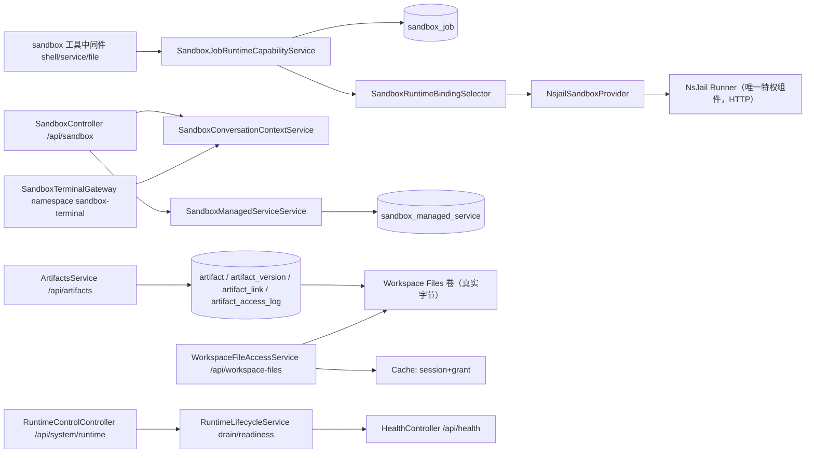
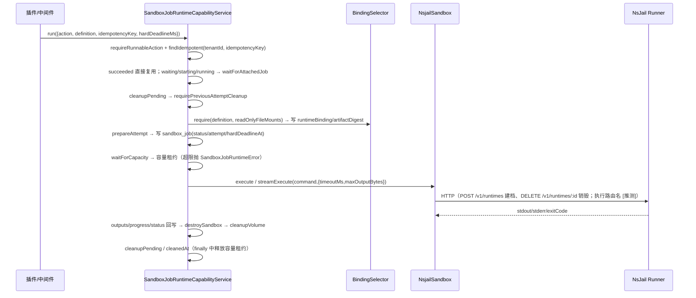
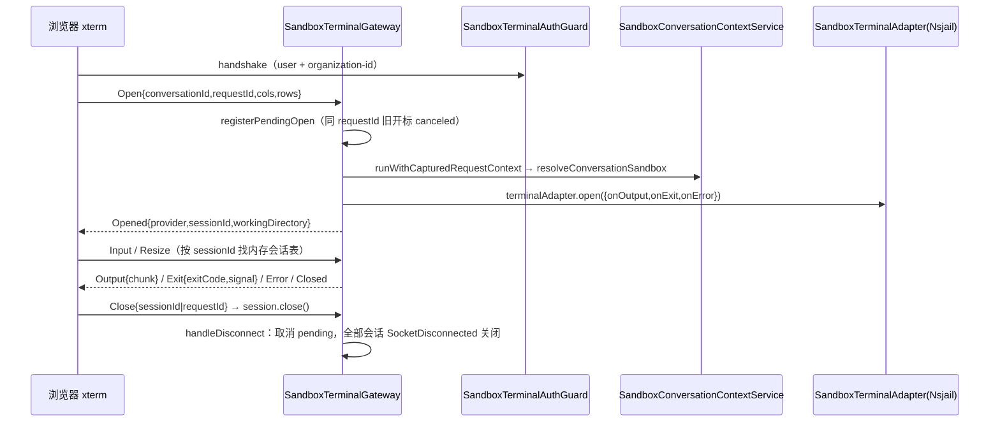
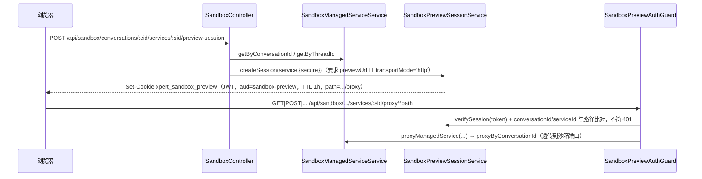
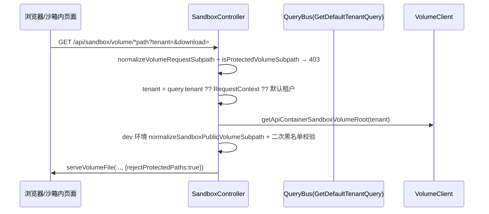
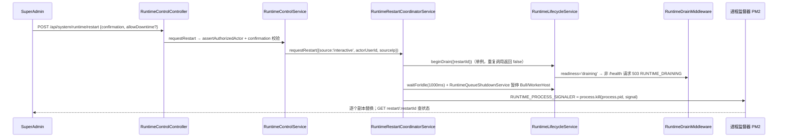
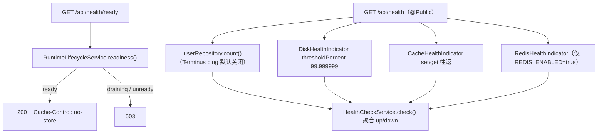
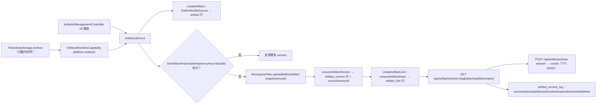
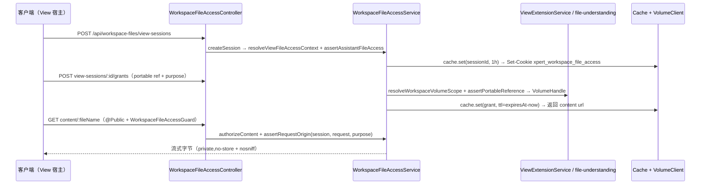

# 运行时·沙箱·产物域 · 数据流转

> 只读梳理（commit `80f5676fd`）。范围与实测：`packages/server-ai/src/sandbox` **74 非 spec / 34 spec / 自建 2 表**、`packages/server/src/runtime-control` **22 / 10 / 0 表**、`packages/server-ai/src/artifacts` **10 / 2 / 4 表**、`packages/server-ai/src/workspace-file-access` **8 / 2 / 0 表**、`packages/server/src/health` **5 / 0 / 0 表** → 合计 **119 非 spec / 48 spec**、**自建 6 张表**。
> **口径差异（必读）**：索引口径的「9 张表」把 `TypeOrmModule.forFeature` 注册的**外部实体**也算进来了——`chat_conversation`、`chat_conversation_thread`（`sandbox.module.ts`）与 `user`（`health.module.ts`）；本文件一律以**实测自建 6 张**为准，外部实体单列在 `04-模型.md`。
> 引用为仓库根相对路径；无法从源码证实之处标 `[推测]`。

**本文引用的文件**

- [sandbox/sandbox.controller.ts](file://packages/server-ai/src/sandbox/sandbox.controller.ts)
- [sandbox/sandbox.module.ts](file://packages/server-ai/src/sandbox/sandbox.module.ts)
- [sandbox/sandbox-preview-auth.guard.ts](file://packages/server-ai/src/sandbox/sandbox-preview-auth.guard.ts)
- [sandbox/sandbox-preview-session.service.ts](file://packages/server-ai/src/sandbox/sandbox-preview-session.service.ts)
- [sandbox/sandbox-terminal.gateway.ts](file://packages/server-ai/src/sandbox/sandbox-terminal.gateway.ts)
- [sandbox/sandbox-managed-service.service.ts](file://packages/server-ai/src/sandbox/sandbox-managed-service.service.ts)
- [sandbox/sandbox-managed-service.entity.ts](file://packages/server-ai/src/sandbox/sandbox-managed-service.entity.ts)
- [sandbox/sandbox-job/sandbox-job-runtime-capability.service.ts](file://packages/server-ai/src/sandbox/sandbox-job/sandbox-job-runtime-capability.service.ts)
- [sandbox/sandbox-job/sandbox-job.entity.ts](file://packages/server-ai/src/sandbox/sandbox-job/sandbox-job.entity.ts)
- [sandbox/sandbox-job/sandbox-runtime-health.service.ts](file://packages/server-ai/src/sandbox/sandbox-job/sandbox-runtime-health.service.ts)
- [sandbox/nsjail/nsjail-sandbox.ts](file://packages/server-ai/src/sandbox/nsjail/nsjail-sandbox.ts)
- [sandbox/nsjail/nsjail-sandbox.provider.ts](file://packages/server-ai/src/sandbox/nsjail/nsjail-sandbox.provider.ts)
- [sandbox/middlewares/file-activity-storage.service.ts](file://packages/server-ai/src/sandbox/middlewares/file-activity-storage.service.ts)
- [artifacts/artifacts.controller.ts](file://packages/server-ai/src/artifacts/artifacts.controller.ts)
- [artifacts/artifacts.service.ts](file://packages/server-ai/src/artifacts/artifacts.service.ts)
- [artifacts/entities/artifact.entity.ts](file://packages/server-ai/src/artifacts/entities/artifact.entity.ts)
- [workspace-file-access/workspace-file-access.controller.ts](file://packages/server-ai/src/workspace-file-access/workspace-file-access.controller.ts)
- [workspace-file-access/workspace-file-access.service.ts](file://packages/server-ai/src/workspace-file-access/workspace-file-access.service.ts)
- [runtime-control/runtime-control.controller.ts](file://packages/server/src/runtime-control/runtime-control.controller.ts)
- [runtime-control/runtime-control.service.ts](file://packages/server/src/runtime-control/runtime-control.service.ts)
- [runtime-control/runtime-lifecycle.service.ts](file://packages/server/src/runtime-control/runtime-lifecycle.service.ts)
- [runtime-control/runtime-drain.middleware.ts](file://packages/server/src/runtime-control/runtime-drain.middleware.ts)
- [health/health.controller.ts](file://packages/server/src/health/health.controller.ts)
- [contracts/src/artifact.model.ts](file://packages/contracts/src/artifact.model.ts)
- [plugin-sdk/src/lib/runtime/capabilities/artifacts.ts](file://packages/plugin-sdk/src/lib/runtime/capabilities/artifacts.ts)

## 目录

- [总览与数据面](#总览与数据面)
- [链路一 沙箱执行链](#链路一-沙箱执行链)
- [链路二 WS 终端链](#链路二-ws-终端链)
- [链路三 预览 proxy 链](#链路三-预览-proxy-链)
- [链路四 volume 通配链](#链路四-volume-通配链)
- [链路五 运行时控制与重启链](#链路五-运行时控制与重启链)
- [链路六 健康检查链](#链路六-健康检查链)
- [链路七 产物登记与读取链](#链路七-产物登记与读取链)
- [链路八 工作区文件访问链](#链路八-工作区文件访问链)
- [状态机汇总](#状态机汇总)
- [本域写 vs 跨域写](#本域写-vs-跨域写)
- [已知风险](#已知风险)

## 总览与数据面

本域四类数据面并存：**执行账本**（`sandbox_job`）、**运行时快照**（`sandbox_managed_service`）、**产物四表**（artifact 族）、**短期状态**（WS/预览/文件访问会话，均在内存或 Cache）。字节统一落在 Workspace Files 卷，本域 6 表**不存文件内容**。

图表来源：[sandbox.module.ts](file://packages/server-ai/src/sandbox/sandbox.module.ts)、[sandbox-job-runtime-capability.service.ts](file://packages/server-ai/src/sandbox/sandbox-job/sandbox-job-runtime-capability.service.ts)、[artifacts.module.ts](file://packages/server-ai/src/artifacts/artifacts.module.ts)、[runtime-lifecycle.service.ts](file://packages/server/src/runtime-control/runtime-lifecycle.service.ts)

- `sandbox` 用 `RouterModule.register([{path:'/sandbox'}])` 加前缀，WS 命名空间 `sandbox-terminal` 不走 HTTP 前缀。
- 生产执行后端只有 nsjail（经 Runner HTTP）；`client.ts` 旧 HTTP 沙箱客户端与 `LocalBrowserRuntimeProvider`（仅 dev）是遗留/工具面。

章节来源：[sandbox.module.ts](file://packages/server-ai/src/sandbox/sandbox.module.ts)（关键符号：SandboxModule / forFeature / LOCAL_BROWSER_RUNTIME_PROVIDERS）、[sandbox.controller.ts](file://packages/server-ai/src/sandbox/sandbox.controller.ts)（关键符号：SandboxController / @Public / @Sse）

## 链路一 沙箱执行链

入口是插件运行时的沙箱作业能力（**不走 HTTP 控制器**），执行前先做 Action/Definition 校验、幂等复用与容量租约，失败/取消均有独立分支。

图表来源：[sandbox-job-runtime-capability.service.ts](file://packages/server-ai/src/sandbox/sandbox-job/sandbox-job-runtime-capability.service.ts)、[nsjail-sandbox.ts](file://packages/server-ai/src/sandbox/nsjail/nsjail-sandbox.ts)

- 超时分支：请求侧 `timeoutMs` 必须 `≤ hardDeadlineMs`（注册表校验），`hardDeadlineAt` 默认 `now + definition.hardDeadlineMs`；Runner 侧默认 2 小时销毁、24 小时硬租约，超限的具体 errorCode 映射 [推测]。
- 取消分支：`cancel()` 先 `runtime.terminate()`，再置 `status='cancelled'`、`errorCode='SANDBOX_CANCELLED'`、`finishedAt`，然后销毁运行时与卷；自愈分支 `withRuntimeRecovery` 在 runtime not-found 时重建。
- 孤儿清理：`cleanupOrphans` 以 60s 间隔扫 `hardDeadlineAt < now` 与 `cleanupPending:true`，与本域 `@Cron` 空壳清理互补。

章节来源：[sandbox-job-runtime-capability.service.ts](file://packages/server-ai/src/sandbox/sandbox-job/sandbox-job-runtime-capability.service.ts)（关键符号：run / cancel / waitForAttachedJob / cleanupOrphans）、[nsjail-sandbox.provider.ts](file://packages/server-ai/src/sandbox/nsjail/nsjail-sandbox.provider.ts)（关键符号：NSJAIL_SANDBOX_PROVIDER / NsjailRunnerClient）

## 链路二 WS 终端链

终端是 Socket.IO 命名空间 `sandbox-terminal`（cors `origin:'*'`），四个客户端事件全部挂 `SandboxTerminalAuthGuard`；WS 处理器不经过 HTTP 请求上下文中间件，故手工回填 actor 与租户/组织头。

图表来源：[sandbox-terminal.gateway.ts](file://packages/server-ai/src/sandbox/sandbox-terminal.gateway.ts)、[contracts/src/ai/sandbox-terminal.model.ts](file://packages/contracts/src/ai/sandbox-terminal.model.ts)

- 会话状态只存在进程内 `Map<socketId, Map<sessionId, entry>>`，**不落表**；断连即清理，关闭失败只 warn（可能残留远端终端会话）。
- 另有遗留面：`POST /api/sandbox/terminal` 同时挂 `@Sse()` 与 `content-type: text/event-stream`（POST+SSE 非标准用法），走 `backend.streamExecute`。

章节来源：[sandbox-terminal.gateway.ts](file://packages/server-ai/src/sandbox/sandbox-terminal.gateway.ts)（关键符号：SandboxTerminalGateway / handleDisconnect / closeSession / PendingTerminalOpen）、[sandbox.controller.ts](file://packages/server-ai/src/sandbox/sandbox.controller.ts)（关键符号：@Post('terminal') / @Sse）

## 链路三 预览 proxy 链

托管服务预览靠**会话 cookie（JWT）+ 三条 @Public() 通配路由**放行：先鉴权建会话拿到 cookie，再由 cookie 直连 proxy（同源 iframe 场景无法带 Authorization 头）。

图表来源：[sandbox.controller.ts](file://packages/server-ai/src/sandbox/sandbox.controller.ts)、[sandbox-preview-auth.guard.ts](file://packages/server-ai/src/sandbox/sandbox-preview-auth.guard.ts)、[sandbox-preview-session.service.ts](file://packages/server-ai/src/sandbox/sandbox-preview-session.service.ts)

- 三条 `@Public()` 路由：`proxy`、`proxy/`、`proxy/*path`，均 `@UseGuards(SandboxPreviewAuthGuard)`；签名密钥取 `JWT_SECRET`，未配置则建会话直接 500。
- proxy 会剥离/改写 Host 与路径后转发到 `service.previewUrl` 目标，`actualPort`/`requestedPort` 决定端口 [推测]。

章节来源：[sandbox.controller.ts](file://packages/server-ai/src/sandbox/sandbox.controller.ts)（关键符号：proxyManagedServiceRoot / proxyManagedServicePath / SandboxPreviewAuthGuard）、[sandbox-preview-session.service.ts](file://packages/server-ai/src/sandbox/sandbox-preview-session.service.ts)（关键符号：SANDBOX_PREVIEW_COOKIE_NAME / createSession / verifySession / buildCookiePath）

## 链路四 volume 通配链

`GET /api/sandbox/volume/*path` 是**唯一为「无鉴权直读卷文件」而开的 `@Public()` 面**（沙箱内页面/预览资源直取），其护栏是路径黑名单而非身份校验。

图表来源：[sandbox.controller.ts](file://packages/server-ai/src/sandbox/sandbox.controller.ts)、[shared/volume（VolumeClient）](file://packages/server-ai/src/shared/volume)

- 真实用途：为容器/Web 预览提供租户级公共卷的只读投递；项目与用户隔离路径（`xperts`/`user-xperts`）必须走各自带身份的私有路由，命中黑名单时抛 `ProtectedVolumeAuthenticationRequired`。
- 访问面：tenant 可来自 query 参数，无身份校验，仅靠黑名单 + 校验规则收敛，属**最宽的一条读取面**。

章节来源：[sandbox.controller.ts](file://packages/server-ai/src/sandbox/sandbox.controller.ts)（关键符号：@Get('volume/*path') / isProtectedVolumeSubpath / normaliseSandboxPublicVolumeSubpath / serveVolumeFile）

## 链路五 运行时控制与重启链

runtime-control 管的是 **API 进程副本生命周期**（PM2 + 容器），不是沙箱容器；重启采用 `rolling-self-signal`——向自身发信号，由监督器拉起替代副本。

图表来源：[runtime-control.controller.ts](file://packages/server/src/runtime-control/runtime-control.controller.ts)、[runtime-control.service.ts](file://packages/server/src/runtime-control/runtime-control.service.ts)、[runtime-drain.middleware.ts](file://packages/server/src/runtime-control/runtime-drain.middleware.ts)

- 对在途执行的影响：新请求被 503 挡住（`Retry-After: 5`），在途请求经 `trackRequest()` 计数；关停前 `waitForIdle(1_000)` 给 SSE/流式响应留 flush 时间；沙箱心跳在 `onModuleDestroy` 里删除 Redis 字段（`sandbox-runtime.unregister`）。
- 沙箱作业本身不因重启丢失：作业状态在 `sandbox_job`，重启后同 `idempotencyKey` 的 `waiting/starting/running` 作业会被 `waitForAttachedJob` 重新挂上（跨进程重挂属该分支的自然结果 [推测]）。
- `restart-capability` / `restart/:id` / `plugin-convergence/:g` 只有 `TenantPermissionGuard` + 服务层 `assertAuthorizedActor()`。

章节来源：[runtime-control.controller.ts](file://packages/server/src/runtime-control/runtime-control.controller.ts)（关键符号：restart / restartCapability / pluginConvergenceStatus）、[runtime-lifecycle.service.ts](file://packages/server/src/runtime-control/runtime-lifecycle.service.ts)（关键符号：beginDrain / trackRequest / readiness / instanceId）

## 链路六 健康检查链

两条探针分工不同：`/health` 做依赖体检（永不因 drain 而失败），`/health/ready` 只反映本副本的运行时生命周期状态。

图表来源：[health.controller.ts](file://packages/server/src/health/health.controller.ts)、[runtime-lifecycle.service.ts](file://packages/server/src/runtime-control/runtime-lifecycle.service.ts)

- 失败语义：各检查自带 try/catch，DB/磁盘失败返回 `status:'down'` 并带上 `err.message`；`checkDb/checkStorage/checkCache/checkRedis` 四个开关**硬编码 true**，Terminus DB ping 因连接问题默认关闭，Redis 检查受环境变量门控。
- `health.module.ts` 导入 `RuntimeControlModule` 并 `forFeature([User])`，即 DB 存活证据来自 `user` 表的 `count()`——健康探针与用户域存在**只读**耦合。

章节来源：[health.controller.ts](file://packages/server/src/health/health.controller.ts)（关键符号：checkDbWithTerminus / readiness / check）、[health.module.ts](file://packages/server/src/health/health.module.ts)（关键符号：HealthModule / TypeOrmModule.forFeature([User]) / RuntimeControlModule）

## 链路七 产物登记与读取链

产物 = **元数据容器 + 不可变版本 + 分享链接 + 访问审计**四表；字节经 Workspace Files 卷落盘，表里只留可移植引用。

图表来源：[file-activity-storage.service.ts](file://packages/server-ai/src/sandbox/middlewares/file-activity-storage.service.ts)、[artifacts.service.ts](file://packages/server-ai/src/artifacts/artifacts.service.ts)、[artifacts.controller.ts](file://packages/server-ai/src/artifacts/artifacts.controller.ts)

- 写入点：插件/Agent 经 runtime capability 调 `createArtifact` + `ensureArtifactVersion`；管理面 19 条路由可建版本/链接/分享/撤销；分享会话 cookie 最长 365 天，签名预览 token 走 query `xpert_artifact_preview`。
- 读取面：公开 `share/:slug`（401 时 302 到 `/artifacts/auth/:slug` 补登录）、认证 `artifacts/shared-links/:slug/content`、管理 `:artifactId/versions/:vid/content`（带 `X-Xpert-Artifact-Version`/`SHA256` 与 HTML CSP）；公开链接按 `accessMode`（含 signed preview）区分。

章节来源：[artifacts.service.ts](file://packages/server-ai/src/artifacts/artifacts.service.ts)（关键符号：createArtifact / ensureArtifactVersion / resolveForPublicAccess / createArtifactShareSession）、[artifacts.controller.ts](file://packages/server-ai/src/artifacts/artifacts.controller.ts)（关键符号：ArtifactsPublicController / ArtifactsShareSessionController / ArtifactsManagementController）

## 链路八 工作区文件访问链

授权分两跳：**会话**（看哪个 View、哪个宿主、哪个运行范围）→ **授权（grant）**（单文件可移植引用 + 用途），两者都放 Cache，不落表。

图表来源：[workspace-file-access.controller.ts](file://packages/server-ai/src/workspace-file-access/workspace-file-access.controller.ts)、[workspace-file-access.service.ts](file://packages/server-ai/src/workspace-file-access/workspace-file-access.service.ts)

- 路径约束：grant 记录的是**可移植引用**（`assertPortableReference`），真实路径由 `volumeClient.resolve(resolved.volumeScope)` 从卷抽象还原，避免主机绝对路径外溢。
- 两条读取出口：带 cookie 的内容控制器（`@Public()` + 守卫 + origin 校验）与带登录态的管理下载（`stat` 后 `StreamableFile`）；`DELETE view-sessions/:id` 撤销会话并清 cookie。

章节来源：[workspace-file-access.service.ts](file://packages/server-ai/src/workspace-file-access/workspace-file-access.service.ts)（关键符号：createSession / createGrant / authorizeContent / resolveAuthorizedFile）、[workspace-file-access.controller.ts](file://packages/server-ai/src/workspace-file-access/workspace-file-access.controller.ts)（关键符号：view-sessions / grants / revokeSession）

## 状态机汇总

| 对象 | 状态枚举 | 合法迁移证据 |
|---|---|---|
| 托管服务（`sandbox_managed_service.status`） | `starting`/`running`/`stopping`/`stopped`/`failed`/`lost`；`transportMode` `none`/`http` | `startService` 先上报 `starting`（含 `actualPort`/`startedAt`），运行期由 `onStateChange` 覆盖；预览要求 `transportMode==='http'` 且有 `previewUrl` |
| 沙箱作业（`sandbox_job.status`） | `waiting`/`starting`/`running`/`succeeded`/`failed`/`cancelled`/`lost` | 重试：`status='waiting'` + `attempt+1` + `containerRef=null`；取消：`cancelled` + `SANDBOX_CANCELLED`；`lost` 后同幂等键重跑 |
| 产物（4 表） | artifact `active`/`archived`/`deleted`；version `active`/`deleted`；link `active`/`revoked`/`expired`；事件 `access`/`download`/`denied`/`revoked`/`expired`/`archived`/`deleted` | `archive`/`delete`/`revokeLink` 端点驱动；link 过期由 `expiresAt` 判定后写 `expired` 审计 |
| API 运行时 | `ready`/`draining`/`unready` | `beginDrain` 单例置 `draining`，`cancelDrain(restartId)` 可回退 |
| WS 终端会话 | 无持久枚举；关闭原因 `ClientClosed`/`ProcessExited`/`SocketDisconnected`/`Error`/`OpenFailed`/`UnsupportedProvider` | 内存 Map 增删；`handleDisconnect` 统一按 `SocketDisconnected` 收口 |
| 健康 | 每项 `up`/`down`；`/health/ready` 200/503 | `readiness().status !== 'ready'` 即 503，且强制 `no-store` |

章节来源：[contracts/src/ai/sandbox-service.model.ts](file://packages/contracts/src/ai/sandbox-service.model.ts)（关键符号：TSandboxManagedServiceStatus）、[plugin-sdk/src/lib/runtime/capabilities/sandbox-jobs.ts](file://packages/plugin-sdk/src/lib/runtime/capabilities/sandbox-jobs.ts)（关键符号：SandboxJobStatus）、[contracts/src/artifact.model.ts](file://packages/contracts/src/artifact.model.ts)（关键符号：ArtifactStatus / ArtifactLinkStatus / ArtifactAccessEvent）

## 本域写 vs 跨域写

| 列 / 表 | 写入方 | 归属判定 |
|---|---|---|
| `sandbox_job` 全列（status/attempt/progress/outputs/hardDeadlineAt/cleanup*） | `SandboxJobRuntimeCapabilityService` | 本域执行账本 |
| `sandbox_job.provider / runtimeBindingId / runtimeArtifact*` | Binding 解析结果回写 | 本域写，值来自运行时定义与镜像 digest |
| `sandbox_managed_service` 全列 | `SandboxManagedServiceService`（`onStateChange` 快照） | 本域运行时快照 |
| `sandbox_managed_service.ownerExecutionId / ownerAgentKey` | 本域写，但值是 `xpert-agent-execution` 的 executionId/agentKey（**字符串弱引用，无 FK**） | 跨域来源、本域落库 |
| `artifact` / `artifact_version` / `artifact_link` / `artifact_access_log` | `ArtifactsService`（含 `FileActivityStorage` 经 capability 调用） | 本域 |
| `artifact_version.workspaceFileRef`（json） | 由 Workspace Files 上传结果组装 | 跨域（字节归 file-understanding/storage-file） |
| `chat_conversation` / `chat_conversation_thread` | 会话域写；沙箱仅 `forFeature` 注册用于 FK 与线程查询 | 跨域，本域只读/关联 |
| `user` | 用户域；health 仅 `count()` | 跨域，本域只读 |
| WS 会话 / preview session / 文件访问 session+grant | 进程内 Map、JWT cookie、Cache（TTL 1h） | 本域短期状态，**不落表** |

章节来源：[sandbox-managed-service.entity.ts](file://packages/server-ai/src/sandbox/sandbox-managed-service.entity.ts)（关键符号：ownerExecutionId / ownerAgentKey / runtimeRef）、[artifact-version.entity.ts](file://packages/server-ai/src/artifacts/entities/artifact-version.entity.ts)（关键符号：workspaceFileRef）、[health.controller.ts](file://packages/server/src/health/health.controller.ts)（关键符号：userRepository.count）

## 已知风险

1. **`@Public()` 面**：3 条 proxy（有 `SandboxPreviewAuthGuard`）、`volume/*path`（仅路径黑名单）、4 条 artifact 分享（cookie/token）、workspace-files content（cookie+origin）、health 两条——其中 volume 通配最宽，tenant 可由 query 指定，跨租户读取风险取决于黑名单完备性 [推测]。
2. **超时泄漏**：`sandbox.service.ts` 的 `@Cron` 清理是空壳（仅打一行 debug 日志），真实回收依赖 60s 的 `cleanupOrphans` 与 Runner 自身 2h/24h TTL；API 挂掉期间无补偿。
3. **清理失败可追但不可自愈**：`cleanupPending`/`cleanedAt` 只留证据，`requirePreviousAttemptCleanup` 会拦住新尝试直到清理成功；`containerRef` 已 `@deprecated`，旧行可能两条引用并存。
4. **终端与预览会话不落表**：多副本部署下会话只在本进程内存；API 重启后浏览器侧 xterm/预览需重连。
5. **鉴权实现重复**：cookie 手工解析在 `sandbox-preview-auth.guard.ts`、`workspace-file-access.guard.ts` 与 terminal 守卫中各写一份，改协议易漏改。
6. **健康探针即查询**：`/health` 用 `userRepository.count()` 判 DB 存活，每次探针打一次全表计数，用户量增长会抬高探针成本 [推测]。
7. **查询面未落地**：`sandbox/queries/index.ts` 为空目录，但 controller 已注入 `commandBus`/`queryBus`。
8. **Runner 与 API 升序耦合**：Runner 不支持应用数据掩码协议时 `create()` 直接失败，且「先升 API 后升 Runner」会被拒。

章节来源：[sandbox.service.ts](file://packages/server-ai/src/sandbox/sandbox.service.ts)（关键符号：@Cron cleanCron）、[sandbox-job-runtime-capability.service.ts](file://packages/server-ai/src/sandbox/sandbox-job/sandbox-job-runtime-capability.service.ts)（关键符号：cleanupOrphans / requirePreviousAttemptCleanup）、[sandbox-preview-auth.guard.ts](file://packages/server-ai/src/sandbox/sandbox-preview-auth.guard.ts)（关键符号：readCookieValue）
