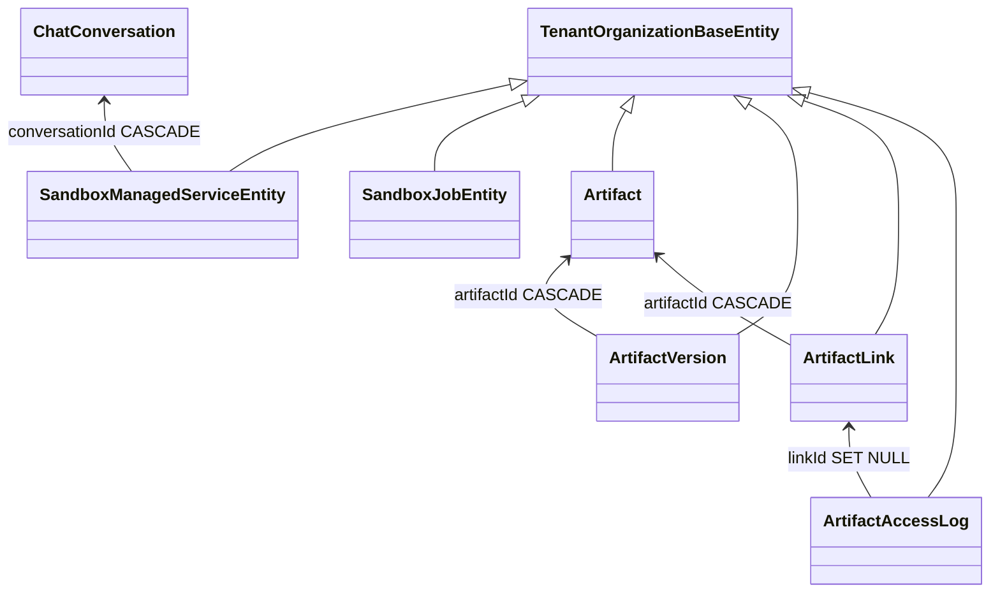

# 运行时·沙箱·产物域 · 数据模型

> 只读梳理（commit `80f5676fd`），引用为仓库根相对路径。
> **口径**：本域**实测自建 6 张表** = `sandbox` 2 张（`sandbox_managed_service`、`sandbox_job`）+ `artifacts` 4 张（`artifact`、`artifact_version`、`artifact_link`、`artifact_access_log`）。索引口径记「9 张」是把 `sandbox.module.ts` 与 `health.module.ts` 里 `TypeOrmModule.forFeature` 注册的**外部实体**（`chat_conversation`、`chat_conversation_thread`、`user`）也算进来了——见「被注册的外部实体」一节。
> `runtime-control`（22 非 spec）与 `workspace-file-access`（8 非 spec）**0 张表**：前者管进程生命周期（内存 + Redis），后者把会话/授权放 Cache 与 JWT cookie。列极多的表只列关键列。

**本文引用的文件**

- [sandbox/sandbox-managed-service.entity.ts](file://packages/server-ai/src/sandbox/sandbox-managed-service.entity.ts)
- [sandbox/sandbox-job/sandbox-job.entity.ts](file://packages/server-ai/src/sandbox/sandbox-job/sandbox-job.entity.ts)
- [sandbox/sandbox-managed-service.service.ts](file://packages/server-ai/src/sandbox/sandbox-managed-service.service.ts)
- [sandbox/sandbox-job/sandbox-job-runtime-capability.service.ts](file://packages/server-ai/src/sandbox/sandbox-job/sandbox-job-runtime-capability.service.ts)
- [sandbox/nsjail/nsjail-sandbox.ts](file://packages/server-ai/src/sandbox/nsjail/nsjail-sandbox.ts)
- [sandbox/sandbox.module.ts](file://packages/server-ai/src/sandbox/sandbox.module.ts)
- [artifacts/entities/artifact.entity.ts](file://packages/server-ai/src/artifacts/entities/artifact.entity.ts)
- [artifacts/entities/artifact-version.entity.ts](file://packages/server-ai/src/artifacts/entities/artifact-version.entity.ts)
- [artifacts/entities/artifact-link.entity.ts](file://packages/server-ai/src/artifacts/entities/artifact-link.entity.ts)
- [artifacts/entities/artifact-access-log.entity.ts](file://packages/server-ai/src/artifacts/entities/artifact-access-log.entity.ts)
- [artifacts/artifacts.service.ts](file://packages/server-ai/src/artifacts/artifacts.service.ts)
- [artifacts/artifacts.module.ts](file://packages/server-ai/src/artifacts/artifacts.module.ts)
- [sandbox/middlewares/file-activity-storage.service.ts](file://packages/server-ai/src/sandbox/middlewares/file-activity-storage.service.ts)
- [workspace-file-access/workspace-file-access.service.ts](file://packages/server-ai/src/workspace-file-access/workspace-file-access.service.ts)
- [runtime-control/runtime-lifecycle.service.ts](file://packages/server/src/runtime-control/runtime-lifecycle.service.ts)
- [health/health.module.ts](file://packages/server/src/health/health.module.ts)
- [health/health.controller.ts](file://packages/server/src/health/health.controller.ts)
- [contracts/src/artifact.model.ts](file://packages/contracts/src/artifact.model.ts)
- [plugin-sdk/src/lib/runtime/capabilities/sandbox-jobs.ts](file://packages/plugin-sdk/src/lib/runtime/capabilities/sandbox-jobs.ts)

## 目录

- [总览与建模边界](#总览与建模边界)
- [沙箱自建表](#沙箱自建表)
- [产物自建表](#产物自建表)
- [被注册的外部实体](#被注册的外部实体)
- [索引与唯一约束口径](#索引与唯一约束口径)
- [校验规则](#校验规则)
- [未确认项](#未确认项)

## 总览与建模边界

6 张表全部继承 `TenantOrganizationBaseEntity`（提供 `tenantId` / `organizationId`），隔离键是租户+组织而非 workspace；外键只有一个方向——产物族指向 `artifact`，沙箱托管服务指向 `chat_conversation`。

图表来源：[sandbox-managed-service.entity.ts](file://packages/server-ai/src/sandbox/sandbox-managed-service.entity.ts)、[artifact-version.entity.ts](file://packages/server-ai/src/artifacts/entities/artifact-version.entity.ts)、[artifact-link.entity.ts](file://packages/server-ai/src/artifacts/entities/artifact-link.entity.ts)、[artifact-access-log.entity.ts](file://packages/server-ai/src/artifacts/entities/artifact-access-log.entity.ts)

三类建模边界（本域报告统一口径）：

- **持久台账**：`sandbox_job`（幂等/重挂/审计/清理证据）、`artifact` + `artifact_version`（版本不可变）、`artifact_link`（访问策略）、`artifact_access_log`（审计）。
- **运行时快照**：`sandbox_managed_service` 的 `status`/`runtimeRef`/`startedAt`/`actualPort` 会被 `onStateChange` 反复覆盖，属于「最后一次观测」而非历史。
- **短期状态（不落表）**：WS 终端会话（进程内 Map）、沙箱预览会话（JWT cookie，TTL 1h）、workspace-file-access 会话与授权（Cache，TTL 1h）、运行时 drain/readiness（进程内单例）。

章节来源：[sandbox.module.ts](file://packages/server-ai/src/sandbox/sandbox.module.ts)（关键符号：RouterModule.register / TypeOrmModule.forFeature）、[workspace-file-access.service.ts](file://packages/server-ai/src/workspace-file-access/workspace-file-access.service.ts)（关键符号：WORKSPACE_FILE_ACCESS_TTL_MS / cacheManager.set）

## 沙箱自建表

### sandbox_managed_service（会话/线程内后台托管服务）

| 项 | 内容 |
|---|---|
| 实体类 | `SandboxManagedServiceEntity`（[sandbox-managed-service.entity.ts](file://packages/server-ai/src/sandbox/sandbox-managed-service.entity.ts)） |
| 表名 | `sandbox_managed_service` |
| 关键列 | 唯一索引 `['conversationId','name']`，普通索引 `['conversationId']`；FK `conversationId → ChatConversation` **onDelete: CASCADE**；`provider`/`name`/`command`(text)/`workingDirectory`(text)/`requestedPort`/`actualPort`/`previewPath`(text)；`status`；`transportMode`；`ownerExecutionId`/`ownerAgentKey`；`startedAt`/`stoppedAt`/`exitCode`/`signal`；**json 列**：`runtimeRef`、`metadata` |
| 生产方 | `SandboxManagedServiceService.startByConversationId / startByThreadId`（经 `NsjailSandbox.startService` 的 `onStateChange` 写快照）、`stopBy*`、`restartBy*` |
| 主要消费方 | 同服务的 `listBy*`/`getBy*`/`getLogsBy*`/`proxyByConversationId`；`SandboxPreviewSessionService.createSession`（读 `previewUrl` + `transportMode`） |
| 用途 | dev server 类托管服务的台账与预览入口，`ownerExecutionId/ownerAgentKey` 把它挂到执行账本（弱引用）。 |

### sandbox_job（Provider 无关的沙箱执行证据）

| 项 | 内容 |
|---|---|
| 实体类 | `SandboxJobEntity`（[sandbox-job.entity.ts](file://packages/server-ai/src/sandbox/sandbox-job/sandbox-job.entity.ts)） |
| 表名 | `sandbox_job` |
| 关键列 | 唯一索引 `['tenantId','idempotencyKey']`；索引 `['tenantId','status','hardDeadlineAt']`、`['tenantId','businessResourceType','businessResourceId']`；`runtimeProfile`/`sandboxRuntimeVersion`/`action`/`actionVersion`/`pluginName`/`businessResourceType`/`businessResourceId`/`provider`/`runtimeBindingId`/`runtimeArtifactKind`/`runtimeArtifactReference`(text)/`runtimeArtifactDigest`；`status`；`attempt`(int, default 0)；`cleanupPending`(bool, default false)/`cleanedAt`；`errorCode`/`errorMessage`(text)；`startedAt`/`finishedAt`/`hardDeadlineAt`；`runtimeRef`；**`containerRef` 已 `@deprecated`**；**json 列**：`progress`、`outputs` |
| 生产方 | `SandboxJobRuntimeCapabilityService.run / cancel`（`prepareAttempt`、状态回写）、`cleanupOrphans`（60s）、容量租约 |
| 主要消费方 | 同一能力的 `getJob`/`getActionHealth`（插件运行时按 `jobId` 回读）、`waitForAttachedJob`（重挂）、`requirePreviousAttemptCleanup` |
| 用途 | 幂等、重挂、审计、取消与孤儿清理的唯一执行账本；插件业务状态仍在插件自己的表里。 |

章节来源：[sandbox-managed-service.entity.ts](file://packages/server-ai/src/sandbox/sandbox-managed-service.entity.ts)（关键符号：SandboxManagedServiceEntity / conversationId+name unique / runtimeRef）、[sandbox-job.entity.ts](file://packages/server-ai/src/sandbox/sandbox-job/sandbox-job.entity.ts)（关键符号：SandboxJobEntity / idempotencyKey / cleanupPending / containerRef @deprecated）

## 产物自建表

### artifact（产物容器）

| 项 | 内容 |
|---|---|
| 实体类 | `Artifact`（[artifact.entity.ts](file://packages/server-ai/src/artifacts/entities/artifact.entity.ts)） |
| 表名 | `artifact` |
| 关键列 | **4 条部分唯一索引**（按 `organizationId`/`userId` 是否为 NULL 分列组合 `tenantId+[organizationId]+[userId]+pluginName+resourceType+resourceId`）+ 1 条同名普通索引；`kind`(default `'file'`)/`status`(default `'active'`)/`title`/`description`(text)/`checksum`/`currentVersionId`(uuid)；作用域列 `workspaceId`/`projectId`/`xpertId`/`userId`；**json 列**：`metadata` |
| 生产方 | `ArtifactsService.createArtifact`（管理端 `POST /artifacts`；插件侧 `createScopedApi()`，如 `FileActivityStorage.archive`） |
| 主要消费方 | `listArtifacts`/`getArtifact`/`findArtifactBySource`、`ArtifactVersion`/`ArtifactLink` 的 FK 目标、分享页与结果视图 |
| 用途 | 以「插件名+资源类型+资源 ID」稳定标识的产物容器，只存元数据与当前版本指针。 |

### artifact_version（不可变内容版本）

| 项 | 内容 |
|---|---|
| 实体类 | `ArtifactVersion`（[artifact-version.entity.ts](file://packages/server-ai/src/artifacts/entities/artifact-version.entity.ts)） |
| 表名 | `artifact_version` |
| 关键列 | 唯一索引 `['tenantId','organizationId','artifactId','versionNumber']`、`['artifactId','idempotencyKey']`；索引 `['tenantId','organizationId','artifactId','sourceVersionId']`、`['sha256']`；FK `artifactId → Artifact` **CASCADE**；**`workspaceFileRef` json 非空**（字节不进表）；`versionNumber`(int)/`status`(default `'active'`)/`mimeType`/`fileName`/`title`/`description`/`size`(bigint + number transformer)/`sha256`/`checksum`/`sourceVersionId`；**json 列**：`workspaceFileRef`、`metadata` |
| 生产方 | `createArtifactVersion` / `ensureArtifactVersion`（以 `idempotencyKey`（常为 sha256）去重）、`FileActivityStorage.archive` 先上传 Workspace Files 再登记 |
| 主要消费方 | `resolveForManagementAccess` / `resolveForPublicAccess` / `resolveDescriptor*`（读 `workspaceFileRef` 后经 VolumeClient 取字节）、下载响应头 `X-Xpert-Artifact-*` |
| 用途 | 一次内容快照；配合 `artifact.currentVersionId` 支撑预览、下载与校验和验证。 |

### artifact_link（分享/打开入口）

| 项 | 内容 |
|---|---|
| 实体类 | `ArtifactLink`（[artifact-link.entity.ts](file://packages/server-ai/src/artifacts/entities/artifact-link.entity.ts)） |
| 表名 | `artifact_link` |
| 关键列 | 唯一索引 `['slug']`；部分唯一 `['artifactId','shareKey'] WHERE shareKey IS NOT NULL AND status='active'`；索引 `['tenantId','organizationId','artifactId']`、`['tenantId','organizationId','status']`；FK `artifactId → Artifact` **CASCADE**；`versionMode`(default `'latest'`)/`accessMode`/`status`(default `'active'`)/`slug`/`publicUrl`(text)/`tokenHash`；`expiresAt`/`revokedAt`；`accessCount`/`downloadCount`(int, default 0)；`disposition`(default `'inline'`)/`allowDownload`(default true)/`safeHtmlProfile`；**json 列**：`customPrincipals`、`metadata` |
| 生产方 | `createArtifactLink` / `ensureArtifactShare`（按 `shareKey` 幂等替换）/ `createSignedPreviewLink` / `updateArtifactLinkAccess` / `revokeArtifactLink` |
| 主要消费方 | `GET /artifacts/share/:slug[/download|/descriptor]`、`/artifacts/shared-links/:slug/content`、`createArtifactShareSession`（会话 cookie，TTL 15 分钟、上限 365 天） |
| 用途 | 把「内容版本 + 访问策略 + 浏览器呈现」绑成一个可复制 URL 的入口。 |

### artifact_access_log（访问与生命周期审计）

| 项 | 内容 |
|---|---|
| 实体类 | `ArtifactAccessLog`（[artifact-access-log.entity.ts](file://packages/server-ai/src/artifacts/entities/artifact-access-log.entity.ts)） |
| 表名 | `artifact_access_log` |
| 关键列 | 索引 `['tenantId','organizationId','linkId']`、`['slug']`；FK `linkId → ArtifactLink`（可空）**onDelete: SET NULL**；`artifactId`(uuid，无 FK)/`slug`/`event`/`accessMode`/`principalUserId`/`ipHash`/`userAgent`(text)/`statusCode`(int)/`error`(text)；**json 列**：`metadata` |
| 生产方 | `ArtifactsService` 在公开/认证访问与销毁动作后写审计（`access`/`download`/`denied`/`revoked`/`expired`/`archived`/`deleted`） |
| 主要消费方 | 管理端审计查询；外部无写入点（全仓仅本模块引用该实体） |
| 用途 | 「谁在什么时候以什么方式访问过哪个链接」的证据，链接被删后仍保留（`linkId` 置空）。 |

章节来源：[artifacts.controller.ts](file://packages/server-ai/src/artifacts/artifacts.controller.ts)（关键符号：ArtifactsManagementController / ArtifactsPublicController）、[artifacts.service.ts](file://packages/server-ai/src/artifacts/artifacts.service.ts)（关键符号：ArtifactsService / createScopedApi / createArtifactShareSession）、[artifact.entity.ts](file://packages/server-ai/src/artifacts/entities/artifact.entity.ts)（关键符号：IDX_artifact_source_*_unique）

## 被注册的外部实体

本域三处 `forFeature` 把**不属于本域**的实体注册进来，这正是「9 表」误记的来源；它们不是本域的建模对象，本域对其只有只读/关联权限。

| 外部实体 | 表名 | 注册位置 | 为何出现在本域 |
|---|---|---|---|
| `ChatConversation` | `chat_conversation` | `sandbox.module.ts` 的 `TypeOrmModule.forFeature` | `SandboxManagedServiceEntity` 的 `ManyToOne(ChatConversation, onDelete:'CASCADE')` 需要实体解析；`conversationId` 由此获得外键语义 |
| `ChatConversationThread` | `chat_conversation_thread` | 同上 | 线程级托管服务查询（`listByThreadId`/`getByThreadId`/`startByThreadId`）需要线程实体参与关联解析 |
| `User` | `user` | `health.module.ts` 的 `TypeOrmModule.forFeature([User])` | `HealthController` 注入 `Repository<User>`，用 `userRepository.count()` 作为 DB 存活的实操探针（Terminus ping 默认关闭） |

- 本域对 `chat_conversation` 的写入仅可能来自会话域；沙箱侧删除策略依赖 FK CASCADE（删会话 ⇒ 级联删托管服务行）——`sandbox_job` **不**挂会话外键，它是纯业务资源引用（`businessResourceType`/`businessResourceId` 字符串）。
- `user` 表只被 `count()` 读取，没有反写点。

章节来源：[sandbox.module.ts](file://packages/server-ai/src/sandbox/sandbox.module.ts)（关键符号：TypeOrmModule.forFeature([SandboxManagedServiceEntity, SandboxJobEntity, ChatConversation, ChatConversationThread])）、[health.module.ts](file://packages/server/src/health/health.module.ts)（关键符号：TypeOrmModule.forFeature([User])）、[health.controller.ts](file://packages/server/src/health/health.controller.ts)（关键符号：userRepository.count）

## 索引与唯一约束口径

- `artifact` 的**四条部分唯一索引**是同一业务约束的四种空值切分：组织+用户、组织+无用户、无组织+用户、无组织+无用户；PG 的部分唯一索引承担了「同一来源在同一作用域内只能有一个容器」的判定，应用层无需再加锁。
- `artifact_version` 用两条唯一索引承担两种幂等：`['artifactId','idempotencyKey']` 抗重放（`ensureArtifactVersion` 返回 `created|reused`），`['tenantId','organizationId','artifactId','versionNumber']` 抗版本号并发。
- `artifact_link` 用 `['slug']` 唯一保证 URL 稳定，用部分唯一（`status='active'`）保证一个 `shareKey` 同时只有一条有效分享。
- `sandbox_job` 用 `['tenantId','idempotencyKey']` 抗重放，另两条索引分别服务「按截止时间扫孤儿」与「按业务资源反查」这两种查询模式。
- `sandbox_managed_service` 用 `['conversationId','name']` 唯一，等价于「同一会话内服务重名即同一服务」。
- **本域 6 表无 `select:false` 列**（5 模块内未命中任何 `select: false`），即敏感字段（`artifact_link.tokenHash`、`artifact_access_log.ipHash`）在实体层无默认屏蔽，靠服务层不出参。

章节来源：[artifact.entity.ts](file://packages/server-ai/src/artifacts/entities/artifact.entity.ts)（关键符号：四条部分唯一索引）、[artifact-link.entity.ts](file://packages/server-ai/src/artifacts/entities/artifact-link.entity.ts)（关键符号：IDX_artifact_link_active_share_unique / tokenHash）、[sandbox-job.entity.ts](file://packages/server-ai/src/sandbox/sandbox-job/sandbox-job.entity.ts)（关键符号：idx tenantId+status+hardDeadlineAt）

## 校验规则

| 规则类别 | 具体规则 | 依据 |
|---|---|---|
| 幂等唯一 | `sandbox_job(tenantId,idempotencyKey)`、`artifact_version(artifactId,idempotencyKey)`、`artifact` 四条部分唯一、`artifact_link.slug`、`sandbox_managed_service(conversationId,name)` | 实体装饰器 |
| 枚举列 | 全部以 `varchar` 存字符串，**无 DB 级 enum/CHECK**（如 `status`、`kind`、`accessMode`、`versionMode`、`disposition`、`event`、`runtimeArtifactKind`），合法性靠 TS 联合类型 + 服务层校验 | `artifact.model.ts` / `sandbox-jobs.ts` 等契约 |
| 配额与上限 | 沙箱侧 `timeoutMs ≤ hardDeadlineMs`、`hardDeadlineAt = now + definition.hardDeadlineMs`、容量租约（`SandboxJobCapacityService` 超限抛错）；请求侧 `requestedPort`/`actualPort` 为 int；产物侧 `artifact_version.size` 用 bigint+transformer，`artifact_link.accessCount/downloadCount` int 计数 | 注册表与实体列 |
| 外键删除语义 | 强级联：`sandbox_managed_service.conversationId`、`artifact_version.artifactId`、`artifact_link.artifactId`（CASCADE）；保留证据：`artifact_access_log.linkId`（SET NULL） | 实体 `onDelete` |
| 弱引用（无 FK） | `artifact_version.workspaceFileRef`（json 指向 Workspace Files）、`sandbox_job.runtimeArtifactReference`/`runtimeRef`、`artifact_access_log.artifactId`、`sandbox_managed_service.ownerExecutionId/ownerAgentKey` | 实体列定义 |
| 审计内容约束 | 只写摘要（`ipHash`、`userAgent`、`statusCode`、`error`），**禁止**落预览 token、平台凭据或文件内容 | `artifact-access-log.entity.ts` 注释 |
| 版本不可变 | `artifact_version` 无更新语义，改内容只能新增版本；展示策略改在 `artifact_link` | 实体注释与服务方法集 |

章节来源：[artifact-version.entity.ts](file://packages/server-ai/src/artifacts/entities/artifact-version.entity.ts)（关键符号：bigintNumberTransformer / workspaceFileRef / idempotencyKey）、[artifact-access-log.entity.ts](file://packages/server-ai/src/artifacts/entities/artifact-access-log.entity.ts)（关键符号：ipHash / 审计约束注释）、[sandbox-job.entity.ts](file://packages/server-ai/src/sandbox/sandbox-job/sandbox-job.entity.ts)（关键符号：hardDeadlineAt / outputs）

## 未确认项

1. **产物是否覆盖全部产物类型**：`artifact.kind` 的取值集来自 `@xpert-ai/contracts` 的 `ArtifactKind`，本文件未枚举其全集；「所有产物都经 `ArtifactsService` 登记」这一点在仓库内**未找到反例，但也未穷举验证** [推测：至少 `storage-file` 与 `file-understanding` 上传字节不经 artifact 四表]。
2. **`artifact_access_log` 的写入覆盖面**：实体仅被 `artifacts.service.ts` 引用，但「descriptor 预览是否也写审计」「`denied` 是否每次 401 都写」未逐一核实。
3. **健康表是否增长**：health **无表**，所以不存在增长问题；沙箱侧真正的健康时序写在 Redis hash（`sandbox_runtime:{health}:<profile>`，TTL = 心跳 TTL 的两倍），是否落库化未在本批找到计划。
4. **`sandbox_job.outputs` 与 Workspace Files 的关系**：列为 json，元素里含 `destination.folder` 等路径元数据，但「输出文件本体如何从卷回收」未确认（配合 `cleanupVolume` 语义 [推测]）。
5. **`runtimeArtifactKind` 三值之外是否有第四种**：实体注释与联合类型只写了 `oci-image`/`filesystem`/`remote-runtime`，是否还有未列值未确认。
6. **DDL 归属**：本域 5 模块**无 `migrations/*.sql`**，6 张表依赖外部 schema-sync 作业/插件 DDL 流程产生，生产环境实际 DDL 文本未在本仓核实。
7. **`sandbox_managed_service` 的历史保留策略**：行只被 upsert/删除（CASCADE 或 stop/restart 更新），未见归档列，长期保留与清理策略未确认。

章节来源：[runtime-lifecycle.service.ts](file://packages/server/src/runtime-control/runtime-lifecycle.service.ts)（关键符号：readiness / drainState）、[sandbox-job-runtime-capability.service.ts](file://packages/server-ai/src/sandbox/sandbox-job/sandbox-job-runtime-capability.service.ts)（关键符号：cleanupVolume / destroySandbox）、[sandbox-job/sandbox-runtime-health.service.ts](file://packages/server-ai/src/sandbox/sandbox-job/sandbox-runtime-health.service.ts)（关键符号：HEALTH_KEY_PREFIX / publish / onModuleDestroy）
