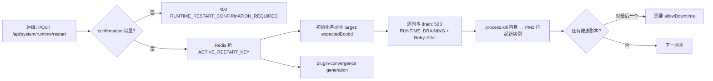

# 运行时·沙箱·产物专家 · 运维说明（07）

**本文引用的文件**

- [.deploy/nsjail-runner/README.md](file://.deploy/nsjail-runner/README.md)
- [.deploy/nsjail-runner/Dockerfile](file://.deploy/nsjail-runner/Dockerfile)
- [.deploy/nsjail-runner/docker-compose.nsjail.yml](file://.deploy/nsjail-runner/docker-compose.nsjail.yml)
- [.deploy/nsjail-runner/docker-compose.nsjail.dev.yml](file://.deploy/nsjail-runner/docker-compose.nsjail.dev.yml)
- [.deploy/api/Dockerfile](file://.deploy/api/Dockerfile)
- [.deploy/api/healthcheck.cjs](file://.deploy/api/healthcheck.cjs)
- [docker-compose.yml](file://docker-compose.yml)
- [package.json](file://package.json)
- [packages/server-ai/src/sandbox/nsjail/nsjail-sandbox.provider.ts](file://packages/server-ai/src/sandbox/nsjail/nsjail-sandbox.provider.ts)
- [packages/server-ai/src/sandbox/nsjail/nsjail-runner.client.ts](file://packages/server-ai/src/sandbox/nsjail/nsjail-runner.client.ts)
- [packages/server-ai/src/sandbox/nsjail/nsjail.types.ts](file://packages/server-ai/src/sandbox/nsjail/nsjail.types.ts)
- [packages/server-ai/src/sandbox/sandbox-job/sandbox-job-capacity.service.ts](file://packages/server-ai/src/sandbox/sandbox-job/sandbox-job-capacity.service.ts)
- [packages/server-ai/src/sandbox/sandbox-preview-session.service.ts](file://packages/server-ai/src/sandbox/sandbox-preview-session.service.ts)
- [packages/server-ai/src/sandbox/sandbox.module.ts](file://packages/server-ai/src/sandbox/sandbox.module.ts)
- [packages/server/src/runtime-control/runtime-control.module.ts](file://packages/server/src/runtime-control/runtime-control.module.ts)
- [packages/server/src/runtime-control/runtime-control.service.ts](file://packages/server/src/runtime-control/runtime-control.service.ts)
- [packages/server/src/runtime-control/runtime-drain.middleware.ts](file://packages/server/src/runtime-control/runtime-drain.middleware.ts)
- [packages/server/src/runtime-control/runtime-lifecycle.service.ts](file://packages/server/src/runtime-control/runtime-lifecycle.service.ts)
- [packages/server/src/health/health.controller.ts](file://packages/server/src/health/health.controller.ts)
- [packages/server/src/health/indicators/cache-health.indicator.ts](file://packages/server/src/health/indicators/cache-health.indicator.ts)

## 目录

1. [一、构建与运行入口](#一构建与运行入口)
2. [二、NsJail 运行时的部署（.deploy/nsjail-runner）](#二nsjail-运行时的部署deploynsjail-runner)
3. [三、nsjail 二进制、内核要求与权限模型](#三nsjail-二进制内核要求与权限模型)
4. [四、根文件系统、挂载点与工作区布局](#四根文件系统挂载点与工作区布局)
5. [五、资源配额与准入（cgroup v2 / rlimit / 进程数 / 超时）](#五资源配额与准入cgroup-v2--rlimit--进程数--超时)
6. [六、容器内与宿主的差异](#六容器内与宿主的差异)
7. [七、升级与回滚](#七升级与回滚)
8. [八、运行时控制面操作](#八运行时控制面操作)
9. [九、健康探针的接入](#九健康探针的接入)
10. [十、产物与状态数据的运维](#十产物与状态数据的运维)
11. [十一、日志与排障入口](#十一日志与排障入口)
12. [十二、常见故障与处置](#十二常见故障与处置)

## 一、构建与运行入口

| 入口 | 命令 / 配置 | 说明 |
|---|---|---|
| 依赖构建 | `pnpm b:p:all` | 依次构建 contracts/common/config/auth/server/server-ai，再 `build:plugins` |
| 本地起 API | `pnpm start:api`（`b:p:all` ＋ `nx serve api`）／`pnpm start:api:dev`（nodemon） | runtime-control 的模块注释明确：本地开发必须走 watcher，否则重启后无法自恢复 |
| API 生产镜像 | `.deploy/api/Dockerfile`：`pnpm nx build api` → `node .deploy/api/dependencies.cjs prepare-runtime` → 生产层 `ENTRYPOINT sh ./entrypoint.prod.sh` ＋ `CMD pm2-runtime main.js` | HEALTHCHECK `node healthcheck.cjs`（interval 30s / timeout 15s / start-period 60s / retries 3） |
| 组合启动 | 根 `docker-compose.yml` | API 卷：`./docker/volumes/api/sandbox/:/sandbox/`、`public/`、`plugins/`、`data/` |
| 沙箱运行时的本地起法 | `pnpm start:nsjail:dev` | 只起 `nsjail-runner` 服务（`--no-deps`），叠加 dev override |

章节来源：[package.json](file://package.json)（关键符号：scripts.start:api / scripts.start:api:dev / scripts.start:nsjail:dev / scripts.b:p:all），[Dockerfile](file://.deploy/api/Dockerfile)（关键符号：HEALTHCHECK / ENTRYPOINT / CMD），[docker-compose.yml](file://docker-compose.yml)（关键符号：volumes.sandbox），[runtime-control.module.ts](file://packages/server/src/runtime-control/runtime-control.module.ts)（关键符号：Invariants 注释）

## 二、NsJail 运行时的部署（.deploy/nsjail-runner）

`packages/nsjail-runner` 只是**发布元数据**（`private: true`，描述为 Release metadata），真实执行后端是工作区的 `.deploy/nsjail-runner/`（`runner.py` 76.4KB ＋ `network.py`/`net_proxy.py`/`seccomp.policy` ＋ 校验脚本）。

**生产/一体化启动（源码给出的三步）**：

```bash
export NSJAIL_RUNNER_TOKEN="$(openssl rand -hex 32)"
docker compose -f docker-compose.yml -f .deploy/nsjail-runner/docker-compose.nsjail.yml up -d --build
```

overlay 做三件事：把同一个 `/sandbox` 卷同时挂给 API 与 Runner；只让 API 与 Runner 接入内部网络 `nsjail-control`（`internal: true`）；注入 `NSJAIL_RUNNER_URL=http://nsjail-runner:8090` 与 `NSJAIL_RUNNER_TOKEN`，这会让 NsJail provider 在 Xpert 中可见并**fail-closed 地关闭 Local Shell**。移除 overlay 并取消两个 API 变量即可隐藏 NsJail、恢复 Local Shell，Docker 行为不变。

**镜像**：`xpert-nsjail-runner:3.6`，三阶段构建——① `nsjail-build`（debian bookworm-slim，`git clone --branch 3.6` 并**校验 commit 哈希**，`make -j`）；② `jail-rootfs`（node 20 bookworm-slim 装 bash/coreutils/curl/git/procps/python3 等，产出 `/opt/xpert-rootfs`）；③ 运行层（python:3.12-slim-bookworm ＋ conntrack/iproute2/nftables），把 nsjail 二进制放进 `/usr/local/bin/nsjail`，`/opt/xpert-app-data-mask` 置 `0555`，`EXPOSE 8090`，`ENTRYPOINT ["python3","/app/runner.py"]`，内置 `HEALTHCHECK` 访问 `http://127.0.0.1:8090/health`（带 Bearer token，10s/3s/3 次）。

**宿主开发**：`.env` 加 `NSJAIL_RUNNER_URL=http://127.0.0.1:8090`、`NSJAIL_RUNNER_TOKEN=…`、`SANDBOX_VOLUME=<绝对路径>`、`XPERT_NSJAIL_USE_CGROUP_V2=false`，再 `pnpm run start:nsjail:dev`；dev override 只发布 `127.0.0.1:8090`，并把 `SANDBOX_VOLUME` 以**同一绝对路径**bind 进 Runner（所以 API 与 Runner 看到的路径字符串一致）。

API 侧读取配置：`process.env.NSJAIL_RUNNER_URL` / `NSJAIL_RUNNER_TOKEN`；Runner 契约端点 `GET /health`、`POST /v1/runtimes`、`DELETE /v1/runtimes/:id`、`POST /v1/runtimes/:id/exec[/stream]`。

章节来源：[README.md](file://.deploy/nsjail-runner/README.md)（关键符号：docker compose overlay / Host development / NSJAIL_RUNNER_URL），[Dockerfile](file://.deploy/nsjail-runner/Dockerfile)（关键符号：NSJAIL_VERSION / NSJAIL_COMMIT / jail-rootfs / HEALTHCHECK），[docker-compose.nsjail.yml](file://.deploy/nsjail-runner/docker-compose.nsjail.yml)（关键符号：privileged / cgroup: host / nsjail-control），[docker-compose.nsjail.dev.yml](file://.deploy/nsjail-runner/docker-compose.nsjail.dev.yml)（关键符号：127.0.0.1:8090 / SANDBOX_VOLUME），[nsjail-sandbox.provider.ts](file://packages/server-ai/src/sandbox/nsjail/nsjail-sandbox.provider.ts)（关键符号：readRunnerConfig），[nsjail-runner.client.ts](file://packages/server-ai/src/sandbox/nsjail/nsjail-runner.client.ts)（关键符号：getHealth / createRuntime / destroyRuntime / execute / streamExecute）

## 三、nsjail 二进制、内核要求与权限模型

- **命名空间与隔离**：每个 execute 调用、终端、托管服务各获得**独立 NsJail 进程边界**；边界包含命名空间、只读 rootfs、`NO_NEW_PRIVS`、capability dropping、seccomp 策略、rlimits。
- **cgroup v2 是硬要求**：overlay 默认 `XPERT_NSJAIL_USE_CGROUP_V2=true`，并要求宿主暴露**可写的统一 cgroup v2 层级**（compose 把 `/sys/fs/cgroup` 以 `rw` 挂入，并 `cgroup: host`）；若不可写，Runner **fail fast** 而不是静默降级。仅"部署探针"可用 `XPERT_NSJAIL_USE_CGROUP_V2=false` 跑 rlimit 兼容模式。
- **权限降权**：Runner 是**唯一特权组件**（`privileged: true`、`apparmor=unconfined`）；禁止把 Docker socket、Xpert 配置、API 凭据或任意宿主目录挂进 Runner。RPC **不能**自选挂载点、宿主 PID、NsJail flag 或可执行文件，工作区路径必须解析在 `XPERT_NSJAIL_WORKSPACE_ROOT` 之下。
- **状态根**：Runner 进程状态限定在 `/var/lib/xpert-nsjail`（或其后代）；启动清理要求 Runner 自有 marker 且拒绝与 rootfs/工作区挂载重叠的路径。
- **身份一致性（高频踩坑）**：API 与 Runner 必须看到**相同的数字属主**，默认 `1000:1000`；API 镜像身份不同则必须同时设置 `XPERT_NSJAIL_UID`/`XPERT_NSJAIL_GID`，否则 `sandbox_write_file` 新建的文件在终端里不可编辑。
- **上线前必须在真实 Ubuntu 22/24 上记录**：`privileged` 能否收窄为能力/设备/挂载白名单、AppArmor/SELinux 要求、cgroup v2 三类控制器的实际强制效果、amd64/arm64 行为、API UID 与 `XPERT_NSJAIL_UID/GID` 的属主、并发下的全局准入与下载/日志上限。Docker Desktop 只能做协议与功能冒烟，**不构成** native Linux 证据。

章节来源：[README.md](file://.deploy/nsjail-runner/README.md)（关键符号：Security and Linux validation / XPERT_NSJAIL_UID / XPERT_NSJAIL_STATE_ROOT），[docker-compose.nsjail.yml](file://.deploy/nsjail-runner/docker-compose.nsjail.yml)（关键符号：privileged / security_opt / /sys/fs/cgroup）

## 四、根文件系统、挂载点与工作区布局

| 宿主 | 容器内 | 说明 |
|---|---|---|
| `./docker/volumes/api/sandbox/` | API `/sandbox` 与 Runner `/sandbox` | 同一份卷；Runner 侧 `XPERT_NSJAIL_WORKSPACE_ROOT=/sandbox` |
| 构建产物 | `/opt/xpert-rootfs` | jail 的只读根（`XPERT_NSJAIL_ROOTFS`） |
| 镜像内置空目录 | `/opt/xpert-app-data-mask` | 只读掩码，覆盖每个 jail 的 `/workspace/.apps` |
| 镜像内置 | `/etc/xpert-nsjail/seccomp.policy` | seccomp 策略文件 |
| javail 内部 | `/workspace` | `NSJAIL_DEFAULT_WORKING_DIRECTORY`，API 与 Runner 的默认工作目录 |

- **项目内容只读**：Project 运行时 API **只发** `protectProjectContent: true`，从不提供宿主挂载源；Runner 自行从已校验的规范 Project 工作区推导 `project.md` 与 `skills`，拒绝缺失/类型错误/符号链接源，并用 `--bindmount_ro` 覆盖到 `/workspace/project.md`、`/workspace/skills`；Runner 的文件上传 RPC 同样拒绝这些路径。该标志同时进入 API 的 runtimeId 与 Runner 的重建兼容性判断。
- **应用数据保护（协议 3）**：`appDataProtection: true`，每个 execute/终端/服务都把 `/workspace/.apps` 覆盖为镜像自有的空只读目录；真实目录只能经宿主 app-data API 写；文件上传/下载 RPC 拒绝 `.apps`（含遍历与符号链接别名），工作目录不得指入 `.apps`；掩码在首次应用写入之前就存在，长驻进程无法看到后写入的数据。
- **路径越界即拒绝**：API 侧 `NsjailWorkspacePathMapper.mapVolumeToWorkspace` 在卷外路径上直接抛错，并在创建前强制上述两项（协议不满足 → `create()` 失败）。
- **dev 环境差异**：`environment.envName === 'dev'` 时匿名卷路由先做 `normalizeSandboxPublicVolumeSubpath`。

章节来源：[README.md](file://.deploy/nsjail-runner/README.md)（关键符号：protectProjectContent / appDataProtection / /workspace/.apps），[docker-compose.yml](file://docker-compose.yml)（关键符号：volumes.sandbox），[nsjail-sandbox.provider.ts](file://packages/server-ai/src/sandbox/nsjail/nsjail-sandbox.provider.ts)（关键符号：NSJAIL_DEFAULT_WORKING_DIRECTORY / mapVolumeToWorkspace / protectProjectContent），[sandbox.controller.ts](file://packages/server-ai/src/sandbox/sandbox.controller.ts)（关键符号：normalizeSandboxPublicVolumeSubpath）

## 五、资源配额与准入（cgroup v2 / rlimit / 进程数 / 超时）

**Runner 侧（overlay 默认值，均可用同名环境变量覆盖）**：

| 类别 | 变量与默认值 |
|---|---|
| 生命周期 | `MAX_RUNTIMES=100`、`RUNTIME_IDLE_TTL_SECONDS=7200`（空闲 2h，**含仍有托管服务的运行时**）、`RUNTIME_HARD_TTL_SECONDS=86400`（24h 硬租约）、`REAPER_INTERVAL_SECONDS=60` |
| 服务/终端 | `MAX_SERVICES_PER_RUNTIME=16`、`MAX_SERVICE_RECORDS_PER_RUNTIME=32`、`MAX_TERMINALS_PER_RUNTIME=8`（终端槽位在 fork 前**原子预留**） |
| 执行/代理准入 | `MAX_EXECUTIONS_GLOBAL=32`、`MAX_EXECUTIONS_PER_RUNTIME=4`、`MAX_PROXIES_GLOBAL=64`、`MAX_PROXIES_PER_RUNTIME=16`、`PROXY_IDLE_TIMEOUT_SECONDS=60` |
| 有界输入 | `MAX_DOWNLOAD_FILES=64`、`MAX_DOWNLOAD_BYTES=33554432`、`MAX_SERVICE_LOG_BYTES=4194304`、`MAX_READY_TEXT_BYTES=4096` |
| 每 jail 资源 | `MEMORY_BYTES=2147483648`、`SWAP_BYTES=0`（禁止溢入宿主 swap）、`CPU_MS_PER_SEC=1000`、`PIDS=128`、`RLIMIT_AS_MB=4096`、`RLIMIT_FSIZE_MB=256`、`TMPFS_MB=256`、`RLIMIT_NOFILE=256` |
| 出网 | `XPERT_NSJAIL_EGRESS_ENABLED=true`、`EGRESS_DNS=1.1.1.1,8.8.8.8`、`EGRESS_CIDR=100.127.0.0/16` |

**API 侧**：作业容量经 Redis ZSET 租约三桶 —— `SANDBOX_JOB_GLOBAL_LIMIT`（默认 20）、`SANDBOX_JOB_TENANT_LIMIT`（4）、`SANDBOX_JOB_USER_LIMIT`（2，匿名作业无此桶）；任一超限抛 `SandboxJobRuntimeError('SANDBOX_CAPACITY_UNAVAILABLE', retryable=true)`，键形如 `sandbox_jobs:{capacity}:global|tenant:<id>|user:<id>:<uid>`。

**超时**：`NsjailExecutionRequest{ command, maxOutputBytes, timeoutMs }`；`timeoutMs` 是单次执行上限，Runner 会在超时或 runtime 销毁时终止其子进程；注册表层面强制 `timeoutMs ≤ hardDeadlineMs`，作业行 `hardDeadlineAt` 到期后由清理扫描接管。托管服务的 `readyPattern` 字段**名不副实**：文本按字节限量并**字面匹配**（正则元字符在特权 Runner 中没有特殊语义）。

章节来源：[docker-compose.nsjail.yml](file://.deploy/nsjail-runner/docker-compose.nsjail.yml)（关键符号：XPERT_NSJAIL_* 全量默认值），[README.md](file://.deploy/nsjail-runner/README.md)（关键符号：admission / readyPattern / two hours / 24-hour hard lease），[sandbox-job-capacity.service.ts](file://packages/server-ai/src/sandbox/sandbox-job/sandbox-job-capacity.service.ts)（关键符号：ACQUIRE_SCRIPT / SANDBOX_JOB_GLOBAL_LIMIT / SandboxJobRuntimeError），[nsjail.types.ts](file://packages/server-ai/src/sandbox/nsjail/nsjail.types.ts)（关键符号：NsjailExecutionRequest）

## 六、容器内与宿主的差异

| 维度 | 容器（overlay 生产） | 宿主（`start:api:dev`） |
|---|---|---|
| cgroup v2 | 默认启用，`cgroup: host` ＋ `/sys/fs/cgroup:rw` | `XPERT_NSJAIL_USE_CGROUP_V2=false`（rlimit-only，仅用于探针/开发） |
| Runner 暴露 | 仅内部 `nsjail-control` 网络（`internal: true`），不发布端口 | dev override 发布 `127.0.0.1:8090` |
| 工作区根 | 固定 `/sandbox`（compose 卷） | `SANDBOX_VOLUME` 绝对路径，以同路径 bind 进 Runner；**设置后 API 会从旧的扁平 `~/data` 布局切到 tenant/scope 隔离路径** |
| Local Shell | 设置 `NSJAIL_RUNNER_URL/TOKEN` 后 fail-closed 关闭 | 同左；未配置时 Local Shell 可用（受信任的开发执行，**不提供** Linux 挂载边界保护） |
| Local Browser Runtime | 生产**不可用**（源码注释：source-checkout tooling, never a production fallback） | 开发环境自动注册 |
| 配置变更生效 | 重建容器 | 改 `.env` 后**必须重启宿主 API**（前端无需重启；Runner token 由 Compose 与 API 共读同一个被忽略的 `.env`） |

章节来源：[docker-compose.nsjail.dev.yml](file://.deploy/nsjail-runner/docker-compose.nsjail.dev.yml)，[README.md](file://.deploy/nsjail-runner/README.md)（关键符号：Host development / Local Shell remains explicitly trusted），[sandbox.module.ts](file://packages/server-ai/src/sandbox/sandbox.module.ts)（关键符号：LOCAL_BROWSER_RUNTIME_PROVIDERS / isDevelopmentSandboxRuntimeEnvironment）

## 七、升级与回滚

1. **顺序不可颠倒**：先升级 Runner 镜像，再升级 API —— **API 会拒绝更旧的 Runner**。协议版本常量：项目内容保护 `NSJAIL_RUNNER_PROJECT_CONTENT_PROTOCOL_VERSION = 2`、应用数据保护 `NSJAIL_RUNNER_APP_DATA_PROTOCOL_VERSION = 3`；老 Runner 不满足协议 3 时 `create()` 直接失败。本轮切换期间要**重启既有运行时**。
2. **镜像固定**：`xpert-nsjail-runner:3.6` ＋ `NSJAIL_COMMIT=f78475530b46d0186111a9096b30725f816b55fe`（Dockerfile 会在 clone 后校验哈希，构建即失败于漂移）。
3. **回滚**：回滚 API 镜像的同时保留 Runner overlay；若要彻底关闭 NsJail，移除 overlay 并**成对**取消 `NSJAIL_RUNNER_URL`/`NSJAIL_RUNNER_TOKEN`（否则 provider 半可见）。模板里"选择不可用 provider"会在安装时归一到第一个可用 provider，回滚后可能落到 Local Shell。
4. **数据库**：本批 6 张自建表（sandbox 2 ＋ artifacts 4）**没有 SQL 迁移文件**，依赖外部 schema-sync 作业；因此回滚不需要 DDL 回退，但**必须**保证 schema-sync 与 API 的同批窗口，避免新表/新列缺失。
5. **API 平滑**：重启由 runtime-control 的自滚动完成（见下节），不需要额外编排。

章节来源：[README.md](file://.deploy/nsjail-runner/README.md)（关键符号：Upgrade the Runner image before the API / Restart existing runtimes），[nsjail.types.ts](file://packages/server-ai/src/sandbox/nsjail/nsjail.types.ts)（关键符号：NSJAIL_RUNNER_PROJECT_CONTENT_PROTOCOL_VERSION / NSJAIL_RUNNER_APP_DATA_PROTOCOL_VERSION），[Dockerfile](file://.deploy/nsjail-runner/Dockerfile)（关键符号：NSJAIL_COMMIT 校验）

## 八、运行时控制面操作

控制面管的是 **API 进程副本的生命周期**（不是容器、也不是沙箱）：生产 API 由 Docker 内的 PM2 托管，重启采用 `rolling-self-signal` —— 进程只对自己发信号（`process.kill(process.pid, signal)`），由进程守护者拉起替代实例。

| 操作 | 端点 | 影响面 |
|---|---|---|
| 查看副本 | `GET /api/system/runtime/instances` | 只读；需超管 ＋ 默认租户 ＋ 交互式会话 |
| 退役单个副本 | `POST /api/system/runtime/instances/:instanceId/retire` | 必须带 `expectedBootId`（防误退），审计日志记录 actor/tenant/sourceIp |
| 查看能力 | `GET /api/system/runtime/restart-capability` | 返回 `allowed/reason`，可用于发布前自检 |
| 触发重启 | `POST /api/system/runtime/restart`（202） | 需要 `confirmation` 常量；已有进行中的重启返回 409；body 可带 `allowDowntime`、`runtimeRequirements[]`（≤100 条） |
| 重启状态 | `GET /api/system/runtime/restart/:restartId` | 目标/已完成/失败副本数 |
| 插件收敛 | `GET /api/system/runtime/plugin-convergence/:generation` | 代次状态与承载它的 restartId |

**执行期行为（务必知情）**：

- 一次只 drain **一个候选副本**（"One candidate drains at a time"）；**最后一个健康副本需要运维显式注明允许中断**（`allowDowntime`）。
- drain 期间该副本对**非 `/health`** 请求返回 **503** ＋ `Retry-After: 5`、`Connection: close`，错误码为 `RUNTIME_DRAINING` 或 `RUNTIME_NOT_READY`；drain 单例保证不重复滚动。
- 关停顺序包含「等待在途请求空闲」（1 秒级 waitForIdle）与队列关停：`RuntimeQueueShutdownService` 通过 `DiscoveryService` **动态发现** `Bull`/`WorkerHost` 并 pause/close，而不是声明式订阅事件。
- 插件变更：`recordPluginRuntimeRequirements` 先**持久化代次**（Redis 键 `PLUGIN_GENERATION_KEY`），再尽力启动 rollout；若 rollout 未起，日志会明说"durable but its rollout has not started yet"，此时用代次端点核对，排队变更在下一轮 rollout 执行。
- **多副本注意事项**：重启协调依赖 Redis（活动重启键、代次、目标表）与实例注册表，**必须保证副本间共享同一 Redis**；重启请求要求交互式超管会话＋**默认租户**（API Key 一律拒绝）；本地开发用 nodemon 时"重启"等价于 watcher 重拉，不要指望 drain 语义。



图表来源：[runtime-control.service.ts](file://packages/server/src/runtime-control/runtime-control.service.ts)（关键符号：requestRestart / restartCapability / assertAuthorizedActor），[runtime-drain.middleware.ts](file://packages/server/src/runtime-control/runtime-drain.middleware.ts)（关键符号：RUNTIME_DRAINING / Retry-After），[runtime-control.module.ts](file://packages/server/src/runtime-control/runtime-control.module.ts)（关键符号：RUNTIME_PROCESS_SIGNALER / forRoutes('*')）

章节来源：[runtime-control.service.ts](file://packages/server/src/runtime-control/runtime-control.service.ts)（关键符号：mode / listInstances / retireInstance / pluginConvergenceStatus），[runtime-control.module.ts](file://packages/server/src/runtime-control/runtime-control.module.ts)（关键符号：RuntimeRestartCoordinatorService / RuntimeQueueShutdownService），[runtime-lifecycle.service.ts](file://packages/server/src/runtime-control/runtime-lifecycle.service.ts)（关键符号：readiness / drain 单例 / waitForIdle）

## 九、健康探针的接入

| 探针 | 端点 | 语义与观测点 |
|---|---|---|
| readiness | `GET /api/health/ready`（`@Public()`；**无 `tenant` query 时回落默认租户**） | 由 `RuntimeLifecycleService.readiness()` 驱动，返回 `ready`/`draining`/`unready`；非 ready 即 **503** ＋ `Cache-Control: no-store`。**drain 时会主动摘流量**，适合先接这个 |
| liveness | `GET /api/health`（`@Public()`；**无 `tenant` query 时回落默认租户**） | Terminus 聚合：`database`（`userRepository.count()`；Terminus ping 默认关闭）、`storage`（磁盘 `thresholdPercent: 99.999999`，即"写满才失败"）、`cache`（set/get 往返）、`redis`（仅 `REDIS_ENABLED=true` 时） |

- 容器自检已有实现可直接抄参数：`HEALTHCHECK --interval=30s --timeout=15s --start-period=60s --retries=3 CMD ["node","healthcheck.cjs"]`；`healthcheck.cjs` 会并发请求 `/api/health/ready` 与 `/api/health`，要求 `ready.status === 'ready'` 且 `health.status === 'ok'`，并逐一校验 `database`、`cache`（`REDIS_ENABLED=true` 时再加 `redis`）的 `details[*].status === 'up'`。
- **K8s 映射建议**（依据端点语义，源码未内置 K8s 清单）：`readinessProbe` → `/api/health/ready`（drain 期间 503 自动摘流量）；`livenessProbe` → `/api/health/ready`（避免 DB/缓存抖动直接杀掉实例），`/api/health` 更适合做**深度巡检/告警**指标源，因为磁盘阈值接近 100%、DB 探活是真实查询。
- `/health` 路径被 drain 中间件白名单放行，滚动重启期间探针仍可用；`log` 会打印 `HealthCheckExecutionTimer-<uuid>` 计时与各段结果，便于关联。

章节来源：[health.controller.ts](file://packages/server/src/health/health.controller.ts)（关键符号：readiness / check / checkDbWithTerminus / thresholdPercent），[cache-health.indicator.ts](file://packages/server/src/health/indicators/cache-health.indicator.ts)（关键符号：isHealthy / cacheType），[healthcheck.cjs](file://.deploy/api/healthcheck.cjs)，[Dockerfile](file://.deploy/api/Dockerfile)（关键符号：HEALTHCHECK），[runtime-drain.middleware.ts](file://packages/server/src/runtime-control/runtime-drain.middleware.ts)（关键符号：isHealthRequest）

## 十、产物与状态数据的运维

- **字节归属**：产物字节不落表 —— `artifact_version.workspaceFileRef`（json 非空）指向 Workspace Files；平台只保存可移植引用，不泄露宿主文件系统路径。产物域的限制因此不在数据库，而在**卷容量与回收**。
- **表增长**：`artifact_access_log` 是审计事件表（`access/download/denied/revoked/expired/archived/deleted`），**未找到 TTL/清理任务**，长期运行需自建归档/分片删除；该表通过 `linkId` FK `onDelete: SET NULL` 保留孤儿事件，删链接不会删日志。
- **链接失效**：`artifact_link.status = expired|revoked` 是**逻辑状态**，在读取时判定（命中即记 410 审计）；`expiresAt`/`revokedAt`/`accessCount`/`downloadCount`/`disposition`/`allowDownload` 都落库，可据此做运营报表。
- **预览/分享凭据**：沙箱预览 cookie TTL 1 小时（路径限定到具体 service 的 proxy）；产物分享会话 cookie TTL **15 分钟**、`path=/artifacts/share`。轮换方式是轮换 `JWT_SECRET`（两者都由它签名；缺失时沙箱预览会 500 `provider_unavailable`）。
- **沙箱状态**：`sandbox_managed_service` 与对话绑定（FK `onDelete: CASCADE`），服务记录会随会话删除；`sandbox_job` 走 `cleanupPending`/`cleanedAt` ＋ 60 秒间隔的 `cleanupOrphans` 回收孤儿运行时。
- **沙箱卷**：`docker/volumes/api/sandbox/` 同时被 API 与 Runner 使用；`RUNTIME_IDLE_TTL_SECONDS=7200` 只回收**运行时**，不回收卷内文件 —— 卷满会同时打崩沙箱与匿名卷投递，需要独立巡检磁盘水位（`/api/health` 的 `storage` 只在近乎写满时才报 down）。

章节来源：[artifacts.service.ts](file://packages/server-ai/src/artifacts/artifacts.service.ts)（关键符号：ARTIFACT_SHARE_SESSION_TTL_SECONDS / recordAccessLog / resolveForPublicAccess），[sandbox-preview-session.service.ts](file://packages/server-ai/src/sandbox/sandbox-preview-session.service.ts)（关键符号：SANDBOX_PREVIEW_TTL_MS / getJwtSecret），[sandbox.module.ts](file://packages/server-ai/src/sandbox/sandbox.module.ts)（关键符号：TypeOrmModule.forFeature / SandboxJobRuntimeCapabilityService）

## 十一、日志与排障入口

| 症状 | 观测入口 | 判据 |
|---|---|---|
| 沙箱不可用 | `GET /api/system/runtime/instances` 之外的沙箱探针：Runner `/health`（能力 `projectContentReadOnly` / `appDataProtection`）与 `NSJAIL_RUNNER_URL/TOKEN` | provider 可见性由这两个变量决定；能力位不足说明 Runner 版本旧于协议 2/3 |
| 命令无输出/被截断 | 执行结果与 Runner 侧 `MAX_SERVICE_LOG_BYTES`、`MAX_READY_TEXT_BYTES`、`MAX_DOWNLOAD_BYTES` | 超限是**字面截断**而非报错，日志里长度恰好等于上限即是它 |
| 终端连不上 | WS 命名空间 `sandbox-terminal` 的 `error`/`closed` 事件 | `unsupported_provider`＝provider 无 terminal 适配器；`sandbox_disabled`＝会话特性开关关闭；403 `WsException`＝握手 token/助手作用域不符 |
| 预览 401 | `unauthorized`：`Sandbox preview session is required.` vs `… is invalid.` | 前者是没带 cookie（多半是 cookie path 与 `/api/sandbox/conversations/<c>/services/<s>/proxy` 不一致或缺少 `secure`），后者是票面与路径不匹配/过期 |
| 预览 400 | `code: unsupported_provider` / `preview_unavailable` | 前者是服务不支持代理，后者是 `transportMode !== 'http'`（无 HTTP 预览目标） |
| 作业堆积 | `sandbox_job.status` ＋ `hardDeadlineAt`；Redis 键 `sandbox_jobs:{capacity}:*` | 容量桶满会持续抛 `SANDBOX_CAPACITY_UNAVAILABLE`（retryable），桶内泄漏表现为永不放行 |
| 运行时泄漏 | Runner 日志 ＋ `XPERT_NSJAIL_REAPER_INTERVAL_SECONDS`、idle/hard TTL | 空闲 2h（含仍有托管服务者）、硬租约 24h 兜底；`MAX_RUNTIMES` 打满会让新 runtime 创建失败 |
| 产物 410 | `artifact_access_log.event` | `revoked`/`expired` 是**预期**状态；同一条链反复出现 `denied` 说明分享策略配置问题 |
| 健康抖动 | `/api/health` 的 `details`、`HealthCheckExecutionTimer-<uuid>` 计时日志 | `cache` down＝缓存往返失败（Redis 开启时 `cacheType=redis`）；`database` down 是真实查询失败，不是 Terminus ping |
| 滚动重启卡住 | `GET /api/system/runtime/restart/:restartId` 与 `/plugin-convergence/:generation` | 副本数长时间不动＝某副本未重新注册（PM2 未拉起）或 Redis 协调键被占 |

章节来源：[README.md](file://.deploy/nsjail-runner/README.md)（关键符号：Global and per-runtime admission / byte-limited），[sandbox-terminal.gateway.ts](file://packages/server-ai/src/sandbox/sandbox-terminal.gateway.ts)（关键符号：emitError / emitClosed），[sandbox-preview-auth.guard.ts](file://packages/server-ai/src/sandbox/sandbox-preview-auth.guard.ts)（关键符号：canActivate），[health.controller.ts](file://packages/server/src/health/health.controller.ts)（关键符号：check / uniqueLabel），[sandbox-job-capacity.service.ts](file://packages/server-ai/src/sandbox/sandbox-job/sandbox-job-capacity.service.ts)（关键符号：keys / SANDBOX_CAPACITY_UNAVAILABLE）

## 十二、常见故障与处置

| 故障 | 根因（结构事实） | 处置 |
|---|---|---|
| 沙箱起不来：provider 不可见 | 未注入 `NSJAIL_RUNNER_URL`/`NSJAIL_RUNNER_TOKEN`，或 overlay 未启用 | 按第二节命令成对设置并 `up -d`；模板里的 provider 名会被归一到第一个可用 provider |
| 沙箱起不来：创建即失败 | Runner 协议不满足（项目内容 2/应用数据 3）或卷路径越界 | 先升级 Runner 镜像再升级 API；核对 `XPERT_NSJAIL_WORKSPACE_ROOT` 与卷映射，越界路径由 API 侧直接拒绝 |
| Runner 启动即退出 | 宿主无可写统一 cgroup v2 层级 → **fail fast** | 修复 cgroup 委派；仅探针场景可临时 `XPERT_NSJAIL_USE_CGROUP_V2=false` |
| 终端连不上 | ① provider 无终端适配器；② 会话 xpert 特性 `sandbox` 未开；③ 握手 token 或助手作用域不符 | 依次核对 `error.code`＝`unsupported_provider`/`sandbox_disabled` 与 403 `WsException`；终端槽位（每 runtime 8）打满也会开不了新会话 |
| 预览 403/401 | cookie path 必须精确等于 `/api/sandbox/conversations/<c>/services/<s>/proxy`；HTTPS 终止在前面但未识别 `x-forwarded-proto` 会让 `secure` cookie 丢失；票面与路径参数不一致直接被拒 | 走 `POST …/preview-session` 重新签发（同一 `conversationId`/`serviceId`），确认代理链透传 `x-forwarded-proto` |
| 预览页面 HMR 失效 | 当前预览控制器**不代理 WebSocket 升级** | 属已知范围外能力；改用轮询或等待共享预览升级工作落地 |
| 终端里写不进 `sandbox_write_file` 产出的文件 | API 与 Runner 的**数字属主不一致** | 同时设置 `XPERT_NSJAIL_UID`/`XPERT_NSJAIL_GID`（默认 1000:1000，需与 API 镜像身份一致） |
| 长驻进程看不到 `.apps` 的真实数据 | 设计如此：`/workspace/.apps` 被只读空目录覆盖，写入只能走宿主 app-data API | 不要把应用数据目录当作 jail 内可写路径；这是协议 3 的**硬约束** |
| 运行时被"莫名回收" | 空闲 2h（含带托管服务的运行时）或 24h 硬租约到期 | 调大 `XPERT_NSJAIL_RUNTIME_IDLE_TTL_SECONDS`/`_HARD_TTL_SECONDS`，或降低空闲判定（保持 API 活动）；被回收的托管服务记录会标记 stopped/lost |
| 服务代理空闲即断 | `XPERT_NSJAIL_PROXY_IDLE_TIMEOUT_SECONDS=60`（上游 body 空闲 60s 关闭） | 长轮询/SSE 类预览需调大该值，或改用非流式交互 |
| 产物"丢失" | 410 是 `deleted`/`revoked`/`expired` 的正常语义；404 是作用域不匹配或卷内文件缺失 | 用 `artifact_access_log` 对齐是哪种；卷内引用缺失属于 Workspace Files 侧（本域只存引用） |
| 健康探测抖动 | DB 真实 `count()` 查询、cache set/get、磁盘阈值；drain 期间 `/ready` 主动 503 | 把 `/ready` 与 `/health` 分工（见第九节）；排查缓存类型（`REDIS_ENABLED`）与磁盘水位 |
| 滚动重启"卡住"或最后一个副本不肯重启 | 最后一个健康副本需要 `allowDowntime`；Redis 协调键被占；旧副本未重新注册 | 用 `restart/:restartId` 与 `plugin-convergence/:generation` 定位；确认副本数（`instances`）与 `expectedBootId` 一致；避免用 API Key/非默认租户身份操作 |

章节来源：[README.md](file://.deploy/nsjail-runner/README.md)（关键符号：fail fast / UID-GID / preview proxy / HMR），[sandbox-preview-session.service.ts](file://packages/server-ai/src/sandbox/sandbox-preview-session.service.ts)（关键符号：buildCookiePath / PreviewUnavailable），[sandbox-managed-service.service.ts](file://packages/server-ai/src/sandbox/sandbox-managed-service.service.ts)（关键符号：Object does not support preview proxying），[runtime-control.service.ts](file://packages/server/src/runtime-control/runtime-control.service.ts)（关键符号：assertAuthorizedActor / restartStatus）
