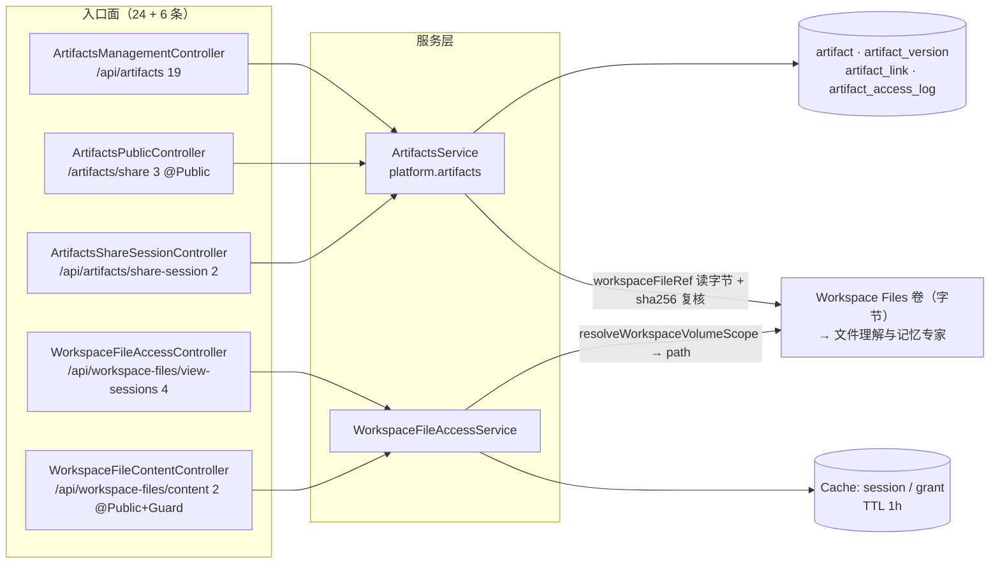

# 产物与文件访问子专家 —— C0 使用总览

> **资产基线**：`2026-10-16 · commit 80f5676fd`（批次 5 第 12 专家 · 子专家③），继承父域 [C0-使用总览.md](file://.module-experts/后端专题/运行时·沙箱·产物专家/C0-使用总览.md)。**范围**：`packages/server-ai/src/artifacts/**`（**10 非 spec / 2 spec / 自建 4 表**：`artifact`、`artifact_version`、`artifact_link`、`artifact_access_log`）＋ `packages/server-ai/src/workspace-file-access/**`（**8 非 spec / 2 spec / 0 表**）。HTTP 面 **24 + 6 = 30 条**：管理面 `/api/artifacts` 19、公开分享面 `/artifacts/share`（**被 `setGlobalPrefix` 的 `exclude` 摘掉 `api` 前缀**）3、分享会话 `/api/artifacts/share-session` 2、工作区文件 `/api/workspace-files/view-sessions` 4 ＋ `/api/workspace-files/content` 2。`sandbox/**` 归 [子专家①](file://.module-experts/后端专题/运行时·沙箱·产物专家/sub-experts/沙箱执行子专家/C0-使用总览.md)，`runtime-control`/`health` 归 [子专家②](file://.module-experts/后端专题/运行时·沙箱·产物专家/sub-experts/运行时控制与健康子专家/C0-使用总览.md)。未证实处标 `[推测]`。

**本文引用的文件**（相对仓库根，链接均为 `file://`）

- [packages/server-ai/src/artifacts/artifacts.controller.ts](file://packages/server-ai/src/artifacts/artifacts.controller.ts)
- [packages/server-ai/src/artifacts/artifacts.service.ts](file://packages/server-ai/src/artifacts/artifacts.service.ts)
- [packages/server-ai/src/artifacts/artifacts.module.ts](file://packages/server-ai/src/artifacts/artifacts.module.ts)
- [packages/server-ai/src/artifacts/artifact-mime-policy.ts](file://packages/server-ai/src/artifacts/artifact-mime-policy.ts)
- [packages/server-ai/src/artifacts/entities/artifact.entity.ts](file://packages/server-ai/src/artifacts/entities/artifact.entity.ts)
- [packages/server-ai/src/artifacts/entities/artifact-version.entity.ts](file://packages/server-ai/src/artifacts/entities/artifact-version.entity.ts)
- [packages/server-ai/src/artifacts/entities/artifact-link.entity.ts](file://packages/server-ai/src/artifacts/entities/artifact-link.entity.ts)
- [packages/server-ai/src/artifacts/entities/artifact-access-log.entity.ts](file://packages/server-ai/src/artifacts/entities/artifact-access-log.entity.ts)
- [packages/server-ai/src/workspace-file-access/workspace-file-access.service.ts](file://packages/server-ai/src/workspace-file-access/workspace-file-access.service.ts)
- [packages/server-ai/src/workspace-file-access/workspace-file-access.controller.ts](file://packages/server-ai/src/workspace-file-access/workspace-file-access.controller.ts)
- [packages/server-ai/src/workspace-file-access/workspace-file-content.controller.ts](file://packages/server-ai/src/workspace-file-access/workspace-file-content.controller.ts)
- [packages/server-ai/src/workspace-file-access/workspace-file-access.guard.ts](file://packages/server-ai/src/workspace-file-access/workspace-file-access.guard.ts)
- [packages/server-ai/src/file-understanding/domain/workspace-file.ts](file://packages/server-ai/src/file-understanding/domain/workspace-file.ts)
- [packages/plugin-sdk/src/lib/runtime/capabilities/artifacts.ts](file://packages/plugin-sdk/src/lib/runtime/capabilities/artifacts.ts)
- [packages/contracts/src/artifact.model.ts](file://packages/contracts/src/artifact.model.ts)
- [apps/api/src/bootstrap/index.ts](file://apps/api/src/bootstrap/index.ts)

## 目录

1. [定位](#定位)
2. [何时找这个子专家](#何时找这个子专家)
3. [能力清单表](#能力清单表)
4. [边界](#边界)
5. [已知问题与常见坑](#已知问题与常见坑)
6. [延伸阅读](#延伸阅读)

## 定位

本子专家负责 **「产物怎么被登记、分享、审计」** 与 **「工作区文件怎么被授权式读取」** 两条正交链路。**产物链**：`artifact` 容器（稳定业务身份 `pluginName + resourceType + resourceId`）→ `artifact_version` 不可变内容快照（字节以 `workspaceFileRef` 便携引用外置）→ `artifact_link` 对外入口与访问/展示策略（`slug` 唯一、`shareKey` 部分唯一）→ `artifact_access_log` 追加型审计。**文件访问链**：`view-sessions`（会话）→ `grants`（短时授权）→ `content`（字节流）三段式，会话与 grant 全在 Cache（TTL 1 小时）＋ JWT cookie，**客户端不能传路径**，路径由服务端从 grant 的便携引用解析。服务层是 `ArtifactsService implements ArtifactsApi`（`@RuntimeCapabilityProvider(ArtifactsRuntimeCapability)`，插件面能力键 `platform.artifacts`）与 `WorkspaceFileAccessService`。

**一句话口径**：`artifact_version.workspaceFileRef` 是本子域与外域**唯一的内容通道**（json 非空列，实体注释逐字「without leaking host filesystem paths」）；**持有引用不等于获得权限**——产物读取靠 link 策略授权 + 每次 `sha256` 复核，工作区文件读取靠「会话 + grant + origin + 重解析比对」四重约束。

章节来源：[artifacts.service.ts](file://packages/server-ai/src/artifacts/artifacts.service.ts)（关键符号：createArtifactWithDefaults / ensureArtifactVersionWithDefaults / resolveForPublicAccess / createScopedApi）、[workspace-file-access.service.ts](file://packages/server-ai/src/workspace-file-access/workspace-file-access.service.ts)（关键符号：createSession / createGrant / resolveAuthorizedFile / authorizeContent）

## 何时找这个子专家

- 要**改产物登记**：`createArtifact` 的同源复用语义（命中即复位 `status='active'` 并回写 `kind`/`checksum`/`title`/`description`/`metadata`）、`normalizeSourceInput` 的三个必填字段、`resolveCreateScope` 的「input → 能力 defaults → `RequestContext`」三级回退（`tenantId` 缺失即 400）、4 条部分唯一索引与 `isUniqueConstraintError` 重查。
- 要**改产物版本**：`createArtifactVersion` 的 `versionNumber = max + 1` 与 `currentVersionId` 回写、`ensureArtifactVersion` **强制** `idempotencyKey` 且走 `withLockedArtifact`（事务 + `pessimistic_write`）先查后写、`readWorkspaceArtifact` 用真实字节复核入参 `sha256`/`size`（不符 400）、`workspaceFileRef.source` 必须为 `platform.workspace.files`。
- 要**改分享与公开读取**：`artifact_link` 的 `accessMode` 六态（`owner_only`/`organization_all`/`workspace_all`/`custom_principals`/`public_link`/`signed_preview`）、`ensureArtifactShare` 的「策略等价则复用，否则旧链 `revoked` + 新建」、`assertPublicAccess` 读到过期即回写 `expired`、`incrementCounters` 原子自增、`slug` 12 字符 + 57 字母表、`MAX_TTL_SECONDS` 365 天上限。
- 要**改审计**：`recordAccessLog(link, …)` 的七类事件（`access`/`download`/`denied`/`revoked`/`expired`，以及 artifact 维度的 `archived`/`deleted`，artifact 维度 `linkId=null`、`slug=artifact:<id>`）、`ipHash` 为裸 `sha256`（无盐）、两处写入都 `try/catch` 静默失败（**尽力而为**语义）、本子域**未暴露任何审计查询端点**。
- 要**改工作区文件读取授权**：`createSession` 的 8 个绑定字段与 TTL 1 小时、`createGrant` 的「session 全等 + 引用可移植 + 到期随 session（不独立续期）」、`authorizeContent` 的 JWT `aud` 双校验与 `bindingsMatch`、`WorkspaceFileAccessGuard` 从 cookie `xpert_workspace_file_access` 取值。
- 要**改路径约束（越界防护）**：`assertPortableReference`（`source` / `filePath` / `tenantId` 三项）、`resolveWorkspaceVolumeScope` 的 catalog 与 scopeId 匹配、`normalizeWorkspaceRelativePath` 拒绝 `.`/`..`/`../` 前缀与 `\0`、`normalizeFileName` 的 `basename` + 控制字符剥离、`assertRequestOrigin` 的三条显式放行分支。
- 要**排查产物 404**：管理面越域一律 404（不泄露存在性）、`version` 模式按 id 否则 `currentVersionId`（非 `active` 即 404）、`artifact.status !== 'active'` 即 410、未登录访问公开分享会 302 到 `/artifacts/auth/<slug>`。
- 要**排查越权 / 403**：`allowDownload === false` 时下载被记 `denied` 并 403、`canAccessLink` 不过按有无身份记 401/403、`assertRequestOrigin` 在「老浏览器不发 `Sec-Fetch-*`」时预览分支会被拒、认证下载路径的重解析比对失败一律 404。
- 要**改清理与配额**：本子域**没有** `@Cron` / `setInterval` / retention 逻辑，也没有 `migrations/*.sql`；失效是「状态位 + 读取时判定」，字节回收属于卷（→「文件理解与记忆专家」）。

章节来源：[artifacts.service.ts](file://packages/server-ai/src/artifacts/artifacts.service.ts)（关键符号：findExistingArtifact / withLockedArtifact / authorizeArtifactLink / canAccessLink / recordAccessLog）、[workspace-file-access.service.ts](file://packages/server-ai/src/workspace-file-access/workspace-file-access.service.ts)（关键符号：createSession / createGrant / assertPortableReference / assertRequestOrigin）、[artifact-mime-policy.ts](file://packages/server-ai/src/artifacts/artifact-mime-policy.ts)（关键符号：isSupportedArtifactMimeType）

## 能力清单表

| 能力 | 入口 | 一句话 |
|---|---|---|
| 产物登记（容器） | `POST /api/artifacts`、插件面 `platform.artifacts.createArtifact` | 以「插件名 + 资源类型 + 资源 ID」为稳定身份；同源重建是**幂等复用**而非新增行 |
| 产物版本（不可变） | `POST /api/artifacts/:artifactId/versions`、`…/versions/ensure` | 只 insert、无 update 路径；`workspaceFileRef` 必填、字节先落卷、读时 `sha256` 复核 |
| 产物查询 | `GET /api/artifacts`、`/by-source`、`/:idOrSlug`、`/:artifactId/versions` | 全部走 `resolveScopedArtifact`（`tenantId`/`organizationId`/`userId` 任一不匹配即 404）；`pageSize` 上限 100 |
| 产物内容投递（管理面） | `GET /api/artifacts/:artifactId/versions/:artifactVersionId/content` | 全量 `Buffer` + `sha256` 复核；`text/html` 追加 `interactive` 档 CSP；**无 Range/206** |
| 分享链接与策略 | `POST /api/artifacts/:artifactId/links`、`…/links/signed-preview`、`PATCH /links/:idOrSlug/access`、`DELETE /links/:idOrSlug`、`/:artifactId/shares/:shareKey`（GET/POST/DELETE） | 六种 `accessMode`；`ensureArtifactShare` 命中同 `shareKey` 且策略等价即 `reused`，否则旧链 `revoked` + 新建 |
| 公开打开 / 下载 / 描述 | **`@Public()`**：`GET /artifacts/share/:slug`、`/artifacts/share/:slug/download`、`/artifacts/share/:slug/descriptor` | 前缀被 `setGlobalPrefix` 的 `exclude` 摘掉 `api`；`descriptor` 序列化时**剔除** `workspaceFileRef` |
| 分享会话（cookie） | `POST /api/artifacts/share-session/:slug`（需登录）、`DELETE /api/artifacts/share-session`（`@Public()`；**无 `tenant` query 时回落默认租户**） | 15 分钟 JWT cookie、`path=/artifacts/share`、`sameSite:'lax'`；未登录时 302 到前端 `/artifacts/auth/:slug` |
| 生命周期 | `PATCH /api/artifacts/:idOrSlug/archive`、`DELETE /api/artifacts/:idOrSlug` | `status ∈ active\|archived\|deleted`（**软删，行不删**）；`deleteArtifact` 同时把该产物全部 link 置 `revoked` |
| 共享内容（登录态） | `GET /api/artifacts/shared-links/:artifactLinkSlug/content`、`/…/descriptor` | 按登录身份判定 link 策略后投递，不需要分享会话 cookie |
| 工作区文件会话 | `POST /api/workspace-files/view-sessions`、`DELETE …/view-sessions/:sessionId` | 解析视图上下文并写 Cache（TTL 1 小时）＋ JWT cookie（`aud='workspace-view-file-access'`） |
| 工作区文件授权 | `POST /api/workspace-files/view-sessions/:sessionId/grants` | 服务端从 View 业务资源解析便携引用；`assertContextMatchesSession` 比对 8 个字段 + `runtimeScope`；到期**随 session** |
| 工作区文件内容流 | `GET …/view-sessions/:sessionId/grants/:grantId/content/:fileName`（认证、`StreamableFile`）、**`@Public()` + `WorkspaceFileAccessGuard`** 的 `GET/HEAD /api/workspace-files/content/:sessionId/:grantId/:fileName` | 完整 Range 支持（206/416）、`HEAD` 只发头、`private, no-store` + `nosniff`；另做 `assertRequestOrigin` |
| MIME 与内容安全 | `artifact-mime-policy.ts` | 精确白名单 + `image/*`；`image/svg+xml` **永不内联**；两档 CSP（`strict` 无脚本 / `interactive` `sandbox allow-scripts`） |

章节来源：[artifacts.controller.ts](file://packages/server-ai/src/artifacts/artifacts.controller.ts)（关键符号：ArtifactsManagementController / ArtifactsPublicController / ArtifactsShareSessionController）、[workspace-file-content.controller.ts](file://packages/server-ai/src/workspace-file-access/workspace-file-content.controller.ts)（关键符号：WorkspaceFileContentController.streamContent）、[artifact-mime-policy.ts](file://packages/server-ai/src/artifacts/artifact-mime-policy.ts)（关键符号：getArtifactArchiveMimeType / isSupportedArtifactMimeType）

## 边界

**做什么**：产物的登记 / 版本 / 分享链接 / 公开访问审计（4 张表），以及工作区文件「会话 + 授权」式读取与投递语义（含越界防护与 Range 流式）。

**不做什么（重点：字节归属）**

- **字节在 Workspace Files 卷，本子域只持可移植引用与访问授权**：`artifact_version.workspaceFileRef` 是 json 非空列、**无外键**，只装便携引用（`source`/`catalog`/`filePath` 等），实体注释逐字「without leaking host filesystem paths」；`workspace-file-access` 的 grant 也只存引用，取字节经 `volumeClient.resolve(...).path(...)`。**字节本体、卷布局、上传与解析**归**「文件理解与记忆专家」**的 `storage-file` / `file-understanding`（`file_asset`/`file_chunk`/`StorageFile`）——本域 4 张表中**无任何指向它们的列或外键**。
- **与「文件理解与记忆专家」的 `storage-file` 分工**：`resolveWorkspaceVolumeScope` 是**从 `file-understanding` 导入**的（本域不自建卷作用域规则）；路径归一化 `normalizeWorkspaceRelativePath`/`normalizeWorkspaceFilePath` 亦在 `file-understanding/domain/workspace-file.ts`。本域只做**授权判定与投递**，不解析文件内容、不做 OCR/分块/嵌入。
- **不含 ① 沙箱执行**：Runner、沙箱运行时、终端、预览、卷投递归 [子专家①](file://.module-experts/后端专题/运行时·沙箱·产物专家/sub-experts/沙箱执行子专家/C0-使用总览.md)(file://.module-experts/后端专题/运行时·沙箱·产物专家/sub-experts/沙箱执行子专家/C0-使用总览.md)。与沙箱的唯一真实接触是**反向调用**：`sandbox/middlewares/file-activity-storage.service.ts` 归档 `present_files` 时调 `ArtifactsRuntimeCapability` 的 `createArtifact`/`listArtifactVersions`/`ensureArtifactVersion`。
- **不含 ② 运行时控制与健康**：`runtime-control`/`health` 归 [子专家②](file://.module-experts/后端专题/运行时·沙箱·产物专家/sub-experts/运行时控制与健康子专家/C0-使用总览.md)。
- **不含会话与消息持久化**：本子域不写会话表、不持会话外键；`ToolImageArtifacts` 只把 `conversationId` 落在 `artifact.metadata` 里（弱引用）。
- **不含项目/组织权限本体**：`workspace_all` 策略调用 `XpertWorkspaceAccessService.assertCanRead`（邻域），`organization_all` 用 `findMembershipByUserAndOrganization`（邻域）。
- **不含 DDL 与配额**：本域**无 `migrations/*.sql`**，4 张表依赖外部 schema-sync；4 张表内**没有任何配额/用量列**（`accessCount`/`downloadCount` 是计数而非配额）。

图表来源：[artifacts.module.ts](file://packages/server-ai/src/artifacts/artifacts.module.ts)（关键符号：TypeOrmModule.forFeature / controllers）、[workspace-file-access.module.ts](file://packages/server-ai/src/workspace-file-access/workspace-file-access.module.ts)（关键符号：RouterModule.register('/workspace-files')）、[artifacts.service.ts](file://packages/server-ai/src/artifacts/artifacts.service.ts)（关键符号：readWorkspaceArtifact / recordAccessLog）

章节来源：[artifact-version.entity.ts](file://packages/server-ai/src/artifacts/entities/artifact-version.entity.ts)（关键符号：workspaceFileRef）、[workspace-file.ts](file://packages/server-ai/src/file-understanding/domain/workspace-file.ts)（关键符号：resolveWorkspaceVolumeScope / normalizeWorkspaceRelativePath）、[workspace-file-access.service.ts](file://packages/server-ai/src/workspace-file-access/workspace-file-access.service.ts)（关键符号：resolveAuthorizedFile）

## 已知问题与常见坑

1. **产物登记是「先查 + 唯一约束重试」两级幂等，不是单靠索引**：`createArtifactWithDefaults` 先按 `tenantId+pluginName+resourceType+resourceId` 查、再在内存里比对可空的 `organizationId`/`userId`；未命中才 `create+save`，**捕获唯一约束错误（`23505` / `1062` / `SQLITE_CONSTRAINT`）后再查一次**。`artifact` 的 4 条**部分唯一索引**按「有/无 organization」×「有/无 user」四种空值切分表达同一业务约束——PG 部分唯一索引才是并发防线。
   - 契约来源：[artifacts.service.ts](file://packages/server-ai/src/artifacts/artifacts.service.ts)（关键符号：createArtifactWithDefaults / findExistingArtifact / isUniqueConstraintError）、[artifact.entity.ts](file://packages/server-ai/src/artifacts/entities/artifact.entity.ts)（关键符号：4 条部分唯一索引）。
2. **版本登记的幂等有两档且语义不同**：`ensureArtifactVersion` **强制** `idempotencyKey` 并在 `withLockedArtifact`（事务 + `pessimistic_write` 锁 `artifact` 行）里先查后写，命中且 `sha256` 一致返回 `reused`、命中但字节不同 → 400「already used for different content」；而 `createArtifactVersion` **不加锁**，`[推测]` 并发创建可能出现「后写的 `currentVersionId` 不是最大版本号」。
   - 契约来源：[artifacts.service.ts](file://packages/server-ai/src/artifacts/artifacts.service.ts)（关键符号：ensureArtifactVersionWithDefaults / withLockedArtifact / createArtifactVersionWithDefaults）。
3. **读取授权与租户边界靠「作用域查询 + link 策略」两处判定，且必须按时区分面**：管理面 `resolveScopedArtifact`/`resolveScopedLink` 越域一律 404（不泄露存在性）；公开面 `authorizeArtifactLink` → `assertPublicAccess` → `canAccessLink` 六态；`revoked` 归 410，`expired` 在**读取时**判定并回写。同一份内容经**三张面孔**投递（管理面 / 公开面 / 运行时面），读代码时必须按面区分。
   - 契约来源：[artifacts.service.ts](file://packages/server-ai/src/artifacts/artifacts.service.ts)（关键符号：resolveScopedArtifact / assertPublicAccess / canAccessLink / resolveAccessContextFromRequest）。
4. **工作区文件路径越界防护有 8 层，且「客户端不能传路径」是第 1 层**：① 路由只接受 `(sessionId, grantId, fileName)`；② `assertPortableReference`（`source==='platform.workspace.files'`、`filePath` 非空、`tenantId === session.tenantId`）；③ `resolveWorkspaceVolumeScope` 的 catalog 与 scopeId 匹配；④ `normalizeWorkspaceRelativePath` 拒绝 `.`/`..`/`../` 前缀与 `\0`；⑤ 认证下载**重新解析资源**并 `isDeepStrictEqual` 比对 `filePath` 与 `volumeScope`（旧 grant 不能跟随被改写的 fileKey）；⑥ `normalizeFileName` = `basename` + 控制字符剥离；⑦ `assertRequestOrigin`；⑧ 前端 `viewFileContentRoute` 二次校验（同源、前缀、3 段路径、无穿越）。
   - 契约来源：[workspace-file-access.service.ts](file://packages/server-ai/src/workspace-file-access/workspace-file-access.service.ts)（关键符号：assertPortableReference / resolveAuthorizedFile / authorizeAuthenticatedContent / assertRequestOrigin / normalizeFileName）、[workspace-file.ts](file://packages/server-ai/src/file-understanding/domain/workspace-file.ts)（关键符号：normalizeWorkspaceRelativePath）。
5. **4 张表分工明确，`artifact_access_log` 的写入面只有两处且「尽力而为」**：`artifact` = 容器与稳定业务身份（唯一索引挂这层，可 `archived`/`deleted` 软删）· `artifact_version` = 不可变内容快照（**只 insert、无 update 路径**）· `artifact_link` = 对外入口与访问/展示策略 · `artifact_access_log` = 追加型审计（`linkId` `SET NULL`，删链接不删日志）。写入面仅 `recordAccessLog`（link 维度五类事件）与 `recordArtifactAccessLog`（artifact 维度 `archived`/`deleted`，`linkId=null`、`slug=artifact:<id>`），**两处 `catch` 静默失败**（注释「审计不得让合法操作失败」），因此审计缺失不会被上游感知。本子域**未暴露任何审计查询端点**。
   - 契约来源：[artifacts.service.ts](file://packages/server-ai/src/artifacts/artifacts.service.ts)（关键符号：recordAccessLog / recordArtifactAccessLog）、[artifact-access-log.entity.ts](file://packages/server-ai/src/artifacts/entities/artifact-access-log.entity.ts)（关键符号：linkId SET NULL）。
6. **与 sandbox job 的关联键是「同名不同义」**：本子域与 `sandbox_job` **既无外键也无字段级关联**；`sandbox_job.runtimeArtifactKind/Reference/Digest` 指的是**运行时镜像 / 文件系统产物**。唯一可对齐的口径是 `artifact.source.{pluginName, resourceType, resourceId}`（业务资源 ID）＋ `artifact_version.workspaceFileRef.filePath`（卷内路径）；两域各自经插件能力面暴露（`platform.artifacts` vs `platform.sandbox.jobs`）。
   - 契约来源：[artifacts.service.ts](file://packages/server-ai/src/artifacts/artifacts.service.ts)（关键符号：normalizeSourceInput / readWorkspaceArtifact）、[sandbox-job.entity.ts](file://packages/server-ai/src/sandbox/sandbox-job/sandbox-job.entity.ts)（关键符号：runtimeArtifactKind / runtimeArtifactReference / runtimeArtifactDigest）。
7. **清理与失效全靠状态机，没有主动回收**：本子域**没有** `@Cron` / `setInterval` / retention 逻辑，也没有 `migrations/*.sql`；`artifact_access_log` 只增不减、无 TTL/分片；`artifact_version.status` 契约含 `deleted` 但**本域无写入点**（只有 insert 写 `'active'`）；字节回收完全属于卷。硬编码有效期：分享会话 15 分钟、签名预览默认 15 分钟、链接 TTL 上限 365 天、工作区文件会话 1 小时（grant 到期随 session）。
   - 契约来源：[artifacts.service.ts](file://packages/server-ai/src/artifacts/artifacts.service.ts)（关键符号：ARTIFACT_SHARE_SESSION_TTL_SECONDS / DEFAULT_SIGNED_PREVIEW_TTL_SECONDS / MAX_TTL_SECONDS）、[workspace-file-access.service.ts](file://packages/server-ai/src/workspace-file-access/workspace-file-access.service.ts)（关键符号：WORKSPACE_FILE_ACCESS_TTL_MS / hasExpired）。
8. **会话与授权状态只在 Cache，多副本强依赖集中式缓存**：`workspace-file-access` **0 张表**，模型实际是 JWT 载荷 + 两条 Cache 键（`workspace-file-access:session:<id>`、`…:grant:<session>:<grant>`）；`CACHE_MANAGER` 的实际 driver 由外部配置决定，**进程重启即全部失效**（用户需重新走两段式授权）。另外 `artifact_access_log.ipHash` 是**裸 `sha256(value)` 无盐**，`[推测]` IPv4 空间可被枚举（隐私弱化，非功能性缺陷）。
   - 契约来源：[workspace-file-access.service.ts](file://packages/server-ai/src/workspace-file-access/workspace-file-access.service.ts)（关键符号：CACHE_MANAGER / sessionKey / grantKey）、[artifacts.service.ts](file://packages/server-ai/src/artifacts/artifacts.service.ts)（关键符号：hashString）。

章节来源：[artifacts.service.ts](file://packages/server-ai/src/artifacts/artifacts.service.ts)（关键符号：withLockedArtifact / authorizeArtifactLink / recordAccessLog / readWorkspaceArtifact）、[workspace-file-access.service.ts](file://packages/server-ai/src/workspace-file-access/workspace-file-access.service.ts)（关键符号：createGrant / authorizeContent / assertPortableReference）、[artifact-version.entity.ts](file://packages/server-ai/src/artifacts/entities/artifact-version.entity.ts)（关键符号：workspaceFileRef / idempotencyKey）

## 延伸阅读

- 逐端点明细、守卫矩阵与错误语义全集：父域 [implementation/05-接口.md](file://.module-experts/后端专题/运行时·沙箱·产物专家/implementation/05-接口.md)
- 4 张表逐列、唯一索引口径与 8 条未确认项：本子专家 [implementation/04-模型.md](file://.module-experts/后端专题/运行时·沙箱·产物专家/sub-experts/产物与文件访问子专家/implementation/04-模型.md)
- 实现细节（登记链 / 读取与下载 / 路径解析 8 层 / 4 表写入点 / 12 条技术债）：本子专家 [implementation/02-实现.md](file://.module-experts/后端专题/运行时·沙箱·产物专家/sub-experts/产物与文件访问子专家/implementation/02-实现.md)
- 端点前缀与分组核实（`setGlobalPrefix` 的 exclude 事实）：本子专家 [implementation/01-架构.md](file://.module-experts/后端专题/运行时·沙箱·产物专家/sub-experts/产物与文件访问子专家/implementation/01-架构.md) §「端点前缀与端点分组核实」
- 本子专家端点逐个索引、服务契约与访问授权契约：[C1-能力契约.md](file://.module-experts/后端专题/运行时·沙箱·产物专家/sub-experts/产物与文件访问子专家/C1-能力契约.md)

章节来源：[artifacts.module.ts](file://packages/server-ai/src/artifacts/artifacts.module.ts)（关键符号：ArtifactsModule）、[workspace-file-access.module.ts](file://packages/server-ai/src/workspace-file-access/workspace-file-access.module.ts)（关键符号：WorkspaceFileAccessModule）、[index.ts](file://apps/api/src/bootstrap/index.ts)（关键符号：setGlobalPrefix / exclude）
