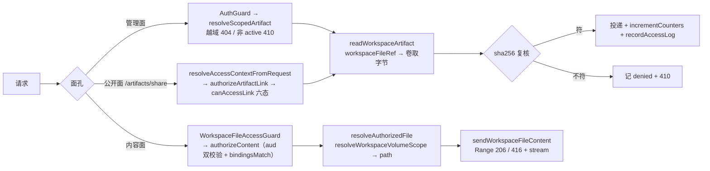

# 产物与文件访问子专家 —— C1 能力契约

> 契约层 CR2 / CR5 / CR7。只写「对外可依赖的语义」：入口、参数行为、返回、异常与约束；路径均为仓库根相对 `file://` 引用。
> **资产基线**：`2026-10-16 · commit 80f5676fd`（批次 5 第 12 专家 · 子专家③），继承父域 [C1-能力契约.md](file://.module-experts/后端专题/运行时·沙箱·产物专家/C1-能力契约.md)。**逐端点明细**（完整字段、错误码全集）见父域 [implementation/05-接口.md](file://.module-experts/后端专题/运行时·沙箱·产物专家/implementation/05-接口.md)，本文不复制。①② 子域见 [子专家① C1](file://.module-experts/后端专题/运行时·沙箱·产物专家/sub-experts/沙箱执行子专家/C1-能力契约.md) 与 [子专家② C1](file://.module-experts/后端专题/运行时·沙箱·产物专家/sub-experts/运行时控制与健康子专家/C1-能力契约.md)。**前缀口径修正**：公开分享面在源码中被 `setGlobalPrefix` 的 `exclude` 摘掉 `api` 前缀，故为 `/artifacts/share/...`（父级 C1 §1 写作 `/api/artifacts/share/...`，以源码为准）。

**本文引用的文件**（相对仓库根，链接均为 `file://`）

- [packages/server-ai/src/artifacts/artifacts.controller.ts](file://packages/server-ai/src/artifacts/artifacts.controller.ts)
- [packages/server-ai/src/artifacts/artifacts.service.ts](file://packages/server-ai/src/artifacts/artifacts.service.ts)
- [packages/server-ai/src/artifacts/artifacts.module.ts](file://packages/server-ai/src/artifacts/artifacts.module.ts)
- [packages/server-ai/src/artifacts/artifact-mime-policy.ts](file://packages/server-ai/src/artifacts/artifact-mime-policy.ts)
- [packages/server-ai/src/artifacts/entities/artifact.entity.ts](file://packages/server-ai/src/artifacts/entities/artifact.entity.ts)
- [packages/server-ai/src/artifacts/entities/artifact-version.entity.ts](file://packages/server-ai/src/artifacts/entities/artifact-version.entity.ts)
- [packages/server-ai/src/artifacts/entities/artifact-link.entity.ts](file://packages/server-ai/src/artifacts/entities/artifact-link.entity.ts)
- [packages/server-ai/src/artifacts/entities/artifact-access-log.entity.ts](file://packages/server-ai/src/artifacts/entities/artifact-access-log.entity.ts)
- [packages/server-ai/src/workspace-file-access/workspace-file-access.controller.ts](file://packages/server-ai/src/workspace-file-access/workspace-file-access.controller.ts)
- [packages/server-ai/src/workspace-file-access/workspace-file-content.controller.ts](file://packages/server-ai/src/workspace-file-access/workspace-file-content.controller.ts)
- [packages/server-ai/src/workspace-file-access/workspace-file-content.response.ts](file://packages/server-ai/src/workspace-file-access/workspace-file-content.response.ts)
- [packages/server-ai/src/workspace-file-access/workspace-file-access.guard.ts](file://packages/server-ai/src/workspace-file-access/workspace-file-access.guard.ts)
- [packages/server-ai/src/workspace-file-access/workspace-file-access.service.ts](file://packages/server-ai/src/workspace-file-access/workspace-file-access.service.ts)
- [packages/server-ai/src/workspace-file-access/workspace-file-access.module.ts](file://packages/server-ai/src/workspace-file-access/workspace-file-access.module.ts)
- [packages/server-ai/src/file-understanding/domain/workspace-file.ts](file://packages/server-ai/src/file-understanding/domain/workspace-file.ts)
- [packages/server-ai/src/sandbox/middlewares/file-activity-storage.service.ts](file://packages/server-ai/src/sandbox/middlewares/file-activity-storage.service.ts)
- [packages/plugin-sdk/src/lib/runtime/capabilities/artifacts.ts](file://packages/plugin-sdk/src/lib/runtime/capabilities/artifacts.ts)
- [packages/contracts/src/artifact.model.ts](file://packages/contracts/src/artifact.model.ts)
- [apps/api/src/bootstrap/index.ts](file://apps/api/src/bootstrap/index.ts)

## 目录

1. [§1 入口索引](#§1-入口索引)
2. [§2 服务契约](#§2-服务契约)
3. [§3 访问授权契约](#§3-访问授权契约)
4. [§4 示例](#§4-示例)
5. [§5 契约来源](#§5-契约来源)

## §1 入口索引

**前缀核实（回源码）**：全局前缀 `api` 带排除清单 `app.setGlobalPrefix('api', { exclude: ['artifacts/share', 'artifacts/share/(.*)', '.well-known/oauth-protected-resource/(.*)'] })`；`artifacts.module.ts` **无 RouterModule**（前缀写在控制器上），`workspace-file-access.module.ts` 用 `RouterModule.register([{ path: '/workspace-files', … }])`。合计 **24（artifacts）＋ 6（workspace-file-access）＝ 30 条**。

### artifacts 管理面 `@Controller('artifacts')` → `/api/artifacts`（19 条）

| # | 方法 / 路径 | 鉴权 | 用途 |
|---|---|---|---|
| 1 | POST `/api/artifacts` | 全局 `AuthGuard` ＋ 服务层作用域 | 登记容器（同源复用） |
| 2 | GET `/api/artifacts` | 同上 | 分页列表（`pageSize ≤ 100`） |
| 3 | GET `/api/artifacts/by-source` | 同上 | 按 `pluginName`/`resourceType`/`resourceId` 查 |
| 4 | GET `/api/artifacts/shared-links/:artifactLinkSlug/descriptor` | 同上 | 共享链接描述（按登录身份判策略；剔除 `workspaceFileRef`） |
| 5 | GET `/api/artifacts/shared-links/:artifactLinkSlug/content` | 同上 | 共享内容投递 |
| 6 | GET `/api/artifacts/:artifactId/versions/:artifactVersionId/content` | 同上 | 指定版本内容（`sha256` 复核；`text/html` 附 CSP） |
| 7 | GET `/api/artifacts/:idOrSlug` | 同上 | 详情（越域即 404） |
| 8 | POST `/api/artifacts/:artifactId/versions` | 同上 | 新建版本（`versionNumber = max + 1`） |
| 9 | GET `/api/artifacts/:artifactId/versions` | 同上 | 版本列表 |
| 10 | POST `/api/artifacts/:artifactId/versions/ensure` | 同上 | **幂等登记**（强制 `idempotencyKey`，返回 `created`/`reused`） |
| 11 | PATCH `/api/artifacts/:idOrSlug/archive` | 同上 | `status='archived'` |
| 12 | DELETE `/api/artifacts/:idOrSlug` | 同上 | 软删 ＋ 连带 `revoke` 全部 link |
| 13 | POST `/api/artifacts/:artifactId/links` | 同上 | 新建分享链接（六种 `accessMode`） |
| 14 | GET `/api/artifacts/:artifactId/shares/:shareKey` | 同上 | 读稳定分享槽位（读到过期即回写 `expired`） |
| 15 | POST `/api/artifacts/:artifactId/shares/:shareKey` | 同上 | `ensureArtifactShare`：等价则 `reused`，否则旧链 `revoked` + 新建 |
| 16 | DELETE `/api/artifacts/:artifactId/shares/:shareKey` | 同上 | 吊销该 shareKey |
| 17 | POST `/api/artifacts/:artifactId/links/signed-preview` | 同上 | 签名预览链（默认 TTL 15 分钟） |
| 18 | PATCH `/api/artifacts/links/:idOrSlug/access` | 同上 | 改访问/展示策略（可改 `versionMode`/`artifactVersionId`） |
| 19 | DELETE `/api/artifacts/links/:idOrSlug` | 同上 | 吊销链接 |

### artifacts 公开面 `@Controller('artifacts/share')` → `/artifacts/share`（3 条，均 `@Public()`）

| # | 方法 / 路径 | 鉴权 | 用途 |
|---|---|---|---|
| 20 | GET `/artifacts/share/:artifactLinkSlug` | **`@Public()`**（签名 token / 登录态 / 分享会话 cookie） | 内联打开；未登录需登录时 **302 → `/artifacts/auth/:slug`** |
| 21 | GET `/artifacts/share/:artifactLinkSlug/download` | 同上（另受 `allowDownload` 约束） | 下载；`allowDownload === false` 记 `denied` 并 403 |
| 22 | GET `/artifacts/share/:artifactLinkSlug/descriptor` | 同上 | 描述（序列化剔除 `workspaceFileRef`） |

### artifacts 分享会话 `@Controller('artifacts/share-session')` → `/api/artifacts/share-session`（2 条）

| # | 方法 / 路径 | 鉴权 | 用途 |
|---|---|---|---|
| 23 | POST `/api/artifacts/share-session/:artifactLinkSlug` | 非 `@Public()`：全局 `AuthGuard` | 复用 `assertPublicAccess` 授权后签 15 分钟 JWT cookie（`path=/artifacts/share`） |
| 24 | DELETE `/api/artifacts/share-session` | **`@Public()`** | 清 cookie |

### workspace-file-access（6 条）

| # | 方法 / 路径 | 鉴权 | 用途 |
|---|---|---|---|
| 25 | POST `/api/workspace-files/view-sessions` | 非 `@Public()`：全局 `AuthGuard` | 建查看会话（Cache TTL 1 小时 ＋ JWT cookie） |
| 26 | POST `/api/workspace-files/view-sessions/:sessionId/grants` | 同上 | 签发 grant（服务端解析便携引用） |
| 27 | GET `/api/workspace-files/view-sessions/:sessionId/grants/:grantId/content/:fileName` | 同上；返回 `StreamableFile` | 认证下载（`private, no-store` ＋ `nosniff`） |
| 28 | DELETE `/api/workspace-files/view-sessions/:sessionId` | 同上 | 撤销会话并清 cookie |
| 29 | GET `/api/workspace-files/content/:sessionId/:grantId/:fileName` | **类级 `@Public()` ＋ `WorkspaceFileAccessGuard`** | 内联内容流（完整 Range）；另做 `assertRequestOrigin` |
| 30 | HEAD `/api/workspace-files/content/:sessionId/:grantId/:fileName` | 同上 | 只发头 |

**逐端点明细见父域 [implementation/05-接口.md](file://.module-experts/后端专题/运行时·沙箱·产物专家/implementation/05-接口.md)**（含每条权限点、主要错误与状态码）；前缀与分组核实见本子专家 [implementation/01-架构.md](file://.module-experts/后端专题/运行时·沙箱·产物专家/sub-experts/产物与文件访问子专家/implementation/01-架构.md)。

章节来源：[artifacts.controller.ts](file://packages/server-ai/src/artifacts/artifacts.controller.ts)（关键符号：ArtifactsManagementController 19 条 / ArtifactsPublicController 3 条 / ArtifactsShareSessionController 2 条 / artifactShareCookieOptions）、[workspace-file-access.controller.ts](file://packages/server-ai/src/workspace-file-access/workspace-file-access.controller.ts)（关键符号：createSession / createGrant / downloadContent / revokeSession）、[workspace-file-content.controller.ts](file://packages/server-ai/src/workspace-file-access/workspace-file-content.controller.ts)（关键符号：streamContent / headContent）、[index.ts](file://apps/api/src/bootstrap/index.ts)（关键符号：setGlobalPrefix / exclude）

## §2 服务契约

| `类.方法(签名)` | 用途 | 参数行为语义 · 约束 |
|---|---|---|
| `ArtifactsService.createArtifact` / `findArtifactBySource` / `createArtifactVersion` / `ensureArtifactVersion` / `createArtifactLink` / `ensureArtifactShare` / `createSignedPreviewLink` / `updateArtifactLinkAccess` / `revokeArtifactLink` / `revokeArtifactShare` / `listArtifacts` / `getArtifact` / `resolveForPublicAccess` / `createArtifactShareSession` / `archiveArtifact` / `deleteArtifact`（`ArtifactsApi`，16 个方法） | 产物登记 / 版本 / 分享 / 审计 | `createArtifact` 命中同源记录即复用并复位 `status='active'`、回写 `kind`/`checksum`/`title`/`description`/`metadata`；`normalizeSourceInput` 要求 `pluginName`/`resourceType`/`resourceId` 均非空；`resolveCreateScope` 走「input → 能力 defaults → `RequestContext`」三级回退，`tenantId` 缺失即 400；`ensureArtifactVersion` **强制** `idempotencyKey`（先查后写，返回 `{version, outcome:'created'\|'reused'}`）；`resolveForPublicAccess` 先授权再取字节并 **`sha256` 复核**，不符记 `denied` 并 410；`listArtifacts` `pageSize` 上限 100（默认 20） |
| `ArtifactsService.createScopedApi(defaults)`＋`@RuntimeCapabilityProvider(ArtifactsRuntimeCapability)` | 插件面能力（键 `platform.artifacts`） | 16 个方法闭包绑定默认 scope，插件只传 `source`/`kind`/`title`/`idempotencyKey`/`workspaceFileRef` 等业务参数，无租户参数 |
| `ArtifactsService.resolveScopedArtifact` / `resolveScopedLink` / `resolveAccessContextFromRequest` | 管理面与公开面的作用域与身份解析 | 作用域为 `tenantId` + `organizationId` + `userId` 三者，**任一不匹配即 404**（不泄露存在性）；`resolveAccessContextFromRequest` 先验 Bearer JWT，再验分享会话 cookie（命中 cookie 时还要 `userService.getIfExists` 查库） |
| `ArtifactsService.resolveForManagementAccess` / `resolveArtifactLink` / `authorizeArtifactLink` / `assertPublicAccess` / `canAccessLink` / `resolveLinkVersion` / `incrementCounters` / `recordAccessLog` / `recordArtifactAccessLog` | 读取授权、计数与审计 | `artifact.status !== 'active'` 即 410；`resolveLinkVersion`：`version` 模式按 id 否则 `currentVersionId`；`canAccessLink` 六种 `accessMode`（`owner_only`/`organization_all`/`workspace_all`/`custom_principals`/`public_link`/`signed_preview`）；`revoked`/`expired`/校验和变化归 410，`denied` 记审计；`incrementCounters` 用 `repository.increment` 原子自增 `accessCount`/`downloadCount`；两处审计写入 `try/catch` 静默失败 |
| `normalizeWorkspaceFileReference` / `normalizeMimeType` / `normalizeArtifactVersionInput` / `assertAndApplyPublicLinkPolicy` / `resolveExpiresAt` | 入参校验与策略施加 | `workspaceFileRef` 必填且 `source` 必须为 `platform.workspace.files`、路径归一化后不得为空/`.`/`..`/`../` 前缀且不含 `\0`；`mimeType` 必过白名单（精确集合 + `image/*`，`image/svg+xml` 直接 400）；传入 `sha256`/`size` 必须与真实字节一致（否则 400）；`public_link` 必须 `userConfirmedPublicLink` 或 `publicLinkAuthorization='application_policy'`；`ttlSeconds ≤ 365 天` |
| `isSupportedArtifactMimeType(mime)` / `getArtifactArchiveMimeType(...)` | MIME 策略与归档降级 | 白名单 + `image/*`；SVG **永不内联**；两档 CSP：`strict`（无脚本）/ `interactive`（`sandbox allow-scripts`），由 `safeHtmlProfile` 决定 |
| `WorkspaceFileAccessService.createSession(input, request)` | 建查看会话 | `viewExtensionService.resolveViewFileAccessContext` → `assertAssistantFileAccess`（`hostType==='agent'` 且无 `projectId` 时派 `ResolveAssistantFileAccessCommand(hostId,'read','runtime')`）；写 Cache `{tenantId, organizationId, userId, hostType, hostId, viewKey, dataScopeKey, runtimeScope, origin, expiresAt}`（TTL 1 小时）；签 JWT（`aud='workspace-view-file-access'`），cookie `path = /api/workspace-files/content/<sessionId>` |
| `WorkspaceFileAccessService.createGrant(sessionId, input, request)` | 签发短时授权 | `requireAuthenticatedSession`（Cache 命中且 `tenantId`/`organizationId`/`userId` 与 `RequestContext` **全等**，否则 404）→ 再 `assertAssistantFileAccess` → `resolveViewFileResource`（**服务端**解析便携引用）→ `assertContextMatchesSession`（`bindingsMatch` 比对 8 字段 + `runtimeScope`）→ `assertPortableReference` → 写 Cache，`expiresAt = session.expiresAt`（**随 session 到期，不独立续期**）；返回 content 路径 |
| `WorkspaceFileAccessService.authorizeContent(sessionId, grantId, fileName, token)` / `resolveAuthorizedFile(session, grant)` / `authorizeAuthenticatedContent(...)` / `assertRequestOrigin(request, session, purpose)` / `normalizeFileName(name)` | 内容读取授权与路径解析 | JWT 验签（`aud` 双校验）+ `payload.sessionId === 路径 sessionId` + `sessionMatchesPayload` + 未过期；grant 必须存在、`publicFileName === 路径 fileName`、`bindingsMatch(session, grant)`、未过期，否则**一律 404**（避免探测）；路径由 `grant.reference.filePath` 经 `resolveWorkspaceVolumeScope` → `volumeClient.resolve(...).path(...)` 解析；认证下载路径会**重新解析资源**并 `isDeepStrictEqual` 比对 `filePath` 与 `volumeScope`；`assertRequestOrigin` 只在 `origin === session.origin` 或等于 `environment.baseUrl` 的 origin 时放行，另有三条显式分支，放行时下发 `Access-Control-Allow-Origin`/`Allow-Credentials`/`Vary: Origin` |
| `sendWorkspaceFileContent(...)` / `buildWorkspaceFileContentDisposition(...)` | 流式投递助手 | 先 `stat` 校验 `isFile`（否则 404）；`resolveHttpByteRange` → 不可满足 416 + `Content-Range: bytes */size`，部分请求 206 + `Content-Range`；`HEAD` 只发头；`createReadStream(pipe)`，流错误时未发送则 404、已发送则 `destroy`，响应 `close` 时销毁流；固定 `Accept-Ranges`/`Cache-Control: private, no-store`/`nosniff`/`no-referrer` |
| `WorkspaceFileAccessGuard.canActivate(context)` | 内容面唯一准入 | 从 cookie 取 `xpert_workspace_file_access`（缺失 401）→ 调 `authorizeContent(sessionId, grantId, fileName, token)` → 结果挂 `request.workspaceFileAccess`；类级 `@Public()` + 该守卫是 `/api/workspace-files/content/*` 的全部保护 |
| `CreateWorkspaceFileAccessSessionDto` / `CreateWorkspaceFileAccessGrantDto` | 入参白名单 | `purpose ∈ {preview, download}`；`whitelist` + `forbidNonWhitelisted` 语义（与 `ValidationPipe` 一致） |
| 相邻复用方（非本域端点） | `WorkspaceFileAccessRuntimeController`（`/api/ai/workspace-files/view-sessions`）与 `GroupViewFilesController` | 走 `ApiKeyOrClientSecretAuthGuard` + `AssistantFileAccessGuard`（`@AssistantFileAccess('view-session-create'\|'view-session')`），返回 grant 的 **pathname** 让客户端用自己的认证传输解析；群工作台额外 `assertAuthenticatedSessionScope` 校验 `hostType='agent'` + `hostId` + `runtimeScope` |

章节来源：[artifacts.service.ts](file://packages/server-ai/src/artifacts/artifacts.service.ts)（关键符号：ArtifactsService / createScopedApi / ensureArtifactVersionWithDefaults / resolveForPublicAccess / canAccessLink / incrementCounters）、[workspace-file-access.service.ts](file://packages/server-ai/src/workspace-file-access/workspace-file-access.service.ts)（关键符号：createSession / createGrant / authorizeContent / resolveAuthorizedFile / authorizeAuthenticatedContent / assertRequestOrigin）、[workspace-file-content.response.ts](file://packages/server-ai/src/workspace-file-access/workspace-file-content.response.ts)（关键符号：sendWorkspaceFileContent / buildWorkspaceFileContentDisposition）

## §3 访问授权契约

**三张面孔的授权判定分别落在三处（读代码必须按面区分）**：

| 面孔 | 谁能读 | 按什么断言 | 失败语义 |
|---|---|---|---|
| **管理面**（`/api/artifacts*`，19 + 2 条） | 通过全局 `AuthGuard` 且落在产物作用域内的登录者 | `resolveScopedArtifact` / `resolveScopedLink`：`tenantId` + `organizationId` + `userId` 三者匹配 | **404**（越域一律 404，不泄露存在性）；`artifact.status !== 'active'` → **410**；指定版本非 `active` → **404** |
| **公开面**（`/artifacts/share/*`，3 条 `@Public()`） | 由 link 策略决定：`owner_only` / `organization_all` / `workspace_all` / `custom_principals` / `public_link` / `signed_preview` | `resolveAccessContextFromRequest`（Bearer JWT → 分享会话 cookie 二级）→ `authorizeArtifactLink` → `assertPublicAccess` → `canAccessLink` | `revoked` / `expired` / `sha256` 不符 → **410**（`expired` 读取时回写状态、校验和变化记 `denied`）；`allowDownload === false` 下载 → 记 `denied` 并 **403**；`canAccessLink` 不过按有无身份记 **401 / 403**；需登录时 `sendOrRedirect` **302 → `/artifacts/auth/<slug>`** |
| **工作区文件内容面**（`/api/workspace-files/content/*`，2 条，类级 `@Public()` + `WorkspaceFileAccessGuard`） | 持有与该会话绑定的 JWT cookie 且 grant 与路径匹配的浏览器 | `WorkspaceFileAccessGuard` → `authorizeContent`（`aud` 双校验 + `payload.sessionId` 与路径一致 + `sessionMatchesPayload` + 未过期；grant 存在、`publicFileName` 相等、`bindingsMatch`、未过期）；另有 `assertRequestOrigin` | cookie 缺失 → **401**；会话/grant 失配、未过期校验失败、卷作用域解析为 `null` → **一律 404**（避免探测）；origin 不符 → **403** |

**路径与越界防护（工作区文件面逐条）**：① 路由只接受 `(sessionId, grantId, fileName)`，**客户端不能传路径**；② `assertPortableReference` 要求 `source === 'platform.workspace.files'`、`filePath` 非空、`reference.tenantId === session.tenantId`，否则 400 `WorkspaceFileAccessInvalidReference`；③ `resolveWorkspaceVolumeScope` 按 catalog 选卷（`projects`/`users`/`xperts`/`user-xperts`/`knowledges`/`skills`）并校验 scopeId，不满足返回 `null` → 404；④ `path.posix.normalize` 归一相对路径并拒绝空/`.`/`..`/`../` 前缀与 `\0`；⑤ 认证下载**重新解析资源**并 `isDeepStrictEqual` 比对（旧 grant 不能跟随被改写的 fileKey）；⑥ `normalizeFileName` = `basename` + 剥离控制字符 + 空白兜底；⑦ `assertRequestOrigin`；⑧ 前端 `viewFileContentRoute` 二次校验（同源、前缀、恰 3 段路径、无穿越）。

**内容安全与有界 IO**：`text/html` 公开投递追加 `interactive` 档 CSP（`sandbox allow-scripts`）、`strict` 档无脚本；`image/svg+xml` 永不内联；管理面与公开面均设 `X-Content-Type-Options: nosniff`、`Referrer-Policy: no-referrer`、`Cache-Control: private, no-store`，并附 `X-Xpert-Artifact-Version`/`X-Xpert-Artifact-SHA256`。**产物面是全量 Buffer（无 Range/206）**，`workspace-file-access` 面才有完整 Range 支持——两套策略并存。



图表来源：[artifacts.service.ts](file://packages/server-ai/src/artifacts/artifacts.service.ts)（关键符号：resolveScopedArtifact / canAccessLink / resolveForPublicAccess / readWorkspaceArtifact）、[workspace-file-access.guard.ts](file://packages/server-ai/src/workspace-file-access/workspace-file-access.guard.ts)（关键符号：WorkspaceFileAccessGuard.canActivate）、[workspace-file-access.service.ts](file://packages/server-ai/src/workspace-file-access/workspace-file-access.service.ts)（关键符号：authorizeContent / resolveAuthorizedFile / assertRequestOrigin）

章节来源：[workspace-file-access.service.ts](file://packages/server-ai/src/workspace-file-access/workspace-file-access.service.ts)（关键符号：assertPortableReference / resolveAuthorizedFile / authorizeAuthenticatedContent / normalizeFileName / assertRequestOrigin）、[artifacts.service.ts](file://packages/server-ai/src/artifacts/artifacts.service.ts)（关键符号：authorizeArtifactLink / assertPublicAccess / canAccessLink / resolveForPublicAccess）

## §4 示例

### ① 登记一个产物（容器 → 版本，幂等键 = 内容 sha256）

```ts
// 真实调用方：packages/server-ai/src/sandbox/middlewares/file-activity-storage.service.ts
const artifacts = context.runtime.capabilities?.get(ArtifactsRuntimeCapability)   // 能力键 platform.artifacts
const artifact = await artifacts.createArtifact({
    source: { pluginName: 'platform.file-activity', resourceType, resourceId }, kind: 'file', title: name
})                                                                                // 同源命中即复用并复位 status='active'
const previous = await artifacts.listArtifactVersions({ artifactId: artifact.id, idempotencyKey: sha256 })
if (previous[0]) return { artifactId: artifact.id, artifactVersionId: previous[0].id, sha256, size: buffer.length }

const file = await files.uploadBuffer({ /* … Workspace Files 卷，folder: `artifact-snapshots/${randomUUID()}` … */ })
const { version } = await artifacts.ensureArtifactVersion({
    artifactId: artifact.id, idempotencyKey: sha256, fileName: name, mimeType: archiveMimeType,
    size: buffer.length, sha256, workspaceFileRef: { source: 'platform.workspace.files', /* catalog/userId/filePath/… */ }
})                                                                                // → { version, outcome: 'created' | 'reused' }
```

要点：**字节先落 Workspace Files 卷**，表里只留 `workspaceFileRef` 与 `sha256`；`idempotencyKey`（这里是内容 sha256）= 幂等键，配合 `(artifactId, idempotencyKey)` 唯一索引 + 事务悲观锁实现「先查后写」；命中但字节不同则 400「already used for different content」。

### ② 读一个产物（公开分享面）

```ts
// 真实调用方：packages/server-ai/src/artifacts/artifacts.controller.ts
@Public() @Get(':artifactLinkSlug')
async open(@Param('artifactLinkSlug') slug: string, @Query('xpert_artifact_preview') previewToken: string,
           @Req() req: Request, @Res() res: Response) {
    await this.sendOrRedirect(slug, previewToken, req, res, false)      // 401 时 302 → /artifacts/auth/:slug
}

private async sendOrRedirect(slug: string, previewToken: string, req: Request, res: Response, download: boolean) {
    const access = await this.service.resolveAccessContextFromRequest(req)
    try {
        const artifact = await this.service.resolveForPublicAccess({
            slug, download, previewToken, principal: access.principal, authenticatedUser: access.authenticatedUser
        })                                                              // 取 workspaceFileRef → 卷读字节 → sha256 复核
        sendArtifactResponse(res, artifact)
    } catch (error) {
        if (!(error instanceof UnauthorizedException)) throw error
        res.redirect(302, `/artifacts/auth/${encodeURIComponent(slug)}${download ? '?download=1' : ''}`)
    }
}
```

要点：路径是 `/artifacts/share/:slug`（**没有 `/api` 前缀**，由 `setGlobalPrefix` 的 `exclude` 摘除）；每次公开访问都重算 `sha256` 比对，不符记 `denied` 并 410；`text/html` 会额外下发 CSP，`image/svg+xml` 永不内联；`descriptor` 变体的序列化会**剔除** `workspaceFileRef`。

### ③ 授权读取一个工作区文件（会话 → grant → content）

```ts
// 真实调用方：packages/server-ai/src/workspace-file-access/workspace-file-access.controller.ts 与 -content.controller.ts
const { sessionId, expiresAt } = await http.post('/api/workspace-files/view-sessions', dto)   // 写 cookie（path=/api/workspace-files/content/<sid>，TTL 1 小时）
const grant = await http.post(`/api/workspace-files/view-sessions/${sessionId}/grants`, {
    hostType: 'agent', hostId, viewKey, purpose: 'preview'                                    // 服务端解析便携引用，到期随 session
})
// → { url: `/api/workspace-files/content/${sessionId}/${grantId}/${encodeURIComponent(fileName)}` }
await fetch(grant.url, { headers: { Range: 'bytes=0-1023' }, credentials: 'include' })         // 206 + Content-Range；不可满足 416

// 服务端内容面（类级 @Public() + 守卫；客户端无法传路径）
@Public() @UseGuards(WorkspaceFileAccessGuard) @Controller('content')
export class WorkspaceFileContentController {
    @Get(':sessionId/:grantId/:fileName') @Head(':sessionId/:grantId/:fileName')
    async streamContent(/* … */) { /* sendWorkspaceFileContent: stat → Range → createReadStream(pipe) */ }
}
```

要点：**客户端不传路径**，`fileName` 只做相等匹配，真实路径由 `grant.reference.filePath` 经 `resolveWorkspaceVolumeScope` + `VolumeClient` 解析；任何失配（会话/grant/票面/文件名的未过期与全等校验）都回 **404**（避免探测），origin 不符才回 **403**；会话/grant 全在 Cache，进程重启即失效。

章节来源：[file-activity-storage.service.ts](file://packages/server-ai/src/sandbox/middlewares/file-activity-storage.service.ts)（关键符号：FileActivityStorage.archive / persist）、[artifacts.controller.ts](file://packages/server-ai/src/artifacts/artifacts.controller.ts)（关键符号：ArtifactsPublicController.open / sendOrRedirect / sendArtifactResponse）、[workspace-file-access.controller.ts](file://packages/server-ai/src/workspace-file-access/workspace-file-access.controller.ts)（关键符号：createSession / createGrant）、[workspace-file-content.controller.ts](file://packages/server-ai/src/workspace-file-access/workspace-file-content.controller.ts)（关键符号：WorkspaceFileContentController.streamContent）

## §5 契约来源

| 契约条目 | 来源 |
|---|---|
| 24 条 artifacts 端点（19 管理 + 3 公开 + 2 分享会话）与 3 个控制器类 | `packages/server-ai/src/artifacts/artifacts.controller.ts` |
| 产物登记/版本/链接/公开读取/审计与 MIME 策略 | `packages/server-ai/src/artifacts/{artifacts.service.ts,artifact-mime-policy.ts}`、`packages/plugin-sdk/src/lib/runtime/capabilities/artifacts.ts`、`packages/contracts/src/artifact.model.ts` |
| 4 表结构、唯一索引与外键删除语义 | `packages/server-ai/src/artifacts/entities/{artifact,artifact-version,artifact-link,artifact-access-log}.entity.ts` |
| 6 条 workspace-file-access 端点（4 管理 + 2 内容） | `packages/server-ai/src/workspace-file-access/{workspace-file-access.controller.ts,workspace-file-content.controller.ts}` |
| 会话 / grant / 授权 / 路径解析 / origin 校验 | `packages/server-ai/src/workspace-file-access/{workspace-file-access.service.ts,workspace-file-access.guard.ts}` |
| Range/206/416、HEAD、流错误处理与文件名编码 | `packages/server-ai/src/workspace-file-access/workspace-file-content.response.ts` |
| 路由挂载与前缀（`/workspace-files`、`artifacts/share` 的 exclude） | `packages/server-ai/src/workspace-file-access/workspace-file-access.module.ts`、[apps/api/src/bootstrap/index.ts](file://apps/api/src/bootstrap/index.ts) |
| 卷作用域与相对路径归一化（字节侧边界） | `packages/server-ai/src/file-understanding/domain/workspace-file.ts`（归属「文件理解与记忆专家」） |
| 逐端点明细与错误语义全集 | 父域 [implementation/05-接口.md](file://.module-experts/后端专题/运行时·沙箱·产物专家/implementation/05-接口.md)（本文不复制） |

章节来源：[artifacts.module.ts](file://packages/server-ai/src/artifacts/artifacts.module.ts)（关键符号：ArtifactsModule / TypeOrmModule.forFeature）、[workspace-file-access.module.ts](file://packages/server-ai/src/workspace-file-access/workspace-file-access.module.ts)（关键符号：WorkspaceFileAccessModule / RouterModule.register）、[artifacts.service.ts](file://packages/server-ai/src/artifacts/artifacts.service.ts)（关键符号：ArtifactsService / recordAccessLog / recordArtifactAccessLog）
