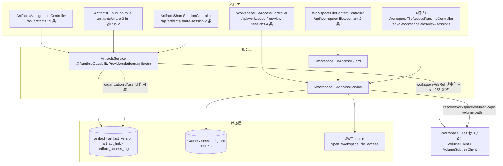

# 产物与文件访问子专家 · 架构（01）

> **范围**：`packages/server-ai/src/artifacts/**`（**10 非 spec / 2 spec / 4 张自建表**）＋ `packages/server-ai/src/workspace-file-access/**`（**8 非 spec / 2 spec / 0 表**）。基线 `2026-10-16 · commit 80f5676fd`（父级专家批次 5 第 12）。
> **跨子域引用**：卷投递由 [① 沙箱执行子专家](file://.module-experts/后端专题/运行时·沙箱·产物专家/sub-experts/沙箱执行子专家/C0-使用总览.md) 的 `sandbox.controller.ts` 承载（本子域只消费其产物引用）；共同契约源见 [sandbox-file-output.model.ts](file://packages/contracts/src/ai/sandbox-file-output.model.ts) / [sandbox-service.model.ts](file://packages/contracts/src/ai/sandbox-service.model.ts)。
**不含**：`sandbox`（→ ① 沙箱执行子专家）· `runtime-control` / `health`（→ ② 运行时控制与健康子专家）· 文件字节与解析（→「文件理解与记忆专家」的 `storage-file` / `file-understanding`）。
> **一句话口径**：本子域负责 **产物（Artifact）的登记 / 版本 / 分享 / 审计** 与 **工作区文件的授权式读取面**；字节一律在 Workspace Files 卷，本子域只持有**可移植引用**与**访问授权**。

**本文引用的文件**（相对仓库根）

- [packages/server-ai/src/artifacts/artifacts.controller.ts](file://packages/server-ai/src/artifacts/artifacts.controller.ts)
- [packages/server-ai/src/artifacts/artifacts.service.ts](file://packages/server-ai/src/artifacts/artifacts.service.ts)
- [packages/server-ai/src/artifacts/artifacts.module.ts](file://packages/server-ai/src/artifacts/artifacts.module.ts)
- [packages/server-ai/src/artifacts/artifact-mime-policy.ts](file://packages/server-ai/src/artifacts/artifact-mime-policy.ts)
- [packages/server-ai/src/artifacts/entities/artifact.entity.ts](file://packages/server-ai/src/artifacts/entities/artifact.entity.ts)
- [packages/server-ai/src/artifacts/entities/artifact-version.entity.ts](file://packages/server-ai/src/artifacts/entities/artifact-version.entity.ts)
- [packages/server-ai/src/artifacts/entities/artifact-link.entity.ts](file://packages/server-ai/src/artifacts/entities/artifact-link.entity.ts)
- [packages/server-ai/src/artifacts/entities/artifact-access-log.entity.ts](file://packages/server-ai/src/artifacts/entities/artifact-access-log.entity.ts)
- [packages/server-ai/src/workspace-file-access/workspace-file-access.service.ts](file://packages/server-ai/src/workspace-file-access/workspace-file-access.service.ts)
- [packages/server-ai/src/workspace-file-access/workspace-file-access.controller.ts](file://packages/server-ai/src/workspace-file-access/workspace-file-access.controller.ts)
- [packages/server-ai/src/workspace-file-access/workspace-file-content.controller.ts](file://packages/server-ai/src/workspace-file-access/workspace-file-content.controller.ts)
- [packages/server-ai/src/workspace-file-access/workspace-file-content.response.ts](file://packages/server-ai/src/workspace-file-access/workspace-file-content.response.ts)
- [packages/server-ai/src/workspace-file-access/workspace-file-access.guard.ts](file://packages/server-ai/src/workspace-file-access/workspace-file-access.guard.ts)
- [packages/server-ai/src/workspace-file-access/workspace-file-access.module.ts](file://packages/server-ai/src/workspace-file-access/workspace-file-access.module.ts)
- [packages/server-ai/src/file-understanding/domain/workspace-file.ts](file://packages/server-ai/src/file-understanding/domain/workspace-file.ts)
- [packages/server-ai/src/ai/workspace-file-access-runtime.controller.ts](file://packages/server-ai/src/ai/workspace-file-access-runtime.controller.ts)
- [packages/server-ai/src/sandbox/middlewares/file-activity-storage.service.ts](file://packages/server-ai/src/sandbox/middlewares/file-activity-storage.service.ts)
- [packages/server-ai/src/shared/runtime/tool-image-artifacts.ts](file://packages/server-ai/src/shared/runtime/tool-image-artifacts.ts)
- [packages/plugin-sdk/src/lib/runtime/capabilities/artifacts.ts](file://packages/plugin-sdk/src/lib/runtime/capabilities/artifacts.ts)
- [packages/contracts/src/artifact.model.ts](file://packages/contracts/src/artifact.model.ts)
- [apps/api/src/bootstrap/index.ts](file://apps/api/src/bootstrap/index.ts)
- [packages/server-ai/src/app.module.ts](file://packages/server-ai/src/app.module.ts)

## 目录

1. [子域职责与边界](#子域职责与边界)
2. [目录结构与分层](#目录结构与分层)
3. [依赖关系](#依赖关系)
4. [端点前缀与端点分组核实](#端点前缀与端点分组核实)
5. [关键不变量](#关键不变量)
6. [架构总览](#架构总览)
7. [结论](#结论)

## 子域职责与边界

**产物（`artifacts/**`）= 沙箱 / Agent 运行输出物的登记与取用**：把「插件名 + 资源类型 + 资源 ID」的稳定业务身份登记成 `artifact` 容器，把每次内容快照登记成不可变的 `artifact_version`（字节以 `workspaceFileRef` 便携引用外置），把「怎么被打开」登记成 `artifact_link`（slug / 访问策略 / 展示策略），把每次打开与生命周期动作写成 `artifact_access_log`。

**工作区文件访问（`workspace-file-access/**`）= 授权的读取面**：`view-sessions`（会话）→ `grants`（短时授权）→ `content`（字节流）三段式；**客户端不能传路径**，路径由服务端从 grant 的便携引用解析（`resolveAuthorizedFile` → `resolveWorkspaceVolumeScope` → `volumeClient.resolve(...).path(...)`）。

与「文件理解与记忆专家」的边界（本子域统一口径）：

| 能力 | 归属 |
|---|---|
| 字节本体、卷布局、文件上传 / 解析 / `file_asset` / `file_chunk` | **文件理解与记忆专家**（`storage-file` / `file-understanding`） |
| 产物的登记、版本、分享链接、访问审计（4 张表） | **本子域** |
| 工作区文件访问的**授权与投递语义**（会话 / grant / 越界防护 / Range 流式） | **本子域**（字节仍取自对方拥有的卷） |
| 沙箱执行、Runner、卷映射与配额 | ① 沙箱执行子专家 |
| 会话与消息持久化 | 对话与会话专家（本子域只按 id 关联或透传 `conversationId`） |

口径依据：`artifact_version.workspaceFileRef` 是 json 非空列，实体注释逐字「without leaking host filesystem paths」；`resolveWorkspaceVolumeScope` 由 `../file-understanding` 导入；卷访问统一经 `../shared/volume` 的 `VolumeClient` / `VolumeSubtreeClient`。

章节来源：[artifact-version.entity.ts](file://packages/server-ai/src/artifacts/entities/artifact-version.entity.ts)（关键符号：workspaceFileRef）、[artifacts.service.ts](file://packages/server-ai/src/artifacts/artifacts.service.ts)（关键符号：readWorkspaceArtifact / VolumeSubtreeClient）、[workspace-file-access.service.ts](file://packages/server-ai/src/workspace-file-access/workspace-file-access.service.ts)（关键符号：resolveAuthorizedFile / resolveWorkspaceVolumeScope 的导入）

## 目录结构与分层

| 子目录 | 非 spec | spec | 自建表 | 形态 |
|---|---|---|---|---|
| `artifacts/` | **10** | 2 | **4** | 3 个控制器（同文件三个类）+ 1 个 1988 行服务 + MIME 策略 + 4 实体 |
| `workspace-file-access/` | **8** | 2 | **0** | 2 个控制器 + 1 个 657 行服务 + DTO + 守卫 + 响应助手 + 模块 |

分层（两个子目录同构，均为「控制器薄 / 服务厚」）：

1. **入口层**：`ArtifactsManagementController`（19 条）· `ArtifactsPublicController`（3 条 `@Public()`）· `ArtifactsShareSessionController`（2 条）；`WorkspaceFileAccessController`（4 条）· `WorkspaceFileContentController`（2 条 `@Public()` + 守卫）。
2. **服务层**：`ArtifactsService implements ArtifactsApi`（`@RuntimeCapabilityProvider(ArtifactsRuntimeCapability)`，可被插件以 `createScopedApi(defaults)` 取用）· `WorkspaceFileAccessService`（会话 / 授权 / 路径解析 / origin 校验）。
3. **持久 / 短时状态层**：4 张 TypeORM 表（`TypeOrmModule.forFeature([Artifact, ArtifactVersion, ArtifactLink, ArtifactAccessLog])`）与 Cache（`CACHE_MANAGER`）+ JWT cookie（workspace-file-access **无表**）。
4. **内容层（跨子域）**：`VolumeModule` 的 `VOLUME_CLIENT`（`artifacts` 与 `workspace-file-access` 的模块 imports 都含它）。

模块注册方式不同：`artifacts.module.ts` 无 `RouterModule`（前缀写在控制器路径上）；`workspace-file-access.module.ts` 用 `RouterModule.register([{ path: '/workspace-files', module: … }])`，两个控制器分别以空路径与 `'content'` 挂载。

章节来源：[artifacts.module.ts](file://packages/server-ai/src/artifacts/artifacts.module.ts)（关键符号：TypeOrmModule.forFeature / controllers / exports）、[workspace-file-access.module.ts](file://packages/server-ai/src/workspace-file-access/workspace-file-access.module.ts)（关键符号：RouterModule.register('/workspace-files')）、[artifacts.service.ts](file://packages/server-ai/src/artifacts/artifacts.service.ts)（关键符号：createScopedApi）

## 依赖关系

**出向依赖（本子域调用别人）**：

| 依赖 | 用途 | 依据 |
|---|---|---|
| `VolumeModule` / `VOLUME_CLIENT` | 产物取字节（`VolumeSubtreeClient.readBuffer`，`allowRootWorkspace: true`）与工作区文件路径解析（`volumeClient.resolve(...).path(filePath)`） | `artifacts.module.ts` / `workspace-file-access.module.ts` 的 imports |
| `file-understanding.resolveWorkspaceVolumeScope` | 把便携引用解析成带 catalog 的卷作用域（`projects/users/xperts/user-xperts/knowledges/skills`） | `workspace-file-access.service.ts`、`artifacts.service.ts` |
| `UserModule` / `UserOrganizationModule` | `loadAuthenticatedUser`、`findMembershipByUserAndOrganization`（`organization_all` 策略） | `artifacts.module.ts` |
| `XpertWorkspaceModule` / `XpertWorkspaceAccessService.assertCanRead` | `workspace_all` 策略（需先 `captureRequestContext` 再用登录用户身份读） | `artifacts.service.ts`（hasWorkspaceAccess） |
| `RuntimeCapabilityModule` + `@RuntimeCapabilityProvider` | 把 `platform.artifacts` 能力注册进插件运行时 | `artifacts.module.ts` / `artifacts.service.ts` |
| `CqrsModule` + `ResolveAssistantFileAccessCommand` | `assertAssistantFileAccess`（Assistant 运行时读权限） | `workspace-file-access.module.ts` / service |
| `ViewExtensionService`（server-core） | `resolveViewFileAccessContext` / `resolveViewFileResource`：把 View 业务资源解析成便携引用 | service 构造器 |
| `ConfigService` / `environment` / `process.env` | `JWT_SECRET`、`PUBLIC_BASE_URL` / `ARTIFACTS_PUBLIC_BASE_URL`、`baseUrl` | service 内 `getJwtSecret` / `resolveArtifactsPublicBaseUrl` |

**入向依赖（谁用本子域）**：`app.module.ts` 同时注册 `ArtifactsModule` 与 `WorkspaceFileAccessModule`；`ai.module.ts` 导入 `WorkspaceFileAccessModule` 并挂 `WorkspaceFileAccessRuntimeController`（`/api/ai/workspace-files/view-sessions`）与 `GroupViewFilesController`（`/api/ai/groups/:groupId/workbench/...`）；插件面经 `AgentMiddlewareRuntimeService.createScopedApi` 注入 `ArtifactsRuntimeCapability`；沙箱子域的 `FileActivityStorage.archive` 与 `ToolImageArtifacts.save` 是产物登记的两个真实写入方；Cloud 前端（`artifactShareSessionUrl`、`viewFileContentRoute`）与 Desktop（`workspace-file-download.cjs`）是消费者。

章节来源：[workspace-file-access.service.ts](file://packages/server-ai/src/workspace-file-access/workspace-file-access.service.ts)（关键符号：assertAssistantFileAccess / assertRequestOrigin）、[middleware-runtime.service.ts](file://packages/server-ai/src/shared/agent/middleware-runtime/middleware-runtime.service.ts)（关键符号：createScopedApi / ArtifactsRuntimeCapability 注册）、[ai.module.ts](file://packages/server-ai/src/ai/ai.module.ts)（关键符号：WorkspaceFileAccessRuntimeController）

## 端点前缀与端点分组核实

**全局前缀**：`app.setGlobalPrefix('api', { exclude: ['artifacts/share', 'artifacts/share/(.*)', '.well-known/oauth-protected-resource/(.*)'] })`。因此：

| 组 | 控制器 | 生效路径 | 条数 |
|---|---|---|---|
| artifacts 管理面 | `@Controller('artifacts')` | `/api/artifacts…` | **19** |
| artifacts 公开分享面 | `@Controller('artifacts/share')` | **`/artifacts/share/:slug[/download|/descriptor]`**（被 exclude 掉 `api` 前缀，前端同源路由） | **3** |
| artifacts 分享会话 | `@Controller('artifacts/share-session')` | `/api/artifacts/share-session[/:slug]` | **2** |
| workspace-file-access 管理/日志 | `@Controller()` + RouterModule `/workspace-files` | `/api/workspace-files/view-sessions…` | **4** |
| workspace-file-access 内容流 | `@Controller('content')` + RouterModule `/workspace-files` | `/api/workspace-files/content/:sessionId/:grantId/:fileName` | **2** |

合计 **24 + 6 = 30 条**，与父级记数一致。**需修正父级表述的地方**：`C1-能力契约.md §1` 与 `05-接口.md §九` 把三条公开路由写成 `/api/artifacts/share/...`，而源码把它们显式排除在 `api` 前缀之外（`/artifacts/share/...`），且服务端生成的 `publicUrl` 也会把 base URL 结尾的 `/api` 剥掉再拼 `/artifacts/share/<slug>`——以源码为准。旁证：分享 cookie 的 `path` 为 `/artifacts/share`，302 跳转目标为 `/artifacts/auth/<slug>`（前端路由）。

章节来源：[index.ts](file://apps/api/src/bootstrap/index.ts)（关键符号：setGlobalPrefix / exclude）、[artifacts.controller.ts](file://packages/server-ai/src/artifacts/artifacts.controller.ts)（关键符号：ArtifactsPublicController / ArtifactsShareSessionController / artifactShareCookieOptions）、[artifacts.service.ts](file://packages/server-ai/src/artifacts/artifacts.service.ts)（关键符号：buildPublicUrl）

## 关键不变量

① **产物登记的唯一性与幂等**：`artifact` 用 4 条**部分唯一索引**（按 `organizationId` / `userId` 是否为 NULL 切分 `tenantId+[organizationId]+[userId]+pluginName+resourceType+resourceId`）保证「同一来源在同一作用域只有一个容器」；服务层先 `findExistingArtifact` 复用，命中唯一约束错误（`23505` / `1062` / `SQLITE_CONSTRAINT`）再查一次。`artifact_version` 用 `(artifactId, idempotencyKey)` 唯一 + `(tenantId, organizationId, artifactId, versionNumber)` 唯一承担两种幂等；`ensureArtifactVersion` **强制** `idempotencyKey`，并在事务内 `pessimistic_write` 锁住 `artifact` 行（`withLockedArtifact`）后「先查后写」。

② **产物读取的授权与租户边界**：管理面所有查询走 `resolveScopedArtifact` / `resolveScopedLink`，`tenantId` / `organizationId` / `userId` 任一不匹配即 404（不泄露存在性）；公开面走 `authorizeArtifactLink` → `assertPublicAccess` → `canAccessLink`（`owner_only` / `organization_all` / `workspace_all` / `custom_principals` / `public_link` / `signed_preview` 六种模式），`revoked` / `expired` 归 410，`denied` 一律写审计。

③ **工作区文件访问的路径约束（越界防护）**：入口只接受 `(sessionId, grantId, fileName)`，**不接受路径**；`assertPortableReference` 要求 `source === 'platform.workspace.files'`、`filePath` 非空、`reference.tenantId === session.tenantId`（否则 400）；`fileName` 只做**相等匹配**（`normalizeFileName` 取 `basename` 并剥离控制字符）；路径由 `resolveWorkspaceVolumeScope` 解析（内部对相对路径做 `path.posix.normalize` 并拒绝 `.` / `..` / `../` 前缀）；认证读取路径会**重新解析资源**并比对 `filePath` 与 `volumeScope`（`isDeepStrictEqual`），旧 grant 不能跟随被改写的 fileKey。

④ **4 张表的分工**：`artifact` = 容器与稳定业务身份（唯一索引就挂在这层）· `artifact_version` = 不可变内容快照（只 insert，无 update）· `artifact_link` = 对外入口与访问/展示策略（slug 唯一、`shareKey` 部分唯一）· `artifact_access_log` = 追加型审计（`linkId` `SET NULL`，删链接不删日志）。

⑤ **产物生命周期与清理**：`artifact.status ∈ {active, archived, deleted}`（`deleteArtifact` 同时把该产物全部 link 置 `revoked`）；`artifact_link.status ∈ {active, revoked, expired}`，`expired` 在**读取时**判定并回写；本子域**没有任何 TTL 任务 / 清理任务 / 迁移 SQL**，字节回收属于卷（→ 文件理解与记忆专家）。

⑥ **与沙箱 job 的关联键**：本子域与 `sandbox_job` **既无外键也无字段级关联**；`sandbox_job.runtimeArtifactKind/Reference/Digest` 指的是**运行时镜像/文件系统产物**（与产品 `artifact` 同名不同义）。唯一可对齐的口径是 `artifact.source.{pluginName, resourceType, resourceId}`（业务资源 ID）＋ `artifact_version.workspaceFileRef.filePath`（卷内路径）；两域各自通过插件能力面暴露（`platform.artifacts` vs `platform.sandbox.jobs`）。

章节来源：[artifact.entity.ts](file://packages/server-ai/src/artifacts/entities/artifact.entity.ts)（关键符号：4 条部分唯一索引）、[artifacts.service.ts](file://packages/server-ai/src/artifacts/artifacts.service.ts)（关键符号：withLockedArtifact / isUniqueConstraintError / resolveScopedArtifact / deleteArtifactWithDefaults / buildPublicUrl）、[workspace-file-access.service.ts](file://packages/server-ai/src/workspace-file-access/workspace-file-access.service.ts)（关键符号：assertPortableReference / resolveAuthorizedFile / authorizeAuthenticatedContent / normalizeFileName）

## 架构总览

图表来源：[artifacts.controller.ts](file://packages/server-ai/src/artifacts/artifacts.controller.ts)（关键符号：三个控制器类）、[artifacts.service.ts](file://packages/server-ai/src/artifacts/artifacts.service.ts)（关键符号：ArtifactsService / readWorkspaceArtifact / recordAccessLog）、[workspace-file-access.service.ts](file://packages/server-ai/src/workspace-file-access/workspace-file-access.service.ts)（关键符号：createSession / createGrant / resolveAuthorizedFile）

## 结论

1. 本子域是「**引用 + 授权**」型子域：4 张表只装元数据、策略与审计，字节一律外置；`workspace-file-access` 甚至**0 张表**，全靠 Cache + JWT cookie。
2. 两条正交链路：**产物链**（登记 → 版本 → 链接 → 公开读取 + 审计）与**文件访问链**（会话 → 授权 → 越界防护 → 流式投递）。二者共享 `VolumeClient` 与便携引用解析，但不共享表。
3. 与父级的唯一口径差异是公开分享路由的**前缀归属**（`/artifacts/share`，非 `/api/artifacts/share`），这是 `setGlobalPrefix` 的 exclude 造成的显式例外，已在 01/02/04 中统一按源码记录。
4. 边界上最需要强调的是：**字节归「文件理解与记忆专家」，产物引用与访问授权归本子域**；与沙箱 job 只有业务身份层面的弱对齐，没有外键。

章节来源：[artifacts.module.ts](file://packages/server-ai/src/artifacts/artifacts.module.ts)（关键符号：ArtifactsModule）、[workspace-file-access.module.ts](file://packages/server-ai/src/workspace-file-access/workspace-file-access.module.ts)（关键符号：WorkspaceFileAccessModule）、[index.ts](file://apps/api/src/bootstrap/index.ts)（关键符号：setGlobalPrefix / exclude）
