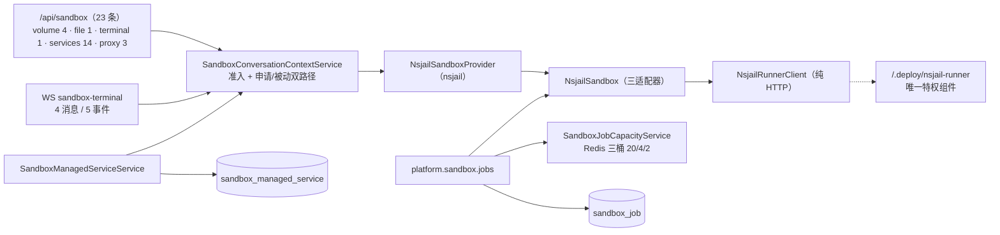

# 沙箱执行子专家 —— C0 使用总览

> **资产基线**：`2026-10-16 · commit 80f5676fd`（批次 5 第 12 专家 · 子专家①），继承父域 [C0-使用总览.md](file://.module-experts/后端专题/运行时·沙箱·产物专家/C0-使用总览.md)。**范围**：`packages/server-ai/src/sandbox/**`（**74 非 spec / 34 spec / 自建 2 表**）＝ 控制器 / WS 网关 / 守卫 / nsjail provider 与 runner 客户端 / `sandbox-job/**` / 托管服务与预览 / `commands/**` / `middlewares/**`。HTTP 前缀 `/api/sandbox`（**23 条**），WS 命名空间 `sandbox-terminal`（**4 客户端消息 / 5 服务端事件**）。执行后端 NsJail，真实 runner 与 Dockerfile 在 **`/.deploy/nsjail-runner/`**。`runtime-control`/`health` 归 [子专家②](file://.module-experts/后端专题/运行时·沙箱·产物专家/sub-experts/运行时控制与健康子专家/C0-使用总览.md)，`artifacts`/`workspace-file-access` 归 [子专家③](file://.module-experts/后端专题/运行时·沙箱·产物专家/sub-experts/产物与文件访问子专家/C0-使用总览.md)。未证实处标 `[推测]`。

**本文引用的文件**（相对仓库根，链接均为 `file://`）

- [packages/server-ai/src/sandbox/sandbox.controller.ts](file://packages/server-ai/src/sandbox/sandbox.controller.ts)
- [packages/server-ai/src/sandbox/sandbox.module.ts](file://packages/server-ai/src/sandbox/sandbox.module.ts)
- [packages/server-ai/src/sandbox/sandbox.service.ts](file://packages/server-ai/src/sandbox/sandbox.service.ts)
- [packages/server-ai/src/sandbox/sandbox-conversation-context.service.ts](file://packages/server-ai/src/sandbox/sandbox-conversation-context.service.ts)
- [packages/server-ai/src/sandbox/sandbox-terminal.gateway.ts](file://packages/server-ai/src/sandbox/sandbox-terminal.gateway.ts)
- [packages/server-ai/src/sandbox/sandbox-terminal-auth.guard.ts](file://packages/server-ai/src/sandbox/sandbox-terminal-auth.guard.ts)
- [packages/server-ai/src/sandbox/sandbox-preview-auth.guard.ts](file://packages/server-ai/src/sandbox/sandbox-preview-auth.guard.ts)
- [packages/server-ai/src/sandbox/sandbox-preview-session.service.ts](file://packages/server-ai/src/sandbox/sandbox-preview-session.service.ts)
- [packages/server-ai/src/sandbox/sandbox-managed-service.service.ts](file://packages/server-ai/src/sandbox/sandbox-managed-service.service.ts)
- [packages/server-ai/src/sandbox/sandbox-managed-service.entity.ts](file://packages/server-ai/src/sandbox/sandbox-managed-service.entity.ts)
- [packages/server-ai/src/sandbox/nsjail/nsjail-sandbox.provider.ts](file://packages/server-ai/src/sandbox/nsjail/nsjail-sandbox.provider.ts)
- [packages/server-ai/src/sandbox/nsjail/nsjail-sandbox.ts](file://packages/server-ai/src/sandbox/nsjail/nsjail-sandbox.ts)
- [packages/server-ai/src/sandbox/nsjail/nsjail-runner.client.ts](file://packages/server-ai/src/sandbox/nsjail/nsjail-runner.client.ts)
- [packages/server-ai/src/sandbox/sandbox-job/sandbox-job-runtime-capability.service.ts](file://packages/server-ai/src/sandbox/sandbox-job/sandbox-job-runtime-capability.service.ts)
- [packages/server-ai/src/sandbox/sandbox-job/sandbox-job-capacity.service.ts](file://packages/server-ai/src/sandbox/sandbox-job/sandbox-job-capacity.service.ts)
- [packages/contracts/src/ai/sandbox-terminal.model.ts](file://packages/contracts/src/ai/sandbox-terminal.model.ts)
- [packages/plugin-sdk/src/lib/runtime/capabilities/sandbox-jobs.ts](file://packages/plugin-sdk/src/lib/runtime/capabilities/sandbox-jobs.ts)
- [.deploy/nsjail-runner/README.md](file://.deploy/nsjail-runner/README.md)

## 目录

1. [定位](#定位)
2. [何时找这个子专家](#何时找这个子专家)
3. [能力清单表](#能力清单表)
4. [边界](#边界)
5. [已知问题与常见坑](#已知问题与常见坑)
6. [延伸阅读](#延伸阅读)

## 定位

本子专家负责 **「不可信代码在哪里跑、怎么跑、跑完留下什么证据」**，共六块能力：① **会话级沙箱上下文**——`SandboxConversationContextService` 的 `authorizeConversation`（只准入）/`resolveConversationSandbox`（**真正申请后端**）/`findExistingSandbox`（被动发现且**不复活**已停运行时）三元分工；② **执行后端**——`NsjailSandboxProvider`（策略 key `nsjail`）+ `NsjailSandbox`（`ManagedService`/`ServiceProxy`/`Terminal` 三适配器）+ `NsjailRunnerClient`（纯 HTTP）；③ **PTY 终端**——WS 网关 `sandbox-terminal` 的 4 消息/5 事件与逐消息重鉴权；④ **托管服务与预览**——`sandbox_managed_service` 台账 + 3 条 `@Public()` proxy + 签名 cookie；⑤ **卷投递**——4 条 `GET volume/*`（3 私有 + 1 匿名通配）与 `POST file` 上传；⑥ **插件面沙箱作业**（能力键 `platform.sandbox.jobs`）——幂等、三桶租约、输入物化、输出校验、运行时证据与孤儿清理。

**一句话口径**：`resolveConversationSandbox` 是**唯一准入入口**（卷路由、上传、SSE 终端、托管服务 14 条、3 条 proxy、WS `open` 全部先经它），隔离边界**只有 Runner 一处**，两条执行形态分别是**会话/交互形态**（状态在 `sandbox_managed_service` 与进程内 Map）与**作业形态**（证据在 `sandbox_job`）。

章节来源：[sandbox-conversation-context.service.ts](file://packages/server-ai/src/sandbox/sandbox-conversation-context.service.ts)（关键符号：authorizeConversation / resolveConversationSandbox / findExistingSandbox）、[nsjail-sandbox.ts](file://packages/server-ai/src/sandbox/nsjail/nsjail-sandbox.ts)（关键符号：withRuntimeRecovery / NsjailTerminalSession.poll）、[sandbox.controller.ts](file://packages/server-ai/src/sandbox/sandbox.controller.ts)（关键符号：terminal / proxyManagedService）

## 何时找这个子专家

- 要**改执行与配额**：卷↔`/workspace` 映射与越界拒绝、`protectProjectContent`、`/workspace/.apps` 只读掩码、三桶租约限值（`SANDBOX_JOB_GLOBAL_LIMIT` 20 / `TENANT_LIMIT` 4 / `USER_LIMIT` 2）、作业执行侧 `Math.min(input.timeoutMs, definition.hardDeadlineMs)`（注册表只声明 `hardDeadlineMs`） 校验、Runner 侧 `MAX_*` 准入变量。
- 要**改 WS 终端**：`SandboxTerminalGateway` 的 4 类客户端消息与 5 类服务端事件、逐消息 `SandboxTerminalAuthGuard`、同 `requestId` 重复 `open` 的取消语义、`handleDisconnect` 清理、`NsjailTerminalSession.poll` 的 100ms→5000ms 指数退避。
- 要**改预览 proxy 的 3 条路由**：`@All('.../proxy')`、`@All('.../proxy/')`（两条固定 pathname 为 `/`）与 `@All('.../proxy/*path')`，三者汇聚到同一个私有 `proxyManagedService`；改动会同时影响 `SandboxPreviewAuthGuard` 的票面比对与双层头清洗。
- 要**改 volume 通配**：`GET /api/sandbox/volume/*path` 的匿名读面、`isProtectedVolumeSubpath` 黑名单（`project/*`、`user/*/xpert/*`、`xpert/*/user/*`、`runtime-jobs/*`）、`assertPublicWorkspacePath` 与 `openFileSnapshot` 后的 `rejectProtectedPaths` 复检。
- 要**改 job 与容量**：`run()` 的「动作校验 → 幂等 → 清理前置 → 绑定选择 → 物化 → `waitForCapacity` → 执行 → `finally release`」稳定顺序、`sandbox_job` 唯一索引 `(tenantId, idempotencyKey)`、`cleanupOrphans` 两批扫描、`requirePreviousAttemptCleanup` 的阻断语义。
- 要**改 managed service**：`(conversationId, name)` 唯一、`onModuleInit` 把 `running|starting` 置 `lost`、列表类方法经 `findExistingSandbox`（**绝不创建沙箱**）、`previewUrl` 仅在 `running` + `transportMode==='http'` 时派生。
- 要**改会话级准入**：`authorizeConversation` 的六项条件（会话存在 / 租户匹配 / 助手 `features.sandbox.enabled` / `provider` 非空 / 项目 `assertCanUseXpert` / 非项目会话归属）与 `resolveSandboxWorkFor` 的「环境优先 → 项目 → 用户」派生。
- 要**排查沙箱起不来**：`NSJAIL_RUNNER_URL`/`NSJAIL_RUNNER_TOKEN` 缺失（`NsJailRunnerNotConfigured`）、Runner `/health` 5 秒缓存回落 `available:false`、协议 2（项目只读）/协议 3（应用数据保护）门槛、`runtimeId` 派生改变。
- 要**排查终端连不上**：握手 token 前缀（`cs-x-` 走 client-secret）、`assertWorkbenchPrincipal` 失败、`open` 缺 `conversationId`、pending open 已被 `canceled`、`closed` 事件携带的 6 种 `reason`。
- 要**排查预览 403**：cookie `xpert_sandbox_preview` 的 `path` 必须精确等于 `/api/sandbox/conversations/<cid>/services/<sid>/proxy`、代理链未透传 `x-forwarded-proto` 导致 `secure` cookie 丢失、票面 `conversationId`/`serviceId` 与路径不一致、`JWT_SECRET` 缺失直接 500。

章节来源：[sandbox-terminal.gateway.ts](file://packages/server-ai/src/sandbox/sandbox-terminal.gateway.ts)（关键符号：open / input / resize / close / handleDisconnect）、[sandbox-job-runtime-capability.service.ts](file://packages/server-ai/src/sandbox/sandbox-job/sandbox-job-runtime-capability.service.ts)（关键符号：run / waitForCapacity / cleanupOrphans）、[sandbox.controller.ts](file://packages/server-ai/src/sandbox/sandbox.controller.ts)（关键符号：getVolumeFile / serveVolumeFile / isProtectedVolumeSubpath / proxyManagedService）

## 能力清单表

| 能力 | 入口 | 一句话 |
|---|---|---|
| 会话级准入与沙箱上下文 | `SandboxConversationContextService.authorizeConversation` / `resolveConversationSandbox` / `findExistingSandbox` | 申请语义与被动语义严格分离；后者永不创建、永不复活 |
| 执行后端建运行时 | `NsjailSandboxProvider.create`（`SandboxAcquireBackendCommand`） | 配置 → Runner `/health` → 协议 2/3 → `runtimeId = sha256(...)[0:32]` → `POST /v1/runtimes` |
| 命令执行（流式/非流式） | `NsjailSandbox.execute` / `streamExecute`、`POST /api/sandbox/terminal`（`@Post` + `@Sse()`） | 都包在 `withRuntimeRecovery` 内；非 0 退出码走 SSE error 通道而非 HTTP 码 |
| Runner HTTP 客户端 | `NsjailRunnerClient.getHealth/createRuntime/destroyRuntime/execute/streamExecute` | 超时对齐为 `timeoutMs + 10s` 宽限；错误三分：runtime-not-found / 永久 / 可重试 |
| WS 终端 | namespace `sandbox-terminal`（4 消息 / 5 事件） | 每条消息重鉴权；`open` 另查会话；同 `requestId` 重复 open 先取消旧请求 |
| 会话/线程托管服务 | `/conversations/:cid/services*`、`/threads/:tid/services*`（各 7 条） | 台账 `sandbox_managed_service`；状态 `starting\|running\|stopping\|stopped\|failed\|lost` |
| 预览 proxy | 3 条 `@Public()` + `SandboxPreviewAuthGuard` | cookie JWT（`aud='sandbox-preview'`、路径受限、TTL 1 小时）；**不代理 WS 升级** |
| 卷文件投递 | 4 条 `GET /api/sandbox/volume/*` | 3 条私有（项目/用户隔离）＋ 1 条匿名通配（仅路径护栏） |
| 文件上传进沙箱 | `POST /api/sandbox/file` | multipart 字段 `file` → `UploadFileCommand`（`mounted_workspace`）；受治理路径 403 |
| 沙箱作业（插件面） | `SandboxJobsApi`：`run/cancel/getJob/getActionHealth` | 幂等键 + 容量租约 + 输入物化 + 输出校验 + 孤儿清理；插件只选动作与版本 |
| 容量配额 | `SandboxJobCapacityService.acquire` / `release`（Redis Lua 三桶） | 默认 20/4/2；任一满即 `SANDBOX_CAPACITY_UNAVAILABLE`（retryable） |
| 运行时定义与绑定 | `SandboxRuntimeDefinitionRegistry`（7 个 JSON 定义）、`SandboxRuntimeBindingSelector.require` | 加载期强制 `timeoutMs ≤ hardDeadlineMs`、`security` 硬化四件套、`networkPolicy.mode ∈ none\|internal-only` |
| 运行时健康心跳 | `SandboxRuntimeHealthService.refreshAll` | 15 秒探测、Redis hash TTL 90 秒（失败态只缓存 5 秒）、`onModuleDestroy` 注销 executorId |
| provider 可见性聚合 | `SandboxService` | 可用性由 `NSJAIL_RUNNER_URL`/`NSJAIL_RUNNER_TOKEN` 决定；`@Cron cleanCron` 是空壳 |

章节来源：[sandbox-job-capacity.service.ts](file://packages/server-ai/src/sandbox/sandbox-job/sandbox-job-capacity.service.ts)（关键符号：ACQUIRE_SCRIPT / acquire / release）、[sandbox-runtime-definition.registry.ts](file://packages/server-ai/src/sandbox/sandbox-job/sandbox-runtime-definition.registry.ts)（关键符号：parseDefinition）、[sandbox.service.ts](file://packages/server-ai/src/sandbox/sandbox.service.ts)（关键符号：cleanCron）、[sandbox-jobs.ts](file://packages/plugin-sdk/src/lib/runtime/capabilities/sandbox-jobs.ts)（关键符号：SandboxJobStatus / SANDBOX_JOB_PROGRESS_PREFIX）

## 边界

**做什么**：会话级隔离执行、NsJail 运行时创建与命令执行、PTY 终端、托管服务与 HTTP/SSE 预览代理、卷投递与上传、插件面沙箱作业与容量配额。

**不做什么**

- **不含 ② 运行时控制与健康**：API 进程副本自身的自信号重启、排空 503、插件收敛门禁与 `/api/health*` 探针归 [子专家②](file://.module-experts/后端专题/运行时·沙箱·产物专家/sub-experts/运行时控制与健康子专家/C0-使用总览.md)；本子域与它共享同一套全局 `AuthGuard`+`PluginScopeGuard` 语义，但不接触副本注册表。
- **不含 ③ 产物与文件访问**：`artifact*` 四表与 `workspace-file-access` 的会话/grant 授权归 [子专家③](file://.module-experts/后端专题/运行时·沙箱·产物专家/sub-experts/产物与文件访问子专家/C0-使用总览.md)；本子域与它只有三处接触——`sandbox_job.runtimeArtifactKind|Reference|Digest` 纯字符串契约、`shared/volume` 卷抽象、`@xpert-ai/contracts` 的 `sandbox-*.model.ts`。
- **文件字节与卷布局归「文件理解与记忆专家」**：本子域不拥有字节，只做路径归一、越界拒绝与投递；`NsjailSandboxProvider` 只把 `volume.hostRoot` 映射进 `/workspace`。
- **Agent 执行账本归「Agent 执行链专家」**：本子域唯一挂接点是 `sandbox_managed_service.ownerExecutionId`/`ownerAgentKey` 字符串弱引用（无外键）。
- **会话与消息归「对话与会话专家」**：`ChatConversation`/`ChatConversationThread` 出现在 `forFeature` 里是**外部实体**（为外键解析与线程查询），表数口径**以自建 2 张为准**。
- **插件 DDL 与 schema-sync 不在本子域**：`sandbox/**` 内**无 `migrations/*.sql`**。

图表来源：[sandbox.module.ts](file://packages/server-ai/src/sandbox/sandbox.module.ts)（关键符号：controllers / providers / LOCAL_BROWSER_RUNTIME_PROVIDERS）、[sandbox.controller.ts](file://packages/server-ai/src/sandbox/sandbox.controller.ts)（关键符号：getVolumeFile / terminal / proxyManagedServicePath）、[.deploy/nsjail-runner/README.md](file://.deploy/nsjail-runner/README.md)（关键符号：Runner 与 API 的职责划分）

章节来源：[sandbox.module.ts](file://packages/server-ai/src/sandbox/sandbox.module.ts)（关键符号：TypeOrmModule.forFeature）、[sandbox-managed-service.entity.ts](file://packages/server-ai/src/sandbox/sandbox-managed-service.entity.ts)（关键符号：ownerExecutionId / conversationId CASCADE）、[sandbox-controller 的共享面见 implementation/01-架构.md](file://.module-experts/后端专题/运行时·沙箱·产物专家/sub-experts/沙箱执行子专家/implementation/01-架构.md)

## 已知问题与常见坑

1. **`@Public()` 面只有两类，且只有一类「不补身份」**：3 条 proxy 是 `@Public()` + `SandboxPreviewAuthGuard`（票面 `conversationId`/`serviceId` 必须等于路径参数）；`GET volume/*path` 是 `@Public()` + **纯路径护栏**。`@Public()` 只等于「跳过全局 JWT」，不等于放行。
   - 契约来源：[sandbox.controller.ts](file://packages/server-ai/src/sandbox/sandbox.controller.ts)（关键符号：getVolumeFile / proxyManagedServiceRoot / proxyManagedServicePath）。
2. **volume 通配是本子域最大匿名读面**：`tenant` 可来自 query，无审计、无速率限制、租户参数只用于定位卷根；护栏只有路径层（`normalizeSandboxVolumeRequestSubpath` → 两次 `isProtectedVolumeSubpath` → `assertPublicWorkspacePath` → `openFileSnapshot` 后按真实卷内相对路径 `rejectProtectedPaths` 复检）。安全性完全依赖「公共前缀不含敏感数据」这一部署假设。
   - 契约来源：[sandbox.controller.ts](file://packages/server-ai/src/sandbox/sandbox.controller.ts)（关键符号：serveVolumeFile / isProtectedVolumeSubpath）。
3. **NsJail 依赖宿主内核能力且不可降级**：cgroup v2 是硬要求（overlay 以 `rw` 挂 `/sys/fs/cgroup` 并 `cgroup: host`），不可写则 Runner **fail fast**；`XPERT_NSJAIL_USE_CGROUP_V2=false` 只跑 rlimit 兼容，仅用于探针/开发，Docker Desktop 结果不构成 native Linux 证据。
   - 契约来源：[.deploy/nsjail-runner/README.md](file://.deploy/nsjail-runner/README.md)（关键符号：cgroup v2 / fail fast / Security and Linux validation）。
4. **runner 的真实位置是 `/.deploy/nsjail-runner/`**：`packages/nsjail-runner` **只有发布元数据**（`private: true`，`description: "Release metadata for the Xpert NsJail runner Docker image"`）；改 runner 行为要改 `.deploy` 侧，API 只经 HTTP 与两个环境变量接触它。
   - 契约来源：[packages/nsjail-runner/package.json](file://packages/nsjail-runner/package.json)、[.deploy/nsjail-runner/README.md](file://.deploy/nsjail-runner/README.md)。
5. **WS 握手鉴权与超时语义不对等**：token 取自 `handshake.auth.token`，`cs-x-` 前缀走 `ClientSecretSocketGuard`，否则 `WsJWTGuard`（两条路径都要求 `assertWorkbenchPrincipal`）；`open` 另要求非空 `conversationId` 且会话可读。网关**没有空闲超时**，会话表在**进程内存、不跨副本**；握手失败是 `WsException({status:403})`，业务失败只用 `error`/`closed` 事件——**不要用 HTTP 状态码断言**。
   - 契约来源：[sandbox-terminal-auth.guard.ts](file://packages/server-ai/src/sandbox/sandbox-terminal-auth.guard.ts)（关键符号：canActivate）、[sandbox-terminal.gateway.ts](file://packages/server-ai/src/sandbox/sandbox-terminal.gateway.ts)（关键符号：handleDisconnect / registerPendingOpen）。
6. **配额是三层并联，缺一层就漏**：① API 作业层 `SandboxJobCapacityService` 的 Redis ZSET **三桶租约**（20/4/2，租约 `id = <jobId>:<Date.now()>`，`release` 必须 `finally`）；② 注册表层把 `timeoutMs ≤ hardDeadlineMs` 变成**加载期校验**；③ Runner 层准入与 TTL（`MAX_RUNTIMES=100`、`MAX_EXECUTIONS_PER_RUNTIME=4`、`MAX_TERMINALS_PER_RUNTIME=8`、`MAX_SERVICES_PER_RUNTIME=16`、`MAX_PROXIES_PER_RUNTIME=16`、空闲 2 小时、24 小时硬租约、reaper 60 秒）。**任一层超限都不表现为 HTTP 码**。
   - 契约来源：[sandbox-job-capacity.service.ts](file://packages/server-ai/src/sandbox/sandbox-job/sandbox-job-capacity.service.ts)（关键符号：ACQUIRE_SCRIPT）、[sandbox-runtime-definition.registry.ts](file://packages/server-ai/src/sandbox/sandbox-job/sandbox-runtime-definition.registry.ts)（关键符号：requireManifestValue）、[.deploy/nsjail-runner/README.md](file://.deploy/nsjail-runner/README.md)（关键符号：Global and per-runtime admission）。
7. **清理是两套机制且 `cleanupPending` 不自愈**：API 侧 `cleanupOrphans`（`onModuleInit` 先跑一次、此后每 60 秒扫「活跃态且 `hardDeadlineAt < now`」与「`cleanupPending` 且终态」两批，定时器 `unref()`），`destroySandbox` 失败会保持 `cleanupPending` 并**拦住后续尝试**（`requirePreviousAttemptCleanup`）；`SandboxService.cleanCron` 是**空壳**（只打日志，表达式与文案互相矛盾）；API 挂掉期间只能靠 Runner 侧 TTL 收敛。
   - 契约来源：[sandbox-job-runtime-capability.service.ts](file://packages/server-ai/src/sandbox/sandbox-job/sandbox-job-runtime-capability.service.ts)（关键符号：cleanupOrphans / destroySandbox / requirePreviousAttemptCleanup）、[sandbox.service.ts](file://packages/server-ai/src/sandbox/sandbox.service.ts)（关键符号：cleanCron）。
8. **job 幂等以数据库唯一索引兜底，附着等待是忙等**：唯一约束 `(tenantId, idempotencyKey)`；命中 `succeeded` 直接复用，命中 `waiting/starting/running` 走 `waitForAttachedJob`（500ms 轮询，`waiting` 时重置 deadline），终态失败按 `errorCode` 判可重试；`prepareAttempt` 并发插入冲突时回查幂等键并转为附着。`waitForCapacity` 在桶满时每 30 秒心跳续期 120 秒，**请求在拿到 lease 前会长时间挂住**。
   - 契约来源：[sandbox-job-runtime-capability.service.ts](file://packages/server-ai/src/sandbox/sandbox-job/sandbox-job-runtime-capability.service.ts)（关键符号：findIdempotent / prepareAttempt / waitForAttachedJob / waitForCapacity）。
9. **managed service 的状态是「进程即真相」而非「库即真相」**：`onModuleInit` 把库里残留的 `running`/`starting` **全量置 `lost`**；列表/查询类方法一律经 `findExistingSandbox`（绝不创建沙箱），解析不到时把活跃态降级为 `lost` 且 `previewUrl = null`；`proxyByConversationId` **每次请求**都 `resolveConversationSandbox`（会真正申请后端），转发前原地替换 `request.headers`/`headersDistinct`/`rawHeaders`、劫持 `response.setHeader` 丢弃 `set-cookie`，`finally` 还原；**线程面无 proxy**。
   - 契约来源：[sandbox-managed-service.service.ts](file://packages/server-ai/src/sandbox/sandbox-managed-service.service.ts)（关键符号：startByConversationId / onModuleInit / proxyByConversationId / buildPreviewUrl）。
10. **外部实体出现在本子域 `forFeature` 里，但不属本子域所有**：`sandbox.module.ts` 注册 `ChatConversation`/`ChatConversationThread` 是为解析 `sandbox_managed_service` 的外键与线程查询；改动它们会牵动「对话与会话专家」。表数口径**以自建 2 张为准**（`sandbox_managed_service`、`sandbox_job`），索引记 9 张是含外部实体的口径。
    - 契约来源：[sandbox.module.ts](file://packages/server-ai/src/sandbox/sandbox.module.ts)（关键符号：TypeOrmModule.forFeature / forFeature 项）、[sandbox-job.entity.ts](file://packages/server-ai/src/sandbox/sandbox-job/sandbox-job.entity.ts)（关键符号：containerRef 已废弃）。

章节来源：[sandbox.controller.ts](file://packages/server-ai/src/sandbox/sandbox.controller.ts)（关键符号：SandboxController.getVolumeFile）、[nsjail-sandbox.ts](file://packages/server-ai/src/sandbox/nsjail/nsjail-sandbox.ts)（关键符号：withRuntimeRecovery / recreateRuntime）、[sandbox-preview-session.service.ts](file://packages/server-ai/src/sandbox/sandbox-preview-session.service.ts)（关键符号：createSession / buildCookiePath）

## 延伸阅读

- 逐端点明细、鉴权矩阵与错误语义全集：父域 [implementation/05-接口.md](file://.module-experts/后端专题/运行时·沙箱·产物专家/implementation/05-接口.md)
- 沙箱执行/终端/预览/volume 通配端到端数据流：[implementation/03-数据流转.md](file://.module-experts/后端专题/运行时·沙箱·产物专家/implementation/03-数据流转.md)
- 4 处跨子域共享文件（`sandbox.controller.ts`/`sandbox.service.ts`/`sandbox-job-runtime-capability.service.ts`/`sandbox-*.model.ts`）：本子专家 [implementation/01-架构.md](file://.module-experts/后端专题/运行时·沙箱·产物专家/sub-experts/沙箱执行子专家/implementation/01-架构.md) §2
- 实现细节（执行请求链 / Runner 协议 / 清理与泄漏防护 / 技术债）：本子专家 [implementation/02-实现.md](file://.module-experts/后端专题/运行时·沙箱·产物专家/sub-experts/沙箱执行子专家/implementation/02-实现.md)
- 本子专家端点分组、服务契约与隔离配额契约：[C1-能力契约.md](file://.module-experts/后端专题/运行时·沙箱·产物专家/sub-experts/沙箱执行子专家/C1-能力契约.md)

章节来源：[sandbox.module.ts](file://packages/server-ai/src/sandbox/sandbox.module.ts)（关键符号：SandboxModule）、[sandbox-job-runtime-capability.service.ts](file://packages/server-ai/src/sandbox/sandbox-job/sandbox-job-runtime-capability.service.ts)（关键符号：SandboxJobRuntimeCapabilityService）、[.deploy/nsjail-runner/README.md](file://.deploy/nsjail-runner/README.md)（关键符号：运维与升级顺序）
