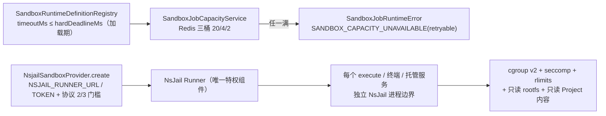

# 沙箱执行子专家 —— C1 能力契约

> 契约层 CR2 / CR5 / CR7。只写「对外可依赖的语义」：入口、参数行为、返回、异常与约束；路径均为仓库根相对 `file://` 引用。
> **资产基线**：`2026-10-16 · commit 80f5676fd`（批次 5 第 12 专家 · 子专家①），继承父域 [C1-能力契约.md](file://.module-experts/后端专题/运行时·沙箱·产物专家/C1-能力契约.md)。**逐端点明细**（完整字段、错误码全集）见父域 [implementation/05-接口.md](file://.module-experts/后端专题/运行时·沙箱·产物专家/implementation/05-接口.md)，本文不复制。②③ 子域见 [子专家② C1](file://.module-experts/后端专题/运行时·沙箱·产物专家/sub-experts/运行时控制与健康子专家/C1-能力契约.md) 与 [子专家③ C1](file://.module-experts/后端专题/运行时·沙箱·产物专家/sub-experts/产物与文件访问子专家/C1-能力契约.md)。

**本文引用的文件**（相对仓库根，链接均为 `file://`）

- [packages/server-ai/src/sandbox/sandbox.controller.ts](file://packages/server-ai/src/sandbox/sandbox.controller.ts)
- [packages/server-ai/src/sandbox/sandbox.module.ts](file://packages/server-ai/src/sandbox/sandbox.module.ts)
- [packages/server-ai/src/sandbox/sandbox.service.ts](file://packages/server-ai/src/sandbox/sandbox.service.ts)
- [packages/server-ai/src/sandbox/sandbox-conversation-context.service.ts](file://packages/server-ai/src/sandbox/sandbox-conversation-context.service.ts)
- [packages/server-ai/src/sandbox/sandbox-terminal.gateway.ts](file://packages/server-ai/src/sandbox/sandbox-terminal.gateway.ts)
- [packages/server-ai/src/sandbox/sandbox-terminal-auth.guard.ts](file://packages/server-ai/src/sandbox/sandbox-terminal-auth.guard.ts)
- [packages/server-ai/src/sandbox/sandbox-preview-auth.guard.ts](file://packages/server-ai/src/sandbox/sandbox-preview-auth.guard.ts)
- [packages/server-ai/src/sandbox/sandbox-preview-session.service.ts](file://packages/server-ai/src/sandbox/sandbox-preview-session.service.ts)
- [packages/server-ai/src/sandbox/sandbox-managed-service.service.ts](file://packages/server-ai/src/sandbox/sandbox-managed-service.service.ts)
- [packages/server-ai/src/sandbox/sandbox-managed-service.error.ts](file://packages/server-ai/src/sandbox/sandbox-managed-service.error.ts)
- [packages/server-ai/src/sandbox/nsjail/nsjail-sandbox.provider.ts](file://packages/server-ai/src/sandbox/nsjail/nsjail-sandbox.provider.ts)
- [packages/server-ai/src/sandbox/nsjail/nsjail-sandbox.ts](file://packages/server-ai/src/sandbox/nsjail/nsjail-sandbox.ts)
- [packages/server-ai/src/sandbox/nsjail/nsjail-runner.client.ts](file://packages/server-ai/src/sandbox/nsjail/nsjail-runner.client.ts)
- [packages/server-ai/src/sandbox/sandbox-job/sandbox-job-runtime-capability.service.ts](file://packages/server-ai/src/sandbox/sandbox-job/sandbox-job-runtime-capability.service.ts)
- [packages/server-ai/src/sandbox/sandbox-job/sandbox-job-capacity.service.ts](file://packages/server-ai/src/sandbox/sandbox-job/sandbox-job-capacity.service.ts)
- [packages/server-ai/src/sandbox/sandbox-job/sandbox-runtime-binding-selector.service.ts](file://packages/server-ai/src/sandbox/sandbox-job/sandbox-runtime-binding-selector.service.ts)
- [packages/server-ai/src/sandbox/sandbox-job/sandbox-runtime-health.service.ts](file://packages/server-ai/src/sandbox/sandbox-job/sandbox-runtime-health.service.ts)
- [packages/server-ai/src/sandbox/middlewares/sandbox-shell.middleware.ts](file://packages/server-ai/src/sandbox/middlewares/sandbox-shell.middleware.ts)
- [packages/contracts/src/ai/sandbox-terminal.model.ts](file://packages/contracts/src/ai/sandbox-terminal.model.ts)
- [packages/plugin-sdk/src/lib/runtime/capabilities/sandbox-jobs.ts](file://packages/plugin-sdk/src/lib/runtime/capabilities/sandbox-jobs.ts)
- [.deploy/nsjail-runner/README.md](file://.deploy/nsjail-runner/README.md)

## 目录

1. [§1 HTTP 与 WS 入口索引](#§1-http-与-ws-入口索引)
2. [§2 服务契约](#§2-服务契约)
3. [§3 隔离与配额契约](#§3-隔离与配额契约)
4. [§4 示例](#§4-示例)
5. [§5 契约来源](#§5-契约来源)

## §1 HTTP 与 WS 入口索引

全局前缀 `api`；`SandboxModule` 走 `RouterModule.register({ path: '/sandbox' })`，控制器自身 `@Controller()` 空前缀。**23 条 HTTP**＝卷投递 4 + 上传 1 + SSE 终端 1 + 托管服务 14 + proxy 3。

| # | 方法 / 路径 | 鉴权 | 用途 |
|---|---|---|---|
| 1 | GET `/api/sandbox/volume/project/:projectId/*path` | 非 `@Public()`：全局 `AuthGuard` ＋ `XpertProjectAccessService.assertCanRead` | 项目卷只读投递；`tenant` query 必须等于项目持久化 tenant |
| 2 | GET `/api/sandbox/volume/user/:userId/xpert/:xpertId/*path` | 非 `@Public()`；当前用户必须等于 `:userId` | 用户隔离 Xpert 卷 |
| 3 | GET `/api/sandbox/volume/xpert/:xpertId/user/:userId/*path` | 非 `@Public()` | 旧版用户隔离布局兼容路由 |
| 4 | GET `/api/sandbox/volume/*path` | **`@Public()`**（匿名通配，仅路径黑名单护栏） | 共享卷投递：预览静态资源、运行时作业产物 |
| 5 | POST `/api/sandbox/file` | 非 `@Public()`：全局 `AuthGuard` | multipart（字段 `file`）＋ `workspace`/`conversationId`/`path` → `UploadFileCommand`（`mounted_workspace`） |
| 6 | POST `/api/sandbox/terminal` | 非 `@Public()`；`@Post` ＋ `@Sse()` | 流式执行命令；非 0 退出码走流内 error 通道 |
| 7–13 | GET/POST `/api/sandbox/conversations/:conversationId/services[/:serviceId\|/start\|/:serviceId/logs\|/:serviceId/stop\|/:serviceId/restart\|/:serviceId/preview-session]` | 非 `@Public()`（服务层解析沙箱上下文） | 会话面托管服务 7 条：列表 / 详情 / 启动 / 日志 / 停止 / 重启 / 签发预览会话 |
| 14–20 | GET/POST `/api/sandbox/threads/:threadId/services…`（与 7–13 同构 7 条） | 同上一行 | 线程面托管服务；服务端把 `threadId` 解析为会话后落同表；**线程面无 proxy** |
| 21 | ALL `/api/sandbox/conversations/:conversationId/services/:serviceId/proxy` | **`@Public()` ＋ `SandboxPreviewAuthGuard`**（pathname 固定 `/`） | 预览代理根路径 |
| 22 | ALL `…/services/:serviceId/proxy/` | 同上（pathname 固定 `/`） | 预览代理带尾斜杠 |
| 23 | ALL `…/services/:serviceId/proxy/*path` | 同上（pathname = `/${paths.join('/')}`） | 预览代理通配；三条汇聚到同一私有 `proxyManagedService` |

**WS 终端（namespace `sandbox-terminal`，非 HTTP）**——每个 handler 均挂 `@UseGuards(SandboxTerminalAuthGuard)`：

| 消息 | 载荷要点 | 鉴权 / 语义 |
|---|---|---|
| `open` | `conversationId`（必填）＋ 可选 `projectId`、`requestId`、`cols`/`rows` | `handshake.auth.token`（`cs-x-` 前缀走 client-secret，否则 `WsJWTGuard`）＋ `assertWorkbenchPrincipal` ＋ 会话可见性校验 |
| `input` | `sessionId`、`data` | 按进程内会话表转发；已移除则回 `error{code:'session_not_found'}` |
| `resize` | `sessionId`、`cols`、`rows` | 转发到 PTY |
| `close` | `sessionId` **或** `requestId` 二选一 | 关闭已开会话，或取消仍在 pending 的 open |
| 服务端事件（5 类） | `opened{provider,requestId,sessionId,workingDirectory}` / `output{sessionId,data}` / `exit{sessionId,exitCode,signal}` / `error{code,message,requestId?/sessionId?}` / `closed{reason,requestId?/sessionId?}` | 握手失败 `WsException({status:403})`；业务失败只用事件；`closed` 有 6 种 `reason`、`error` 有 11 种 `code` |

**逐端点明细见父域 [implementation/05-接口.md](file://.module-experts/后端专题/运行时·沙箱·产物专家/implementation/05-接口.md)**（含每条的权限点、主要错误与状态码）。

章节来源：[sandbox.controller.ts](file://packages/server-ai/src/sandbox/sandbox.controller.ts)（关键符号：getVolumeFile / uploadFile / terminal / listConversationServices / startConversationManagedService / createManagedServicePreviewSession / proxyManagedServicePath）、[sandbox.module.ts](file://packages/server-ai/src/sandbox/sandbox.module.ts)（关键符号：RouterModule.register / controllers）、[sandbox-terminal.model.ts](file://packages/contracts/src/ai/sandbox-terminal.model.ts)（关键符号：SANDBOX_TERMINAL_NAMESPACE / SandboxTerminalClientEvent / SandboxTerminalServerEvent）

## §2 服务契约

| `类.方法(签名)` | 用途 | 参数行为语义 · 约束 |
|---|---|---|
| `SandboxConversationContextService.authorizeConversation(params)` | 会话级准入（**不申请**后端） | 会话必须存在且 `tenantId` 匹配、助手 `features.sandbox.enabled`、`features.sandbox.provider` 非空；项目会话要求 `xpertId` 且过 `assertCanUseXpert`；非项目/非群会话要求 `createdById === userId`；群会话另派 `ResolveGroupRuntimeAccessCommand`；拒绝态用 `SandboxTerminalErrorCode` 的 `ConversationRequired`/`ConversationNotFound`/`SandboxDisabled`/`ProviderUnavailable` |
| `SandboxConversationContextService.resolveConversationSandbox(params)` / `findExistingSandbox(context)` | 组装沙箱上下文 | `resolve*` = 准入 + `resolveSandbox(ctx, true)`，会派 `SandboxAcquireBackendCommand` **真正申请**；`findExisting*` 用 `create=false`，**不复活**已停运行时、**绝不创建**；返回体同时带 `backend`（插件 SDK `SandboxBackendProtocol`，解不出即 `ProviderUnavailable`）与 `sandbox`；`workingDirectory = sandbox.workingDirectory ?? workArea.workingDirectory` |
| `NsjailSandboxProvider.create(options?)` | 建执行后端运行时 | 缺 `NSJAIL_RUNNER_URL`/`NSJAIL_RUNNER_TOKEN` 抛 `NsJailRunnerNotConfigured`；要求 `workspaceBinding.volumeRoot`；先探 Runner `/health`（5 秒缓存 + 同 configKey 并发合流，失败回落 `available:false`）；项目态校验协议 2、所有运行时校验协议 3；`runtimeId = sha256([tenantId,workFor.type,workFor.id,environmentId,workspacePath,workingDirectory,protectProjectContent])[0:32]`；`id = nsjail-<runtimeId>` |
| `NsjailSandbox.execute(command, options)` / `streamExecute(...)` | 进程边界内执行命令 | 两者都包在 `withRuntimeRecovery`：捕获 `isNsjailRuntimeNotFoundError` → `recreateRuntime(generation)`（按 generation 去重并发重建，成功后 `runtimeGeneration += 1`）→ **重试一次**；其它错误一律上抛，不吞；返回 `ExecuteResponse{exitCode, output, timedOut, truncated}` |
| `NsjailRunnerClient.getHealth/createRuntime/destroyRuntime/execute/streamExecute/uploadFile/downloadFile/...` | 唯一特权组件的 HTTP 客户端 | 纯 HTTP、无状态、每请求带 `authorization: Bearer <token>`；超时默认 10 秒、exec/stream 为 `timeoutMs + RUNNER_GRACE_PERIOD_MS`、health 2 秒；错误三分：`isNsjailRuntimeNotFoundError` / `isPermanentNsjailRunnerRequestError`（4xx 且非 408/429）/ `isRetryableNsjailRunnerRequestError`（408/429/5xx、`TypeError`、`NsjailRunnerTimeoutError`）；proxy 响应以头 `x-xpert-nsjail-proxy-response` 标记，命中时**任何状态码都不当错误** |
| `SandboxManagedServiceService.startByConversationId` / `listBy*` / `getBy*` / `getLogsBy*` / `stopBy*` / `restartBy*` / `proxyByConversationId` | 托管服务台账与生命周期 | `start*` 先 `resolveConversationSandbox`（**会创建**）再取适配器；同名冲突无 `replaceExisting` → 409 `ServiceNameConflict`，带则先 `stopService`；状态 `starting→running\|failed` 经 `onStateChange` 落库；**列表类方法经 `findExistingSandbox`，绝不创建沙箱**；`proxyByConversationId` **每次请求**都解析沙箱、清洗 8 类敏感头、丢弃 `set-cookie`/`service-worker-allowed`、重写 `location`，`finally` 还原；400 `unsupported_provider` |
| `SandboxPreviewSessionService.createSession(service, {secure})` / `verifySession(token)` | 预览 cookie 签发/校验 | 要求 `status==='running'`、`transportMode==='http'`、`previewUrl` 非空，否则 400 `PreviewUnavailable`；JWT `aud='sandbox-preview'`、`sub='sandbox-preview-session'`，载荷含 `conversationId`/`serviceId`；cookie 名 `xpert_sandbox_preview`、`httpOnly`、`sameSite:'lax'`、TTL 1 小时、`path` 精确为 `/api/sandbox/conversations/<cid>/services/<sid>/proxy`；缺 `JWT_SECRET` → 500（**不降级放行**） |
| `SandboxJobRuntimeCapabilityService.run(input)` | 插件面沙箱作业（`platform.sandbox.jobs`） | 顺序：`requireRunnableAction` → `findIdempotent` → `requirePreviousAttemptCleanup` → `bindingSelector.require` → `prepareAttempt` → `waitForCapacity` → `execute` → `finally capacity.release`；有效超时 `min(normalizeTimeout(input.timeoutMs, definition.timeoutMs), definition.hardDeadlineMs)`；单作业输入/输出各 350 MB |
| `SandboxJobRuntimeCapabilityService.cancel/getJob/getActionHealth` | 取消、回读与就绪聚合 | 全部**按当前租户**查询（无租户上下文返回 `null`）；`cancel` 先尽力 `runtime.terminate()` 再置 `cancelled` + `SANDBOX_CANCELLED`，随后销毁运行时/卷；取消不存在的作业也抛 `SANDBOX_CANCELLED`、`retryable=false` |
| `SandboxJobCapacityService.acquire(...)` / `release(lease)` | 容量租约 | 一段 Lua 同时占 `global`/`tenant`/可选 `user` 三槽（ZSET，先 `ZREMRANGEBYSCORE` 清过期再逐桶 `ZCARD` 比限），全满足才 `ZADD` + `PEXPIRE`；租约时长 = `definition.hardDeadlineMs + 60_000`；`release` 幂等 `ZREM`；超限抛 `SANDBOX_CAPACITY_UNAVAILABLE`（retryable） |
| `SandboxRuntimeBindingSelector.require(definition, jobId?, {readOnlyFileMounts})` | 候选过滤、排序与健康探测 | 按「profile 名 + provider 类型 + 能力满足 + 只读挂载 + 产物可接受」过滤，按 `priority → provider.type → binding.id` 排序后**逐个探测健康**；失败归一为 `SANDBOX_RUNTIME_UNAVAILABLE`（retryable=false）与 `SANDBOX_START_FAILED`（retryable=true）；生产 `oci-image` 必须 `@sha256:` 摘要钉住 |
| `SandboxRuntimeHealthService.refreshAll` / `publish` / `onModuleDestroy` | 运行时健康心跳 | 每 15 秒探测全部定义写入 Redis hash `sandbox_runtime:{health}:<profile>`（TTL 90 秒，失败态只缓存 5 秒），`pendingProbes` 去重；`onModuleDestroy` 经 `runShutdownStep('sandbox-runtime.unregister')` 注销自己的 executorId |
| `SandboxService`（provider 清单与可用性聚合） | provider 可见性 | 可用性由 `NSJAIL_RUNNER_URL`/`NSJAIL_RUNNER_TOKEN` 决定，未配置时 NsJail provider 不可见（fail-closed 关闭 Local Shell）；`@Cron cleanCron` 是空壳 |
| `SandboxProviderRegistry` / `SandboxRuntimeProviderRegistry` / `resolveSandbox*Adapter` | 策略注册与适配器解析 | `@SandboxProviderStrategy('nsjail')`、`@SandboxWorkspaceMapperStrategy('nsjail')`、`@SandboxRuntimeProviderStrategy`；`NsjailSandbox` 实现 `SandboxManagedServiceAdapter`/`SandboxServiceProxyAdapter`/`SandboxTerminalAdapter` 三个出口 |

章节来源：[sandbox-conversation-context.service.ts](file://packages/server-ai/src/sandbox/sandbox-conversation-context.service.ts)（关键符号：authorizeConversation / resolveSandbox / resolveSandboxWorkFor）、[nsjail-sandbox.provider.ts](file://packages/server-ai/src/sandbox/nsjail/nsjail-sandbox.provider.ts)（关键符号：create / getRunnerHealth / createRuntimeId / NsjailWorkspacePathMapper）、[sandbox-managed-service.service.ts](file://packages/server-ai/src/sandbox/sandbox-managed-service.service.ts)（关键符号：startByConversationId / proxyByConversationId / onModuleInit / buildPreviewUrl）

## §3 隔离与配额契约

**NsJail 边界（唯一特权面，RPC 不能自选挂载 / 宿主 PID / NsJail 参数 / 可执行文件）**：

| 维度 | 契约 |
|---|---|
| 挂载 | 卷根 `volume.hostRoot` → 容器 `/workspace`，越界即抛（`NsJailWorkspacePathOutsideVolume`/`NsJailWorkspacePathOutsideMount`）；`protectProjectContent = options.protectProjectContent === true \|\| workFor.type === 'project'`，Runner 以 `--bindmount_ro` 覆盖 `project.md`/`skills`；`/workspace/.apps` 由镜像只读空目录掩码覆盖（协议 3），且掩码在首次应用写入之前就存在 |
| 网络 | 出网由 Runner 侧变量控制（`XPERT_NSJAIL_EGRESS_ENABLED`、DNS/CIDR）；预览代理只进入该服务的网络命名空间，上游 body 空闲 60 秒关闭；**不代理 WebSocket 升级** |
| 权限 | Runner 是唯一特权组件；每个 execute / 终端 / 托管服务各得独立 NsJail 进程边界（命名空间 + 只读 rootfs + `NO_NEW_PRIVS` + capability dropping + seccomp 策略 + rlimits） |
| 身份 | API 与 Runner 必须看到相同数字属主（默认 `1000:1000`），否则 `sandbox_write_file` 新建文件在终端不可编辑 |
| 内核 | cgroup v2 是硬要求，不可写则 Runner **fail fast**；`XPERT_NSJAIL_USE_CGROUP_V2=false` 仅用于探针/开发（rlimit-only） |

**配额三层与超限语义（三者并联，缺一层即漏）**：

| 层 | 配额 | 超限表现 |
|---|---|---|
| API 作业并发（三桶租约） | `SANDBOX_JOB_GLOBAL_LIMIT` 20 / `TENANT_LIMIT` 4 / `USER_LIMIT` 2（Redis ZSET；匿名作业无 user 桶） | 抛 `SandboxJobRuntimeError('SANDBOX_CAPACITY_UNAVAILABLE', retryable=true)`；请求在拿到 lease 前由 `waitForCapacity` 长时间挂住（每 30 秒心跳续期 120 秒） |
| 作业时限（注册表加载期校验） | 强制 `timeoutMs ≤ hardDeadlineMs`；`hardDeadlineAt` 在等待期为 `now + 120s` 心跳续期、进入执行期改写为 `now + definition.hardDeadlineMs`；到期由 60 秒 `cleanupOrphans` 接管 | 超时/取消走作业状态与 `errorCode`（`EXPORT_TIMEOUT` / `SANDBOX_CANCELLED`），**不是 HTTP 码** |
| Runner 运行时与每 runtime 准入 | `MAX_RUNTIMES=100`、空闲 2 小时（含仍有托管服务的运行时）、24 小时硬租约、reaper 60 秒；`MAX_EXECUTIONS_PER_RUNTIME=4`、`MAX_TERMINALS_PER_RUNTIME=8`（终端槽位 fork 前原子预留）、`MAX_SERVICES_PER_RUNTIME=16`、`MAX_PROXIES_PER_RUNTIME=16` | 打满后新 runtime 创建失败 / 新终端与执行被拒；被回收的托管服务记录标记 `stopped`/`lost` |

**每 jail 资源与有界 IO**：内存 2 GiB、swap 0、CPU 1000ms/s、PID 128、`RLIMIT_AS` 4096 MB、`RLIMIT_FSIZE` 256 MB、tmpfs 256 MB、`RLIMIT_NOFILE` 256；单作业输入/输出各 350 MB（API 侧），`MAX_DOWNLOAD_BYTES`/`MAX_SERVICE_LOG_BYTES`/`MAX_READY_TEXT_BYTES`（Runner 侧）超限是**字面截断**而非报错；`readyPattern` 是**字面匹配 + 字节限量**，不是正则。



图表来源：[nsjail-sandbox.provider.ts](file://packages/server-ai/src/sandbox/nsjail/nsjail-sandbox.provider.ts)（关键符号：create / readRunnerConfig）、[sandbox-job-capacity.service.ts](file://packages/server-ai/src/sandbox/sandbox-job/sandbox-job-capacity.service.ts)（关键符号：ACQUIRE_SCRIPT / acquire）、[.deploy/nsjail-runner/README.md](file://.deploy/nsjail-runner/README.md)（关键符号：Security and Linux validation / Global and per-runtime admission）

章节来源：[.deploy/nsjail-runner/README.md](file://.deploy/nsjail-runner/README.md)（关键符号：protectProjectContent / appDataProtection / fail fast）、[sandbox-runtime-definition.registry.ts](file://packages/server-ai/src/sandbox/sandbox-job/sandbox-runtime-definition.registry.ts)（关键符号：parseDefinition / requireManifestValue）、[sandbox-job-capacity.service.ts](file://packages/server-ai/src/sandbox/sandbox-job/sandbox-job-capacity.service.ts)（关键符号：SandboxJobRuntimeError）

## §4 示例

### ① 起一次沙箱执行（会话工具面 + 作业面）

```ts
// 真实调用方 A：packages/server-ai/src/sandbox/middlewares/sandbox-shell.middleware.ts（工具 sandbox_shell）
const backend = resolveSandboxBackend(configurable?.sandbox)
if (!backend) throw new Error('Sandbox backend is not available for SandboxShell.')
const timeoutSec = timeout_sec ?? DEFAULT_SANDBOX_SHELL_TIMEOUT_SEC   // 受 SANDBOX_SHELL_TIMEOUT_LIMITS_SEC 钳制
const result = await withStreamingToolMessage(toolCallId, SANDBOX_SHELL_TOOL_NAME, command, observedBackend, {
    timeoutMs: secondsToMilliseconds(timeoutSec),
    ...(config.signal ? { signal: config.signal } : {})
})
if (result.timedOut) return stringifyToolResult(result.output)        // 超时由沙箱终止命令并显式回报
```

```ts
// 真实调用方 B（同一能力的「执行 + 配额」两端）：sandbox-job/sandbox-job-runtime-capability.service.ts
async run(input: SandboxJobRunInput): Promise<SandboxJobRunResult> {
    const { action, definition } = await this.requireRunnableAction(input)              // 动作 / 版本 / 租户校验
    let job = await this.findIdempotent(input.scope.tenantId, input.idempotencyKey)     // 幂等复用
    if (job?.status === 'succeeded') return this.toSucceeded(job)
    if (job?.cleanupPending) await this.requirePreviousAttemptCleanup(job)              // 先清理上一轮
    const resolution = await this.bindingSelector.require(definition, job?.id as string | undefined, {
        readOnlyFileMounts: hasReadOnlySeekableInputs(input)
    })
    const lease = await this.waitForCapacity(job, input, definition)                    // Redis 三桶租约
    try {
        return await this.execute(job, input, action, definition, resolution)
    } finally {
        await this.capacity.release(lease).catch((error) => {                           // 必须释放
            this.logger.warn(`Failed to release sandbox job capacity lease ${job.id}: ${messageOf(error)}`)
        })
    }
}
```

要点：插件侧只选 `action`/`actionVersion` 并给 `idempotencyKey`（含不可变输入校验和）、`scope`、`timeoutMs`（软上限，被定义硬截止钳制）；容量是**三档同时占位**，任一满即 `SANDBOX_CAPACITY_UNAVAILABLE`（retryable），客户端应**退避重试而不是换 idempotencyKey**。

### ② 连 WS 终端并收发

```ts
// 契约符号来自 packages/contracts/src/ai/sandbox-terminal.model.ts；握手与事件名与网关一致
const socket = io(SANDBOX_TERMINAL_NAMESPACE, { auth: { token: '<JWT 或 cs-x- 客户端密钥>', organizationId } })

socket.emit(SandboxTerminalClientEvent.Open, { conversationId, projectId, requestId, cols: 120, rows: 32 })
socket.on(SandboxTerminalServerEvent.Opened, ({ sessionId, provider, workingDirectory }) => {
    socket.emit(SandboxTerminalClientEvent.Input, { sessionId, data: 'ls\r' })
    socket.emit(SandboxTerminalClientEvent.Resize, { sessionId, cols: 140, rows: 40 })
})
socket.on(SandboxTerminalServerEvent.Output, ({ data }) => term.write(data))
socket.on(SandboxTerminalServerEvent.Exit, ({ exitCode, signal }) => term.writeln(`exit ${exitCode}`))
socket.on(SandboxTerminalServerEvent.Error, ({ code, message }) => showGuidance(code, message))
socket.emit(SandboxTerminalClientEvent.Close, { sessionId })      // 或 { requestId } 取消仍在 pending 的 open
```

要点：每个 handler 都挂 `@UseGuards(SandboxTerminalAuthGuard)`（逐消息重鉴权）；`open` 还要求 `conversationId` 且会话可读；网关**没有空闲超时**、会话表在进程内存且不跨副本；握手失败是 `WsException({status:403})`，业务失败只用 `error`/`closed` 事件，客户端必须**两路都处理**。

### ③ 走一次预览 proxy

```ts
// 真实调用方：packages/server-ai/src/sandbox/sandbox.controller.ts
await this.http.post(`/api/sandbox/conversations/${conversationId}/services/${serviceId}/preview-session`)  // → Set-Cookie + { expiresAt, previewUrl }

// 服务端代理入口（三条路由都汇聚到同一个 private 方法）
@Public() @UseGuards(SandboxPreviewAuthGuard)
@All('conversations/:conversationId/services/:serviceId/proxy/*path')
async proxyManagedServicePath(@Param('conversationId') conversationId: string, @Param('serviceId') serviceId: string,
                             @Param('path') paths: string[], @Req() request: Request, @Res() response: Response) {
    const pathname = `/${(paths ?? []).join('/')}`
    return this.proxyManagedService(conversationId, serviceId, pathname, request, response)
}
```

要点：先 `POST …/preview-session` 拿 cookie（票面绑定 `conversationId`/`serviceId`、路径限定到该服务的 proxy 前缀、TTL 1 小时），再由 iframe 直连 `.../proxy/*path`；同源 iframe 不带 `Authorization` 头，所以**签名 cookie 是唯一准入**；Vite HMR 类 WebSocket 升级当前不被代理。

章节来源：[sandbox-shell.middleware.ts](file://packages/server-ai/src/sandbox/middlewares/sandbox-shell.middleware.ts)（关键符号：createMiddleware / withStreamingToolMessage）、[sandbox-job-runtime-capability.service.ts](file://packages/server-ai/src/sandbox/sandbox-job/sandbox-job-runtime-capability.service.ts)（关键符号：run / waitForCapacity / capacity.release）、[sandbox-terminal.gateway.ts](file://packages/server-ai/src/sandbox/sandbox-terminal.gateway.ts)（关键符号：open / input / resize / close）、[sandbox.controller.ts](file://packages/server-ai/src/sandbox/sandbox.controller.ts)（关键符号：proxyManagedServicePath / proxyManagedService / createManagedServicePreviewSession）

## §5 契约来源

| 契约条目 | 来源 |
|---|---|
| 23 条 HTTP（卷投递 4 / 上传 1 / SSE 终端 1 / 托管服务 14 / proxy 3）与 RouterModule 前缀 | `packages/server-ai/src/sandbox/{sandbox.controller.ts,sandbox.module.ts}` |
| WS 终端网关、逐消息鉴权与 pending open 取消 | `packages/server-ai/src/sandbox/{sandbox-terminal.gateway.ts,sandbox-terminal-auth.guard.ts}`、`packages/contracts/src/ai/sandbox-terminal.model.ts` |
| 预览 cookie 签发/校验与代理头清洗 | `packages/server-ai/src/sandbox/{sandbox-preview-session.service.ts,sandbox-preview-auth.guard.ts,sandbox-managed-service.service.ts}` |
| 会话级准入、上下文组装、托管服务台账与状态机 | `packages/server-ai/src/sandbox/{sandbox-conversation-context.service.ts,sandbox-managed-service.service.ts,sandbox-managed-service.entity.ts,sandbox-managed-service.error.ts,sandbox-work-for.ts,sandbox.service.ts}` |
| 执行后端（provider / 自愈 / Runner 客户端 / 路径映射 / 结果结构） | `packages/server-ai/src/sandbox/nsjail/{nsjail-sandbox.provider.ts,nsjail-sandbox.ts,nsjail-runner.client.ts,nsjail.types.ts}` |
| 沙箱作业（幂等、三桶租约、定义与绑定、心跳、动作包校验） | `packages/server-ai/src/sandbox/sandbox-job/{sandbox-job-runtime-capability.service.ts,sandbox-job-capacity.service.ts,sandbox-job.entity.ts,sandbox-runtime-definition.registry.ts,sandbox-runtime-binding-selector.service.ts,sandbox-runtime-health.service.ts,sandbox-action.registry.ts}`、`packages/plugin-sdk/src/lib/runtime/capabilities/sandbox-jobs.ts` |
| 隔离边界、cgroup/权限模型、Runner 配额变量与升级顺序 | `.deploy/nsjail-runner/{README.md,Dockerfile,docker-compose.nsjail.yml}` |
| 工具面（`sandbox_shell` 与特性开关） | `packages/server-ai/src/sandbox/middlewares/{sandbox-shell.middleware.ts,xpert-feature-gate.ts}` |
| 逐端点明细与错误语义全集 | 父域 [implementation/05-接口.md](file://.module-experts/后端专题/运行时·沙箱·产物专家/implementation/05-接口.md)（本文不复制） |

章节来源：[sandbox.controller.ts](file://packages/server-ai/src/sandbox/sandbox.controller.ts)（关键符号：SandboxController 全量方法）、[nsjail-sandbox.ts](file://packages/server-ai/src/sandbox/nsjail/nsjail-sandbox.ts)（关键符号：withRuntimeRecovery / NsjailTerminalSession.poll）、[sandbox-terminal-auth.guard.ts](file://packages/server-ai/src/sandbox/sandbox-terminal-auth.guard.ts)（关键符号：SandboxTerminalAuthGuard.canActivate）
