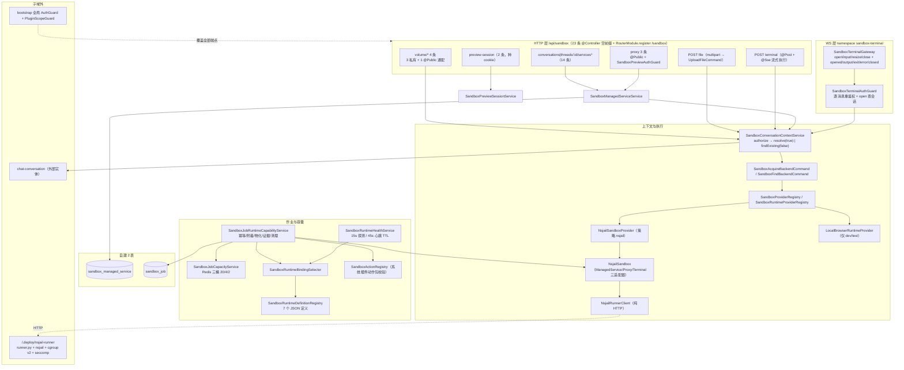

# 运行时·沙箱·产物域 · ① 沙箱执行子专家 · 架构（01-架构）

> 范围：`packages/server-ai/src/sandbox/**`（74 非 spec / 34 spec / **自建 2 表**）。HTTP 前缀 `/api/sandbox`（**23 条**），WS 命名空间 `sandbox-terminal`（**4 客户端消息 / 5 服务端事件**）。**不含** ② `runtime-control`/`health`、③ `artifacts`/`workspace-file-access`。
> 关键口径（父级已定）：配额＝**作业层 Redis 三桶租约 + 作业执行侧 `Math.min(input.timeoutMs, definition.hardDeadlineMs)`（注册表只声明 `hardDeadlineMs`） + Runner 层准入与 TTL**；`packages/nsjail-runner` **仅发布元数据**，真实 runner/Dockerfile 在 **`/.deploy/nsjail-runner/`**。

**本文引用的文件**

- [packages/server-ai/src/sandbox/sandbox.module.ts](file://packages/server-ai/src/sandbox/sandbox.module.ts)
- [packages/server-ai/src/sandbox/sandbox.controller.ts](file://packages/server-ai/src/sandbox/sandbox.controller.ts)
- [packages/server-ai/src/sandbox/sandbox.service.ts](file://packages/server-ai/src/sandbox/sandbox.service.ts)
- [packages/server-ai/src/sandbox/sandbox-conversation-context.service.ts](file://packages/server-ai/src/sandbox/sandbox-conversation-context.service.ts)
- [packages/server-ai/src/sandbox/sandbox-terminal.gateway.ts](file://packages/server-ai/src/sandbox/sandbox-terminal.gateway.ts)
- [packages/server-ai/src/sandbox/sandbox-terminal-auth.guard.ts](file://packages/server-ai/src/sandbox/sandbox-terminal-auth.guard.ts)
- [packages/server-ai/src/sandbox/sandbox-preview-auth.guard.ts](file://packages/server-ai/src/sandbox/sandbox-preview-auth.guard.ts)
- [packages/server-ai/src/sandbox/sandbox-preview-session.service.ts](file://packages/server-ai/src/sandbox/sandbox-preview-session.service.ts)
- [packages/server-ai/src/sandbox/sandbox-managed-service.service.ts](file://packages/server-ai/src/sandbox/sandbox-managed-service.service.ts)
- [packages/server-ai/src/sandbox/sandbox-managed-service.entity.ts](file://packages/server-ai/src/sandbox/sandbox-managed-service.entity.ts)
- [packages/server-ai/src/sandbox/sandbox-managed-service.error.ts](file://packages/server-ai/src/sandbox/sandbox-managed-service.error.ts)
- [packages/server-ai/src/sandbox/sandbox-work-for.ts](file://packages/server-ai/src/sandbox/sandbox-work-for.ts)
- [packages/server-ai/src/sandbox/nsjail/nsjail-sandbox.provider.ts](file://packages/server-ai/src/sandbox/nsjail/nsjail-sandbox.provider.ts)
- [packages/server-ai/src/sandbox/nsjail/nsjail-sandbox.ts](file://packages/server-ai/src/sandbox/nsjail/nsjail-sandbox.ts)
- [packages/server-ai/src/sandbox/nsjail/nsjail-runner.client.ts](file://packages/server-ai/src/sandbox/nsjail/nsjail-runner.client.ts)
- [packages/server-ai/src/sandbox/nsjail/nsjail.types.ts](file://packages/server-ai/src/sandbox/nsjail/nsjail.types.ts)
- [packages/server-ai/src/sandbox/sandbox-job/sandbox-job.entity.ts](file://packages/server-ai/src/sandbox/sandbox-job/sandbox-job.entity.ts)
- [packages/server-ai/src/sandbox/sandbox-job/sandbox-job-runtime-capability.service.ts](file://packages/server-ai/src/sandbox/sandbox-job/sandbox-job-runtime-capability.service.ts)
- [packages/server-ai/src/sandbox/sandbox-job/sandbox-job-capacity.service.ts](file://packages/server-ai/src/sandbox/sandbox-job/sandbox-job-capacity.service.ts)
- [packages/server-ai/src/sandbox/sandbox-job/sandbox-runtime-definition.registry.ts](file://packages/server-ai/src/sandbox/sandbox-job/sandbox-runtime-definition.registry.ts)
- [packages/server-ai/src/sandbox/sandbox-job/sandbox-runtime-binding-selector.service.ts](file://packages/server-ai/src/sandbox/sandbox-job/sandbox-runtime-binding-selector.service.ts)
- [packages/server-ai/src/sandbox/sandbox-job/sandbox-runtime-health.service.ts](file://packages/server-ai/src/sandbox/sandbox-job/sandbox-runtime-health.service.ts)
- [packages/server-ai/src/sandbox/sandbox-job/sandbox-action.registry.ts](file://packages/server-ai/src/sandbox/sandbox-job/sandbox-action.registry.ts)
- [packages/server-ai/src/sandbox/commands/handlers/index.ts](file://packages/server-ai/src/sandbox/commands/handlers/index.ts)
- [packages/contracts/src/ai/sandbox-terminal.model.ts](file://packages/contracts/src/ai/sandbox-terminal.model.ts)
- [packages/plugin-sdk/src/lib/runtime/capabilities/sandbox-jobs.ts](file://packages/plugin-sdk/src/lib/runtime/capabilities/sandbox-jobs.ts)
- [packages/plugin-sdk/src/lib/sandbox/runtime-environment.ts](file://packages/plugin-sdk/src/lib/sandbox/runtime-environment.ts)
- [packages/server-ai/src/shared/volume/workspace-managed-path.ts](file://packages/server-ai/src/shared/volume/workspace-managed-path.ts)
- [.deploy/nsjail-runner/README.md](file://.deploy/nsjail-runner/README.md)
- [packages/nsjail-runner/package.json](file://packages/nsjail-runner/package.json)

## 目录

1. [子域职责与边界](#1-子域职责与边界)
2. [跨子域共享文件清单](#2-跨子域共享文件清单)
3. [目录结构与分层](#3-目录结构与分层)
4. [依赖关系](#4-依赖关系)
5. [关键不变量](#5-关键不变量)
6. [架构总览](#6-架构总览)
7. [结论](#7-结论)

## 1. 子域职责与边界

**做什么**（六块能力）：① **会话级沙箱上下文**——`SandboxConversationContextService.authorizeConversation` 只做准入，`resolveConversationSandbox` **会真正申请后端**，`findExistingSandbox` 被动发现且**不复活**已停运行时；② **执行后端**——`NsjailSandboxProvider`（策略 key `nsjail`）创建运行时，`NsjailSandbox` 实现 `SandboxManagedServiceAdapter`/`SandboxServiceProxyAdapter`/`SandboxTerminalAdapter` 三个出口适配器；③ **PTY 终端**——WS 网关 `sandbox-terminal` 的 4 消息/5 事件与逐消息重鉴权；④ **托管服务与预览**——`sandbox_managed_service` 台账 + 3 条 `@Public()` proxy 路由 + 签名 cookie；⑤ **卷投递**——4 条 `GET volume/*`（3 私有 + 1 匿名通配）与 `POST file` 上传；⑥ **插件面沙箱作业**——`platform.sandbox.jobs` 的幂等、三桶租约、输入物化、输出校验、运行时证据与孤儿清理。

**不做什么**：不拥有字节（卷布局归 Workspace Files 卷，本域只做路径归一/越界拒绝/投递）；不写执行账本表（唯一挂接点是 `sandbox_managed_service.ownerExecutionId`/`ownerAgentKey` 字符串弱引用）；不拥有会话与消息（只按 `conversationId` 建 `CASCADE` 外键与查会话准入）；不做插件 DDL 与 schema-sync（本子域无 `migrations/*.sql`）。

**与 ②③ 的分工**：②（`runtime-control`/`health`）管 **API 进程副本自身**的排水、自信号重启与探针，本子域在全局 `PluginScopeGuard` 下与它共享同一套鉴权语义；③（`artifacts`/`workspace-file-access`）管 **产物登记与短时文件授权**，本子域与它只有三处接触：`sandbox_job.runtimeArtifactKind|Reference|Digest` 纯字符串契约、`shared/volume` 卷抽象、`@xpert-ai/contracts` 的 `sandbox-*.model.ts`。

章节来源：[sandbox-conversation-context.service.ts](file://packages/server-ai/src/sandbox/sandbox-conversation-context.service.ts)（关键符号：authorizeConversation / resolveConversationSandbox / findExistingSandbox）、[sandbox-managed-service.entity.ts](file://packages/server-ai/src/sandbox/sandbox-managed-service.entity.ts)（关键符号：ownerExecutionId / ownerAgentKey）、[sandbox-job.entity.ts](file://packages/server-ai/src/sandbox/sandbox-job/sandbox-job.entity.ts)（关键符号：runtimeArtifactKind / runtimeArtifactReference / runtimeArtifactDigest）

## 2. 跨子域共享文件清单

本子域与 ②③ 之间存在 **4 处单文件双职责**，改任一侧必须双边复核：

| 共享文件 | 本子域用法 | 对侧（②/③）用法 |
|---|---|---|
| [sandbox.controller.ts](file://packages/server-ai/src/sandbox/sandbox.controller.ts) | 23 条路由：卷投递、上传、SSE 终端、托管服务 14 条、3 条 proxy | ② 依赖同一控制器承载的 `POST terminal` SSE 语义；③ 的卷投递出向（`serveVolumeFile`）与 `assertPublicWorkspacePath` 复用同一越界原语 |
| [sandbox.service.ts](file://packages/server-ai/src/sandbox/sandbox.service.ts) | provider 清单/可用性聚合（`listProviders`/`getDefaultProviderType`） | ② 的运维面在排障时消费同一清单；`@Cron cleanCron` 是空壳（只打日志） |
| [sandbox-job-runtime-capability.service.ts](file://packages/server-ai/src/sandbox/sandbox-job/sandbox-job-runtime-capability.service.ts) | 作业执行账本写入与孤儿清理 | ③ 只经 `runtimeArtifact*` 三列读取作业产物线索；`resolveSandboxWorkFor` 为 `{type:'job'}` 的卷落在 `runtime-jobs` catalog |
| [packages/contracts/src/ai/sandbox-*.model.ts](file://packages/contracts/src/ai/sandbox-terminal.model.ts) | WS 消息/事件、托管服务状态与传输模式、错误码 | ③ 与插件消费方共用同一枚举源，跨仓改动需同步 |

另外三处**间接共享**：`shared/volume`（`VolumeClient`/`VolumeHandle`/`assertPublicWorkspacePath`/`volume-layout`）、`plugin-sdk` 的 `SandboxProviderRegistry`/`SandboxRuntimeProviderRegistry`/`resolveSandbox*Adapter`/`SandboxJobRuntimeError`、以及 `packages/plugin-sdk/src/lib/runtime/capabilities/sandbox-jobs.ts` 的作业状态枚举（7 值）与进度行前缀。

章节来源：[sandbox.module.ts](file://packages/server-ai/src/sandbox/sandbox.module.ts)（关键符号：SandboxModule 的 imports/controllers/exports）、[sandbox.controller.ts](file://packages/server-ai/src/sandbox/sandbox.controller.ts)（关键符号：SandboxController 全量方法）、[sandbox-jobs.ts](file://packages/plugin-sdk/src/lib/runtime/capabilities/sandbox-jobs.ts)（关键符号：SandboxJobStatus / SANDBOX_JOB_PROGRESS_PREFIX）

## 3. 目录结构与分层

| 层 | 承载者 | 职责 |
|---|---|---|
| HTTP 控制器 | `SandboxController`（23 条，`RouterModule.register({path:'/sandbox'})` 给前缀） | 校验 query/param 形态、组织作用域包装（`SuperAdminOrganizationScopeService.run`）、托管服务错误归一（404/409/400） |
| WS 网关 | `SandboxTerminalGateway`（`namespace: 'sandbox-terminal'`, `cors.origin: '*'`） | 4 类客户端消息 + 5 类服务端事件；进程内 `#sessions`/`#pendingOpens`；`handleDisconnect` 逐个关闭 |
| 守卫 | `SandboxTerminalAuthGuard`（WS，逐消息）、`SandboxPreviewAuthGuard`（3 条 proxy） | WS：`cs-x-` 走 client-secret，否则 `WsJWTGuard`；proxy：cookie JWT 票面与路径参数比对 |
| 会话上下文 | `SandboxConversationContextService` | 准入（会话/租户/用户/特性/provider/项目）与沙箱上下文组装 |
| 执行 Provider | `NsjailSandboxProvider` + `NsjailWorkspacePathMapper`（策略 key `nsjail`） | Runner 配置与健康/协议门槛、`runtimeId` 派生、卷↔`/workspace` 双向映射 |
| Provider 适配器 | `NsjailSandbox`（extends `BaseSandbox`） | execute/stream/文件/终端/托管服务/proxy 六类操作 + `withRuntimeRecovery` 自愈 |
| Runner 客户端 | `NsjailRunnerClient` | 纯 HTTP：`/health`、`/v1/runtimes*`、exec/stream、terminals、services、proxy |
| job 与容量 | `SandboxJobRuntimeCapabilityService` + `SandboxJobCapacityService` + `SandboxRuntimeDefinitionRegistry` + `SandboxRuntimeBindingSelector` + `SandboxRuntimeHealthService` + `SandboxActionRegistry` | 幂等、附着、三桶租约、定义校验、绑定选择、健康心跳、动作包校验 |
| 托管服务与预览 | `SandboxManagedServiceService` + `SandboxPreviewSessionService` + `.entity`/`.error` | 台账与生命周期、日志路径、预览 URL、proxy 头清洗、cookie 签发 |
| 命令面 | `commands/**`（11 command / 10 handler）、`queries/index.ts`（**空**） | CQRS 入口：`SandboxAcquireBackendCommand`/`SandboxFindBackendCommand` 等 |
| 工具中间件 | `middlewares/**`（`sandbox_shell`/`sandbox_service_*`/`SandboxFile`/文件活动与呈现） | Agent 工具面（非 HTTP），经执行上下文注入沙箱对象 |
| 开发态运行时 | `LocalBrowserRuntimeProvider`（`LOCAL_BROWSER_RUNTIME_PROVIDERS` 三元注入） | 仅 `NODE_ENV=development\|test` 可见；注释逐字「never a production fallback」 |

章节来源：[sandbox.module.ts](file://packages/server-ai/src/sandbox/sandbox.module.ts)（关键符号：LOCAL_BROWSER_RUNTIME_PROVIDERS / providers / exports）、[sandbox-terminal.gateway.ts](file://packages/server-ai/src/sandbox/sandbox-terminal.gateway.ts)（关键符号：SandboxTerminalGateway.open / handleDisconnect）、[nsjail-sandbox.ts](file://packages/server-ai/src/sandbox/nsjail/nsjail-sandbox.ts)（关键符号：NsjailSandbox.withRuntimeRecovery）

## 4. 依赖关系

**出向（跨域）**：`chat-conversation`（`ChatConversation`/`ChatConversationThread` 实体，用于准入与外键解析）、`xpert-project`（`XpertProjectAccessModule` + `assertCanUseXpert`/`assertCanRead`）、`shared/volume`（`VOLUME_CLIENT`、`VolumeHandle`、`assertPublicWorkspacePath`、`volume-layout` 归一）、`shared/runtime`（`WorkspaceFilesRuntimeModule`、`RuntimeCapabilityProvider`、`WorkspaceFilesRuntimeCapabilityService`）、`tenant`（`TenantModule`）、`chat-group`（`ResolveGroupRuntimeAccessCommand`）、`xpert`（`InitializeAssistantTemplateFilesCommand`）、`super-admin-organization-scope`、`@xpert-ai/plugin-sdk` 注册表与适配器解析、`@xpert-ai/contracts` 枚举、`MANAGED_QUEUE_SERVICE_TOKEN` 的 Redis 连接（容量与健康心跳）。

**入向**：`xpert-template` 的 `SandboxToolsCapabilityProvider`（模块内注入）；域外经 `SandboxModule.exports` 取用 `SandboxConversationContextService`/`SandboxJobRuntimeCapabilityService`/`SandboxRuntimeDefinitionRegistry` 等；`bootstrap` 的全局 `AuthGuard`+`PluginScopeGuard` 覆盖本子域全部端点。

**执行后端的真实归属**：`packages/nsjail-runner/package.json`（`private: true`，`description: "Release metadata for the Xpert NsJail runner Docker image"`）**只是发布元数据**；真实 runner 与 Dockerfile 在工作区 `/.deploy/nsjail-runner/`，`README.md` 逐字写明「The runner and Dockerfile remain in [.deploy/nsjail-runner]」。API 侧只经 HTTP 与 `NSJAIL_RUNNER_URL`/`NSJAIL_RUNNER_TOKEN` 两个环境变量接触它，`README.md` 另声明权属「Xpert still owns provider selection, workspace binding, terminal routing, managed-service records, and preview authorization」。

章节来源：[nsjail-sandbox.provider.ts](file://packages/server-ai/src/sandbox/nsjail/nsjail-sandbox.provider.ts)（关键符号：readRunnerConfig / NsjailSandboxProvider.isAvailable）、[packages/nsjail-runner/package.json](file://packages/nsjail-runner/package.json)（关键符号：private / description）、[.deploy/nsjail-runner/README.md](file://.deploy/nsjail-runner/README.md)（关键符号：runner 位置与权属声明）

## 5. 关键不变量

1. **`@Public()` 只有两类，且只有一类「不补身份」**：3 条 proxy 路由（`@Public()` + `SandboxPreviewAuthGuard`，票面 `conversationId`/`serviceId` 必须与路径参数相等）与 1 条 **volume 通配**（`@Public()` + 纯路径护栏）。volume 通配的实际校验链是：`normalizeSandboxVolumeRequestSubpath` → 第一次 `isProtectedVolumeSubpath`（`project/*`、`user/*/xpert/*`、`xpert/*/user/*`、`runtime-jobs/*` → 403）→ tenant 解析（query → `RequestContext.currentTenantId()` → `GetDefaultTenantQuery` 默认租户，再 `assertValidVolumeScopeId`）→ dev 环境 `normalizeSandboxPublicVolumeSubpath` 归一 → 第二次黑名单校验 → `serveVolumeFile` 内 `assertPublicWorkspacePath` + `openFileSnapshot` 后按**实际卷内相对路径**复检 `rejectProtectedPaths`（防符号链接别名绕过）。它**不做租户授权、不写审计、无限流**。
2. **WS 握手与逐消息鉴权**：`SandboxTerminalAuthGuard` 的 token 取自 `handshake.auth.token`；以 `cs-x-` 开头则写入 `handshake.headers['x-client-secret']` 并回填 `organization-id`，交给 `ClientSecretSocketGuard`（`AuthGuard('client-secret')`，其 `getRequest` 返回 `handshake`）；否则走 `WsJWTGuard`。两条路径都要求 `handshake.user` 存在且 `assertWorkbenchPrincipal(handshake.user)` 通过；`open` 额外要求请求体带非空 `conversationId`、`conversations.findOneByOrFail` 成功，并再次 `assertWorkbenchPrincipal(user, conversation)`。失败一律抛 `WsException({ status: 403, message })`。
3. **预览会话签名是 proxy 唯一准入**：JWT `aud='sandbox-preview'`、`sub='sandbox-preview-session'`、载荷含 `conversationId`/`serviceId`；cookie 名 `xpert_sandbox_preview`，`httpOnly`、`sameSite:'lax'`、TTL 1 小时、`path` 精确为 `/api/sandbox/conversations/<cid>/services/<sid>/proxy`、`secure` 由 `request.secure || x-forwarded-proto === 'https'` 推导；`JWT_SECRET` 缺失抛 `ProviderUnavailable`（500），**不降级放行**。
4. **三桶租约语义**：`SandboxJobCapacityService.acquire` 用一段 Lua 同时占 `global`/`tenant`/可选 `user` 三槽（`sandbox_jobs:{capacity}:global|tenant:<tid>|user:<tid>:<uid>`），key 为 ZSET，先 `ZREMRANGEBYSCORE` 清过期、再逐桶 `ZCARD` 比限（默认 20/4/2，可由 `SANDBOX_JOB_GLOBAL_LIMIT`/`TENANT_LIMIT`/`USER_LIMIT` 覆盖），任一满即返回 0 → 抛 `SANDBOX_CAPACITY_UNAVAILABLE`（retryable）；租约 `id = <jobId>:<Date.now()>`，`release` 幂等 `ZREM`，**必须 `finally` 释放**。
5. **超时/取消/清理三件套**：注册表强制 `timeoutMs ≤ hardDeadlineMs`；作业 `hardDeadlineAt` 在等待期为 `now + 120s` 心跳续期、进入执行期改写为 `now + definition.hardDeadlineMs`；`cancel()` 先尽力 `runtime.terminate()` 再置 `cancelled` + `SANDBOX_CANCELLED`，随后 `destroySandbox` → `cleanupVolume`；`cleanupOrphans` 在 `onModuleInit` 先跑一次、此后每 60 秒扫「`status ∈ waiting\|starting\|running` 且 `hardDeadlineAt < now`」与「`cleanupPending = true` 且非活跃」两批，定时器 `unref()`。
6. **job 幂等以数据库唯一索引兜底**：`sandbox_job` 唯一索引 `(tenantId, idempotencyKey)`；`run()` 命中 `succeeded` 直接复用，命中 `waiting/starting/running` 附着等待（`waitForAttachedJob` 500ms 轮询、`waiting` 时重置 deadline，终态失败按 `errorCode` 判可重试），`cleanupPending` 时先 `requirePreviousAttemptCleanup`；`prepareAttempt` 并发插入冲突时回查幂等键并转为附着。`attempt` 每轮 +1。
7. **托管服务语义**：一表一服务、`(conversationId, name)` 唯一；`onModuleInit` 把 `running`/`starting` 一律置 `lost`（进程重启即失效）；列表类方法一律经 `findExistingSandbox`（**绝不创建沙箱**），解析不到时把活跃态降级为 `lost` 且 `previewUrl = null`；`start` 在 `replaceExisting` 时先 `stopService`；`proxyByConversationId` **每次请求**都 `resolveConversationSandbox`，转发前原地替换 `request.headers`/`headersDistinct`/`rawHeaders`、劫持 `response.setHeader` 丢弃 `set-cookie`/`service-worker-allowed` 并重写 `location`，`finally` 全部还原。
8. **2 张自建表 + 2 个外部实体**：自建表为 `sandbox_managed_service`（FK `conversationId → ChatConversation`，`onDelete: 'CASCADE'`）与 `sandbox_job`；`TypeOrmModule.forFeature` 里注册的 `ChatConversation`/`ChatConversationThread` 是**外部实体**（为外键解析与线程查询），不属本子域所有——表数口径**以 2 张为准**。
9. **隔离边界只在 Runner**：卷映射 `bindSource = volume.hostRoot` → 容器 `/workspace`，越界即抛（`NsJailWorkspacePathOutsideVolume`/`NsJailWorkspacePathOutsideMount`）；`protectProjectContent = options.protectProjectContent === true || workFor.type === 'project'`；创建前置校验协议 2（项目只读）与协议 3（应用数据保护），不满足直接失败。

章节来源：[sandbox.controller.ts](file://packages/server-ai/src/sandbox/sandbox.controller.ts)（关键符号：getVolumeFile / isProtectedVolumeSubpath / serveVolumeFile / proxyManagedService）、[sandbox-terminal-auth.guard.ts](file://packages/server-ai/src/sandbox/sandbox-terminal-auth.guard.ts)（关键符号：canActivate / ClientSecretSocketGuard）、[sandbox-preview-session.service.ts](file://packages/server-ai/src/sandbox/sandbox-preview-session.service.ts)（关键符号：createSession / verifySession / buildCookiePath）、[sandbox-job-capacity.service.ts](file://packages/server-ai/src/sandbox/sandbox-job/sandbox-job-capacity.service.ts)（关键符号：ACQUIRE_SCRIPT / acquire / release）、[sandbox-job-runtime-capability.service.ts](file://packages/server-ai/src/sandbox/sandbox-job/sandbox-job-runtime-capability.service.ts)（关键符号：run / cancel / cleanupOrphans / requirePreviousAttemptCleanup）、[sandbox-managed-service.service.ts](file://packages/server-ai/src/sandbox/sandbox-managed-service.service.ts)（关键符号：onModuleInit / listByConversationId / proxyByConversationId）、[nsjail-sandbox.provider.ts](file://packages/server-ai/src/sandbox/nsjail/nsjail-sandbox.provider.ts)（关键符号：create / NsjailWorkspacePathMapper）

## 6. 架构总览

图表来源：[sandbox.module.ts](file://packages/server-ai/src/sandbox/sandbox.module.ts)（关键符号：SandboxModule 的 controllers/providers）、[sandbox.controller.ts](file://packages/server-ai/src/sandbox/sandbox.controller.ts)（关键符号：getVolumeFile / terminal / proxyManagedServicePath）、[sandbox-terminal.gateway.ts](file://packages/server-ai/src/sandbox/sandbox-terminal.gateway.ts)（关键符号：open / handleDisconnect）、[sandbox-job-runtime-capability.service.ts](file://packages/server-ai/src/sandbox/sandbox-job/sandbox-job-runtime-capability.service.ts)（关键符号：run / execute / cleanupOrphans）、[nsjail-runner.client.ts](file://packages/server-ai/src/sandbox/nsjail/nsjail-runner.client.ts)（关键符号：NsjailRunnerClient）、[.deploy/nsjail-runner/README.md](file://.deploy/nsjail-runner/README.md)（关键符号：Runner 与 API 的职责划分）

## 7. 结论

本子域的结构主线是「**一个准入入口 + 一个隔离边界 + 两条执行形态**」。准入入口是 `resolveConversationSandbox`：卷路由、上传、SSE 终端、托管服务 14 条、预览 proxy、WS `open` 全部先经它，且**申请语义（`resolve*`）与被动语义（`findExisting*`）严格分离**——后者永不复活已停运行时，也永不创建沙箱。隔离边界只有 Runner 一处，API 侧只持 HTTP 客户端与两个环境变量，协议 2/3 是硬门槛。两条执行形态是：**会话/交互形态**（终端、托管服务、预览，生命周期挂在会话上、状态在 `sandbox_managed_service` 与进程内 Map）与**作业形态**（`platform.sandbox.jobs`，幂等键 + 三桶租约 + 硬截止 + 孤儿清理，证据落在 `sandbox_job`）。

需要长期防守四处：① `volume/*path` 的 `@Public()` 通配是本子域最大匿名读面，护栏只有路径层，安全性完全依赖「公共前缀不含敏感数据」这一部署假设；② 预览 cookie 的 `path` 前缀是**弱隔离**，跨服务混淆只能靠票面 `conversationId`/`serviceId` 比对兜住，且代理链未透传 `x-forwarded-proto` 会让 `secure` cookie 丢失；③ 三桶租约与 Runner 准入是两套独立配额，桶计数泄漏的表现是「永不放行」而非报错；④ `cleanupPending` 只留证据、不自愈，`requirePreviousAttemptCleanup` 会拦住后续尝试直到销毁成功。新增能力的正确骨架是：走命令入口 → 在 Runner 侧加协议能力位并在 `create()` 前置校验 → 产物只登记引用与 digest → 对外投递一律走「短时签名 + 最小范围」。

章节来源：[sandbox-conversation-context.service.ts](file://packages/server-ai/src/sandbox/sandbox-conversation-context.service.ts)（关键符号：resolveConversationSandbox / findExistingSandbox）、[sandbox.controller.ts](file://packages/server-ai/src/sandbox/sandbox.controller.ts)（关键符号：getVolumeFile）、[sandbox-job-runtime-capability.service.ts](file://packages/server-ai/src/sandbox/sandbox-job/sandbox-job-runtime-capability.service.ts)（关键符号：run / cleanupOrphans / destroySandbox）
