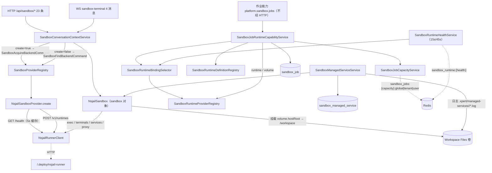
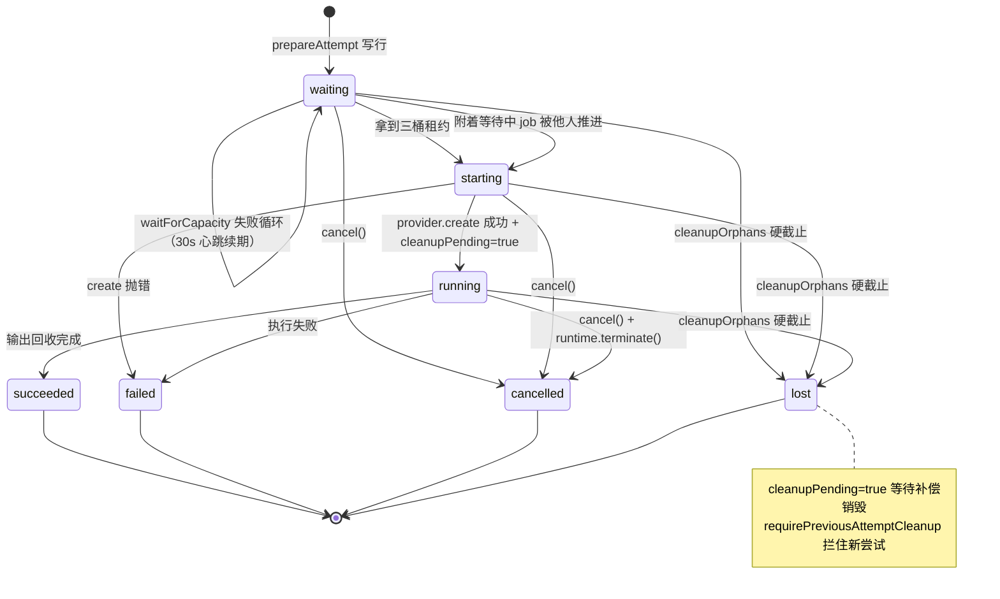

# 运行时·沙箱·产物域 · ① 沙箱执行子专家 · 数据流转（03-数据流转）

> 覆盖 7 条链：执行 / WS 终端 / 预览 proxy / volume / job 与容量 / managed service / 清理。持久面只有 **2 张自建表**（`sandbox_managed_service`、`sandbox_job`）；短期面在进程内 `Map`、Redis（租约与心跳）与 JWT cookie 中。

**本文引用的文件**

- [packages/server-ai/src/sandbox/sandbox.controller.ts](file://packages/server-ai/src/sandbox/sandbox.controller.ts)
- [packages/server-ai/src/sandbox/sandbox-conversation-context.service.ts](file://packages/server-ai/src/sandbox/sandbox-conversation-context.service.ts)
- [packages/server-ai/src/sandbox/sandbox-terminal.gateway.ts](file://packages/server-ai/src/sandbox/sandbox-terminal.gateway.ts)
- [packages/server-ai/src/sandbox/sandbox-preview-session.service.ts](file://packages/server-ai/src/sandbox/sandbox-preview-session.service.ts)
- [packages/server-ai/src/sandbox/sandbox-managed-service.service.ts](file://packages/server-ai/src/sandbox/sandbox-managed-service.service.ts)
- [packages/server-ai/src/sandbox/sandbox-managed-service.entity.ts](file://packages/server-ai/src/sandbox/sandbox-managed-service.entity.ts)
- [packages/server-ai/src/sandbox/nsjail/nsjail-sandbox.provider.ts](file://packages/server-ai/src/sandbox/nsjail/nsjail-sandbox.provider.ts)
- [packages/server-ai/src/sandbox/nsjail/nsjail-sandbox.ts](file://packages/server-ai/src/sandbox/nsjail/nsjail-sandbox.ts)
- [packages/server-ai/src/sandbox/nsjail/nsjail-runner.client.ts](file://packages/server-ai/src/sandbox/nsjail/nsjail-runner.client.ts)
- [packages/server-ai/src/sandbox/sandbox-job/sandbox-job-runtime-capability.service.ts](file://packages/server-ai/src/sandbox/sandbox-job/sandbox-job-runtime-capability.service.ts)
- [packages/server-ai/src/sandbox/sandbox-job/sandbox-job-capacity.service.ts](file://packages/server-ai/src/sandbox/sandbox-job/sandbox-job-capacity.service.ts)
- [packages/server-ai/src/sandbox/sandbox-job/sandbox-job.entity.ts](file://packages/server-ai/src/sandbox/sandbox-job/sandbox-job.entity.ts)
- [packages/server-ai/src/sandbox/sandbox-job/sandbox-runtime-health.service.ts](file://packages/server-ai/src/sandbox/sandbox-job/sandbox-runtime-health.service.ts)
- [packages/server-ai/src/sandbox/sandbox.service.ts](file://packages/server-ai/src/sandbox/sandbox.service.ts)
- [packages/contracts/src/ai/sandbox-terminal.model.ts](file://packages/contracts/src/ai/sandbox-terminal.model.ts)
- [packages/plugin-sdk/src/lib/runtime/capabilities/sandbox-jobs.ts](file://packages/plugin-sdk/src/lib/runtime/capabilities/sandbox-jobs.ts)
- [.deploy/nsjail-runner/README.md](file://.deploy/nsjail-runner/README.md)

## 目录

1. [总览](#1-总览)
2. [链 1 执行](#2-链-1-执行)
3. [链 2 WS 终端](#3-链-2-ws-终端)
4. [链 3 预览 proxy](#4-链-3-预览-proxy)
5. [链 4 volume](#5-链-4-volume)
6. [链 5 job 与容量](#6-链-5-job-与容量)
7. [链 6 managed service](#7-链-6-managed-service)
8. [链 7 清理与泄漏防护](#8-链-7-清理与泄漏防护)
9. [状态机（job / 实例 / 会话）](#9-状态机job--实例--会话)
10. [已知风险](#10-已知风险)
11. [结论](#11-结论)

## 1. 总览

图表来源：[sandbox.module.ts](file://packages/server-ai/src/sandbox/sandbox.module.ts)（关键符号：SandboxModule 的 controllers/providers/forFeature）、[sandbox-conversation-context.service.ts](file://packages/server-ai/src/sandbox/sandbox-conversation-context.service.ts)（关键符号：resolveConversationSandbox）、[sandbox-job-runtime-capability.service.ts](file://packages/server-ai/src/sandbox/sandbox-job/sandbox-job-runtime-capability.service.ts)（关键符号：run / execute）、[sandbox-managed-service.service.ts](file://packages/server-ai/src/sandbox/sandbox-managed-service.service.ts)（关键符号：buildLogPaths）、[nsjail-runner.client.ts](file://packages/server-ai/src/sandbox/nsjail/nsjail-runner.client.ts)（关键符号：NsjailRunnerClient）、[sandbox-runtime-health.service.ts](file://packages/server-ai/src/sandbox/sandbox-job/sandbox-runtime-health.service.ts)（关键符号：publish）

**数据面四分**：① **持久台账**（`sandbox_job` 执行证据、`sandbox_managed_service` 运行时快照）；② **跨进程事实**（Redis 的三桶租约 ZSET 与运行时健康 hash）；③ **短期状态**（WS 会话 `Map`、预览 JWT cookie）；④ **外部字节**（Workspace Files 卷：沙箱工作区 + 作业卷 + 托管服务日志路径）。本子域**不存文件内容**。

章节来源：[sandbox-job.entity.ts](file://packages/server-ai/src/sandbox/sandbox-job/sandbox-job.entity.ts)（关键符号：SandboxJobEntity）、[sandbox-managed-service.entity.ts](file://packages/server-ai/src/sandbox/sandbox-managed-service.entity.ts)（关键符号：SandboxManagedServiceEntity）、[sandbox-job-capacity.service.ts](file://packages/server-ai/src/sandbox/sandbox-job/sandbox-job-capacity.service.ts)（关键符号：keys）

## 2. 链 1 执行

**入口**：`POST /api/sandbox/terminal`（`@Post` + `@Sse`）或 Agent 工具 `sandbox_shell`（中间件侧，非 HTTP）。**流转**：`resolveConversationSandbox({conversationId, projectId})` → 准入（会话存在 / `tenantId` 匹配 / 助手 `features.sandbox.enabled` / `provider` 非空 / 项目与会话项目一致 / 权限）→ `XpertWorkAreaResolver.resolve` 给出 `volumeScope`+`workspaceBinding`+`workingDirectory` → `SandboxAcquireBackendCommand` → `NsjailSandboxProvider.create` → 健康与协议门槛 → `runtimeId` 派生 → `POST /v1/runtimes` → `NsjailSandbox`。**执行**：`streamExecute` 优先，否则 `execute`；每次调用都经 `withRuntimeRecovery`。**事件形态**：流式逐行 `subscriber.next(line)`，30 秒一次 keepAlive 注释事件；`exitCode === 0` 时 `complete()`，非 0 时 `subscriber.error(output || 兜底文案)`——**失败走 SSE error 通道**。

**落点**：无持久写入（HTTP 链路不留表）；运行时身份在 Runner 侧（`runtimeId`），API 侧只持 `NsjailSandbox` 实例与 `id = nsjail-<runtimeId>`。

章节来源：[sandbox.controller.ts](file://packages/server-ai/src/sandbox/sandbox.controller.ts)（关键符号：terminal / serveVolumeFile 之外的 Observable 分支）、[nsjail-sandbox.provider.ts](file://packages/server-ai/src/sandbox/nsjail/nsjail-sandbox.provider.ts)（关键符号：create / createRuntimeId）、[nsjail-sandbox.ts](file://packages/server-ai/src/sandbox/nsjail/nsjail-sandbox.ts)（关键符号：execute / streamExecute / withRuntimeRecovery）

## 3. 链 2 WS 终端

**入口**：namespace `sandbox-terminal`；`handshake.auth.token` 与可选 `organizationId`。**流转**：握手 → `SandboxTerminalAuthGuard`（`cs-x-` → client-secret；否则 `WsJWTGuard`；两者都要求 `handshake.user` + `assertWorkbenchPrincipal`）→ `open` 再查 `ChatConversation` 并复核助手作用域 → `runWithCapturedRequestContext({user, headers:{tenant-id, organization-id}})` → `resolveConversationSandbox` → `resolveSandboxTerminalAdapter(resolved.sandbox)` → `adapter.open({cols, rows, onOutput, onExit, onError})` → 分配 `sessionId = randomUUID()` 并写入进程内 `#sessions[socketId][sessionId]` → 发 `opened`。**交互**：`input`/`resize` 直接转发到适配器（会话不存在时只回 `session_not_found`）；输出经 `client.emit('output')` 直透不缓冲；进程退出触发 `exit` + `closed`（reason 取 `entry.closeReason ?? 'process_exited'`）。**取消与断连**：`close{requestId}` 命中 pendingOpen 则置 canceled 并发 `closed{client_closed}`；`close{sessionId}` 与 `handleDisconnect` 走 `closeSession`（后者 reason 为 `socket_disconnected`、不发 `closed`）。

**落点**：全部在进程内存，**不落库、不跨副本**；远端终端由 Runner 持有，`closeTerminal` 失败只 `logger.warn`（可能残留远端会话）。

章节来源：[sandbox-terminal.gateway.ts](file://packages/server-ai/src/sandbox/sandbox-terminal.gateway.ts)（关键符号：open / input / resize / close / handleDisconnect / closeSession）、[sandbox-terminal.model.ts](file://packages/contracts/src/ai/sandbox-terminal.model.ts)（关键符号：SandboxTerminalClientEvent / SandboxTerminalClosedReason）

## 4. 链 3 预览 proxy

**发牌**：`POST .../services/:serviceId/preview-session` → `getByConversationId`（读 `sandbox_managed_service`）→ `createSession`（要求 `running` + `transportMode==='http'` + `previewUrl`）→ 签 JWT 并 `response.cookie('xpert_sandbox_preview', token, {httpOnly, maxAge:1h, path:<该服务 proxy 前缀>, sameSite:'lax', secure})` → 返回 `{expiresAt, previewUrl}`。**请求**：浏览器（同源 iframe）直连 3 条 `@All` proxy 路由之一（**不带 `Authorization`**）→ `SandboxPreviewAuthGuard` 校验 cookie 票面 → `proxyManagedService` 把 pathname + query 拼成 `requestPath` → `proxyByConversationId`：`requireService`（读表）→ `resolveConversationSandbox`（**会申请运行时**）→ `resolveSandboxServiceProxyAdapter` → 头清洗（原地替换三份 header 结构 + 劫持 `setHeader`）→ `adapter.proxyServiceRequest` → `NsjailRunnerClient.proxyService`（`POST /v1/runtimes/:id/services/:sid/proxy`，`redirect:'manual'`、不设超时）→ 上游响应经第二层头过滤 +（HTML/CSS/JS）正文路径重写回写 → `finally` 还原 header 与 `setHeader`。

**落点**：读 `sandbox_managed_service`；不写表；cookie 是唯一凭证（1 小时，进程重启仍有效直到过期，因为签名校验无状态）。

章节来源：[sandbox-preview-session.service.ts](file://packages/server-ai/src/sandbox/sandbox-preview-session.service.ts)（关键符号：createSession / buildCookiePath）、[sandbox-preview-auth.guard.ts](file://packages/server-ai/src/sandbox/sandbox-preview-auth.guard.ts)（关键符号：canActivate）、[sandbox-managed-service.service.ts](file://packages/server-ai/src/sandbox/sandbox-managed-service.service.ts)（关键符号：proxyByConversationId）、[nsjail-sandbox.ts](file://packages/server-ai/src/sandbox/nsjail/nsjail-sandbox.ts)（关键符号：proxyServiceRequest）

## 5. 链 4 volume

**写侧**：`POST /api/sandbox/file`（multipart 字段 `file` + `workspace`/`conversationId`/`path`/`organizationId`）→ `resolveConversationSandbox`（**创建沙箱**）→ `volumeClient.resolve(resolved.volumeScope)` → `resolveUploadWorkspacePath`（三种入参形态：空用 mapper、`workspaceRoot` 前缀用 mapper、`volume.serverRoot` 前缀直接用、绝对路径拒绝、其余相对拼接）→ `assertProjectUploadAllowed`（项目态下 `project.md`/`skills` 等治理路径 403）→ `UploadFileCommand({targets:[{kind:'sandbox', mode:'mounted_workspace', workspacePath, workspaceBoundaryPath, projectContentReadOnly, workspaceUrl, folder}]})` → 返回 `{url, filePath}`。**读侧（匿名通配）**：`GET volume/*path` → 归一 → 黑名单（两次）→ tenant 推导 → dev 归一 → `serveVolumeFile`（`assertPublicWorkspacePath` → `openFileSnapshot` → 复检 → Range/Content-Type/Disposition → 流式 pipe）。**读侧（私有）**：`volume/project/:projectId/*path`（`assertCanRead` + 跨租户 tenant 403）、`volume/user/:userId/xpert/:xpertId/*path`（当前用户必须等于 `:userId`）、`volume/xpert/:xpertId/user/:userId/*path`（旧布局兼容）。

**落点**：字节在卷；本子域只做路径映射与投递，不写表、不留审计。

章节来源：[sandbox.controller.ts](file://packages/server-ai/src/sandbox/sandbox.controller.ts)（关键符号：uploadFile / getVolumeFile / servePrivateXpertVolumeFile）

## 6. 链 5 job 与容量

**输入**：`SandboxJobRunInput{scope:{tenantId, organizationId?, userId?, pluginName, businessResourceType, businessResourceId}, action, actionVersion, idempotencyKey, jobId?, timeoutMs?, files[], outputs[]}`。**流转**：`requireRunnableAction` → `findIdempotent` → 复用/附着/新建 → `bindingSelector.require` → `prepareAttempt`（写 `sandbox_job`）→ `waitForCapacity`（Redis 三桶；桶满时把心跳写回 `waiting` 并续期 120 秒）→ `execute`（卷 `runtime-jobs/<jobId>/workspace` → `provider.create` → `runtimeRef` + `cleanupPending = true` + `running`）→ 动作与输入物化（`.platform/inputs`）→ 运行 → 输出回收（`outputs[]` 含 `path`/`size`/`sha256`/`reference`）→ `finally capacity.release`。**失败轨迹**：`SANDBOX_ACTION_INVALID|UNAVAILABLE`、`SANDBOX_PROFILE_UNAVAILABLE`、`SANDBOX_VERSION_MISMATCH`、`EXPORT_INPUT_INVALID`（全部 retryable=false）、`SANDBOX_CAPACITY_UNAVAILABLE`（true）、`SANDBOX_START_FAILED`（true）、`SANDBOX_CANCELLED`（false）、`EXPORT_TIMEOUT`（true）。**证据列**：`provider`/`runtimeBindingId`/`runtimeArtifactKind|Reference|Digest`（来自绑定）、`runtimeRef`、`attempt`、`progress`、`hardDeadlineAt`、`cleanupPending`/`cleanedAt`。

**容量事实**：`sandbox_jobs:{capacity}:global`、`:tenant:<tenantId>`、`:user:<tenantId>:<userId>`（无 user 时只两桶）；`acquire` 原子占三槽，`PEXPIRE = expires - now + 60000`；`release` 幂等。**健康事实**：`sandbox_runtime:{health}:<runtimeProfile>` hash，字段名 = `executorId`（`hostname:pid:uuid`），TTL = 心跳 TTL 两倍（90 秒），成功存活 45 秒、失败只 5 秒。

章节来源：[sandbox-job-runtime-capability.service.ts](file://packages/server-ai/src/sandbox/sandbox-job/sandbox-job-runtime-capability.service.ts)（关键符号：run / prepareAttempt / waitForCapacity / execute）、[sandbox-job-capacity.service.ts](file://packages/server-ai/src/sandbox/sandbox-job/sandbox-job-capacity.service.ts)（关键符号：ACQUIRE_SCRIPT / keys / release）、[sandbox-runtime-health.service.ts](file://packages/server-ai/src/sandbox/sandbox-job/sandbox-runtime-health.service.ts)（关键符号：healthKey / publish）

## 7. 链 6 managed service

**启动**：`POST conversations/:cid/services/start`（或线程面同构）→ `startByConversationId` → `resolveConversationSandbox`（**创建沙箱**）→ 适配器解析 → 同名冲突判定（409 或 `replaceExisting` 先停）→ 写实体（`starting` + `metadata.launch`/`metadata.logs`）→ `adapter.startService({serviceId: entity.id, onStateChange})` → 回调反复 `updateState`（每次独立读行 + `applyState` + `save`）→ `applyState(saved, result)` 落最终态。**观察**：`GET .../services` 走 `findExistingSandbox`（**不创建**）+ `adapter.listServices`，把 Runner 状态合并回实体并**批量 save**；解析不到沙箱时把活跃态降级 `lost` 且 `previewUrl = null`。**日志**：`GET .../logs?tail=` 走 `resolveConversationSandbox`（**创建**）+ `adapter.getServiceLogs`（默认 tail 200）；实体 `metadata.logs` 记录 `<workingDirectory>/.xpert/managed-services/<serviceId>/{stdout,stderr}.log` 路径（字节不在表里）。**停止/重启**：`stopBy*` 走适配器 `stopService`；`restartBy*` 先 `stopService` 再 `startService`（复用 `command`/`workingDirectory`/`metadata.launch`/`requestedPort`/`previewPath`）。

**落点**：唯一写入 `sandbox_managed_service`；进程重启由 `onModuleInit` 把 `running`/`starting` 全量置 `lost`。

章节来源：[sandbox-managed-service.service.ts](file://packages/server-ai/src/sandbox/sandbox-managed-service.service.ts)（关键符号：startByConversationId / listByConversationId / getLogsByConversationId / restartByConversationId / onModuleInit）、[nsjail-sandbox.ts](file://packages/server-ai/src/sandbox/nsjail/nsjail-sandbox.ts)（关键符号：startService / listServices / restartService）

## 8. 链 7 清理与泄漏防护

**四条清理路径**：① **作业取消**：`cancel({jobId})` → `findTenantScopedJob`（当前租户内查）→ `active` 里直接 `runtime.terminate()` → 置 `cancelled` + `SANDBOX_CANCELLED` + `finishedAt` → `destroySandbox` → 成功才 `cleanupVolume`；② **硬截止回收**：`cleanupOrphans` 每 60 秒把 `status ∈ waiting|starting|running` 且 `hardDeadlineAt < now` 的行置 `lost` + `SANDBOX_START_FAILED` + `finishedAt`，再销毁与清卷；③ **补偿清理**：`cleanupPending = true` 且终态的行重试 `destroySandbox` → `cleanupVolume`；④ **前置拦截**：`requirePreviousAttemptCleanup` 在上一轮 `cleanupPending` 未清干净时抛 `SANDBOX_START_FAILED`（retryable=true），阻止叠加新尝试。**销毁语义**：`destroySandbox` 无 ref 无 provider → 直接清 pending 并写 `cleanedAt`；有 ref 无 provider → 保持 pending 并告警；provider 销毁抛错 → 保持 pending 并告警。**自愈**：`NsjailSandbox.withRuntimeRecovery` 在 runtime-not-found 时按 generation 去重重建并重试一次。**外部兜底**：Runner 侧「无 API 活动 2 小时销毁、连续活跃 24 小时硬租约、reaper 60 秒、`MAX_RUNTIMES` 打满即拒新建」，是被回收托管服务行标记 `stopped`/`lost` 的来源。

章节来源：[sandbox-job-runtime-capability.service.ts](file://packages/server-ai/src/sandbox/sandbox-job/sandbox-job-runtime-capability.service.ts)（关键符号：cancel / cleanupOrphans / destroySandbox / cleanupVolume / requirePreviousAttemptCleanup）、[nsjail-sandbox.ts](file://packages/server-ai/src/sandbox/nsjail/nsjail-sandbox.ts)（关键符号：withRuntimeRecovery / recreateRuntime）、[.deploy/nsjail-runner/README.md](file://.deploy/nsjail-runner/README.md)（关键符号：Runner TTL 与准入）

## 9. 状态机（job / 实例 / 会话）

图表来源：[sandbox-job-runtime-capability.service.ts](file://packages/server-ai/src/sandbox/sandbox-job/sandbox-job-runtime-capability.service.ts)（关键符号：prepareAttempt / waitForCapacity / execute / cancel / cleanupOrphans / requirePreviousAttemptCleanup）、[sandbox-jobs.ts](file://packages/plugin-sdk/src/lib/runtime/capabilities/sandbox-jobs.ts)（关键符号：SandboxJobStatus）

**其余三类状态**：

| 对象 | 状态与含义 | 迁移触发 |
|---|---|---|
| 作业行 `sandbox_job.status` | `waiting → starting → running → succeeded\|failed\|cancelled\|lost`（7 值，无 DB 约束） | 见上方状态图；`attempt` 每轮 +1，`hardDeadlineAt` 在等待期为 120 秒滚动、执行期为 `now + definition.hardDeadlineMs` |
| 运行时实例（Nsjail runtime） | API 侧无持久状态，只有 `runtimeGeneration`（自愈重建递增）与 Runner 侧生命周期：活跃 → 空闲 2 小时销毁 → 24 小时硬租约 | `withRuntimeRecovery` 检测 404 not-found 后重建；Runner reaper 与 `MAX_RUNTIMES` 准入 |
| 托管服务行 `sandbox_managed_service.status` | `starting\|running\|stopping\|stopped\|failed\|lost`；`transportMode ∈ none\|http` | `onStateChange` 回调逐次覆盖；被动发现降级 `lost`；`onModuleInit` 把 `running`/`starting` 全量置 `lost` |
| WS 终端会话（内存） | 打开态 → 退出/错误/显式关闭/断连；`closeReason` 决定 `closed` 的 `reason` | `onExit` / `onError` / `close` / `handleDisconnect`；表项删除即失效 |
| 预览会话（cookie） | 有效 → 过期（1 小时） | 纯无状态 JWT，无服务端撤销列表 |

章节来源：[sandbox-job-runtime-capability.service.ts](file://packages/server-ai/src/sandbox/sandbox-job/sandbox-job-runtime-capability.service.ts)（关键符号：toSnapshot / execute 的状态写入）、[sandbox-managed-service.service.ts](file://packages/server-ai/src/sandbox/sandbox-managed-service.service.ts)（关键符号：applyState / onModuleInit / listByConversationId）、[sandbox-terminal.gateway.ts](file://packages/server-ai/src/sandbox/sandbox-terminal.gateway.ts)（关键符号：handleSessionExit / handleSessionError / closeSession）、[sandbox-preview-session.service.ts](file://packages/server-ai/src/sandbox/sandbox-preview-session.service.ts)（关键符号：verifySession）

## 10. 已知风险

1. **匿名读面**：`volume/*path` 对未登录者可读公共前缀，无审计、无限流、`tenant` 只定位卷根；安全性依赖「公共前缀不含敏感数据」的部署假设。
2. **预览 cookie 的弱隔离**：`path` 前缀与票面对比共同兜住跨服务混淆；`secure` 依赖 `x-forwarded-proto` 透传，代理链漏传会表现为 401 而非明确错误；`JWT_SECRET` 缺失是 500（fail-closed，不降级）。
3. **配额双轨**：API 三桶（20/4/2）与 Runner 每 runtime 准入（执行 4 / 终端 8 / 服务 16 / 代理 16，`MAX_RUNTIMES` 100）互不知情；桶满表现为请求长时间挂住后抛 retryable 错误，`MAX_RUNTIMES` 打满表现为 create 失败。
4. **清理不可自愈**：`cleanupPending` 只留证据，销毁失败会持续 pending 并拦住新尝试；`cleanOrphan` 依赖进程存活，API 全挂时只剩 Runner TTL。`SandboxService.cleanCron` 是空壳（表达式与日志文案矛盾），**不能**当作补偿。
5. **短期状态不可跨副本**：WS 会话表在进程内，多副本下同一 socket 的会话不可迁移；预览与托管服务的「运行中」结论在进程重启后需靠 `lost` 修复与 Runner 状态重新对齐。
6. **超时语义混用三套**：作业 `hardDeadlineAt`（数据库）、作业执行侧 `Math.min(input.timeoutMs, definition.hardDeadlineMs)`（注册表只声明 `hardDeadlineMs`）（加载期）、Runner `timeoutMs + 10s 宽限`（传输层）；排查「为什么超时」必须指明是哪一套。
7. **`[推测]` 附着与并发复核**：`prepareAttempt` 的唯一索引冲突转附着已实现，但并发插入后由谁执行、跨副本附着是否收敛，未在专项用例中取证。

章节来源：[sandbox.controller.ts](file://packages/server-ai/src/sandbox/sandbox.controller.ts)（关键符号：getVolumeFile）、[sandbox-preview-session.service.ts](file://packages/server-ai/src/sandbox/sandbox-preview-session.service.ts)（关键符号：getJwtSecret）、[sandbox.service.ts](file://packages/server-ai/src/sandbox/sandbox.service.ts)（关键符号：cleanCron）、[.deploy/nsjail-runner/README.md](file://.deploy/nsjail-runner/README.md)（关键符号：per-runtime admission / MAX_RUNTIMES）

## 11. 结论

本子域的流转骨架是「**一次准入 + 两份证据 + 三类易失状态**」。一次准入指所有入口（HTTP/WS/作业）都必须先过 `SandboxConversationContextService`，且 `resolve*` 与 `findExisting*` 的语义差（申请 vs 被动）决定了「看一眼列表是否会复活沙箱」。两份证据指 `sandbox_job`（作业的幂等键、尝试次数、硬截止、运行时引用、产物引用与清理位）与 `sandbox_managed_service`（服务的命令、端口、传输模式、运行引用与归属），它们是本子域唯一的可查询事实。三类易失状态指 WS 会话表（进程内）、预览 JWT cookie（1 小时）、Redis 键（三桶租约与 45 秒心跳），它们的丢失都不影响幂等重放——这正是「持久证据 + 易失状态」分层的价值：进程重启后作业可按 `idempotencyKey` 重新附着，托管服务会显式降级为 `lost`，终端与预览让客户端重连即可。

数据面扩展时的正确姿势：新增字段进 `sandbox_job` 前先确认它是否属于「证据」（可查询、可审计、可驱动清理）而非「状态」（可从 Runner 重新观测）；任何跨域产物线索只写 `runtimeArtifact*` 三列字符串，不建外键；任何卷内新路径都要同步评估是否落在受保护前缀（`project/*`、`user/*/xpert/*`、`xpert/*/user/*`、`runtime-jobs/*`）内并被通配路由拦下。

章节来源：[sandbox-job-runtime-capability.service.ts](file://packages/server-ai/src/sandbox/sandbox-job/sandbox-job-runtime-capability.service.ts)（关键符号：prepareAttempt / run / cleanupOrphans / toSnapshot）、[sandbox-job-capacity.service.ts](file://packages/server-ai/src/sandbox/sandbox-job/sandbox-job-capacity.service.ts)（关键符号：acquire / release）、[sandbox-managed-service.entity.ts](file://packages/server-ai/src/sandbox/sandbox-managed-service.entity.ts)（关键符号：SandboxManagedServiceEntity）
