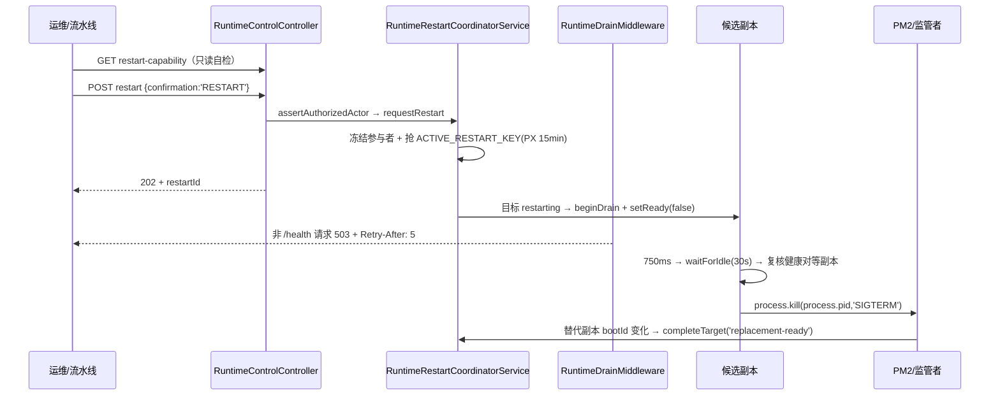

# 运行时控制与健康子专家 —— C1 能力契约

> 契约层 CR2 / CR5 / CR7。只写「对外可依赖的语义」：入口、参数行为、返回、异常与约束；路径均为仓库根相对 `file://` 引用。
> **资产基线**：`2026-10-16 · commit 80f5676fd`（批次 5 第 12 专家 · 子专家②），继承父域 [C1-能力契约.md](file://.module-experts/后端专题/运行时·沙箱·产物专家/C1-能力契约.md)。对外合同 **`/api/system/runtime`（6 端点）＋ `/api/health`（2 端点）**；**逐端点明细**见父域 [implementation/05-接口.md](file://.module-experts/后端专题/运行时·沙箱·产物专家/implementation/05-接口.md)，本文不复制。①③ 子域见 [子专家① C1](file://.module-experts/后端专题/运行时·沙箱·产物专家/sub-experts/沙箱执行子专家/C1-能力契约.md) 与 [子专家③ C1](file://.module-experts/后端专题/运行时·沙箱·产物专家/sub-experts/产物与文件访问子专家/C1-能力契约.md)。

**本文引用的文件**（相对仓库根，链接均为 `file://`）

- [packages/server/src/runtime-control/runtime-control.controller.ts](file://packages/server/src/runtime-control/runtime-control.controller.ts)
- [packages/server/src/runtime-control/runtime-control.service.ts](file://packages/server/src/runtime-control/runtime-control.service.ts)
- [packages/server/src/runtime-control/runtime-control.dto.ts](file://packages/server/src/runtime-control/runtime-control.dto.ts)
- [packages/server/src/runtime-control/runtime-control.module.ts](file://packages/server/src/runtime-control/runtime-control.module.ts)
- [packages/server/src/runtime-control/runtime-drain.middleware.ts](file://packages/server/src/runtime-control/runtime-drain.middleware.ts)
- [packages/server/src/runtime-control/runtime-lifecycle.service.ts](file://packages/server/src/runtime-control/runtime-lifecycle.service.ts)
- [packages/server/src/runtime-control/runtime-process-signaler.ts](file://packages/server/src/runtime-control/runtime-process-signaler.ts)
- [packages/server/src/runtime-control/runtime-restart-coordinator.service.ts](file://packages/server/src/runtime-control/runtime-restart-coordinator.service.ts)
- [packages/server/src/runtime-control/runtime-rollout-policy.ts](file://packages/server/src/runtime-control/runtime-rollout-policy.ts)
- [packages/server/src/runtime-control/runtime-restart-deadlines.ts](file://packages/server/src/runtime-control/runtime-restart-deadlines.ts)
- [packages/server/src/runtime-control/runtime-restart-target.store.ts](file://packages/server/src/runtime-control/runtime-restart-target.store.ts)
- [packages/server/src/runtime-control/plugin-runtime-generation.store.ts](file://packages/server/src/runtime-control/plugin-runtime-generation.store.ts)
- [packages/server/src/runtime-control/plugin-runtime-requirements.ts](file://packages/server/src/runtime-control/plugin-runtime-requirements.ts)
- [packages/server/src/runtime-control/plugin-convergence-capacity.ts](file://packages/server/src/runtime-control/plugin-convergence-capacity.ts)
- [packages/server/src/runtime-control/runtime-plugin-admission.ts](file://packages/server/src/runtime-control/runtime-plugin-admission.ts)
- [packages/server/src/runtime-control/runtime-shutdown.ts](file://packages/server/src/runtime-control/runtime-shutdown.ts)
- [packages/server/src/runtime-control/runtime-shutdown-preparation.ts](file://packages/server/src/runtime-control/runtime-shutdown-preparation.ts)
- [packages/server/src/runtime-control/shutdown-step.ts](file://packages/server/src/runtime-control/shutdown-step.ts)
- [packages/server/src/runtime-control/runtime-queue-shutdown.service.ts](file://packages/server/src/runtime-control/runtime-queue-shutdown.service.ts)
- [packages/server/src/health/health.controller.ts](file://packages/server/src/health/health.controller.ts)
- [packages/server/src/health/indicators/cache-health.indicator.ts](file://packages/server/src/health/indicators/cache-health.indicator.ts)
- [packages/server/src/health/indicators/redis-health.indicator.ts](file://packages/server/src/health/indicators/redis-health.indicator.ts)
- [packages/contracts/src/runtime-control.ts](file://packages/contracts/src/runtime-control.ts)
- [.deploy/api/healthcheck.cjs](file://.deploy/api/healthcheck.cjs)

## 目录

1. [§1 入口索引](#§1-入口索引)
2. [§2 服务契约](#§2-服务契约)
3. [§3 重启与排空契约](#§3-重启与排空契约)
4. [§4 示例](#§4-示例)
5. [§5 契约来源](#§5-契约来源)

## §1 入口索引

全局 URL 前缀 `api`（`bootstrap` 的 `setGlobalPrefix('api', { exclude: [...] })`）；`runtime-control` **无 RouterModule**，前缀写在 `@Controller('system/runtime')`；`health` 为 `@Controller('health')`。`runtime-control` 类级挂 `TenantPermissionGuard`，方法级装饰器与**服务层断言**两层粒度不等（逐条见下）。

| # | 方法 / 路径 | 类级 | 方法级 `RoleGuard` | 服务层断言 | 语义 |
|---|---|---|---|---|---|
| 1 | GET `/api/system/runtime/instances` | `TenantPermissionGuard` | **有**（`@Roles(SUPER_ADMIN)`） | `assertAuthorizedActor()` | 列出已注册 API 副本（`getRegisteredInstanceDetails()`） |
| 2 | POST `/api/system/runtime/instances/:instanceId/retire` | 同上 | **有** | 同上（另写结构化审计 `runtime.instance.retirement` ＋ actor/tenant/sourceIp） | 下线指定副本；body 必须 `expectedBootId`；不匹配返回 `boot-changed` 而非抛错 |
| 3 | POST `/api/system/runtime/restart` | 同上 | **有** | 同上 ＋ `confirmation === RUNTIME_RESTART_CONFIRMATION` | 全量优雅滚动重启；**202**；重复请求 409 `RUNTIME_RESTART_IN_PROGRESS`（带 `restartId`） |
| 4 | GET `/api/system/runtime/restart-capability` | 同上 | **无** | `restartCapability()` 结果仅作返回值，**不抛错** | 返回 `{ allowed, mode: 'rolling-self-signal', reason }`；任何通过租户门禁者可读 |
| 5 | GET `/api/system/runtime/restart/:restartId` | 同上 | **无** | **未调用** `assertAuthorizedActor()` | 读一次滚动重启状态；缺失 404 `RUNTIME_RESTART_NOT_FOUND` |
| 6 | GET `/api/system/runtime/plugin-convergence/:generation` | 同上 | **无** | **未调用** | 读某代插件运行时收敛状态；缺失 404 `PLUGIN_RUNTIME_CONVERGENCE_NOT_FOUND` |
| 7 | GET `/api/health/ready` | — | — | — | **`@Public()`**；只读本地 `readiness()`，非 `ready` 时 **503** ＋ `Cache-Control: no-store` |
| 8 | GET `/api/health` | — | — | — | **`@Public()`**；Terminus 聚合四项（`database`/`storage`/`cache`/`redis`，`redis` 仅 `REDIS_ENABLED=true`） |

DTO 校验：`RuntimeControlController` 带 `ValidationPipe(whitelist, forbidNonWhitelisted)` 双重 DTO 校验——`RuntimeRestartRequestDto`（`confirmation`、`allowDowntime`、`runtimeRequirements ≤100`、`reason`）与 `RuntimeInstanceRetirementDto`（`expectedBootId ≤100`）。

章节来源：[runtime-control.controller.ts](file://packages/server/src/runtime-control/runtime-control.controller.ts)（关键符号：@Controller('system/runtime') / @UseGuards(TenantPermissionGuard) / listInstances / retireInstance / restartCapability / restartStatus / pluginConvergenceStatus / restart）、[runtime-control.dto.ts](file://packages/server/src/runtime-control/runtime-control.dto.ts)（关键符号：RuntimeRestartRequestDto / RuntimeInstanceRetirementDto）、[health.controller.ts](file://packages/server/src/health/health.controller.ts)（关键符号：HealthController.readiness / HealthController.check）

## §2 服务契约

| `类.方法(签名)` | 用途 | 参数行为语义 · 约束 |
|---|---|---|
| `RuntimeControlService.listInstances()` / `retireInstance(instanceId, dto, {sourceIp})` / `restartCapability()` / `requestRestart(input, audit)` / `restartStatus(restartId)` / `pluginConvergenceStatus(generation)` | 6 端点的直接服务 | 前三个方法调 `assertAuthorizedActor()`；`restartCapability()` **纯返回不抛**（`interactive-auth-required` / `super-admin-required` / `default-tenant-required` / `allowed`）；`requestRestart` 再校验 `confirmation` 并把 `{source:'interactive', allowDowntime?, reason?, actorUserId, tenantId, sourceIp, runtimeRequirements}` 交给协调器；`restartStatus`/`pluginConvergenceStatus` 空则 404 |
| `RuntimeControlService.assertAuthorizedActor()`（private） | 三重前置断言 | 非 API Key（交互式会话）＋ `SUPER_ADMIN` ＋ 默认租户；把 `restartCapability().reason` **按字符串映射**为 403 `…_INTERACTIVE_AUTH_REQUIRED` / `…_SUPER_ADMIN_REQUIRED` / `…_DEFAULT_TENANT_REQUIRED` |
| `RuntimeControlService.recordPluginRuntimeChange(input)` / `recordPluginRuntimeRequirements(requirements, reason)` | 插件域内部登记面 | 直接转发协调器，**无身份断言**；发布失败返回 `scheduled:false, generation:0` 并打 error；rollout 未起时打 warn「durable but its rollout has not started yet」 |
| `RuntimeRestartCoordinatorService.requestRestart/processActiveRestart/beginReplicaRestart/terminateAfterDrain/finishOperation/transitionActiveRestart/reconcileLocalPlugins/getStatus/getPluginConvergenceStatus` | 唯一编排状态机 | `startOperation` → `prepareOperation`（`randomUUID()` 作 restartId、快照 `getReadyInstances()` 逐副本 `initialize`、`EXPIRE` 目标表）→ 抢锁（普通 `SET NX PX 15min`；`plugin-catch-up` 走 `claimCatchUp`）→ `activateOperation`（`deadlineAt = ceil(副本数/1) × 300s + 30s`、`phase='rolling'`）；每 tick 检查 `PENDING_TARGET_TIMEOUT_MS = 45s`、`REPLICA_RESTART_TIMEOUT_MS = 300s`、`deadlineAt`；协调 1 秒轮询 + Pub/Sub 唤醒（`duplicate()` 不可用则纯轮询） |
| `RuntimeLifecycleService.readiness()` / `beginDrain(restartId)` / `trackRequest()` / `waitForIdle(ms)` / `setReadinessGuard(guard)` / `beforeApplicationShutdown` | 就绪、排水与在途计数 | `beginDrain` **单例**（重复进入返回 false）；`trackRequest()` 返回 `null` 表示「drain 中或 `readinessGuard()` 为假」，成功时返回幂等 release 闭包；计数归零唤醒全部 `idleWaiters`；`readiness()` 返回 `status ∈ ready\|draining\|unready` |
| `RuntimeDrainMiddleware.use(request, response, next)` / `isHealthRequest(request)` | 全路由排空闸门 | `isHealthRequest` 用 `/\/health(?:\/|$)/` 匹配 `originalUrl.split('?')[0]`；命中即 `next()`；`trackRequest()` 为 `null` 时写 `Retry-After: 5` ＋ `Connection: close` ＋ **503** `{statusCode, errorCode, message}` 并**直接 return（不调 next）**；`errorCode` 取 `RUNTIME_DRAINING`（drain 中）或 `RUNTIME_NOT_READY`（准入未通过）；成功分支把 release 挂到 `response.once('finish')` 与 `once('close')` |
| `RUNTIME_PROCESS_SIGNALER`（`runtime-process-signaler.ts`） | 自信号抽象 | `useValue` 默认实现 `signal: (signal) => process.kill(process.pid, signal)`；生命周期取值只有 `'SIGTERM'`；测试可替换 |
| `RuntimePluginAdmission.refresh(generations, rollout?)` / `isStable()` | 准入闸门（决定本副本是否 ready） | `ready = isPluginStartupListening() && admitted && isLeaseValid() && readiness().status !== 'draining'`，随后 `setReady(ready, checkedUntil = now + 5s)`；`isStable()` 要求 ready 持续 ≥3 秒；稳定后才 `admitPluginStartup(state)` 落盘「已知良好启动」；失败的候选不清空既有健康副本的准入 |
| `PluginRuntimeGenerationStore.publish/readDesired/writeState/readPending/hasAttempted/claimCatchUp` | 插件代次存储（Lua） | `publish` 原子冻结清单（`INCR` 代次 → 写 `:gen:change`/`:gen:status=in_progress` → 逐条 `HSET` 期望清单 → 快照 `:gen:requirements`）；`writeState` 带 `restartId` 时要求活动锁属于它且**拒绝覆盖当前代次的 failed**；`readDesired` 一次 `HGETALL` 取原子快照，历史过期后 fail-closed 取 `failed`；`hasAttempted` 用 `REPLICA_ATTEMPTS_KEY` 保证每副本每代次最多追平一次 |
| `evaluateRuntimeRequirements(requirements, state)` / `mergeRuntimeRequirements(...)` | 收敛判定与清单合并 | 四种失败：需求 `absent` 却发现插件或失败记录、`failure` 命中、`loaded` 未命中、`version`/`runtimeRevision` 不一致；无运行态返回 `waiting`；合并以 `scopeKey\u0000pluginName` 为键去重 |
| `createRestartMetadata(...)`（`runtime-rollout-policy.ts`）/ `operationDeadlineAt` / `restartStatus`（`runtime-restart-deadlines.ts`） | 策略与期限推导（纯函数） | 把「交互式需求 + 各排队代次需求」合并为 `runtimeRequirements`，并以 `readRequirements(generation)` 冻结 `admissionRequirements`（注释：「Full desired manifest at this operation's generation, never a later queued generation」）；`maxConcurrentRestarts = 1`、`batchSize = 1`、`slot:0` |
| `awaitPluginRestartApproval(...)`（`plugin-convergence-capacity.ts`） | 最后副本的保险 | 「只剩 1 个健康副本且需求未满足且未获故障容忍」时**保持 idle** 并把代次写成 `awaiting_restart`（不自动中断服务），等运维显式 `allowDowntime` |
| `prepareApiShutdown(...)` / `RuntimeQueueShutdownService.close/closeQueues/drainShutdownQueues` / `enableRuntimeShutdown` / `runShutdownStep` / `pendingShutdownSteps` | 关停面 | `prepareApiShutdown` = `beginDrain({restartId:'process-shutdown'})` → `waitForIdle(10_000)` → `queues.close()`；队列发现按实例身份去重（`Bull.pause(true)`/`close(true)`、`WorkerHost.worker.pause()/close(true)`），单队列 `runShutdownStep(..., timeoutMs = 10_000)` 且全部排水后加 barrier 再 close；`enableRuntimeShutdown` 覆盖 Nest 自带无界监听、装**一个** 30 秒看门狗（`unref`），`beforeClose` 非 `completed` 即 `finish(1)`，`app.close(signal)` 后 `process.exit(status === 'completed' ? 0 : 1)`；`runShutdownStep` 默认 3 秒、返回 `completed\|failed\|timed_out` |
| `HealthController.readiness(response)` / `check()` | 两条 `@Public()` 探针 | `readiness` 只读 `runtimeLifecycle.readiness()`，非 `ready` 时 `status(503)`（`passthrough`）＋恒设 `Cache-Control: no-store`，**不查外部依赖**；`check` 生成 `HealthCheckExecutionTimer-<uuid>`、按四个硬编码开关顺序 push 四项再 `health.check(checks)`；`database` 用 `userRepository.count()`（`checkDbWithTerminus=false` 使 60 秒 ping 常闭），`storage` 用 `disk.checkStorage('storage', {path: resolve(__dirname), thresholdPercent: 99.999999})`，`cache` 用 `cacheManager.set/get` 往返，`redis` 仅 `REDIS_ENABLED === 'true'` 时入列；前三项之外，DB/磁盘异常被吞成 `{status:'down', message}`，`cache`/`redis` 抛 `HealthCheckError` 才聚合失败 |
| `CacheHealthIndicator.isHealthy(context)` / `RedisHealthIndicator.startRedis/checkRedis/stopRedis` | 两个自定义指示器 | `cache` 指示器写随机键比对并附 `cacheType: REDIS_ENABLED==='true' ? 'redis' : 'memory'`；`redis` 指示器构造函数内异步 `startRedis()`（不 await、打印含口令的 `REDIS_URL`），`checkRedis()` 用自建客户端 set/get 随机键，`stopRedis()` **无调用点**（注释 `TODO`） |

章节来源：[runtime-control.service.ts](file://packages/server/src/runtime-control/runtime-control.service.ts)（关键符号：RuntimeControlService / restartCapability / requestRestart / assertAuthorizedActor）、[runtime-restart-coordinator.service.ts](file://packages/server/src/runtime-control/runtime-restart-coordinator.service.ts)（关键符号：startOperation / beginReplicaRestart / terminateAfterDrain / transitionActiveRestart）、[runtime-plugin-admission.ts](file://packages/server/src/runtime-control/runtime-plugin-admission.ts)（关键符号：refresh / isStable / setReadinessGuard）、[health.controller.ts](file://packages/server/src/health/health.controller.ts)（关键符号：check / readiness / checkDbWithTerminus / checkStorage）

## §3 重启与排空契约

| 阶段 | 前置条件 | 影响面 | 恢复判据 |
|---|---|---|---|
| **① 触发与准入** | body `confirmation === RUNTIME_RESTART_CONFIRMATION`；三重断言（交互式 ＋ `SUPER_ADMIN` ＋ 默认租户）；`ACTIVE_RESTART_KEY` 未被占用（否则 409 `RUNTIME_RESTART_IN_PROGRESS` 带 `restartId`） | 无（仅写 Redis：`…:restart:<id>:metadata`、逐副本 `…:targets`） | 操作被 `EXPIRE` 后自然清理；重复请求在活动锁 `PX 15min`（激活时按期限延长）内被拒 |
| **② 参与者冻结与期限** | `getReadyInstances()` 快照 + 逐副本 `expectedBootId` 落库 | **未就绪副本不被纳入**，之后由 `plugin-catch-up` 追平（每副本每代次一次，`REPLICA_ATTEMPTS_KEY`） | `deadlineAt = ceil(副本数 / 1) × 300s + 30s`；超期 → failed |
| **③ 候选副本摘流量** | `admission.isStable()`（ready 且 ready 持续 ≥3s）、抢到唯一重启槽、复核「`allowDowntime` 或仍有别的健康副本」、`preparePluginStartupRetry()` | `setReady(false)` ＋ `lifecycle.beginDrain({restartId, requestedAt})`（单例，返回 false 即回滚目标并释放槽）；此后**非 `/health` 请求一律 503 ＋ `Retry-After: 5` ＋ `Connection: close`** | drain 期间 `/health*` 仍可探活（中间件豁免），故「探针绿、业务红」是可观测的稳定状态 |
| **④ 排空与自信号** | 延迟 `signalDelayMs = 750ms`（`unref`）后 `waitForIdle(30_000)` | SSE/长连接被计为在途请求，故需 30 秒上限（`DEFAULT_DRAIN_TIMEOUT_MS`）＋ `forceCloseConnections`；**在途沙箱作业不中断**，但依赖本副本 SSE 的调用方会看到流被切断 | 复核「活动键未变 + 无 failed 目标 + 仍有健康对等副本」→ 写审计 `runtime.restart.replica-signaling` → `processSignaler.signal('SIGTERM')`；任一步失败即 `cancelDrain` ＋ `failTarget` ＋ `finishOperation('failed')` |
| **⑤ 替代副本交接** | 新进程 bootId 变化；先查 `getPluginStartupFailure()` 再做 `evaluateRuntimeRequirements`（优先用操作冻结的 `admissionRequirements`） | 替代副本在达标前不接流量（准入闸门） | `satisfied` 且 `isStable()` 才 `completeTarget('replacement-ready')`（写 `acknowledgedBootId`、释放槽、审计、广播）；`waiting` 就等、`failed` 就失败；同操作内出现更新代次时用 `TRANSITION_ACTIVE_RESTART_SCRIPT` **原子交棒**（`generation-changed` 重试、`lost` 退出） |
| **⑥ 进程关停预算（旁路）** | `enableRuntimeShutdown` 被安装到真实入口 `[推测]`（仓库内无生产调用点） | HTTP 宽限 10 秒（`HTTP_SHUTDOWN_DRAIN_TIMEOUT_MS`）→ 队列 `pause(true)`/`close(true)`（本地 pause 不暂停其它副本）；总预算 30 秒 | `runShutdownStep` 三态；超时 `writeSync(2, …deadline-exceeded, pendingSteps…)` 后 `process.exit(1)`；`beforeClose` 非 `completed` 直接 `finish(1)`（**绝不在未完成的 prepare 之下销毁依赖**） |
| **⑦ 多副本与 `allowDowntime`** | 串行滚动（`maxConcurrentRestarts = 1`）；**最后一个健康副本必须运维显式 `allowDowntime`** | 否则 `awaitPluginRestartApproval` 把代次写成 `awaiting_restart` 并静默等待（不重试、不通知，只有代次端点可查） | 多副本硬前提：**共享同一 Redis**，否则各副本各看到一份空状态 |



图表来源：[runtime-restart-coordinator.service.ts](file://packages/server/src/runtime-control/runtime-restart-coordinator.service.ts)（关键符号：startOperation / beginReplicaRestart / terminateAfterDrain / completeTarget）、[runtime-drain.middleware.ts](file://packages/server/src/runtime-control/runtime-drain.middleware.ts)（关键符号：use / isHealthRequest）、[runtime-process-signaler.ts](file://packages/server/src/runtime-control/runtime-process-signaler.ts)（关键符号：RUNTIME_PROCESS_SIGNALER）

章节来源：[runtime-restart-coordinator.service.ts](file://packages/server/src/runtime-control/runtime-restart-coordinator.service.ts)（关键符号：ACTIVE_RESTART_KEY / prepareOperation / activateOperation / cancelDrain）、[runtime-lifecycle.service.ts](file://packages/server/src/runtime-control/runtime-lifecycle.service.ts)（关键符号：beginDrain / trackRequest / waitForIdle / readiness）、[runtime-rollout-policy.ts](file://packages/server/src/runtime-control/runtime-rollout-policy.ts)（关键符号：createRestartMetadata / maxConcurrentRestarts）

## §4 示例

### ① 触发一次重启（能力自检 → 202 → 轮询状态）

```ts
// 真实调用方形态：先 GET /api/system/runtime/restart-capability 自检，再 POST /restart
const capability = await http.get('/api/system/runtime/restart-capability')
// → { allowed: boolean, mode: 'rolling-self-signal', reason?: 'interactive-auth-required' | … }
if (!capability.allowed) throw new Error(capability.reason)

const accepted = await http.post('/api/system/runtime/restart', {
    confirmation: 'RESTART',      // RuntimeRestartRequestDto：confirmation 必须等于 RUNTIME_RESTART_CONFIRMATION
    allowDowntime: false,         // 最后一个健康副本必须显式改为 true，否则 awaitPluginRestartApproval 保持 idle
    reason: 'release 2026.10'
})                                // → 202 + { restartId }
const status = await http.get(`/api/system/runtime/restart/${accepted.restartId}`)
```

要点：`restart-capability` 是**只读自检且不抛错**；`requestRestart` 会再做一次 `assertAuthorizedActor()`（交互式 ＋ `SUPER_ADMIN` ＋ 默认租户），失败依次是三个 `RUNTIME_RESTART_*` 403；重复请求在活动锁内抛 409 并回带 `restartId`。

### ② 观察一次排空（中间件 503 与探针豁免）

```ts
// 客户端视角（服务端为 RuntimeDrainMiddleware.forRoutes('*')）
const res = await fetch('/api/xpert', { headers })
if (res.status === 503) {
    const body = await res.json()            // { statusCode: 503, errorCode, message }
    if (body.errorCode === 'RUNTIME_DRAINING') await sleep(Number(res.headers.get('retry-after')) * 1000)
    // 注意：Retry-After 固定 5 秒，而实际 drain 上限是 30 秒 → 可能连续撞 503
    if (body.errorCode === 'RUNTIME_NOT_READY') await backoff()   // 准入闸门未通过，不是排空
}
const probe = await fetch('/api/health/ready')   // /health* 被中间件豁免，排空期仍可探活
```

要点：中间件在 503 分支**不调用 `next()`**；`/health*` 路径按 `/\/health(?:\/|$)/` 豁免，因此排空期「探针绿、业务红」是设计内状态；`RUNTIME_NOT_READY` 来自 `readinessGuard()`（`RuntimePluginAdmission` 注入），排障要跳到该文件而不是只看生命周期服务。

### ③ 探针接入（容器自检与就绪判定）

```js
// 真实调用方：.deploy/api/healthcheck.cjs
const ready = await check('/api/health/ready', 5000)   // AbortSignal.timeout(5000)
const health = await check('/api/health', 5000)
// 要求 ready.status === 'ready'、health.status === 'ok'，
// 并逐项校验 database / cache（REDIS_ENABLED=true 时含 redis）的 details[*].status === 'up'

// 服务端：HealthController
@Public() @Get('ready')
async readiness(@Res({ passthrough: true }) response: Response) {
    const state = this.runtimeLifecycle.readiness()      // { status, instanceId, activeRequests, restartId }
    response.header('Cache-Control', 'no-store')
    if (state.status !== 'ready') response.status(HttpStatus.SERVICE_UNAVAILABLE)
    return state
}
```

要点：`/health/ready` 只反映**本地**就绪（drain / 准入 / 注册租约），**不查任何外部依赖**；`/health` 才做四项体检，但 DB 与磁盘异常被吞成 `{status:'down'}` 返回体（Terminus 聚合可能仍为 `ok`），因此容器脚本必须**逐项校验 `details[*].status`**；本域不设单点超时，则时限来自探针侧的 5 秒。

章节来源：[runtime-control.service.ts](file://packages/server/src/runtime-control/runtime-control.service.ts)（关键符号：restartCapability / requestRestart / restartStatus）、[runtime-drain.middleware.ts](file://packages/server/src/runtime-control/runtime-drain.middleware.ts)（关键符号：use / isHealthRequest）、[health.controller.ts](file://packages/server/src/health/health.controller.ts)（关键符号：readiness / check）、[healthcheck.cjs](file://.deploy/api/healthcheck.cjs)（关键符号：check）

## §5 契约来源

| 契约条目 | 来源 |
|---|---|
| 6 端点、类级/方法级门禁组合与 DTO 校验 | `packages/server/src/runtime-control/{runtime-control.controller.ts,runtime-control.dto.ts,runtime-control.module.ts}` |
| 三重断言、错误码映射与审计转发 | `packages/server/src/runtime-control/runtime-control.service.ts` |
| 滚动重启状态机（锁、目标表、期限、交棒、审计） | `packages/server/src/runtime-control/{runtime-restart-coordinator.service.ts,runtime-restart-target.store.ts,runtime-rollout-policy.ts,runtime-restart-deadlines.ts,runtime-restart.types.ts}` |
| 插件代次发布/收敛判定/准入/等待批准 | `packages/server/src/runtime-control/{plugin-runtime-generation.store.ts,plugin-runtime-requirements.ts,plugin-convergence-capacity.ts,runtime-plugin-admission.ts,runtime-plugin-admission.ts}` |
| 排空中间件、在途计数与就绪状态 | `packages/server/src/runtime-control/{runtime-drain.middleware.ts,runtime-lifecycle.service.ts}` |
| 自信号抽象与进程级关停预算 | `packages/server/src/runtime-control/{runtime-process-signaler.ts,runtime-shutdown.ts,runtime-shutdown-preparation.ts,shutdown-step.ts,runtime-queue-shutdown.service.ts}` |
| 两条健康探针与四个检查项 | `packages/server/src/health/{health.controller.ts,health.module.ts,indicators/cache-health.indicator.ts,indicators/redis-health.indicator.ts}`、`.deploy/api/healthcheck.cjs` |
| 跨域消费面（注册表、插件启动态） | `packages/server/src/managed-connection/instance-registry.service.ts`、`packages/server/src/plugin/plugin-startup-state.ts`（邻域） |
| 逐端点明细与错误语义全集 | 父域 [implementation/05-接口.md](file://.module-experts/后端专题/运行时·沙箱·产物专家/implementation/05-接口.md)（本文不复制） |

章节来源：[runtime-control.module.ts](file://packages/server/src/runtime-control/runtime-control.module.ts)（关键符号：RuntimeControlModule）、[plugin-runtime-generation.store.ts](file://packages/server/src/runtime-control/plugin-runtime-generation.store.ts)（关键符号：PUBLISH_PLUGIN_GENERATION_SCRIPT / writeState）、[runtime-control/index.ts](file://packages/server/src/runtime-control/index.ts)（关键符号：导出面）
