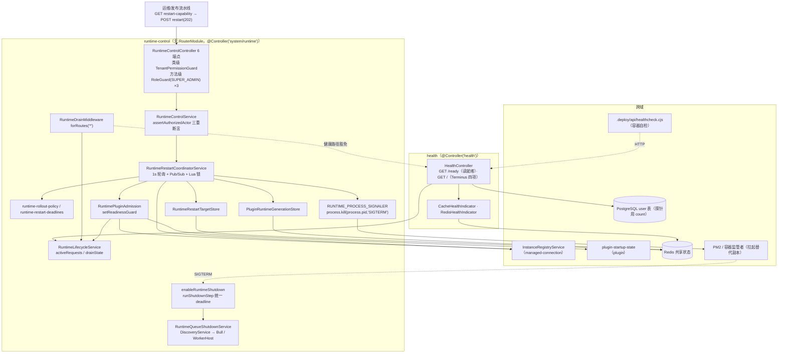

# 运行时·沙箱·产物专家 ② · 运行时控制与健康子专家 · 架构

> 只读梳理（commit `80f5676fd`）。范围：`packages/server/src/runtime-control/**`（**22 非 spec / 10 spec / 0 表**）＋ `packages/server/src/health/**`（**5 非 spec / 0 spec / 1 表**，注册外部实体 `user`）。实际前缀 **`/api/system/runtime`（6 端点，无 RouterModule）** 与 **`/api/health`（2 端点）**。**不含** `sandbox`（→①）· `artifacts`/`workspace-file-access`（→③）。引用为仓库根相对 `file://` 路径；未证实处标 `[推测]`。

**本文引用的文件**

- [runtime-control/runtime-control.controller.ts](file://packages/server/src/runtime-control/runtime-control.controller.ts) · [runtime-control.service.ts](file://packages/server/src/runtime-control/runtime-control.service.ts) · [runtime-control.dto.ts](file://packages/server/src/runtime-control/runtime-control.dto.ts) · [runtime-control.module.ts](file://packages/server/src/runtime-control/runtime-control.module.ts) · [index.ts](file://packages/server/src/runtime-control/index.ts)
- [runtime-drain.middleware.ts](file://packages/server/src/runtime-control/runtime-drain.middleware.ts) · [runtime-lifecycle.service.ts](file://packages/server/src/runtime-control/runtime-lifecycle.service.ts) · [runtime-process-signaler.ts](file://packages/server/src/runtime-control/runtime-process-signaler.ts)
- [runtime-restart-coordinator.service.ts](file://packages/server/src/runtime-control/runtime-restart-coordinator.service.ts) · [runtime-rollout-policy.ts](file://packages/server/src/runtime-control/runtime-rollout-policy.ts) · [runtime-restart-deadlines.ts](file://packages/server/src/runtime-control/runtime-restart-deadlines.ts) · [runtime-restart-target.store.ts](file://packages/server/src/runtime-control/runtime-restart-target.store.ts) · [runtime-restart.types.ts](file://packages/server/src/runtime-control/runtime-restart.types.ts)
- [plugin-runtime-generation.store.ts](file://packages/server/src/runtime-control/plugin-runtime-generation.store.ts) · [plugin-runtime-requirements.ts](file://packages/server/src/runtime-control/plugin-runtime-requirements.ts) · [plugin-convergence-capacity.ts](file://packages/server/src/runtime-control/plugin-convergence-capacity.ts) · [runtime-plugin-admission.ts](file://packages/server/src/runtime-control/runtime-plugin-admission.ts)
- [runtime-shutdown.ts](file://packages/server/src/runtime-control/runtime-shutdown.ts) · [runtime-shutdown-preparation.ts](file://packages/server/src/runtime-control/runtime-shutdown-preparation.ts) · [shutdown-step.ts](file://packages/server/src/runtime-control/shutdown-step.ts) · [runtime-queue-shutdown.service.ts](file://packages/server/src/runtime-control/runtime-queue-shutdown.service.ts) · [runtime-restart.test-fixture.ts](file://packages/server/src/runtime-control/runtime-restart.test-fixture.ts) · [fixtures/shutdown-process.cjs](file://packages/server/src/runtime-control/fixtures/shutdown-process.cjs)
- [health/health.controller.ts](file://packages/server/src/health/health.controller.ts) · [health/health.module.ts](file://packages/server/src/health/health.module.ts) · [health/index.ts](file://packages/server/src/health/index.ts) · [indicators/cache-health.indicator.ts](file://packages/server/src/health/indicators/cache-health.indicator.ts) · [indicators/redis-health.indicator.ts](file://packages/server/src/health/indicators/redis-health.indicator.ts)
- 同包依赖：[managed-connection/instance-registry.service.ts](file://packages/server/src/managed-connection/instance-registry.service.ts) · [plugin/plugin-startup-state.ts](file://packages/server/src/plugin/plugin-startup-state.ts) · [bootstrap/index.ts](file://packages/server/src/bootstrap/index.ts) · [bootstrap/bootstrap.module.ts](file://packages/server/src/bootstrap/bootstrap.module.ts) · [server.module.ts](file://packages/server/src/server.module.ts) · [packages/contracts/src/runtime-control.ts](file://packages/contracts/src/runtime-control.ts) · [.deploy/api/healthcheck.cjs](file://.deploy/api/healthcheck.cjs)
- 父级：[C1-能力契约.md](file://.module-experts/后端专题/运行时·沙箱·产物专家/C1-能力契约.md) · [C5-关键决策.md](file://.module-experts/后端专题/运行时·沙箱·产物专家/C5-关键决策.md) · [implementation/01-架构.md](file://.module-experts/后端专题/运行时·沙箱·产物专家/implementation/01-架构.md) · [implementation/05-接口.md](file://.module-experts/后端专题/运行时·沙箱·产物专家/implementation/05-接口.md) · [implementation/07-运维.md](file://.module-experts/后端专题/运行时·沙箱·产物专家/implementation/07-运维.md)

## 目录

1. [§1 子域职责与边界](#§1-子域职责与边界)
2. [§2 目录结构与分层](#§2-目录结构与分层)
3. [§3 依赖关系](#§3-依赖关系)
4. [§4 关键不变量](#§4-关键不变量)
5. [§5 架构总览](#§5-架构总览)
6. [§6 结论](#§6-结论)

## §1 子域职责与边界

**做什么**：管的是 **API 进程副本自己的生命周期**，不是容器也不是沙箱。① 运行时控制面（`RuntimeControlController` 6 端点 → `RuntimeControlService` → `RuntimeRestartCoordinatorService`）：列出/退役注册副本（`listInstances`、`retireInstance`）、重启能力自检（`restartCapability`）、滚动重启编排与查询（`requestRestart`、`restartStatus`）、插件运行时收敛查询（`pluginConvergenceStatus`），并对外暴露 `recordPluginRuntimeChange` / `recordPluginRuntimeRequirements` 供插件域登记「目标插件清单」。② 排空与关停面：`RuntimeDrainMiddleware`（全路由挂载）＋ `RuntimeLifecycleService`（在途请求计数、drain 单例、就绪状态）＋ `prepareApiShutdown` / `RuntimeQueueShutdownService`（HTTP 宽限期 → 队列 pause/close）＋ `enableRuntimeShutdown`（一信号一预算的进程级看门狗）。③ 健康面：`HealthController` 两条探针（`GET /health/ready` 读就绪；`GET /health` 用 Terminus 聚合依赖体检）＋两个指示器。

**不做什么**：不重启容器、不调度 Pod、不接触 NsJail Runner（容器编排在部署层，详见父级 [implementation/07-运维.md](file://.module-experts/后端专题/运行时·沙箱·产物专家/implementation/07-运维.md)）；不拥有副本注册表本体（`InstanceRegistryService` 属 `managed-connection`，本域只消费 `getReadyInstances` / `getRegisteredInstanceDetails` / `retireInstance` / `setReady` / `isLeaseValid` / `getPluginState`）；不拥有插件装载与启动重试语义（`plugin/plugin-startup-state.ts`）；不承担业务数据健康（DB 探活只做 `userRepository.count()`，不校验表结构或迁移状态）；不写任何本域表——`health` 的唯一实体注册是从 `core/entities/internal` 引入的外部实体 `User`。

**边界判据（实测）**：`runtime-control` **没有 RouterModule**，前缀直接写在 `@Controller('system/runtime')`；`health` 同样是 `@Controller('health')` ＋ 全局前缀 `api`（`bootstrap/index.ts` 的 `setGlobalPrefix('api', { exclude: [...] })`）。因此两条域面的对外合同分别是 `/api/system/runtime/*`（6 条）与 `/api/health*`（2 条）。

章节来源：[runtime-control.controller.ts](file://packages/server/src/runtime-control/runtime-control.controller.ts)（关键符号：RuntimeControlController / listInstances / retireInstance / restartCapability / restartStatus / pluginConvergenceStatus / restart）、[runtime-control.service.ts](file://packages/server/src/runtime-control/runtime-control.service.ts)（关键符号：RuntimeControlService / requestRestart / recordPluginRuntimeRequirements）、[health.controller.ts](file://packages/server/src/health/health.controller.ts)（关键符号：HealthController.readiness / HealthController.check）、[bootstrap/index.ts](file://packages/server/src/bootstrap/index.ts)（关键符号：setGlobalPrefix）

## §2 目录结构与分层

**`runtime-control/` 22 个非 spec 文件按职责分四层**：

| 层 | 文件 | 职责 |
|---|---|---|
| 入口层 | `runtime-control.controller.ts`、`runtime-control.dto.ts`、`runtime-control.module.ts`、`index.ts` | 6 端点 ＋ 类级/方法级门禁 ＋ `ValidationPipe(whitelist, forbidNonWhitelisted)` 双重 DTO 校验；模块负责装配与 `forRoutes('*')` 挂载中间件，并导出 3 个服务给同包复用 |
| 控制面服务层 | `runtime-control.service.ts`、`runtime-restart-coordinator.service.ts` | 前者做门禁断言与错误码映射（403 三兄弟 / 400 / 404 / 409 / 503），后者是唯一的编排状态机（Redis 锁、目标表、1 秒轮询、Pub/Sub 唤醒） |
| 策略与存储层 | `runtime-rollout-policy.ts`、`runtime-restart-deadlines.ts`、`runtime-restart-target.store.ts`、`plugin-runtime-generation.store.ts`、`plugin-runtime-requirements.ts`、`plugin-convergence-capacity.ts`、`runtime-plugin-admission.ts`、`runtime-restart.types.ts` | 纯函数策略（准入清单冻结、期限与状态推导、需求求值/合并）＋ 两个 Redis 存储封装（targets / generations）＋ 准入闸门（读写就绪与插件代次对齐） |
| 生命周期与关停层 | `runtime-drain.middleware.ts`、`runtime-lifecycle.service.ts`、`runtime-process-signaler.ts`、`runtime-shutdown.ts`、`runtime-shutdown-preparation.ts`、`shutdown-step.ts`、`runtime-queue-shutdown.service.ts` | 请求侧排空与在途计数、自信号抽象、进程级关停预算、逐步超时包装、队列发现与排水 |
| 测试基建（非 spec） | `runtime-restart.test-fixture.ts`、`fixtures/shutdown-process.cjs` | 内存 `FakeRedis` ＋ `createNode` 多副本夹具；真实 Node/Nest 子进程夹具（用 `typescript` 现场转译本域 TS 源码） |

**`health/` 5 个文件分两层**：控制器层 `health.controller.ts`（2 端点）＋ 装配层 `health.module.ts` / `index.ts`（`TypeOrmModule.forFeature([User])`、`DatabaseModule`、`RuntimeControlModule`、`TerminusModule`）；指示器层 `indicators/cache-health.indicator.ts`（`CACHE_MANAGER` set/get 往返）与 `indicators/redis-health.indicator.ts`（自建 `redis` 客户端，仅 `REDIS_ENABLED === 'true'` 时被健康检查调用）。

**分层约束**：控制器不持业务状态；编排状态全在 Redis（键族 `xpert:system:runtime:restart:*`、`xpert:system:plugin-runtime:*`）；进程内状态只有三个——`RuntimeLifecycleService` 的 `activeRequests`/`drainState`、`RuntimePluginAdmission` 的准入位与 `readySince`、协调器的 `processing` 重入锁。因此**任何进程重启都会丢失本地视图而保留集群视图**。

章节来源：[runtime-control.module.ts](file://packages/server/src/runtime-control/runtime-control.module.ts)（关键符号：RuntimeControlModule.configure）、[runtime-control.dto.ts](file://packages/server/src/runtime-control/runtime-control.dto.ts)（关键符号：RuntimeRestartRequestDto / RuntimeInstanceRetirementDto）、[runtime-restart.types.ts](file://packages/server/src/runtime-control/runtime-restart.types.ts)（关键符号：RestartOperationMetadata / RestartTargetState / PluginGenerationState）、[health.module.ts](file://packages/server/src/health/health.module.ts)（关键符号：HealthModule imports）

## §3 依赖关系

**出向（本域依赖别人）**：

| 依赖 | 用途 | 证据 |
|---|---|---|
| Redis（`REDIS_CLIENT` 注入） | 活动重启锁、目标表、注册锁、插件代次与期望清单、Pub/Sub 频道 `xpert:system:runtime:restart:events`；**多处 Lua 脚本**（发布代次、写代次状态、catch-up 抢占、锁释放/续期、活动中转） | `runtime-restart-coordinator.service.ts`、`plugin-runtime-generation.store.ts`、`runtime-restart-target.store.ts` |
| `InstanceRegistryService`（`managed-connection`） | 参与者集合 `getReadyInstances`、身份 `instanceId`/`bootId`、就绪上报 `setReady`、租约 `isLeaseValid`、插件运行态 `getPluginState`、退役 `retireInstance`/`getRegisteredInstanceDetails` | `runtime-control.service.ts`、`runtime-plugin-admission.ts` |
| `plugin/plugin-startup-state.ts` | 启动监听位 `isPluginStartupListening`、准入落库 `admitPluginStartup`、失败恢复 `canRestorePluginStartup`、重试准备 `preparePluginStartupRetry`、启动失败 `getPluginStartupFailure` | `runtime-plugin-admission.ts`、`runtime-restart-coordinator.service.ts` |
| 队列运行时（`bull` 的 `Bull` / `@nestjs/bullmq` 的 `WorkerHost`） | 关停时用 `DiscoveryService` 按身份发现队列并 `pause(true)`/`close(true)`、`worker.pause()`/`worker.close(true)` | `runtime-queue-shutdown.service.ts` |
| `RequestContext`（`core/context`）＋ `getDefaultTenantId`（plugin-sdk） | 三重断言：交互式会话、`SUPER_ADMIN`、默认租户 | `runtime-control.service.ts` |
| health 侧 | Terminus（`HealthCheckService`/`TypeOrmHealthIndicator`/`DiskHealthIndicator`）、`CACHE_MANAGER`、TypeORM `Repository<User>`、`redis` 客户端 | `health.controller.ts`、两个指示器、`bootstrap/bootstrap.module.ts` 的 cache 配置 |

**入向（谁依赖本域）**：`server.module.ts` 同时导入 `RuntimeControlModule` 与 `HealthModule`；`plugin/plugin.module.ts` 导入 `RuntimeControlModule` 并复用 `runShutdownStep` 做插件侧关停步骤；`health.module.ts` 为拿 `RuntimeLifecycleService` 而导入 `RuntimeControlModule`（被导出符号：`RuntimeLifecycleService` / `RuntimeControlService` / `RuntimeQueueShutdownService`）。全局 `AuthGuard`＋`PluginScopeGuard` 由 bootstrap 安装，故两条健康端点必须 `@Public()` 才可达。

**部署向依赖（不属代码依赖但决定语义）**：生产 API 由 Docker 内的 PM2 监管，重启是「进程对自己发 SIGTERM，监管者拉起替代副本」；容器自检脚本 `.deploy/api/healthcheck.cjs` 并发取 `/api/health/ready` 与 `/api/health` 并要求 `database`/`cache`（`REDIS_ENABLED=true` 时含 `redis`）为 `up`。

章节来源：[runtime-restart-coordinator.service.ts](file://packages/server/src/runtime-control/runtime-restart-coordinator.service.ts)（关键符号：ACTIVE_RESTART_KEY / RESTART_CHANNEL / startSubscriber / ensurePendingPluginOperation）、[runtime-queue-shutdown.service.ts](file://packages/server/src/runtime-control/runtime-queue-shutdown.service.ts)（关键符号：RuntimeQueueShutdownService.closeQueues）、[server.module.ts](file://packages/server/src/server.module.ts)（关键符号：RuntimeControlModule / HealthModule）、[healthcheck.cjs](file://.deploy/api/healthcheck.cjs)（关键符号：check）

## §4 关键不变量

**① 6 端点的门禁粒度实测差异（装饰器 + 服务层两层，读写不等）**：

| 端点（前缀 `/api/system/runtime`） | 类级 | 方法级 `RoleGuard` | 服务层断言 | 实测结论 |
|---|---|---|---|---|
| `GET /instances` | `TenantPermissionGuard` | **有**（`@Roles(SUPER_ADMIN)`） | `assertAuthorizedActor()` | 双层 |
| `POST /instances/:instanceId/retire` | 同上 | **有** | 同上（另记审计 actor/tenant/sourceIp） | 双层 |
| `POST /restart`（**202**） | 同上 | **有** | 同上 ＋ `confirmation === 'RESTART'` | 双层 |
| `GET /restart-capability` | 同上 | **无** | `restartCapability()` 结果仅为返回值，**不抛错** | **仅装饰器层租户门禁；任何人可读能力位** |
| `GET /restart/:restartId` | 同上 | **无** | `restartStatus()` **未调用** `assertAuthorizedActor()` | **仅租户门禁；可读任意 restartId 状态** |
| `GET /plugin-convergence/:generation` | 同上 | **无** | `pluginConvergenceStatus()` **未调用** 断言 | **仅租户门禁** |

服务层 `assertAuthorizedActor()` 只在 `listInstances`/`retireInstance`/`requestRestart` 三处被调用（实测），其三重前置为「非 API Key（交互式）＋ `SUPER_ADMIN` ＋ 默认租户」，失败依次抛 403 `RUNTIME_RESTART_INTERACTIVE_AUTH_REQUIRED` / `…_SUPER_ADMIN_REQUIRED` / `…_DEFAULT_TENANT_REQUIRED`。`restartCapability` 自身对这三种身份返回 `allowed:false`＋`reason`。

**② `runtime-drain.middleware` 的作用与触发面**：`RuntimeControlModule.configure` 以 `forRoutes('*')` 全路由挂载；`use()` 先用 `isHealthRequest`（`/\/health(?:\/|$)/` 匹配 `originalUrl` 去 query 后的路径）**放行任何以 `/health` 结尾或 `/health/…` 的路径**，再调 `lifecycle.trackRequest()`。返回 `null` 即进入「排空/未就绪」分支：`Retry-After: 5` ＋ `Connection: close` ＋ **503**，`errorCode` 依 `readiness().status` 取 `RUNTIME_DRAINING`（drain 中）或 `RUNTIME_NOT_READY`（准入闸门未通过）。成功分支把释放闭包挂到 `response.once('finish')` 与 `once('close')`（内部 `released` 幂等位，双触发只释放一次）。**触发面有两个**：`beginDrain` 之后的排空期，以及 `readinessGuard()` 为假（插件启动未监听、准入未通过、校验窗口过期、注册租约失效）——即**插件收敛的围栏会直接表现为中间件 503**。

**③ 重启的幂等与在途执行影响**：幂等由「单活动操作」保证——`ACTIVE_RESTART_KEY`（`SET NX PX` 15 分钟，激活时按期限延长）＋ 每 `restartId` 只有一个重启槽（`batchSize = 1`，`slot:0`）＋ 协调器 `processing` 重入锁；重复请求抛 409 `RUNTIME_RESTART_IN_PROGRESS`（带 `restartId`）。在途影响：候选副本先 `setReady(false)`，等 **750 ms**（`signalDelayMs`）后 `waitForIdle(30_000)`，再校验「活动键未变、无 failed 目标、且仍有别的就绪副本（或 `allowDowntime`）」才 `process.kill(process.pid, 'SIGTERM')`；若校验失败则 `cancelDrain` 并可能把该目标标 failed。**沙箱/队列关系**：本域不接触沙箱运行时（沙箱进程边界与作业台账属①），关停期只做「HTTP 宽限 10 s → 队列 pause/close」；因此**在途的沙箱作业不因 API 重启而中断**，但**依赖本副本 SSE/HTTP 长连接的调用方会看到流被切断**（`RUNTIME_STREAM_INTERRUPTED_EVENT = 'runtime-interrupted'` 是契约层对此的显式命名）。

**④ 插件收敛（`plugin-convergence`）的判定与失败面**：插件域调 `recordPluginRuntimeRequirements` → 先用 Lua **原子发布代次**（`INCR` 代次键、写 `:gen:change`、把每个需求 `HSET` 进期望清单哈希、快照 `:gen:requirements`）→ 「durable but its rollout has not started yet」只在日志里说明（`scheduled:false, generation:0` 表示发布失败）。判定 `evaluateRuntimeRequirements` 的四种失败：需求为 `absent` 却发现插件或失败记录、`failure` 命中、`loaded` 未命中、`version`/`runtimeRevision` 不一致；无运行态返回 `waiting`。准入 `RuntimePluginAdmission.refresh` 决定本副本能否 ready，并把 `setReadinessGuard` 接到生命周期服务上（**准入为假 ⇒ 中间件 503**）。收敛失败面：`awaitPluginRestartApproval` 在「单副本且需求未满足且未获故障容忍」时**保持 idle 并把代次写成 `awaiting_restart`**，不自动中断服务；失败代次在历史过期后仍**封锁**（`writeState` 拒绝覆盖 failed 的当前代次，`readDesired` 在结果缺失时 fail-closed 取 `failed`）。

**⑤ 健康探针的检查项、超时与失败语义（回源码核实）**：`GET /api/health/ready`（`@Public()`；**无 `tenant` query 时回落默认租户**）只返回 `runtimeLifecycle.readiness()`，非 `ready` 时 **503**，恒带 `Cache-Control: no-store`。`GET /api/health`（`@Public()`；**无 `tenant` query 时回落默认租户**）用 `HealthCheckService.check()` 聚合**四项（开关常量硬编码 `true`）**：`database`（`userRepository.count()` 真实查询；Terminus `pingCheck('database', { timeout: 60000 })` 由 `checkDbWithTerminus = false` **默认关闭**）、`storage`（`disk.checkStorage('storage', { path: resolve(__dirname), thresholdPercent: 99.999999 })`，注释「basically will fail if disk is full」）、`cache`（`cacheManager.set(key,'health',60_000)` 后 `get` 比对）、`redis`（仅 `process.env.REDIS_ENABLED === 'true'` 时加入，走 `RedisHealthIndicator` 自建客户端 set/get）。**失败语义不等价**：DB 与磁盘把异常吞成 `{ status:'down', message }` 返回体（不抛）；`cache`/`redis` 指示器抛 `HealthCheckError`，由 Terminus 聚合成整体 `error`。**本域没有单点超时**：除关闭的 60 s DB ping 外，四项只继承 Terminus 默认行为与 `healthcheck.cjs` 的 `AbortSignal.timeout(5000)`（探针侧 5 s）。

**⑥ 多副本下的行为差异**：所有副本共享 `ACTIVE_RESTART_KEY`，但**只有目标是自己（`expectedBootId === 本进程 bootId`）时才会执行重启**；收到别人目标的副本只刷新准入与状态。参与者是在操作创建时冻结的 `getReadyInstances()` 快照（`expectedBootId` 逐副本落库），**未就绪副本不被纳入，之后由 `reconcileLocalPlugins` 的 `plugin-catch-up` 追平**（每副本每代次只尝试一次，`REPLICA_ATTEMPTS_KEY` 记录）。协调通信是「1 秒轮询 ＋ Pub/Sub 唤醒」双通道，`duplicate()` 不可用则退化为**纯轮询**。串行滚动（一次一个候选）＋「最后一个健康副本必须显式 `allowDowntime`」。**多副本硬前提：共享同一 Redis**，否则各副本各看到一份空状态。

章节来源：[runtime-control.controller.ts](file://packages/server/src/runtime-control/runtime-control.controller.ts)（关键符号：RuntimeControlController 的 @UseGuards 组合）、[runtime-control.service.ts](file://packages/server/src/runtime-control/runtime-control.service.ts)（关键符号：assertAuthorizedActor / restartCapability / restartStatus / pluginConvergenceStatus）、[runtime-drain.middleware.ts](file://packages/server/src/runtime-control/runtime-drain.middleware.ts)（关键符号：use / isHealthRequest）、[runtime-lifecycle.service.ts](file://packages/server/src/runtime-control/runtime-lifecycle.service.ts)（关键符号：trackRequest / beginDrain / waitForIdle / readiness）、[runtime-plugin-admission.ts](file://packages/server/src/runtime-control/runtime-plugin-admission.ts)（关键符号：RuntimePluginAdmission.refresh / setReadinessGuard）、[plugin-runtime-requirements.ts](file://packages/server/src/runtime-control/plugin-runtime-requirements.ts)（关键符号：evaluateRuntimeRequirements / mergeRuntimeRequirements）、[plugin-convergence-capacity.ts](file://packages/server/src/runtime-control/plugin-convergence-capacity.ts)（关键符号：awaitPluginRestartApproval）、[health.controller.ts](file://packages/server/src/health/health.controller.ts)（关键符号：check / readiness / checkDbWithTerminus）、[cache-health.indicator.ts](file://packages/server/src/health/indicators/cache-health.indicator.ts)（关键符号：isHealthy）、[redis-health.indicator.ts](file://packages/server/src/health/indicators/redis-health.indicator.ts)（关键符号：startRedis / checkRedis）

## §5 架构总览

图表来源：[runtime-control.controller.ts](file://packages/server/src/runtime-control/runtime-control.controller.ts)（关键符号：RuntimeControlController）、[runtime-restart-coordinator.service.ts](file://packages/server/src/runtime-control/runtime-restart-coordinator.service.ts)（关键符号：processActiveRestart / beginReplicaRestart / terminateAfterDrain）、[runtime-control.module.ts](file://packages/server/src/runtime-control/runtime-control.module.ts)（关键符号：processSignaler / forRoutes('*')）、[health.controller.ts](file://packages/server/src/health/health.controller.ts)（关键符号：readiness / check）、[runtime-drain.middleware.ts](file://packages/server/src/runtime-control/runtime-drain.middleware.ts)（关键符号：isHealthRequest）、[healthcheck.cjs](file://.deploy/api/healthcheck.cjs)（关键符号：check）

## §6 结论

本子域的结构主线是「**集群状态在 Redis、本地状态只在进程内、健康是唯一的例外通道**」。控制面把「谁该重启、什么时候重启、重启后是否达标」全部外化成 Redis 键与目标表：操作元数据（`…:restart:<id>:metadata`）、逐副本目标（`…:targets`，Lua 比较后写入以抗过期轮询）、重启槽（`…:slot:0`）、注册锁（`…:registration`）、插件代次与期望清单（`xpert:system:plugin-runtime:*`）。本地只留三样：在途请求计数、准入位与重入锁。健康面刻意**不依赖集群状态**（`/health/ready` 只读本地就绪），并被排空中间件白名单豁免，因此「重启中仍能探活、但不再接业务流量」这条编排契约是成立的。

需要长期防守的四点：① **门禁粒度不对称**——3 条读端点没有装饰器级 `RoleGuard`，且 `restartStatus`/`pluginConvergenceStatus` 连服务层断言都没调用，任何通过租户权限的登录者可枚举重启与收敛状态（写路径不受影响）；② **`enableRuntimeShutdown` 在仓库内没有生产调用点**（`packages/` 内仅 `runtime-shutdown.spec.ts` 经 `fixtures/shutdown-process.cjs` 调用；`bootstrap/index.ts` 只 `app.listen`，`BootstrapModule.onApplicationShutdown` 只打日志），所以「SIGTERM → 排空 → 队列 close → 显式 exit」这条预算链在仓库可见范围内未被接线，实际接线位置在仓库外 `[推测]`；③ **健康探针零测试**（5 文件 / 0 spec）却决定编排层是否杀实例，且 DB/磁盘异常被吞成 `down` 返回体；④ **多副本强依赖共享 Redis 与 PM2 式监管者**，本地 nodemon 下 drain 语义不成立——父级运维文档对此已明示。

章节来源：[runtime-restart-coordinator.service.ts](file://packages/server/src/runtime-control/runtime-restart-coordinator.service.ts)（关键符号：metadataKey / restartSlotKey / registrationKey / transitionActiveRestart）、[runtime-lifecycle.service.ts](file://packages/server/src/runtime-control/runtime-lifecycle.service.ts)（关键符号：readiness）、[runtime-shutdown.ts](file://packages/server/src/runtime-control/runtime-shutdown.ts)（关键符号：enableRuntimeShutdown）、[bootstrap/index.ts](file://packages/server/src/bootstrap/index.ts)（关键符号：bootstrap / app.listen）、[implementation/07-运维.md](file://.module-experts/后端专题/运行时·沙箱·产物专家/implementation/07-运维.md)（关键符号：运行时控制面操作 / 健康探针的接入）
