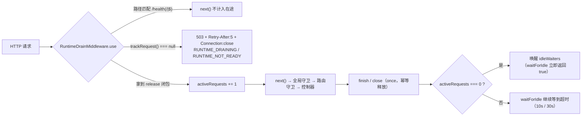
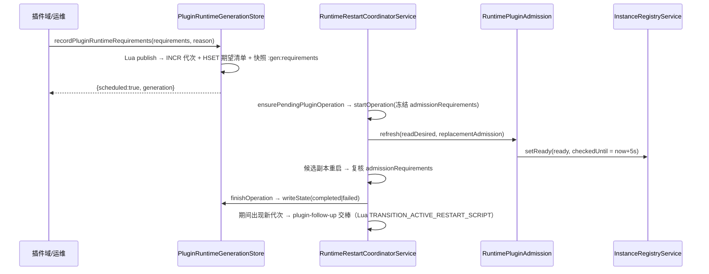
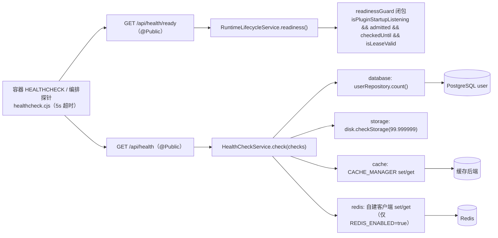
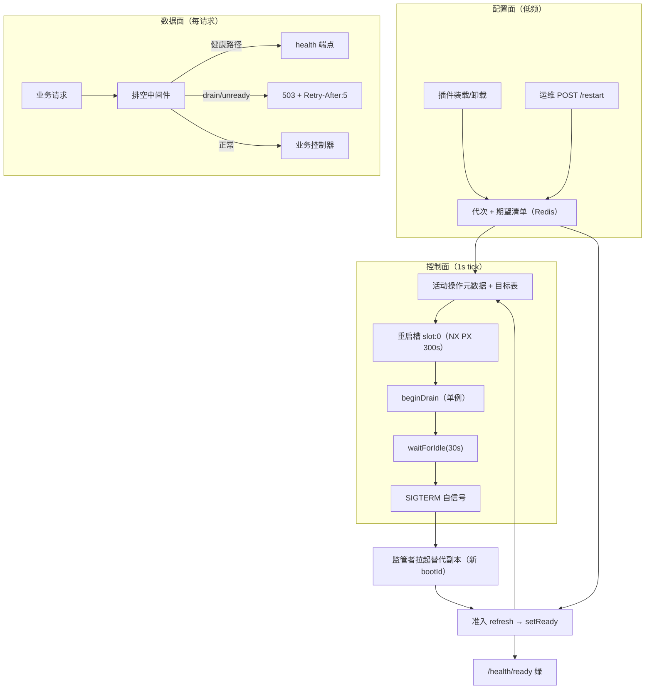
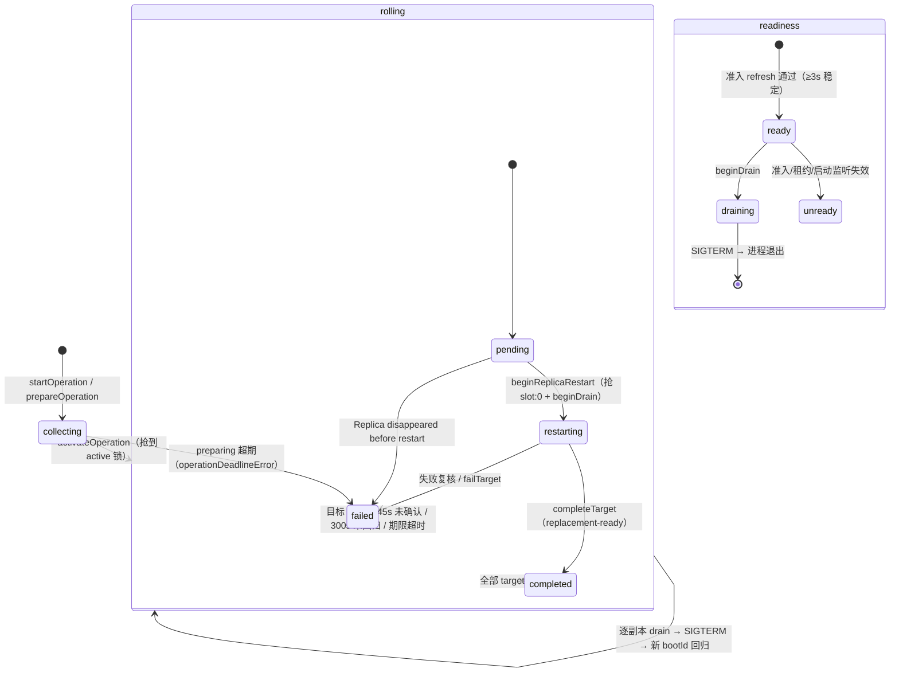

# 运行时·沙箱·产物专家 ② · 运行时控制与健康子专家 · 数据流转

> 只读梳理。对象：`packages/server/src/runtime-control/**` 与 `packages/server/src/health/**`。本文只追「数据/状态怎么流动」：**重启请求链**、**排空中间件在请求链中的位置**、**插件收敛链**、**健康探测链**，并给出重启/排空/健康三套状态机与已知风险。所有引用为仓库根相对 `file://` 路径。

**本文引用的文件**

- [runtime-control.controller.ts](file://packages/server/src/runtime-control/runtime-control.controller.ts) · [runtime-control.service.ts](file://packages/server/src/runtime-control/runtime-control.service.ts) · [runtime-restart-coordinator.service.ts](file://packages/server/src/runtime-control/runtime-restart-coordinator.service.ts) · [runtime-rollout-policy.ts](file://packages/server/src/runtime-control/runtime-rollout-policy.ts) · [runtime-restart-deadlines.ts](file://packages/server/src/runtime-control/runtime-restart-deadlines.ts) · [runtime-restart-target.store.ts](file://packages/server/src/runtime-control/runtime-restart-target.store.ts)
- [plugin-runtime-generation.store.ts](file://packages/server/src/runtime-control/plugin-runtime-generation.store.ts) · [plugin-runtime-requirements.ts](file://packages/server/src/runtime-control/plugin-runtime-requirements.ts) · [plugin-convergence-capacity.ts](file://packages/server/src/runtime-control/plugin-convergence-capacity.ts) · [runtime-plugin-admission.ts](file://packages/server/src/runtime-control/runtime-plugin-admission.ts)
- [runtime-drain.middleware.ts](file://packages/server/src/runtime-control/runtime-drain.middleware.ts) · [runtime-lifecycle.service.ts](file://packages/server/src/runtime-control/runtime-lifecycle.service.ts) · [runtime-process-signaler.ts](file://packages/server/src/runtime-control/runtime-process-signaler.ts) · [runtime-shutdown-preparation.ts](file://packages/server/src/runtime-control/runtime-shutdown-preparation.ts) · [runtime-queue-shutdown.service.ts](file://packages/server/src/runtime-control/runtime-queue-shutdown.service.ts)
- [health.controller.ts](file://packages/server/src/health/health.controller.ts) · [health.module.ts](file://packages/server/src/health/health.module.ts) · [cache-health.indicator.ts](file://packages/server/src/health/indicators/cache-health.indicator.ts) · [redis-health.indicator.ts](file://packages/server/src/health/indicators/redis-health.indicator.ts) · [.deploy/api/healthcheck.cjs](file://.deploy/api/healthcheck.cjs)
- 外部：[managed-connection/instance-registry.service.ts](file://packages/server/src/managed-connection/instance-registry.service.ts) · [plugin/plugin-startup-state.ts](file://packages/server/src/plugin/plugin-startup-state.ts) · [packages/contracts/src/runtime-control.ts](file://packages/contracts/src/runtime-control.ts)

## 目录

1. [§1 链路一：重启请求 → 判定 → 执行 → 恢复](#§1-链路一重启请求--判定--执行--恢复)
2. [§2 链路二：排空中间件在请求链中的位置](#§2-链路二排空中间件在请求链中的位置)
3. [§3 链路三：插件收敛](#§3-链路三插件收敛)
4. [§4 链路四：健康探测](#§4-链路四健康探测)
5. [§5 总览](#§5-总览)
6. [§6 状态机](#§6-状态机)
7. [§7 已知风险](#§7-已知风险)
8. [§8 结论](#§8-结论)

## §1 链路一：重启请求 → 判定 → 执行 → 恢复

**参与者**：运维客户端 → `RuntimeControlController.restart`（POST `/api/system/runtime/restart`）→ `RuntimeControlService.requestRestart` → `RuntimeRestartCoordinatorService` → Redis（锁/元数据/目标表/代次）→ `InstanceRegistryService`（参与者与就绪）→ `RuntimeLifecycleService` → `RUNTIME_PROCESS_SIGNALER` → 监管者（拉起替代副本）→ 回归的新进程（新 `bootId`）→ `RuntimePluginAdmission` 准入 → `completeTarget`。

**逐跳载荷**：

| 步骤 | 输入/载体 | 输出/副作用 |
|---|---|---|
| 1. HTTP 入口 | body `{confirmation:'RESTART', reason?, allowDowntime?, runtimeRequirements?[]}`；类级 `TenantPermissionGuard` ＋ `RoleGuard(SUPER_ADMIN)`；`ValidationPipe(whitelist, forbidNonWhitelisted)` | body 非法直接 400（`allowDowntime:'true'`、`confirmation:'wrong'`、额外字段 `force` 均被拒） |
| 2. 服务层 | `RequestContext.currentApiKey()`/`hasRole`/`currentTenantId()`/`currentUserId()`，`getDefaultTenantId()` | 不满足三重断言 → 403（`…_INTERACTIVE_AUTH_REQUIRED`/`…_SUPER_ADMIN_REQUIRED`/`…_DEFAULT_TENANT_REQUIRED`）；`confirmation` 不符 → 400 `RUNTIME_RESTART_CONFIRMATION_REQUIRED` |
| 3. 协调器入口 | `{source:'interactive', actorUserId, tenantId, sourceIp, runtimeRequirements?}` | 有 `runtimeRequirements` → 先 `generations.publish()` 得代次 → 审计 `runtime.restart.queued` → 广播 `plugin-generation-changed`；普通请求 → `GET xpert:system:runtime:restart:active`，非空即 409 `RUNTIME_RESTART_IN_PROGRESS` |
| 4. 建操作 | `getReadyInstances()` 快照 | `restartId = randomUUID()`；元数据键 `…:restart:<id>:metadata`（TTL 依期限 +15 min 保留）；每个参与者写目标 `{replicaId, expectedBootId, status:'pending'}` 到 `…:targets` |
| 5. 抢锁 | `SET xpert:system:runtime:restart:active <restartId> NX PX 15min`（catch-up 走 Lua `claimCatchUp`） | 抢不到 → 409；`processActiveRestart` 失败 → 503 `RUNTIME_RESTART_COORDINATION_UNAVAILABLE` |
| 6. 激活 | 元数据 + 目标表 | 逐代次写 `in_progress`；`deadlineAt = ceil(副本数/1)×300 s + 30 s`；`phase='rolling'`、`preparing=false`；`PEXPIRE` 延长活动锁；广播 restartId；返回 `{accepted:true, restartId, mode:'rolling-self-signal', instanceId, requestedAt, signalAfterMs:750, drainTimeoutMs:30_000}` → HTTP **202** |
| 7. 逐副本推进（1 s tick） | `GET active` → 元数据 → `targets` | 45 s 未确认的 `pending` → `Replica … disappeared before restart` → 操作 failed；300 s 未回归的 `restarting` → `did not return after restart` → failed；全 completed → completed |
| 8. 本副本执行 | 目标 `expectedBootId === this.bootId` 且 `admits stable` | 抢 `…:slot:0`（NX PX 300 s）→ 复核健康对等副本 → `targets.update(pending→restarting)` → `beginDrain` → `setReady(false)` → 750 ms 后 `waitForIdle(30 s)` → 复核 → `process.kill(process.pid,'SIGTERM')` |
| 9. 恢复 | 新进程 `bootId`、`getPluginState()`、操作冻结的 `admissionRequirements` | `waiting` 继续等 / `satisfied` 且 ready 持续 ≥3 s → `completeTarget(…,'replacement-ready')`（写 `acknowledgedBootId`、释放槽、广播）；启动失败 → `failTarget` ＋ 操作 failed |

**幂等要点**：同一时刻最多一个活动操作（NX 锁）；同一操作内每副本一个目标行、最多一个重启槽；过期轮询用 Lua「比较 `expectedBootId` 与当前值」写回，迟到的确认不能覆盖更新状态（README 级不变量写在 `runtime-restart-target.store.ts` 头部注释）。**在途影响**：等待 `activeRequests === 0` 才发信号，所以「已接受的 HTTP 请求」有 30 s 上限的保护；SSE 长流算在途，超时靠 Nest 的 `forceCloseConnections` 收尾。

章节来源：[runtime-control.controller.ts](file://packages/server/src/runtime-control/runtime-control.controller.ts)（关键符号：restart / RuntimeRestartRequestDto）、[runtime-control.service.ts](file://packages/server/src/runtime-control/runtime-control.service.ts)（关键符号：requestRestart / assertAuthorizedActor）、[runtime-restart-coordinator.service.ts](file://packages/server/src/runtime-control/runtime-restart-coordinator.service.ts)（关键符号：startOperation / activateOperation / processActiveRestart / beginReplicaRestart / terminateAfterDrain / completeTarget）、[runtime-restart-target.store.ts](file://packages/server/src/runtime-control/runtime-restart-target.store.ts)（关键符号：UPDATE_TARGET_SCRIPT / initialize）

## §2 链路二：排空中间件在请求链中的位置

**位置**：`RuntimeControlModule.configure` → `consumer.apply(RuntimeDrainMiddleware).forRoutes('*')`，模块经 `server.module.ts` 全局装载；因此顺序是「HTTP 服务器 → 全局中间件（含排空）→ 全局 `AuthGuard`/`PluginScopeGuard` → 路由守卫（`TenantPermissionGuard`/`RoleGuard`）→ 控制器 → 服务」。

**单请求流**：① `use()` 取 `(originalUrl || url).split('?')[0]`；② 命中 `/\/health(?:\/|$)/` → `next()`（**完全不计数、不拦截**）；③ `lifecycle.trackRequest()`：`drainState` 已设或 `readinessGuard()` 为假 → 返回 `null` → 写 `Retry-After: 5` / `Connection: close` / `status(503)` 的 JSON（`errorCode` 依 `readiness().status` 取 `RUNTIME_DRAINING` 或 `RUNTIME_NOT_READY`）并结束；④ 放行分支：`activeRequests += 1`，把幂等释放闭包挂 `response.once('finish')` 与 `once('close')`，`next()`；⑤ 响应结束/连接关闭 → 计数减一；归零时唤醒所有 `idleWaiters`（`waitForIdle` 的等待者）。

**与重启/关停的交汇点**：滚动重启的 `beginDrain`（协调器）与进程关停的 `beginDrain({restartId:'process-shutdown'})`（`prepareApiShutdown`）**共用同一单例** —— 第二次调用返回 `false`，注释指出「已有的 drain 可能已超时，`beginDrain(false)` 并不意味着请求已空闲」，故两条路径都会独立 `waitForIdle`。`prepareApiShutdown` 的宽限是 10 s，滚动重启的宽限是 30 s；两者之后分别是「队列 pause/close」与「发 SIGTERM」。

图表来源：[runtime-drain.middleware.ts](file://packages/server/src/runtime-control/runtime-drain.middleware.ts)（关键符号：use / isHealthRequest）、[runtime-lifecycle.service.ts](file://packages/server/src/runtime-control/runtime-lifecycle.service.ts)（关键符号：trackRequest / waitForIdle / beginDrain / idleWaiters）、[runtime-control.module.ts](file://packages/server/src/runtime-control/runtime-control.module.ts)（关键符号：configure）、[runtime-shutdown-preparation.ts](file://packages/server/src/runtime-control/runtime-shutdown-preparation.ts)（关键符号：prepareApiShutdown）

## §3 链路三：插件收敛

**入口两种**：插件域调 `RuntimeControlService.recordPluginRuntimeChange` / `recordPluginRuntimeRequirements`（HTTP 面不暴露），或运维用 `POST /restart` 带 `runtimeRequirements[]`。

**流转**：① `generations.publish({generation:0, requirements: mergeRuntimeRequirements(...), source:'plugin-change'|'interactive'})` 用 Lua 原子完成「`INCR` 代次 → 写 `:gen:change` → 写 `:gen:status = in_progress` → 逐条 `HSET` 期望清单 → 快照 `:gen:requirements`」，失败则返回 `{scheduled:false, generation:0}` 并打 error；② 广播 `plugin-generation-changed`，再「尽力」`ensurePendingPluginOperation()`（未起只打 warn）；③ 起操作时 `createRestartMetadata` 把交互式需求与排队代次需求合并成 `runtimeRequirements`，并把该代次的**快照**冻结为 `admissionRequirements`；④ 每个副本的 tick 里 `admission.refresh(generations, replacementAdmission(...))` 重算准入并 `setReady(...)`；⑤ 候选副本重启后按 `admissionRequirements` 复核，`satisfied` 且稳定才 `completeTarget`；⑥ 操作结束 `finishOperation` 逐代次写 `completed`/`failed`；若期间出现更新代次则 `plugin-follow-up` 交棒；⑦ 未被纳入首轮操作的副本，在「期望代次已完成但自己仍不满足」时由 `reconcileLocalPlugins` 以 `plugin-catch-up` **原子抢占**并单独追平（`REPLICA_ATTEMPTS_KEY` 保证每代次一次）。

**失败面与可观测点**：`awaitPluginRestartApproval` 把「单副本 + 需求未满足 + 未获运维中断同意」的收敛挂起为 `awaiting_restart`（不中断服务）；`evaluateRuntimeRequirements` 的四类失败经 `failTarget` 收敛为操作 failed；`GET /plugin-convergence/:generation` 会读持久状态并在承载操作 failed 时上报 failed。**数据保留**：代次 `:gen:change`/`:gen:status`/`:gen:requirements` 各自 TTL 24 小时，期望清单哈希**不带 TTL**（「Desired requirements and the outcome outlive expiring operation history」）。

图表来源：[plugin-runtime-generation.store.ts](file://packages/server/src/runtime-control/plugin-runtime-generation.store.ts)（关键符号：PUBLISH_PLUGIN_GENERATION_SCRIPT / publish / readRequirements / writeState / readPending）、[runtime-restart-coordinator.service.ts](file://packages/server/src/runtime-control/runtime-restart-coordinator.service.ts)（关键符号：recordPluginRequirements / ensurePendingPluginOperation / finishOperation / reconcileLocalPlugins）、[plugin-runtime-requirements.ts](file://packages/server/src/runtime-control/plugin-runtime-requirements.ts)（关键符号：evaluateRuntimeRequirements）、[runtime-plugin-admission.ts](file://packages/server/src/runtime-control/runtime-plugin-admission.ts)（关键符号：refresh / isStable）

## §4 链路四：健康探测

**两条独立通路，不共享缓存**：

| 探针 | 数据源 | 流转 | 非健康表现 |
|---|---|---|---|
| `GET /api/health/ready` | `RuntimeLifecycleService.readiness()`（纯内存：`drainState`、`activeRequests`、`readinessGuard()` 闭包） | 控制器 → 生命周期服务；`passthrough` 下按状态设 503；恒设 `Cache-Control: no-store` | `draining`/`unready` → 503，body 即 readiness 对象（含 `instanceId`、`activeRequests`、drain 时的 `restartId`/`requestedAt`） |
| `GET /api/health` | `HealthCheckService.check([...])` 聚合四项 | 控制器按开关顺序组装 `checks` → Terminus 逐个执行 → 汇总 `{status, info, error, details}` | `cache`/`redis` 抛 `HealthCheckError` → 整体 `error`；`database`/`storage` 只返回 `down` 详情，不一定让整体失败 |

**每次调用的数据流动**：① `uniqueLabel = HealthCheckExecutionTimer-<uuid>`，`console.time` 起表；② `database`：可选 Terminus `pingCheck`（默认关）→ `userRepository.count()` 查 PostgreSQL `user`（**本域注册的唯一外部实体**）→ 打印计数 → 返回 `{database:{status:'up'}}`；异常吞成 `down`；③ `storage`：`path.resolve(__dirname)` ＋ `disk.checkStorage('storage', {thresholdPercent:99.999999})`；④ `cache`：`cacheManager.set/get` 往返（`cacheType` 标 redis/memory）；⑤ `redis`（仅 `REDIS_ENABLED==='true'`）：`RedisHealthIndicator` 自建客户端 `set/get` 随机键；⑥ `console.timeEnd` ＋ 全量 `console.log(JSON.stringify(result))`。

**编排侧消费**：`.deploy/api/healthcheck.cjs` 并发请求两条端点（各 5 s `AbortSignal.timeout`），要求 `ready.status === 'ready'` 且 `health.status === 'ok'`，并逐项校验 `details.database|details.cache(.details.redis?)` 为 `up`。

图表来源：[health.controller.ts](file://packages/server/src/health/health.controller.ts)（关键符号：readiness / check / checkDbWithTerminus）、[runtime-lifecycle.service.ts](file://packages/server/src/runtime-control/runtime-lifecycle.service.ts)（关键符号：readiness）、[runtime-plugin-admission.ts](file://packages/server/src/runtime-control/runtime-plugin-admission.ts)（关键符号：setReadinessGuard / refresh）、[cache-health.indicator.ts](file://packages/server/src/health/indicators/cache-health.indicator.ts)（关键符号：isHealthy）、[redis-health.indicator.ts](file://packages/server/src/health/indicators/redis-health.indicator.ts)（关键符号：checkRedis）、[healthcheck.cjs](file://.deploy/api/healthcheck.cjs)（关键符号：check）

## §5 总览

图表来源：[runtime-restart-coordinator.service.ts](file://packages/server/src/runtime-control/runtime-restart-coordinator.service.ts)（关键符号：processActiveRestart / claimRestartSlot / beginReplicaRestart）、[runtime-plugin-admission.ts](file://packages/server/src/runtime-control/runtime-plugin-admission.ts)（关键符号：refresh）、[runtime-drain.middleware.ts](file://packages/server/src/runtime-control/runtime-drain.middleware.ts)（关键符号：use）、[health.controller.ts](file://packages/server/src/health/health.controller.ts)（关键符号：readiness）

## §6 状态机

**重启操作（`RestartOperationMetadata.phase` ＋ 目标状态聚合）**：`collecting`（预注册，`preparing=true`，期限 15 min）→ `rolling`（抢锁后激活，期限 = 批次 × 300 s + 30 s）→ `completed`（全部目标 completed 且数目相符）或 `failed`（任一目标 failed / 45 s 未确认 / 300 s 未回归 / 期限超时）。**逐副本目标**：`pending → restarting → completed`（`replacement-ready` 或 `already-current`），任何一步失败进入 `failed` 并终止操作。

**排空（`RuntimeLifecycleService`）**：`ready`（`readinessGuard()` 真且未 drain）→ `draining`（`beginDrain` 成功，单例）→ 关停完成；`beginDrain` 之后的副本**不会回到 ready**（`cancelDrain` 只在终止前复核失败时调用，用于放弃本次重启）。

**健康状态（对编排可见）**：`ready` | `draining` | `unready`；`draining` 与 `unready` 都让 `/health/ready` 返回 503，但**只有 `draining` 会在业务 503 上标 `RUNTIME_DRAINING`**。

图表来源：[runtime-restart-deadlines.ts](file://packages/server/src/runtime-control/runtime-restart-deadlines.ts)（关键符号：restartStatus / operationDeadlineAt / REPLICA_RESTART_TIMEOUT_MS）、[runtime-restart-coordinator.service.ts](file://packages/server/src/runtime-control/runtime-restart-coordinator.service.ts)（关键符号：PENDING_TARGET_TIMEOUT_MS / processActiveRestart / finishOperation）、[runtime-lifecycle.service.ts](file://packages/server/src/runtime-control/runtime-lifecycle.service.ts)（关键符号：beginDrain / cancelDrain / readiness）、[packages/contracts/src/runtime-control.ts](file://packages/contracts/src/runtime-control.ts)（关键符号：RuntimeRestartStatus / IRuntimeReadiness）

## §7 已知风险

1. **`activeRequests` 是进程本地计数**：多副本下「本副本在途」与「集群在途」不同；drain 只保证本副本 30 s 宽限内完成响应，`[推测]` 客户端侧仍有连接被重置的窗口。
2. **SSE/长流会拉满宽限**：`RuntimeLifecycleService.beforeApplicationShutdown` 只给 1 s 的响应 flush 时间，`terminateAfterDrain` 给 30 s；超过后由 Nest `forceCloseConnections` 断连。
3. **`/health` 路径豁免面偏宽**：正则 `/\/health(?:\/|$)/` 会放行任何末段为 `health` 的路径，`[推测]` 新增同名业务路由会被静默排除出排空保护。
4. **健康探针零测试且无超时**：DB/磁盘异常被吞成 `down` 返回体，`cache`/`redis` 才抛错；`RedisHealthIndicator` 的连接在构造期建立且无关闭路径（`stopRedis` 无调用点）。
5. **只读状态端点门禁弱**：`GET /restart/:restartId`、`GET /plugin-convergence/:generation` 无方法级 `RoleGuard`、也无服务层断言；`GET /restart-capability` 无方法级 `RoleGuard`（服务层只返回 `allowed:false` 而不抛错）。
6. **`enableRuntimeShutdown` 未见生产接线**：`packages/` 内仅测试夹具调用；若真实入口未安装信号监听，`prepareApiShutdown` 的 10 s 队列宽限不会生效。
7. **插件收敛在单副本场景会静默挂起**：`awaitPluginRestartApproval` 把代次写成 `awaiting_restart` 后既不重试也不主动告警，只能靠代次端点轮询发现。
8. **重启协调强依赖共享 Redis**：活动锁、目标表、代次全在 Redis；Redis 不可用或各副本不共享同一实例时，`processActiveRestart` 每 tick 只打 warn（`Runtime restart coordination tick failed: …`），集群表现为「不重启且不解释」。`redis.duplicate` 不可用时退化为纯轮询（日志明示），不影响正确性但轮询延迟 1 s。
9. **审计只落日志**：`writeAuditLog` 用 `logger.warn(JSON.stringify(...))`，无表、无脱敏、无保留期策略。

章节来源：[runtime-lifecycle.service.ts](file://packages/server/src/runtime-control/runtime-lifecycle.service.ts)（关键符号：beforeApplicationShutdown / activeRequests）、[runtime-drain.middleware.ts](file://packages/server/src/runtime-control/runtime-drain.middleware.ts)（关键符号：isHealthRequest）、[health.controller.ts](file://packages/server/src/health/health.controller.ts)（关键符号：check）、[redis-health.indicator.ts](file://packages/server/src/health/indicators/redis-health.indicator.ts)（关键符号：stopRedis）、[plugin-convergence-capacity.ts](file://packages/server/src/runtime-control/plugin-convergence-capacity.ts)（关键符号：awaitPluginRestartApproval）、[runtime-restart-coordinator.service.ts](file://packages/server/src/runtime-control/runtime-restart-coordinator.service.ts)（关键符号：startSubscriber / writeAuditLog）

## §8 结论

四条链的共同特征是「**状态外置 + 幂等重入**」：重启链把「谁该动」写进 Redis 后，每个副本每秒重读一次并只对属于自己的目标动手；排空链把「能不能接流量」压缩成一个布尔（`trackRequest()` 是否为 `null`），因此 drain 与插件未就绪共用同一条 503 出口；插件收敛链把「期望什么」冻结成不可变快照，让「重启前」与「重启后」的判定使用同一份清单；健康链刻意与前三者解耦（本地就绪 vs 外部依赖体检）。

真正需要盯的是**出口层**：业务 503 只有一个来源（中间件）却有两种语义（`RUNTIME_DRAINING`/`RUNTIME_NOT_READY`），健康豁免面比字面更宽，编排侧能否据此正确摘流量完全取决于「`/health/ready` 反映挂起状态」这一点成立——而该状态的实际判定由 `RuntimePluginAdmission` 运行期注入的闭包决定，是本子域最需要被文档化的隐式耦合。

章节来源：[runtime-drain.middleware.ts](file://packages/server/src/runtime-control/runtime-drain.middleware.ts)（关键符号：use / isHealthRequest）、[runtime-plugin-admission.ts](file://packages/server/src/runtime-control/runtime-plugin-admission.ts)（关键符号：setReadinessGuard / refresh）、[plugin-runtime-generation.store.ts](file://packages/server/src/runtime-control/plugin-runtime-generation.store.ts)（关键符号：publish / readRequirements）、[health.controller.ts](file://packages/server/src/health/health.controller.ts)（关键符号：readiness / check）
