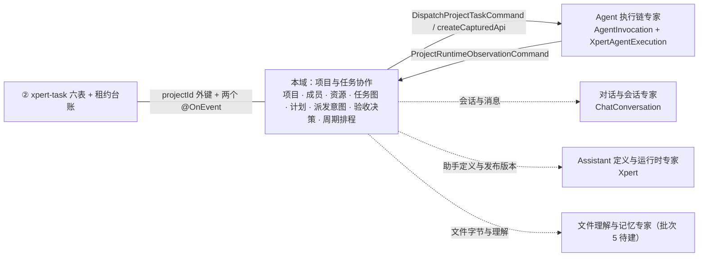

# 项目与任务协作专家 —— C0 使用总览

> **资产基线**：`2026-10-16 · commit 80f5676fd`（批次 5 首专家）。实测范围：`packages/server-ai/src/xpert-project`（122 非 spec / 18 张表 / 102 条真实路由 / 9 个 handler（定义 9 / 装配 8））、`packages/server-ai/src/xpert-task`（35 非 spec / 6 张表 / 35 个端点）、`packages/server/src/business-area`（5 非 spec / 1 张 closure-table 表 / 5 个端点）＝ **162 非 spec + 61 spec**；HTTP 前缀 `/api/xpert-project`、`/api/xpert-task`、`/api/business-area`。

**本文引用的文件**（相对仓库根，链接均为 `file://`）

- [packages/server-ai/src/xpert-project/project.controller.ts](file://packages/server-ai/src/xpert-project/project.controller.ts)
- [packages/server-ai/src/xpert-project/project-planning.controller.ts](file://packages/server-ai/src/xpert-project/project-planning.controller.ts)
- [packages/server-ai/src/xpert-project/project-task-graph.controller.ts](file://packages/server-ai/src/xpert-project/project-task-graph.controller.ts)
- [packages/server-ai/src/xpert-project/project-invitation.controller.ts](file://packages/server-ai/src/xpert-project/project-invitation.controller.ts)
- [packages/server-ai/src/xpert-project/project-admin.controller.ts](file://packages/server-ai/src/xpert-project/project-admin.controller.ts)
- [packages/server-ai/src/xpert-project/project.module.ts](file://packages/server-ai/src/xpert-project/project.module.ts)
- [packages/server-ai/src/xpert-project/project.service.ts](file://packages/server-ai/src/xpert-project/project.service.ts)
- [packages/server-ai/src/xpert-project/services/project-access.service.ts](file://packages/server-ai/src/xpert-project/services/project-access.service.ts)
- [packages/server-ai/src/xpert-project/services/project-type.service.ts](file://packages/server-ai/src/xpert-project/services/project-type.service.ts)
- [packages/server-ai/src/xpert-project/services/project-membership.service.ts](file://packages/server-ai/src/xpert-project/services/project-membership.service.ts)
- [packages/server-ai/src/xpert-project/services/project-invitation.service.ts](file://packages/server-ai/src/xpert-project/services/project-invitation.service.ts)
- [packages/server-ai/src/xpert-project/services/project-plan.service.ts](file://packages/server-ai/src/xpert-project/services/project-plan.service.ts)
- [packages/server-ai/src/xpert-project/services/project-task.service.ts](file://packages/server-ai/src/xpert-project/services/project-task.service.ts)
- [packages/server-ai/src/xpert-project/services/project-automation.service.ts](file://packages/server-ai/src/xpert-project/services/project-automation.service.ts)
- [packages/server-ai/src/xpert-project/guards/project.guard.ts](file://packages/server-ai/src/xpert-project/guards/project.guard.ts)
- [packages/server-ai/src/xpert-project/guards/project-permission.guard.ts](file://packages/server-ai/src/xpert-project/guards/project-permission.guard.ts)
- [packages/server-ai/src/xpert-project/runtime/project-task-dispatch.service.ts](file://packages/server-ai/src/xpert-project/runtime/project-task-dispatch.service.ts)
- [packages/server-ai/src/xpert-project/runtime/project-runtime-observation.handler.ts](file://packages/server-ai/src/xpert-project/runtime/project-runtime-observation.handler.ts)
- [packages/server-ai/src/xpert-project/entities/project-task-execution.entity.ts](file://packages/server-ai/src/xpert-project/entities/project-task-execution.entity.ts)
- [packages/server-ai/src/xpert-project/entities/project.entity.ts](file://packages/server-ai/src/xpert-project/entities/project.entity.ts)
- [packages/server-ai/src/xpert-task/xpert-task.module.ts](file://packages/server-ai/src/xpert-task/xpert-task.module.ts)
- [packages/server-ai/src/xpert-task/xpert-task.controller.ts](file://packages/server-ai/src/xpert-task/xpert-task.controller.ts)
- [packages/server-ai/src/xpert-task/xpert-task.service.ts](file://packages/server-ai/src/xpert-task/xpert-task.service.ts)
- [packages/server/src/business-area/business-area.controller.ts](file://packages/server/src/business-area/business-area.controller.ts)
- [packages/contracts/src/ai/xpert-project.model.ts](file://packages/contracts/src/ai/xpert-project.model.ts)

## 目录

1. [专家定位](#专家定位)
2. [何时找这个专家](#何时找这个专家)
3. [契约自足声明](#契约自足声明)
4. [能力清单表](#能力清单表)
5. [边界](#边界)
6. [已知问题与常见坑](#已知问题与常见坑)
7. [延伸阅读](#延伸阅读)

## 专家定位

本专家负责 **「项目与任务怎么被定义、组织、排期、派发与验收」**——即项目与任务的**业务决策面**：项目聚合根与项目类型（`XpertProjectService`、`XpertProjectTypeService`）、成员与四层准入（`guards/**`、`XpertProjectAccessService`）、项目资源与内容（助手 M2M、工具集/知识库/附件、`project.md` 与 `skills/`、资产索引）、项目内任务图与执行派发（`XpertProjectTaskService`、`ProjectTaskGraphService`、`runtime/**`）、计划族（plan/milestone/sprint/swimlane）、活动流、独立于项目的定时与自动化任务（`XpertTaskService`、`ScheduledTaskExecutionCoordinator`），以及平台级业务领域字典（`BusinessAreaService`）。

**一句话口径**：本域只做业务决策（图变更、派发意图、验收决策、周期排程）；**执行由 `AgentInvocationModule` / `XpertAgentExecution` 承载**，运行期事实经 `ProjectRuntimeObservationCommand` 回流到本域的 `ProjectRuntimeObservationHandler`，任务状态只被单向投影，绝不在本域再建第二本运行时账本（`xpert_project_task_execution` 源码注释逐字：「Read projection from the associated Invocation, never a second runtime ledger.」）。

章节来源：[project.service.ts](file://packages/server-ai/src/xpert-project/project.service.ts)（关键符号：XpertProjectService.createProject）、[project-task-dispatch.service.ts](file://packages/server-ai/src/xpert-project/runtime/project-task-dispatch.service.ts)（关键符号：ProjectTaskDispatchService.dispatch）、[project-task-execution.entity.ts](file://packages/server-ai/src/xpert-project/entities/project-task-execution.entity.ts)（关键符号：invocationStatus / dispatchState）

## 何时找这个专家

- 要**改项目管理或项目类型**：类型目录与 `applicationKey`/`projectTypeKey` 解析、应用安装绑定（`applicationInstallationId`）、`projectTypeSnapshot` 的生成与读取口径。
- 要改**成员、角色与邀请**：成员列表/追加/改角色/移除、owner 转移、token 邀请的签发/接受/拒绝/撤销、组织管理员介入。
- 要改**项目资源挂载**：Assistant 家族绑定（M2M `xpert_project_xpert`）、工具集与知识库绑定、附件（`StorageFile`）、项目卷内容（`project.md`、`skills/`）与资产索引（`xpert_project_asset`）。
- 要改**项目内任务图与执行派发**：任务 CRUD/步骤/批量/重排、`predecessorIds` 与图变更、`dispatchRequestId` 幂等重放、`expectedRevision` CAS、前驱依赖与在途尝试门禁。
- 要改**计划族**：默认计划与未分类里程碑（`ensureDefaults`）、冲刺与默认泳道（`strategyType` → `planning/coding/review/release` 等）、泳道的 `concurrencyLimit`/`wipLimit`/`agentRole`/`environmentType`。
- 要改**活动流**：`XpertProjectActivityService.record` 的写点与写前脱敏（`sanitizeActivityPayload`）、`/overview` 工作台聚合字段。
- 要改**独立任务的调度与自动任务**（`xpert-task` 35 端点）：创建/排程/暂停/归档/软删恢复/试跑、`schedule/overview|day|capabilities` 视图、`schedule/notes` 便签、`auto-tasks`、`auto-task-templates`、`templates`。
- 要改 **run-as 提案确认流**：`pendingRunAs*` 四列、`pendingRunAsConfigurationHash`、提名本人 accept 与配置变更自动作废。
- 要**查项目/任务接口**的路径、守卫与错误码：给前端或插件对接 `/api/xpert-project`、`/api/xpert-task` 时。
- 要**排查任务卡住或派发未回执**：`dispatchState='pending'` 的补偿扫描、`invocationId` 存在但状态未推进、`xpert_task_execution` 租约过期。
- 要**排查「恢复后不跑」**：`recoverHttpTask` 不重建 cron job、`unarchive` 落 `PAUSED` 且不排程、`schedule` 列被创建链清空后的重建。
- 要**归档与删除**：`archived` 后拒绝编辑；HTTP `DELETE /:id` 是「owner 守卫 ＋ 平台生命周期断言」的物理删除（**不查文件占用**）；`owner + archived` 与文件占用 400 属插件 provisioning 路径的 `XpertProjectPurgeService.purge`。
- 要改**业务领域字典**：`business-area` 的树与校验（旁挂，归 ① 子专家）。
- 要改 **Agent 任务工具与中间件面**：`plugins/project-tasks/**` 的 8 个工具与工具注册。
- 要改**导入/导出/复制与工作台读模型**：`importDsl` / `exportProject` / `duplicate` / `GET /overview`。
- 要改**前端任务视图数据源**：`views/project-tasks.provider.ts` 与 `remote-components/**`。

章节来源：[project.controller.ts](file://packages/server-ai/src/xpert-project/project.controller.ts)（关键符号：XpertProjectController）、[project-plan.service.ts](file://packages/server-ai/src/xpert-project/services/project-plan.service.ts)（关键符号：XpertProjectPlanService.ensureDefaults）、[xpert-task.service.ts](file://packages/server-ai/src/xpert-task/xpert-task.service.ts)（关键符号：recoverHttpTask / unarchive）

## 契约自足声明

本专家的 `C0`（使用总览）+ `C1`（能力契约）构成该子域**完整契约面**：HTTP 入口索引、服务方法签名与参数行为语义、返回与异常、准入门槛、代码示例均在本层可查，无需阅读实现层即可完成集成与排障；实现细节（算法、私有方法、表结构逐列）只在需要定位时按 `file://` 链接回源码。**逐端点明细**（完整字段、分页、错误码全集、控制器逐条清单）见 [implementation/05-接口.md](file://.module-experts/后端专题/项目与任务协作专家/implementation/05-接口.md)，本文不复制。凡未标 `[推测]` 的结论均取自源码或本域实现层文档。

| 项 | 值 |
|---|---|
| 基线时点 / commit | `2026-10-16` · `80f5676fd`（批次 5 首专家） |
| 规模实测 | 162 非 spec 文件（122 + 35 + 5）、61 spec（49 + 11 + 1）、**25 张表**（18 + 6 + 1）、142 条真实路由（102 + 35 + 5） |
| 子域 | ① 项目本体与资源 ② 任务·计划·调度（含 `xpert-task` 全部） |
| 契约入口 | 本文件 + [C1-能力契约.md](file://.module-experts/后端专题/项目与任务协作专家/C1-能力契约.md) |
| 实现层 | [01-架构](file://.module-experts/后端专题/项目与任务协作专家/implementation/01-架构.md) · [02-实现](file://.module-experts/后端专题/项目与任务协作专家/implementation/02-实现.md) · [03-数据流转](file://.module-experts/后端专题/项目与任务协作专家/implementation/03-数据流转.md) · [04-模型](file://.module-experts/后端专题/项目与任务协作专家/implementation/04-模型.md) · [05-接口](file://.module-experts/后端专题/项目与任务协作专家/implementation/05-接口.md) · [06-测试](file://.module-experts/后端专题/项目与任务协作专家/implementation/06-测试.md) · [07-运维](file://.module-experts/后端专题/项目与任务协作专家/implementation/07-运维.md) |

章节来源：[project.module.ts](file://packages/server-ai/src/xpert-project/project.module.ts)（关键符号：XpertProjectModule / RouterModule.register）、[xpert-task.module.ts](file://packages/server-ai/src/xpert-task/xpert-task.module.ts)（关键符号：XpertTaskModule）、[business-area.controller.ts](file://packages/server/src/business-area/business-area.controller.ts)（关键符号：BusinessAreaController）

## 能力清单表

| 能力 | 入口 | 一句话 |
|---|---|---|
| 项目 CRUD 与生命周期 | `GET/POST/PUT /api/xpert-project` 及 `/:id/archive`、`/:id/soft`、`/:id/recover`、`DELETE /:id` | 归档后拒绝编辑；物理清除要求 `owner` + `archived` 且无在途文件 |
| 项目导入导出与复制 | `POST /import`、`GET /:id/export`、`POST /:id/duplicate` | 导出走 `ExportProjectCommand`，导入接受项目 DSL |
| 项目类型目录与分类快照 | `GET /types`、`GET /type-entry`；`XpertProjectTypeService.catalog/classification` | 类型只认当前已加载插件里的活体；`projectTypeSnapshot` 是创建时固化的展示快照 |
| 成员与角色 | `GET/POST/PUT/PATCH/DELETE /:id/members*`；`XpertProjectMembershipService` | owner 不入成员表；移除成员前先批量暂停其 `XpertTask` |
| 邀请与管理员干预 | `/:id/invitations*`、`/invitations/accept`、`/decline`、`/:id/admin/intervene` | 邀请为 token 驱动（库内只存 `tokenHash`）；干预需组织级权限 + 显式理由 |
| 项目资源挂载（助手/工具集/知识库/附件/会话） | `/:id/xperts*`、`/:id/toolsets*`、`/:id/knowledges*`、`/:id/attachments*`、`/:id/conversations` | 助手按「家族」而非版本快照比较；创建时不允许直选工具集/知识库 |
| 项目内容与技能 | `/:id/content/instructions`、`/:id/content/skills*` | 维护卷内 `project.md` 与 `skills/`；受治理路径不能走普通文件 API |
| 工作区文件与资产索引 | `/:id/workspace/files*`、`/:id/files`、`/:id/file/upload`、`/:id/assets*` | 文件列表/上传/删除，资产以 `unique(projectId,path)` 做 upsert |
| 活动流与工作台总览 | `GET /:id/activities`、`GET /overview` | 写前递归剔除 `token/secret/password/prompt/authorization/apiKey` 键 |
| 旧版自动化（只读遗留） | `GET /:id/automations*` | 写路径全部 410 Gone；`triggerEvent()` 恒返回 `[]` |
| 计划与里程碑 | `/:id/plans*`、`/:id/plans/:planId/milestones*` | `ensureDefaults` 保证 Default plan + Uncategorized；simple 模式只允许默认对象 |
| 冲刺与泳道 | `/:id/plans/:planId/sprints`、`/:id/sprints/:sprintId[/swimlanes*]` | 冲刺强制 advanced 且 `strategyType` 不可改；`backlog` 为保留泳道键 |
| 项目内任务（CRUD/步骤/批量/重排） | `/:id/tasks*`（含 `/order`、`/batch`、`/:taskId/conversations`、`/:taskId/executions*`） | 写入统一经项目行锁 + `revision` CAS；provider 行与 host-owned 列被断言拒绝 |
| 任务图与执行目标解析 | `GET/PUT /:id/task-graph`、`GET /:id/task-executions/:executionId/target` | 节点 id 由 sha256 派生、跨快照稳定；图变更必须带 `expectedRevision` |
| 执行派发与验收决策（命令/工具面） | `DispatchProjectTaskCommand`、`DecideProjectTaskCommand`；`project_dispatch_task`/`project_decide_task` 工具 | 授权先于预约与重放；规格与意图被钉死，重放不新造 callId |
| 独立任务 CRUD 与生命周期（`xpert-task`） | `GET/POST/PUT/DELETE /api/xpert-task*`、`/:id/schedule`、`/pause`、`/archive`、`/unarchive`、`/test`、`/soft`、`/recover` | 三套调度机制并存；读走 `findHttpAccessible`，内部调度器绕开 HTTP 可见性 |
| 调度视图·便签·自动任务与模板 | `/api/xpert-task/schedule/*`、`/auto-tasks*`、`/auto-task-templates*`、`/templates*` | 自动任务由 `@Cron('0 * * * * *')` 在 Redis 锁下扫描；模板按 `source` 区分内置与个人 |
| run-as 提案确认流 | `POST /:id/run-as/proposal`、`POST /:id/run-as/accept` | 两步确认 + 配置 hash 条件更新；配置变更自动作废未确认提案 |
| 业务领域字典 | `GET/POST/PUT/DELETE /api/business-area` | closure-table 树，写端点需 `SUPER_ADMIN`/`ADMIN`，父节点校验是环检测 |

章节来源：[project.controller.ts](file://packages/server-ai/src/xpert-project/project.controller.ts)（关键符号：create / archive / listInvitations / listAutomations）、[project-planning.controller.ts](file://packages/server-ai/src/xpert-project/project-planning.controller.ts)（关键符号：XpertProjectPlanningController）、[xpert-task.controller.ts](file://packages/server-ai/src/xpert-task/xpert-task.controller.ts)（关键符号：schedule / pause / unarchive / proposeRunAs / acceptRunAs）

## 边界

**做什么**：项目聚合根与类型、成员/邀请与四层准入、项目资源与内容、项目内任务图与执行派发意图、计划族、活动流、独立定时/自动化任务与执行台账、业务领域字典。

**不做什么（与相邻专家分工）**

- **不含 Assistant（Xpert）定义与发布版本**：本域只持有 `xpert_project_xpert` M2M 与「当前版本」解析结果，可用性一律回落 `PublishedXpertAccessService` 与家族判定（→ Assistant 定义与运行时专家）。
- **不含会话与消息**：会话行由对话域持有；本域只写 `xpert_project_task_conversation` 链接与 `taskId`/`projectId` 引用，经 `ChatConversationUpsertCommand` 跨域写入（→ 对话与会话专家）。
- **不含 Agent 调用账本与执行账本**：`AgentInvocation` 与 `XpertAgentExecution` 的写入/状态机不在本域；本域只 pin 出 `invocationId`/`dispatchIntent` 并做单向回执投影（→ Agent 执行链专家）。
- **不含文件理解与存储**：文件字节、解析与记忆归文件域；本域只持有 `FileAsset` 引用、卷内路径与资产索引（→ 文件理解与记忆专家，批次 5 待建）。
- **不含队列投递与沙箱执行后端**：投递走 `handoff/runtime-messaging`，执行后端由沙箱/执行后端域提供，本域只发意图。
- **子专家划分（两个，均有独立资产）**：① [项目本体与资源子专家](file://.module-experts/后端专题/项目与任务协作专家/sub-experts/项目本体与资源子专家/C0-使用总览.md)（项目本体/类型与应用安装/成员与邀请/资源与文件/活动/自动化/四层准入/`business-area`）· ② [任务计划与调度子专家](file://.module-experts/后端专题/项目与任务协作专家/sub-experts/任务计划与调度子专家/C0-使用总览.md)（项目内任务图与派发/计划族/`xpert-task` 全部）；跨子域共享文件的权威清单见两子专家 `implementation/01-架构.md` §跨子域共享文件清单（互为权威）
- **内部边界：两套任务体系不可互换**：`xpert_project_task*`（项目内任务、provider 快照、Invocation 投影）与 `xpert_task*`（跨项目周期调度、租约台账）是两套表与两套运行时，只靠 `projectId` 外键与两个 `@OnEvent` 耦合。

图表来源：[project.module.ts](file://packages/server-ai/src/xpert-project/project.module.ts)（关键符号：XpertProjectModule 的 imports/exports）、[project-runtime-observation.handler.ts](file://packages/server-ai/src/xpert-project/runtime/project-runtime-observation.handler.ts)（关键符号：ProjectRuntimeObservationHandler.execute）、[project.entity.ts](file://packages/server-ai/src/xpert-project/entities/project.entity.ts)（关键符号：XpertProject 的 M2M 关系）

章节来源：[project.service.ts](file://packages/server-ai/src/xpert-project/project.service.ts)（关键符号：XpertProjectService.createProject / ensureManagedProject）、[xpert-task.service.ts](file://packages/server-ai/src/xpert-task/xpert-task.service.ts)（关键符号：pauseProjectTasksForRemovedMember）、[project-task-execution.entity.ts](file://packages/server-ai/src/xpert-project/entities/project-task-execution.entity.ts)（关键符号：invocationStatus 读投影注释）

## 已知问题与常见坑

1. **四层准入不可绕过**：`@Public()` 只跳过全局 JWT 守卫（≠放行）；真正准入是类级 `XpertProjectAuthGuard → XpertProjectFeatureGuard → XpertProjectPermissionGuard` + `@ProjectPermission`，方法级再叠加 `XpertProjectGuard`/`XpertProjectOwnerGuard`，最后的业务断言在 `XpertProjectAccessService`。
   - 契约来源：[project.guard.ts](file://packages/server-ai/src/xpert-project/guards/project.guard.ts)、[project-permission.guard.ts](file://packages/server-ai/src/xpert-project/guards/project-permission.guard.ts)。
2. **两套任务体系别改错表**：`xpert_project_task*` 是项目内任务（provider 快照 + `revision` CAS + Invocation 投影），`xpert_task*` 是独立周期调度（cron + 租约台账）；两者状态机、可见性与权限口径完全不同。
   - 契约来源：[project-task.service.ts](file://packages/server-ai/src/xpert-project/services/project-task.service.ts)、[xpert-task.service.ts](file://packages/server-ai/src/xpert-task/xpert-task.service.ts)。
3. **执行表三个唯一索引**：`IDX_project_task_execution_invocation(invocationId)`、`IDX_project_task_execution_dispatch(projectId,createdById,dispatchRequestId)`、`(taskId,sourceKey)`——`dispatchRequestId` 是派发重放保护，同 id 但意图不一致即 409 `Conflict`（防护生效而非故障）。
   - 契约来源：[project-task-execution.entity.ts](file://packages/server-ai/src/xpert-project/entities/project-task-execution.entity.ts)、[project-task-dispatch.service.ts](file://packages/server-ai/src/xpert-project/runtime/project-task-dispatch.service.ts)。
4. **`@VersionColumn revision` 乐观锁**：全批只有 `xpert_project_task.revision` 一处版本列；`PUT /:id/task-graph` 与派发都要求 `expectedRevision`，不匹配即 409 `Conflict`（`XpertTask` 无版本列，run-as 只能用配置 hash 条件更新）。
   - 契约来源：[project-task-graph.service.ts](file://packages/server-ai/src/xpert-project/services/project-task-graph.service.ts)、[xpert-task.service.ts](file://packages/server-ai/src/xpert-task/xpert-task.service.ts)。
5. **任务幂等键 `unique(projectId, providerKey, sourceKey)`**：provider 投影任务的 id 由 `projectTaskIdentity(projectId, provider, key)` 的 sha256 派生为稳定 UUID，snapshot 按 `providerKey` 比差写入；手工改这三列会破坏重放稳定性。
   - 契约来源：[project-task-graph.service.ts](file://packages/server-ai/src/xpert-project/services/project-task-graph.service.ts)、[project.service.ts](file://packages/server-ai/src/xpert-project/project.service.ts)。
6. **`projectTypeSnapshot` 是创建/发布时固化的展示快照**：改类型定义不影响存量项目；快照绝不授权（源码注释「display snapshots never authorize app execution」），可用性一律以 `resolve()` 对当前已加载插件重解析为准。
   - 契约来源：[project-type.service.ts](file://packages/server-ai/src/xpert-project/services/project-type.service.ts)、[xpert-project.model.ts](file://packages/contracts/src/ai/xpert-project.model.ts)。
7. **`xpert_project_member` 已 `@deprecated`**：新代码一律走 `xpert_project_membership`；但 `addLegacyMember`/`removeLegacyMember`/`syncLegacyMembership` 仍在双写，且「no startup backfill is performed」，长期存在两套成员事实。
   - 契约来源：[project.entity.ts](file://packages/server-ai/src/xpert-project/entities/project.entity.ts)、[project-membership.service.ts](file://packages/server-ai/src/xpert-project/services/project-membership.service.ts)。
8. **`forwardRef(XpertProjectModule)` 双向依赖**：`xpert-task.module.ts` 反向引用项目模块，项目模块对 `XpertModule`/`XpertAgentModule`/`SkillRepositoryModule` 也用 `forwardRef`；两端必须同批发布，否则启动期 DI 报错或事件监听缺失。
   - 契约来源：[project.module.ts](file://packages/server-ai/src/xpert-project/project.module.ts)、[xpert-task.module.ts](file://packages/server-ai/src/xpert-task/xpert-task.module.ts)。
9. **`@OnEvent` 是唯一的跨域撤权通道**：成员/助手移除时先批量 `pause` 对应 `XpertTask`，再 `emitAsync('xpert-project.member-removed')`/`xpert-project.xpert-removed` 让持有内存 cron job 的一侧自行清理；漏订阅即状态不同步（两侧都跳过 `ARCHIVED`，避免复活归档任务）。
   - 契约来源：[project-membership.service.ts](file://packages/server-ai/src/xpert-project/services/project-membership.service.ts)、[xpert-task.service.ts](file://packages/server-ai/src/xpert-task/xpert-task.service.ts)。
10. **执行行 `conversationId → ChatConversation SET NULL` 是弱引用**：它表示「这次执行发生在哪个线程」，任务讨论过哪些会话由 `xpert_project_task_conversation`（四元组唯一）承担；会话被删时执行行只丢引用、不丢执行记录，排查不要当成「任务没了会话」。
    - 契约来源：[project-task-execution.entity.ts](file://packages/server-ai/src/xpert-project/entities/project-task-execution.entity.ts)、[project-task.service.ts](file://packages/server-ai/src/xpert-project/services/project-task.service.ts)。
11. **`runtime/` 的 `dispatchState` 语义**：`pending`＝意图与尝试已提交但 Invocation 未确认启动（补偿扫描会重放），`submitted`＝已拿到启动回执；`invocationStatus`/`runtimeStartedAt`/`runtimeCompletedAt` 是**非持久化读投影**，别指望在库里查到。
    - 契约来源：[project-task-dispatch.service.ts](file://packages/server-ai/src/xpert-project/runtime/project-task-dispatch.service.ts)、[project-runtime-observation.handler.ts](file://packages/server-ai/src/xpert-project/runtime/project-runtime-observation.handler.ts)。
12. **run-as 是两步确认**：`proposal` 只写 `pendingRunAs*` 四列 + 配置 hash；`accept` 必须由被提名人本人触发，重算 hash 并做条件 UPDATE，`affected !== 1` 即 `ProposalChanged`；换 Xpert/改 connector 绑定会自动作废提案。
    - 契约来源：[xpert-task.service.ts](file://packages/server-ai/src/xpert-task/xpert-task.service.ts)、[xpert-task.controller.ts](file://packages/server-ai/src/xpert-task/xpert-task.controller.ts)。
13. **自动化 `triggerEvent` 现状：整体下线**：`createAutomation/updateAutomation/removeAutomation/run` 全部抛 `GoneException`（410），`triggerEvent()` 直接返回 `[]`，`@Cron('*/30 * * * * *')` 扫描器直接 `return`——但两张表与事件触发点仍在装配中，调用会静默空转（扫描报告口径：现已下线）。
    - 契约来源：[project-automation.service.ts](file://packages/server-ai/src/xpert-project/services/project-automation.service.ts)。
14. **`dispatchIntent` 是 `select:false` 的服务端恢复意图**：备份/数据修复脚本漏了显式 `addSelect` 会让补偿重放因意图解析失败而不可用；它含 prompt 与 `replyTo`，绝不可序列化到任务视图。
    - 契约来源：[project-task-execution.entity.ts](file://packages/server-ai/src/xpert-project/entities/project-task-execution.entity.ts)、[project-task-dispatch.service.ts](file://packages/server-ai/src/xpert-project/runtime/project-task-dispatch.service.ts)。
15. **「恢复后不排程」类预期行为**：`unarchive → PAUSED` 且不排程，`PUT /:id/recover` 只软恢复不重建 job，创建链把 `schedule` 置 `null` 而 `onModuleInit` 只重建 `options || schedule` 存在的任务——恢复后需显式再调 `PUT /:id/schedule`。
    - 契约来源：[xpert-task.service.ts](file://packages/server-ai/src/xpert-task/xpert-task.service.ts)、[xpert-task.controller.ts](file://packages/server-ai/src/xpert-task/xpert-task.controller.ts)。

章节来源：[project.controller.ts](file://packages/server-ai/src/xpert-project/project.controller.ts)（关键符号：XpertProjectController 类级装饰器与四层守卫）、[project-access.service.ts](file://packages/server-ai/src/xpert-project/services/project-access.service.ts)（关键符号：assertCanPurge / assertProjectWritable）、[project-automation.service.ts](file://packages/server-ai/src/xpert-project/services/project-automation.service.ts)（关键符号：legacyProjectAutomationDisabled / triggerEvent）

## 延伸阅读

- 域内端点全集与错误码（含 4 条被注释的 VCS 路由口径）：[implementation/05-接口.md](file://.module-experts/后端专题/项目与任务协作专家/implementation/05-接口.md)
- 端到端数据流（项目创建、成员邀请、资源挂载、任务链、派发投影、独立调度、run-as 七链）：[implementation/03-数据流转.md](file://.module-experts/后端专题/项目与任务协作专家/implementation/03-数据流转.md)
- 装配与共享文件清单（13 处双边复核点）：[implementation/01-架构.md](file://.module-experts/后端专题/项目与任务协作专家/implementation/01-架构.md)
- 表结构与约束（**25 张表**、唯一索引与残值 `[推测]`）：[implementation/04-模型.md](file://.module-experts/后端专题/项目与任务协作专家/implementation/04-模型.md)
- 运维口径（5 份 SQL 顺序、三套调度、OIDC 令牌、租约堆积）：[implementation/07-运维.md](file://.module-experts/后端专题/项目与任务协作专家/implementation/07-运维.md)
- 测试与默认 skip（真库集成用例需 `/xpert_execution_test_` 前缀库）：[implementation/06-测试.md](file://.module-experts/后端专题/项目与任务协作专家/implementation/06-测试.md)

章节来源：[project.module.ts](file://packages/server-ai/src/xpert-project/project.module.ts)（关键符号：XpertProjectModule）、[xpert-task.service.ts](file://packages/server-ai/src/xpert-task/xpert-task.service.ts)（关键符号：XpertTaskService）、[business-area.controller.ts](file://packages/server/src/business-area/business-area.controller.ts)（关键符号：BusinessAreaController）
