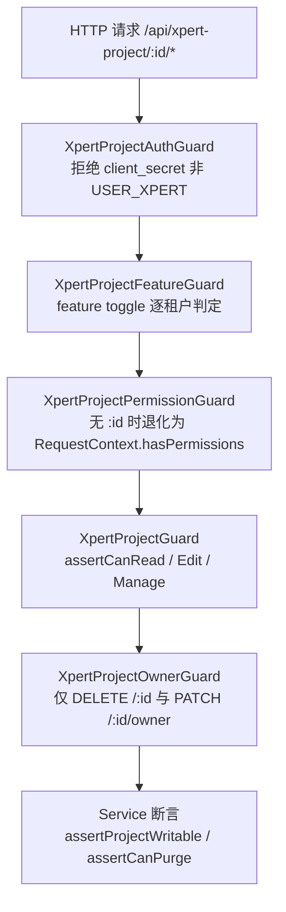

# 项目与任务协作专家 —— C1 能力契约

> 契约层 CR2 / CR5 / CR7。只写「对外可依赖的语义」：入口、参数行为、返回、异常与约束；路径均为仓库根相对 `file://` 引用。
> **资产基线**：`2026-10-16 · commit 80f5676fd`（批次 5 首专家）。**逐端点明细**（完整字段、分页、错误码全集）见 [implementation/05-接口.md](file://.module-experts/后端专题/项目与任务协作专家/implementation/05-接口.md)，本文不复制。

**本文引用的文件**（相对仓库根，链接均为 `file://`）

- [packages/server-ai/src/xpert-project/project.controller.ts](file://packages/server-ai/src/xpert-project/project.controller.ts)
- [packages/server-ai/src/xpert-project/project-planning.controller.ts](file://packages/server-ai/src/xpert-project/project-planning.controller.ts)
- [packages/server-ai/src/xpert-project/project-task-graph.controller.ts](file://packages/server-ai/src/xpert-project/project-task-graph.controller.ts)
- [packages/server-ai/src/xpert-project/project-invitation.controller.ts](file://packages/server-ai/src/xpert-project/project-invitation.controller.ts)
- [packages/server-ai/src/xpert-project/project-admin.controller.ts](file://packages/server-ai/src/xpert-project/project-admin.controller.ts)
- [packages/server-ai/src/xpert-project/project.service.ts](file://packages/server-ai/src/xpert-project/project.service.ts)
- [packages/server-ai/src/xpert-project/services/project-access.service.ts](file://packages/server-ai/src/xpert-project/services/project-access.service.ts)
- [packages/server-ai/src/xpert-project/services/project-access-runtime.service.ts](file://packages/server-ai/src/xpert-project/services/project-access-runtime.service.ts)
- [packages/server-ai/src/xpert-project/services/project-membership.service.ts](file://packages/server-ai/src/xpert-project/services/project-membership.service.ts)
- [packages/server-ai/src/xpert-project/services/project-invitation.service.ts](file://packages/server-ai/src/xpert-project/services/project-invitation.service.ts)
- [packages/server-ai/src/xpert-project/services/project-plan.service.ts](file://packages/server-ai/src/xpert-project/services/project-plan.service.ts)
- [packages/server-ai/src/xpert-project/services/project-task.service.ts](file://packages/server-ai/src/xpert-project/services/project-task.service.ts)
- [packages/server-ai/src/xpert-project/services/project-task-graph.service.ts](file://packages/server-ai/src/xpert-project/services/project-task-graph.service.ts)
- [packages/server-ai/src/xpert-project/services/project-task-ownership.ts](file://packages/server-ai/src/xpert-project/services/project-task-ownership.ts)
- [packages/server-ai/src/xpert-project/services/project-type.service.ts](file://packages/server-ai/src/xpert-project/services/project-type.service.ts)
- [packages/server-ai/src/xpert-project/runtime/project-task-dispatch.service.ts](file://packages/server-ai/src/xpert-project/runtime/project-task-dispatch.service.ts)
- [packages/server-ai/src/xpert-project/runtime/project-task-dispatch.command.ts](file://packages/server-ai/src/xpert-project/runtime/project-task-dispatch.command.ts)
- [packages/server-ai/src/xpert-project/runtime/project-task-decision.service.ts](file://packages/server-ai/src/xpert-project/runtime/project-task-decision.service.ts)
- [packages/server-ai/src/xpert-project/runtime/project-task-runtime-context.service.ts](file://packages/server-ai/src/xpert-project/runtime/project-task-runtime-context.service.ts)
- [packages/server-ai/src/xpert-project/runtime/project-runtime-observation.handler.ts](file://packages/server-ai/src/xpert-project/runtime/project-runtime-observation.handler.ts)
- [packages/server-ai/src/xpert-project/entities/project-task-execution.entity.ts](file://packages/server-ai/src/xpert-project/entities/project-task-execution.entity.ts)
- [packages/server-ai/src/xpert-project/guards/index.ts](file://packages/server-ai/src/xpert-project/guards/index.ts)
- [packages/server-ai/src/xpert-project/plugins/project-tasks/tools/runtime.ts](file://packages/server-ai/src/xpert-project/plugins/project-tasks/tools/runtime.ts)
- [packages/server-ai/src/xpert-task/xpert-task.controller.ts](file://packages/server-ai/src/xpert-task/xpert-task.controller.ts)
- [packages/server-ai/src/xpert-task/xpert-task.service.ts](file://packages/server-ai/src/xpert-task/xpert-task.service.ts)
- [packages/server-ai/src/xpert-task/scheduled-task-execution.coordinator.ts](file://packages/server-ai/src/xpert-task/scheduled-task-execution.coordinator.ts)
- [packages/server/src/business-area/business-area.service.ts](file://packages/server/src/business-area/business-area.service.ts)
- [packages/contracts/src/ai/project-task-runtime.model.ts](file://packages/contracts/src/ai/project-task-runtime.model.ts)
- [packages/contracts/src/ai/xpert-project.model.ts](file://packages/contracts/src/ai/xpert-project.model.ts)

## 目录

1. [§1 HTTP 入口索引](#§1-http-入口索引)
2. [§2 服务能力契约](#§2-服务能力契约)
3. [§3 准入与守卫契约](#§3-准入与守卫契约)
4. [§4 代码示例（真实调用方）](#§4-代码示例真实调用方)
5. [§5 契约来源索引](#§5-契约来源索引)

## §1 HTTP 入口索引

全局前缀 `api`，模块前缀由各自 `RouterModule.register` 给出（`/xpert-project`、`/xpert-task`、`/business-area`）；项目域真实路由 102 条（含继承 planning 23 条，已扣 4 条注释路由）。

| 方法 | 路径 | 守卫 | 用途 |
|---|---|---|---|
| GET/POST | `/api/xpert-project` | 类级三守卫 + `@ProjectPermission(VIEW/CREATE)` | 我的项目列表 / 创建（直选 `toolsetIds`、`knowledgebaseIds` 被有意忽略） |
| GET | `/api/xpert-project/types`、`/type-entry` | 同上（VIEW） | 项目类型目录、按 `applicationKey` 解析类型入口 |
| GET/PUT | `/api/xpert-project/:id` | `XpertProjectGuard` + VIEW/EDIT | 项目详情 / 更新（须过 `createProjectUpdateValidationPipe`） |
| POST | `/api/xpert-project/:id/archive` | Guard + MANAGE | 归档，显式写 `status='archived'` |
| DELETE/PUT | `/:id/soft`、`/:id/recover`、`DELETE /:id` | Guard + MANAGE（物理清除再加 `XpertProjectOwnerGuard`） | 软删 / 软恢复 / 物理清除（要求 `owner` + `archived`） |
| POST/GET | `/api/xpert-project/import`、`/:id/export`、`/:id/duplicate` | Guard + VIEW/CREATE | 导入 DSL / 导出（`ExportProjectCommand`）/ 复制 |
| PATCH | `/api/xpert-project/:id/owner` | Guard + `XpertProjectOwnerGuard` | 转移所有权 |
| GET/POST/PUT/PATCH/DELETE | `/api/xpert-project/:id/members[/:userId]` | Guard + VIEW/MANAGE | 成员列表/覆盖/追加/改角色/移除（移除同步暂停其 `XpertTask`） |
| GET/POST/DELETE | `/api/xpert-project/:id/invitations[/:invitationId]` | Guard + MANAGE | 邀请列表/发邀请/撤销（需组织上下文与 `ORG_INVITE_EDIT`） |
| POST | `/api/xpert-project/invitations/accept`、`/decline` | **无项目守卫**（token 驱动，service 层校验） | 接受/拒绝邀请；失败面 `ProjectInvitationInvalid`/`EmailMismatch` |
| POST | `/api/xpert-project/:id/admin/intervene` | `XpertProjectFeatureGuard` + `PermissionGuard` + `@Permissions(ORG_USERS_EDIT, ALL_ORG_EDIT)` | 组织管理员带显式理由加入项目 |
| GET/PUT/DELETE | `/api/xpert-project/:id/xperts[/:xpert]`、`/:id/available-xperts`、`/:id/assistant` | Guard + VIEW/MANAGE | Assistant 家族绑定/解绑/可绑定清单（解绑会清 `XpertTask.xpertId`） |
| GET/PUT/DELETE | `/:id/toolsets[/:toolset]`、`/:id/knowledges[/:kb]`、`/:id/attachments[/:file]`、`GET /:id/conversations` | Guard + VIEW/EDIT | 工具集/知识库/附件挂载与会话反查 |
| GET/PUT/POST/PATCH/DELETE | `/:id/content/instructions`、`/:id/content/skills*` | Guard + VIEW/EDIT | `project.md` 与 `skills/` 读写、技能安装/上传/启停/卸载 |
| GET/PUT/POST/DELETE | `/:id/workspace/files*`、`/:id/files`、`/:id/file/upload`、`/:id/file`、`/:id/assets*`、`GET /:id/activities`、`GET /overview` | Guard + VIEW/EDIT | 工作区文件、卷文件、资产索引、活动流、工作台聚合 |
| GET/POST/PUT/DELETE | `/api/xpert-project/:id/automations*` | Guard + MANAGE | 旧版自动化：GET 可读历史，写路径与 `run` 一律 **410 Gone** |
| GET/POST/PUT/DELETE | `/:id/plans*`、`/:id/plans/:planId/milestones*`、`/:id/plans/:planId/sprints`、`/:id/sprints/:sprintId[/swimlanes*]` | `XpertProjectGuard` + VIEW/EDIT（继承自 planning 23 条） | 计划族 CRUD；simple 模式只允许默认计划与默认里程碑 |
| GET/POST/PUT | `/:id/tasks`、`/:id/tasks/order`、`/:id/tasks/batch`、`/:id/tasks/:taskId`、`/:id/tasks/:taskId/relations`、`/:id/tasks/:taskId/conversations`、`/:id/tasks/:taskId/executions[/:executionId]` | 同上（`@ProjectPermission` + `XpertProjectGuard`） | 项目内任务分页/创建/重排/批量/更新/关系/会话链接/执行尝试 |
| GET/PUT | `/:id/task-graph`、`GET /:id/task-executions/:executionId/target` | 类级 `XpertProjectGuard` + 方法级 `@ProjectPermission(VIEW/EDIT)` | 任务图读快照 / 图变更（**必须带 `expectedRevision`**）/ 执行目标解析 |
| GET/POST/PUT/DELETE | `/api/xpert-task`（`/count`、`/pagination`、`/my`、`/total`、`/by-ids`、`/:id`、`/:id/test`） | **无守卫**（service 层 `findHttpAccessible`/`*HttpTask`） | 独立任务查询与创建、试跑 |
| PUT/DELETE | `/api/xpert-task/:id/schedule`、`/pause`、`/archive`、`/unarchive`、`/:id/recover`、`DELETE /:id/soft`、`DELETE /:id` | **无守卫**（service 层 `assertHttpMutationAccess`） | 生命周期与删除/恢复；硬删 202，先 `deleteJob` 再 `remove` |
| GET/POST/PUT/DELETE | `/api/xpert-task/schedule/*`、`/auto-tasks*`、`/auto-task-templates*`、`/templates*`、`/:id/run-as/proposal`、`/:id/run-as/accept` | **无守卫**（run-as 另有 `createXpertTaskRunAsProposalValidationPipe`） | 调度视图、日程便签、自动任务与模板、run-as 两步确认 |
| GET/POST/PUT/DELETE | `/api/business-area[/:id]` | 读端无守卫；写端 `RoleGuard` + `@Roles(SUPER_ADMIN, ADMIN)` | 业务领域字典（closure-table 树） |

**逐端点明细见 [implementation/05-接口.md](file://.module-experts/后端专题/项目与任务协作专家/implementation/05-接口.md)**（含每条的权限点、主要错误与状态码）。

章节来源：[project.controller.ts](file://packages/server-ai/src/xpert-project/project.controller.ts)（关键符号：create / update / archive / purge / listAssets / listAutomations）、[project-planning.controller.ts](file://packages/server-ai/src/xpert-project/project-planning.controller.ts)（关键符号：getTasks / reorderTasks / listPlans / listSwimlanes）、[xpert-task.controller.ts](file://packages/server-ai/src/xpert-task/xpert-task.controller.ts)（关键符号：XpertTaskController extends CrudController）

## §2 服务能力契约

| `类.方法(签名)` | 用途 | 参数行为语义 | 返回 | 异常 / 约束 |
|---|---|---|---|---|
| `XpertProjectService.createProject(input)` | 建项目（初始助手、成员、内容初始化） | `xpertIds` 去重后逐个 `resolveAccessibleCurrentXpert`；合并 `XpertProjectTypeService.forCreate(projectType ?? GENERAL_PROJECT_TYPE)`；`binding.kind==='entity'` 抛 `ProjectApplicationWorkflowRequired`；默认计划与活动记录由调用方补 | `XpertProject` | 400（`ProjectTypeInvalid`/`ProjectApplicationWorkflowRequired`）；唯一冲突 23505 转类型冲突 |
| `XpertProjectService.getTasks/createTasks/updateTask/reorderTasks/linkTaskConversation/createTaskExecution/updateTaskExecution/claimTaskExecution` | 项目内任务与会话/执行的代理入口（控制器只经它） | 全部委托 `XpertProjectTaskService`；`createExecution` 先过 `assertNativeExecutionInput`；`claimTaskExecution(projectId,{threadId,xpertId,agentExecutionId})` 缺 `threadId`/`xpertId` 直接返回 `null`，只认 `queued` 且无 `invocationId`、任务无 `providerKey` 的行 | 分页 / 任务 / 任务数组 / 执行行 / `null` | 404 `Xpert project not found`；400 `Owned`；409（`Conflict`/`DecisionRequired`） |
| `XpertProjectTypeService.catalog()/list(xpertId?)/resolve(ref)/classification(ref)/forCreate(ref)` | 类型目录、解析与分类快照 | `catalog` 只列当前已加载插件里的活体类型；`resolve` 校验两个类型键并强校验「插件名 + scope 与类型声明一致」；`classification` 产出 `{applicationKey, projectTypeKey, applicationInstallationId, projectTypeSnapshot}` | `RegisteredType[]` / `XpertProjectClassification` | 400（`ProjectTypeInvalid`、`ProjectApplicationWorkflowRequired`） |
| `XpertProjectAccessService.resolveAccess/assertCanRead/assertCanUse/assertCanEdit/assertCanManage/assertCanPurge` | 授权唯一业务入口 | 角色由 `ownerId` + `xpert_project_membership` 派生；`canEdit=['owner','manager','editor']`、`canManage=['owner','manager']`；`assertProjectWritable` 拒绝 archived 编辑；`assertCanUse` 在 archived 时拒绝；`assertCanPurge` 要求 `role==='owner' && status==='archived'` | `XpertProjectAccess` | 403 |
| `ProjectAccessRuntimeService.listReadable/assertManage/assertEdit` | 插件/运行时侧准入 API（无 HTTP） | 被 sandbox、对话域、文件域复用的薄入口，语义与上同 | 列表 / `void` | 403 |
| `XpertProjectMembershipService.add(projectId,userId,role)/remove/list/transferOwnership/replaceMembers/interveneAsOrganizationAdministrator` | 成员与角色 | `add` 需 `assertCanManage`，拒绝 owner 入表，要求目标为同组织 active 用户，命中软删行先 restore 复用；`remove` 拒移除 owner，置 `removedAt` + `softRemove`，**先批量 `pause` 该用户 `XpertTask`** 再 `emitAsync('xpert-project.member-removed')` | `TXpertProjectMemberSummary[]` / 成员行 | 403；成员已存在 / 角色非法 400 |
| `XpertProjectInvitationService.invite(projectId,email,role)/accept(token)/decline(token)/revoke(projectId,invitationId)/list(projectId)` | 邀请（token 驱动） | `invite` 需 `assertCanManage` + 组织级 `ORG_INVITE_EDIT` + 项目必须有 Organization；明文 token 只回一次、库内仅 `tokenHash`（`select:false`）；同项目同邮箱 pending 复用同一行并轮换 hash；`accept` 幂等返回既有成员行 | 邀请行 / 成员行 | 400（`ProjectInvitationInvalid`/`NotPending`/`ProjectOrganizationRequired`）；403（`EmailMismatch`/`VerifiedUserRequired`） |
| `XpertProjectPlanService.list/ensureDefaults/createPlan/createMilestone/createSprint/createSwimlane/updateSwimlane/updateSprint` | 计划族（plan→milestone、plan→sprint→swimlane） | `ensureDefaults` 保证「Default plan + Uncategorized」存在；simple 模式只允许这两个默认对象；`createSprint` 强制 advanced 并写 `defaultSwimlanes`（保留 `backlog` + 按 `strategyType` 生成的执行泳道）；`createSwimlane` 拒绝 `key==='backlog'`，`updateSwimlane` 拒绝把 backlog 升为 `execution`；`updateSprint` 禁改 `strategyType` | 计划族实体 | 400（如 `Sprints require advanced project mode`）、404 |
| `XpertProjectTaskService.createTask(projectId,input)/saveAll(...entities)/updateTask(projectId,taskId,input)/updateTaskSteps(projectId,threadId,...entities)/createExecution/claimExecution`；`project-task-ownership` 三道断言 | 项目任务写路径（项目行锁唯一持有者） | 骨架统一为 `assertOrdinaryTaskInput → lockProject(pessimistic_write) → assertOrdinaryTask → assertBusinessStatus → 保存`；`assertOrdinaryTaskInput` 拒外部写 provider/投影列，`assertNativeExecutionInput` 拒 HTTP 侧写 host-owned 列（违者 `Owned`），`assertProjectTaskProgress` 限 0–100；有带 `invocationId` 执行时直写 `done/completed` 抛 `DecisionRequired`；步骤全 done 且无带 invocationId 执行时任务隐式 `done` | 任务 / 任务数组 / 执行行 | 400（`Owned`/`ProjectTaskProviderCommandRequired`）；409（`DecisionRequired`/`Conflict`） |
| `ProjectTaskGraphService.graph(context)/change(context,input)/resolveExecution(context,taskExecutionId)`；`projectTaskIdentity(projectId,provider,key)` | 任务图快照、图变更与执行目标解析 | `graph` 在项目行锁内调 provider `snapshot` 并落库（旧快照不能覆盖新快照）；`change` 先取图再比 `current.revision !== input.expectedRevision` → 409；节点 id 由 sha256 派生 UUID、跨快照稳定 | `ProjectTaskGraph` / 目标解析结果 | 404 `ProjectTaskNotFound`；409 `ProjectTaskRevisionConflict` |
| `ProjectTaskDispatchService.dispatch(projectId,input,caller)/submit(execution)` | 派发意图固化与 Invocation 启动 | `dispatch`＝授权 → 项目行锁 → 按 `(projectId,createdById,dispatchRequestId)` 重放比对（不一致 409）→ `expectedRevision` CAS → 生成 `specificationSnapshot` + digest → 前驱依赖校验 → 在途尝试 Busy 检查 → 写 `dispatchState='pending'` + `dispatchIntent`；`submit` 重放已存意图、**绝不新造 callId**；`projectTaskDispatchInputSchema` 要求 `bindingId` 与 `target(type='group_member')` 二选一 | 派发回执 + 资源卡 | 400/403/404 与「其余一律 409」（`Conflict`/`Busy`/`Dependencies`/`State`/`Owned`/`Evidence`/`DecisionRequired`） |
| `ProjectTaskDecisionService.decide(projectId,input,caller?)` | 业务验收决策 | `assertCanEdit` + 项目行锁 + `expectedRevision` + 决策 `requestId` 幂等（同 id 不同 actor/内容 409）+ review 执行与 evidence 校验；`accept` 把任务 CAS 成 `done` 并 append `decisions`，否则回 `todo` | 决策结果 / 任务 | 409（`Conflict`/`Evidence`/`DecisionRequired`） |
| `ProjectTaskRuntimeContextService.resolve(projectId,caller)` | caller → `AgentInvocationScope` | `projectTaskCallerSchema` 或非 UUID 项目 id 失败即 `Invalid`；`assertCanEdit` 后按 `type` 校验会话/线程/执行行/助手与项目关系；群运行时另走 `AuthorizeGroupTaskCallerCommand` | `AgentInvocationScope` | 403 `Scope`；400 `Invalid` |
| `XpertTaskService.*HttpTask` 族（`updateHttpTask`/`scheduleHttpTask`/`pauseHttpTask`/`archiveHttpTask`/`unarchiveHttpTask`/`testHttpTask`/`deleteHttpTask`/`softDeleteHttpTask`/`recoverHttpTask`）+ `schedule`/`pause`/`unarchive`/`proposeProjectTaskRunAs`/`acceptProjectTaskRunAs` | 独立任务（`xpert-task`）HTTP 边界与状态迁移 | 每个 `*HttpTask` 先 `assertHttpMutationAccess`；`schedule` 重解析项目当前助手版本 + connector 预检后置 `SCHEDULED` 并清 `statusReason`；`pause`/`archive` 先 `deleteJob`；**`unarchive` 落 `PAUSED` 且不排程**；`softDeleteHttpTask = pause + softRemove`，`recoverHttpTask` 只软恢复、不重建 job；run-as 提案要求任务有 `projectId` + `xpertId` | `XpertTask` | 403；提案族 400（`ProjectTaskRunAsProposalMissing`/`Changed`）、403（`TargetOnly`） |
| `ScheduledTaskExecutionCoordinator.claim(task,occurrenceKey,scheduledAt)/markRunning/bindRun/refreshLease/finish` | 调度执行台账与租约 | 唯一约束 `uq_xpert_task_execution_occurrence(taskId,occurrenceKey)` + `.orIgnore()` 保证「同一时段至多一次」；租约 `SCHEDULED_TASK_LEASE_MS = 5 分钟`，`ownerId = XPERT_INSTANCE_ID \|\| HOSTNAME \|\| randomUUID`；终态或未过期租约返回 `null`，过期接管 `attempt+1` | 执行行 / `null` | 条件更新失败抛 `lease was lost` |
| `BusinessAreaService.createArea/updateArea(id,entity)/deleteArea(id)/validateParent` | 业务领域字典（closure-table） | 名称去空必填；`validateParent` 拒绝「自己是自己的父」与「移动到自己的后代之下」（沿 `parentId` 上溯检测） | `BusinessArea` | 400（空名 / 环）；删除为硬删，级联由 `@TreeParent({onDelete:'CASCADE'})` 承担 |

章节来源：[project.service.ts](file://packages/server-ai/src/xpert-project/project.service.ts)（关键符号：createProject / getTasks / claimTaskExecution）、[project-task.service.ts](file://packages/server-ai/src/xpert-project/services/project-task.service.ts)（关键符号：saveAll / updateTaskSteps / claimExecution）、[xpert-task.service.ts](file://packages/server-ai/src/xpert-task/xpert-task.service.ts)（关键符号：scheduleHttpTask / unarchive / acceptProjectTaskRunAs）

## §3 准入与守卫契约

| 层 | 组件 | 判定输入 | 失败行为 |
|---|---|---|---|
| 0 | 类级 `@Public()` | 无参数 | 只跳过全局 JWT 守卫，**不等于放行** |
| 1 | `XpertProjectAuthGuard` | 继承 `ApiKeyOrClientSecretAuthGuard`；拒绝 `client_secret` 且非 `USER_XPERT` 绑定的主体 | 401 / 403 |
| 2 | `XpertProjectFeatureGuard` | 环境 toggle + `Feature`/`FeatureOrganization` 逐租户/组织判定；**feature 未 seed 时放行** | 403 |
| 3 | `XpertProjectPermissionGuard` | 无 `:id` 参数时退化为 `RequestContext.hasPermissions` | 403 |
| 4 | `XpertProjectGuard`（方法级；`ProjectTaskGraphController` 为类级）/ `XpertProjectOwnerGuard` | 读 `XPERT_PROJECT_PERMISSION` metadata（`@ProjectPermission(XPERT_PROJECT_VIEW/EDIT/CREATE/MANAGE)`）后调 `assertCanRead/assertCanEdit/assertCanManage`；OwnerGuard 判 `role !== 'owner'` | 403（仅 `DELETE /:id` 与 `PATCH /:id/owner` 用 OwnerGuard） |
| 5 | Service 内断言（无声明式守卫时的唯一边界） | `XpertProjectAccessService.assertProjectWritable/assertCanPurge`、`project-task-ownership` 三道断言、`assertHttpMutationAccess` | 403 / 400 / 409 |

**无守卫、靠 service 断言的端点**：`/api/xpert-project/invitations/*`（token 驱动，`XpertProjectInvitationService` 校验 pending/过期/邮箱）；`/api/xpert-task/*` **全部 35 条**（`findHttpAccessible`/`findHttpAccessibleById` 做项目成员校验，`*HttpTask` 做归属与可管理校验）；`/api/business-area` 读端点。**绕过 service 直查仓库即越权**；插件/运行时侧另有 `ProjectAccessRuntimeService` 三个方法与 `AssertProjectAssistantAccessCommand`。



图表来源：[guards/index.ts](file://packages/server-ai/src/xpert-project/guards/index.ts)（关键符号：XpertProjectAuthGuard / XpertProjectFeatureGuard / XpertProjectPermissionGuard / XpertProjectGuard / XpertProjectOwnerGuard）、[project-access.service.ts](file://packages/server-ai/src/xpert-project/services/project-access.service.ts)（关键符号：resolveAccess / assertProjectWritable）

章节来源：[project-access.service.ts](file://packages/server-ai/src/xpert-project/services/project-access.service.ts)（关键符号：assertCanRead / assertCanEdit / assertCanManage / assertCanPurge）、[project-task-ownership.ts](file://packages/server-ai/src/xpert-project/services/project-task-ownership.ts)（关键符号：assertOrdinaryTaskInput / assertNativeExecutionInput）、[project-access-runtime.service.ts](file://packages/server-ai/src/xpert-project/services/project-access-runtime.service.ts)（关键符号：listReadable / assertManage / assertEdit）

## §4 代码示例（真实调用方）

### ① 创建一个项目（类型解析与快照）

```ts
// 真实调用方：packages/server-ai/src/xpert-project/project.controller.ts
@ProjectPermission(AIPermissionsEnum.XPERT_PROJECT_CREATE)
@HttpCode(HttpStatus.CREATED)
@Post()
async create(@Body() entity: IXpertProjectCreateInput): Promise<XpertProject> {
    const { xpertIds, toolsetIds, knowledgebaseIds, memberIds, ...projectInput } = entity
    void toolsetIds            // Deprecated direct capability selections are intentionally ignored.
    void knowledgebaseIds
    const project = await this.service.createProject({
        ...projectInput,
        xpertIds,
        status: projectInput.status ?? 'active',
        settings: {
            instruction: projectInput.settings?.instruction ?? '',
            mode: projectInput.settings?.mode,
            managementMode: projectInput.settings?.managementMode ?? 'simple'
        }
    })

    const initialMemberIds = [...new Set((memberIds ?? []).map((id) => id?.trim()).filter(Boolean))]
    for (const memberId of initialMemberIds) await this.membershipService.add(project.id, memberId, 'member')
    await this.planService.ensureDefaults(project.id)          // 默认计划 + Uncategorized 里程碑
    await this.activityService.record(project.id, { type: 'project.created', /* … */ })
    return project
}
```

要点：`projectType` 走 `forCreate` → `resolve`（只接受当前已加载插件里的活体类型）→ `classification`（固化 `projectTypeSnapshot`）；`binding.kind === 'entity'` 的类型不允许普通创建；创建时直选工具集/知识库被有意忽略，故新项目这两个集合恒为空。

### ② 项目内建任务并派发执行（幂等键 + `dispatchRequestId`）

```ts
// 真实调用方：packages/server-ai/src/xpert-project/plugins/project-tasks/tools/runtime.ts
// 幂等键与「持久化的 tool call」绑定，而非当前 executionId 或可变参数：
function requestId(projectId: string, operation: ProjectToolEnum, caller: ProjectTaskCaller) {
    return uuidv5(JSON.stringify([
        'xpert.project-tasks.tool.v1', projectId, caller.conversationId, caller.threadId,
        caller.type, caller.xpertId ?? null, caller.agentKey, operation, caller.sourceMessageId
    ]), uuidv5.URL)
}

const actor = caller(config)                                  // projectTaskCallerSchema 校验，失败即 Scope(403)
const receipt = await commandBus.execute(
    new DispatchProjectTaskCommand(
        context.projectId,
        { ...input, requestId: requestId(context.projectId, ProjectToolEnum.DispatchTask, actor) },
        actor
    )
)
if (receipt.card) await emitResourceCard(receipt.card, config).catch(() => { /* 只告警 */ })
```

要点：入参由 `projectTaskDispatchToolInputSchema` 校验（`taskId`、`expectedRevision`、`bindingId` 或 `target.type==='group_member'` 二选一、`instructions` ≤16000）；`requestId` 落到 `dispatchRequestId` 并受 `IDX_project_task_execution_dispatch(projectId,createdById,dispatchRequestId)` 保护——**同一 tool call 改了参数仍复用同一 `requestId`，服务端会以 409 `Conflict` 拒绝，而不是静默换一次执行**。

### ③ 走一次 run-as 提案确认流

```ts
// 真实调用方：packages/server-ai/src/xpert-task/xpert-task.controller.ts
@Post(':id/run-as/proposal')
@UsePipes(createXpertTaskRunAsProposalValidationPipe())
async proposeRunAs(@Param('id', UUIDValidationPipe) id: string, @Body() body: XpertTaskRunAsProposalDTO) {
    return this.service.proposeProjectTaskRunAs(id, body.runAsUserId)
}

@Post(':id/run-as/accept')
async acceptRunAs(@Param('id', UUIDValidationPipe) id: string) {
    return this.service.acceptProjectTaskRunAs(id)
}
```

```ts
// 服务侧语义：packages/server-ai/src/xpert-task/xpert-task.service.ts
// propose：actor === 当前 run-as 用户 → assertCanUse；否则 → assertCanManage；目标必须是项目可用成员
// 写 pendingRunAsUserId / RequestedById / RequestedAt / pendingRunAsConfigurationHash
// accept：仅被提名人本人；重算 buildProjectTaskRunAsConfigurationHash(task) 做条件 UPDATE，
//         affected !== 1 → ProjectTaskRunAsProposalChanged；成功后清空 pending 并写 runAsUserId
```

要点：配置 hash 由 `xpertId` + 排序后的 connector 绑定派生；配置变更由 `invalidatePendingRunAsProposalForConfigurationChange` 主动作废；接受后若任务为 `SCHEDULED` 会 `rescheduleTask` 以新身份重建 job。

### ④ 建一个周期任务并暂停（`xpert-task`）

```ts
// 真实调用方：packages/server-ai/src/xpert-task/xpert-task.controller.ts
@Post()
async create(@Body() entity: XpertTask) {
    const task = await this.commandBus.execute(new CreateXpertTaskCommand(entity))
    return task
}

@Put(':id/schedule')
async schedule(@Param('id') id: string, @Body() entity: XpertTask) {
    try {
        return await this.service.scheduleHttpTask(id, entity)   // 重解析项目当前助手版本 + connector 预检
    } catch (err) {
        throw new BadRequestException(getErrorMessage(err))
    }
}

@Put(':id/pause')
async pause(@Param('id') id: string) {
    return this.service.pauseHttpTask(id)                        // 先 deleteJob(taskId) 再写 PAUSED
}
```

要点：创建链把 `schedule` 置 `null` 并入队一次 `xpert-task-scheduler`，真正的周期调度由进程内 cron 承载；`pause`/`archive` 先删 job，**`unarchive` 落 `PAUSED` 且不排程**，`DELETE /:id/soft` = pause + softRemove，`PUT /:id/recover` 只软恢复（恢复后要显式再 `schedule`）。

章节来源：[plugins/project-tasks/tools/runtime.ts](file://packages/server-ai/src/xpert-project/plugins/project-tasks/tools/runtime.ts)（关键符号：requestId / DispatchProjectTaskCommand）、[project-task-runtime.model.ts](file://packages/contracts/src/ai/project-task-runtime.model.ts)（关键符号：projectTaskDispatchInputSchema）、[xpert-task.service.ts](file://packages/server-ai/src/xpert-task/xpert-task.service.ts)（关键符号：proposeProjectTaskRunAs / acceptProjectTaskRunAs / scheduleHttpTask / pauseHttpTask / unarchive）

## §5 契约来源索引

| 契约条目 | 来源 |
|---|---|
| 项目 CRUD、归档/清除、导入导出、成员与邀请、资源与内容、文件与资产、活动与自动化 | `packages/server-ai/src/xpert-project/project.controller.ts`、`project.service.ts`、`services/project-*.service.ts` |
| 准入与守卫（四层 + 方法级 + service 断言 + 运行时 API） | `packages/server-ai/src/xpert-project/guards/**`、`services/project-access.service.ts`、`services/project-access-runtime.service.ts` |
| 项目类型、分类快照与平台生命周期断言 | `packages/server-ai/src/xpert-project/services/project-type.service.ts`；`packages/contracts/src/ai/xpert-project.model.ts` |
| 计划族与项目内任务端点（继承 planning 23 条） | `packages/server-ai/src/xpert-project/project-planning.controller.ts`、`services/project-plan.service.ts`、`services/project-task.service.ts` |
| 任务图与图变更（`expectedRevision`） | `packages/server-ai/src/xpert-project/project-task-graph.controller.ts`、`services/project-task-graph.service.ts`、`project-task-plan.schema.ts` |
| 派发/决策/上下文/回执与所有权断言 | `packages/server-ai/src/xpert-project/runtime/project-task-dispatch.service.ts`、`runtime/project-task-dispatch.command.ts`、`runtime/project-task-decision.service.ts`、`runtime/project-task-runtime-context.service.ts`、`runtime/project-runtime-observation.handler.ts`、`services/project-task-ownership.ts` |
| 执行行索引与 `dispatchIntent` 语义 | `packages/server-ai/src/xpert-project/entities/project-task-execution.entity.ts`；`packages/contracts/src/ai/project-task-runtime.model.ts` |
| 独立任务 CRUD/生命周期/调度/模板/run-as | `packages/server-ai/src/xpert-task/xpert-task.controller.ts`、`xpert-task.service.ts`、`scheduled-task-execution.coordinator.ts`、`commands/handlers/create.handler.ts` |
| 业务领域字典 | `packages/server/src/business-area/business-area.controller.ts`、`business-area.service.ts`、`business-area.entity.ts` |
| 逐端点明细与错误语义全集 | [implementation/05-接口.md](file://.module-experts/后端专题/项目与任务协作专家/implementation/05-接口.md)（本文不复制） |

章节来源：[project.controller.ts](file://packages/server-ai/src/xpert-project/project.controller.ts)（关键符号：XpertProjectController）、[project-task-dispatch.command.ts](file://packages/server-ai/src/xpert-project/runtime/project-task-dispatch.command.ts)（关键符号：DispatchProjectTaskCommand / DecideProjectTaskCommand）、[project-task-execution.entity.ts](file://packages/server-ai/src/xpert-project/entities/project-task-execution.entity.ts)（关键符号：IDX_project_task_execution_dispatch / dispatchIntent / dispatchState）
