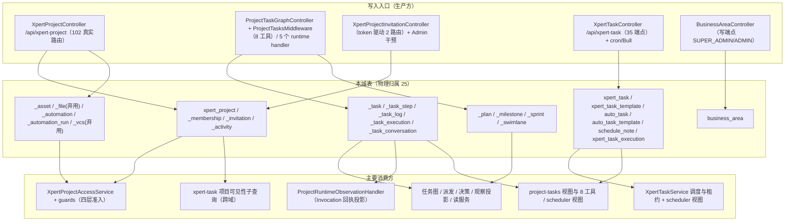
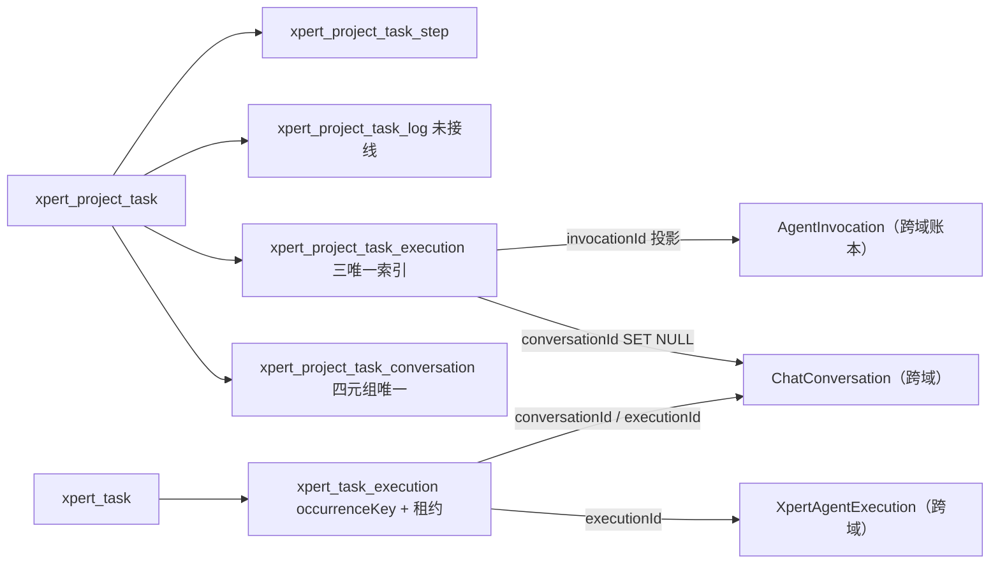

# C4 数据流向与消费（项目与任务协作专家）

> 口径：表结构与索引以实现层 [04-模型.md](file://.module-experts/后端专题/项目与任务协作专家/implementation/04-模型.md) 与源码实体为准；**逐条实测 `@Entity(...)` 计数为 `xpert-project` 18 + `xpert-task` 6 + `business-area` 1 = 25 张表**（见末节口径核对）。另有 4 张在用 M2M 联接表 + 1 张弃用联接表由 `@JoinTable` 声明，不计入 25。
> 消费方为模块级概括，跨 3 个以上消费者时归纳为模块族；未能证实处标 `[推测]`。

**本文引用的文件**
- [xpert-project/entities/project.entity.ts](file://packages/server-ai/src/xpert-project/entities/project.entity.ts) · [project.entity 的 M2M JoinTable](file://packages/server-ai/src/xpert-project/entities/project.entity.ts)
- [entities/project-membership.entity.ts](file://packages/server-ai/src/xpert-project/entities/project-membership.entity.ts) · [entities/project-invitation.entity.ts](file://packages/server-ai/src/xpert-project/entities/project-invitation.entity.ts) · [entities/project-activity.entity.ts](file://packages/server-ai/src/xpert-project/entities/project-activity.entity.ts)
- [entities/project-asset.entity.ts](file://packages/server-ai/src/xpert-project/entities/project-asset.entity.ts) · [entities/project-file.entity.ts](file://packages/server-ai/src/xpert-project/entities/project-file.entity.ts) · [entities/project-vcs.entity.ts](file://packages/server-ai/src/xpert-project/entities/project-vcs.entity.ts)
- [entities/project-automation.entity.ts](file://packages/server-ai/src/xpert-project/entities/project-automation.entity.ts) · [entities/project-automation-run.entity.ts](file://packages/server-ai/src/xpert-project/entities/project-automation-run.entity.ts)
- [entities/project-task.entity.ts](file://packages/server-ai/src/xpert-project/entities/project-task.entity.ts) · [project-task-step.entity.ts](file://packages/server-ai/src/xpert-project/entities/project-task-step.entity.ts) · [project-task-log.entity.ts](file://packages/server-ai/src/xpert-project/entities/project-task-log.entity.ts) · [project-task-execution.entity.ts](file://packages/server-ai/src/xpert-project/entities/project-task-execution.entity.ts) · [project-task-conversation.entity.ts](file://packages/server-ai/src/xpert-project/entities/project-task-conversation.entity.ts)
- [entities/project-plan.entity.ts](file://packages/server-ai/src/xpert-project/entities/project-plan.entity.ts) · [project-milestone.entity.ts](file://packages/server-ai/src/xpert-project/entities/project-milestone.entity.ts) · [project-sprint.entity.ts](file://packages/server-ai/src/xpert-project/entities/project-sprint.entity.ts) · [project-swimlane.entity.ts](file://packages/server-ai/src/xpert-project/entities/project-swimlane.entity.ts)
- [xpert-task/xpert-task.entity.ts](file://packages/server-ai/src/xpert-task/xpert-task.entity.ts) · [xpert-task-template.entity.ts](file://packages/server-ai/src/xpert-task/xpert-task-template.entity.ts) · [auto-task.entity.ts](file://packages/server-ai/src/xpert-task/auto-task.entity.ts) · [auto-task-template.entity.ts](file://packages/server-ai/src/xpert-task/auto-task-template.entity.ts) · [schedule-note.entity.ts](file://packages/server-ai/src/xpert-task/schedule-note.entity.ts) · [scheduled-task-execution.entity.ts](file://packages/server-ai/src/xpert-task/scheduled-task-execution.entity.ts)
- [business-area/business-area.entity.ts](file://packages/server/src/business-area/business-area.entity.ts) · [project.module.ts](file://packages/server-ai/src/xpert-project/project.module.ts) · [xpert-task.module.ts](file://packages/server-ai/src/xpert-task/xpert-task.module.ts)
- [runtime/project-task-invocation-view.ts](file://packages/server-ai/src/xpert-project/runtime/project-task-invocation-view.ts) · [runtime/project-task-specification.ts](file://packages/server-ai/src/xpert-project/runtime/project-task-specification.ts) · [services/project-task-ownership.ts](file://packages/server-ai/src/xpert-project/services/project-task-ownership.ts)

## 目录
1. [总览：写入入口 → 表 → 主要消费方](#总览写入入口--表--主要消费方)
2. [子域一 项目本体与资源（9 张表）](#子域一-项目本体与资源9-张表)
3. [子域二 任务计划与调度（15 张表）](#子域二-任务计划与调度15-张表)
4. [子域三 业务字典（1 张表）](#子域三-业务字典1-张表)
5. [本域写 vs 跨域投影写](#本域写-vs-跨域投影写)
6. [口径核对与未确认项](#口径核对与未确认项)

## 总览：写入入口 → 表 → 主要消费方

图表来源：[project.module.ts](file://packages/server-ai/src/xpert-project/project.module.ts)（关键符号：TypeOrmModule.forFeature 实体清单）、[xpert-task.module.ts](file://packages/server-ai/src/xpert-task/xpert-task.module.ts)（关键符号：BullModule.registerQueue）、[project.controller.ts](file://packages/server-ai/src/xpert-project/project.controller.ts)、[xpert-task.controller.ts](file://packages/server-ai/src/xpert-task/xpert-task.controller.ts)、[business-area.controller.ts](file://packages/server/src/business-area/business-area.controller.ts)

章节来源：[project.module.ts](file://packages/server-ai/src/xpert-project/project.module.ts)（关键符号：forFeature 24 个实体注册，`XpertProjectFile`/`XpertProjectVCS` 未注册）、[xpert-task.module.ts](file://packages/server-ai/src/xpert-task/xpert-task.module.ts)（关键符号：6 张自有表 + ChatConversation/User）

## 子域一 项目本体与资源（9 张表）

| 实体 | 表名与结构（关键列 + 唯一索引） | 生产方 | 主要消费方 | 用途 |
|---|---|---|---|---|
| `XpertProject` | `xpert_project`：`applicationKey(320)`/`projectTypeKey(100)`/`applicationInstallationId(uuid)`/`projectTypeSnapshot(jsonb)`/`name`/`avatar`/`description`/`status`/`settings`/`ownerId`；索引 `IDX_project_application_type(tenantId,organizationId,applicationKey,projectTypeKey,status)`；FK `workspaceId → XpertWorkspace onDelete: RESTRICT`；OneToOne `copilotModel`(cascade)、`vcs`(cascade, 弃用) | `createProject`、`ConversationProjectService.prepare`、`ensureManagedProject`、`duplicate`、`importProject` | 准入服务与各 guard、任务图/派发/决策（取项目行锁）、`xpert-task` 可见性子查询 | 项目聚合根与交付记录（必须比 Workspace 活得久） |
| `XpertProjectMembership` | `xpert_project_membership`：唯一 `IDX_xpert_project_membership_unique(projectId,userId)`；`role varchar(20) default 'member'`/`joinedAt`/`removedAt`/`deletedAt`；FK project/user CASCADE、invitedBy SET NULL | 成员服务 `add`、邀请 `accept`、组织管理员干预 | `resolveAccess`（成员即角色来源）、成员列表、`xpert-task` 权限 | 项目成员与角色（**owner 不入此表**） |
| `XpertProjectInvitation` | `xpert_project_invitation`：部分唯一 `IDX_xpert_project_invitation_pending(projectId,normalizedEmail) WHERE status='pending' AND "deletedAt" IS NULL`；唯一 `IDX_xpert_project_invitation_token(tokenHash)` 且 `tokenHash select:false` + `@Exclude`；`email(255)`/`normalizedEmail(255)`/`targetUserId SET NULL`/`role`/`status default 'pending'`/`expiresAt`/`invitedById RESTRICT`/`acceptedById SET NULL`/`lastSentAt`/`legacyMembershipSync*` 4 列 | 邀请服务 `invite`/`accept`/`decline`；`@Interval(60s)` legacy 补偿 | 邀请控制器、`list`、legacy 同步器 | token 驱动加入项目（含过期与幂等重放） |
| `XpertProjectActivity` | `xpert_project_activity`：`type`/`entityType`/`entityId`/`summary text`/`payload json`；继承软删 `deletedAt` | `XpertProjectActivityService.record`（项目与计划两控制器共 12 处写点） | `list(projectId, take=50)`、`/overview` 汇总 | 项目活动流（写入前按敏感键名递归脱敏） |
| `XpertProjectAsset` | `xpert_project_asset`：唯一 `@Index(projectId,path)`；`parentId`（自引用 FK CASCADE）/`name`/`path`/`kind ∈ file\|folder`/`mimeType`/`size bigint`/`source ∈ upload\|ai_output\|conversation\|import`/`taskId`/`conversationId`/`status ∈ available\|processing\|failed` | `XpertProjectAssetService.createAsset`、`duplicate`、`importProject`、AI 产出回路 | 资产 list/tree、`/overview` 计数、导出 | 项目资产索引（文件与文件夹树） |
| `XpertProjectFile` | `xpert_project_file`：`filePath`/`fileType`/`url`/`contents`/`description`；`storageFileId` 为**非列**属性 | **无**（`XpertProjectFileService` 全仓无引用，表未注册进 forFeature） | 无 | 类注释 `@deprecated Use project file volume / FileAsset workspace projection instead.` |
| `XpertProjectAutomation` | `xpert_project_automation`：`name`/`enabled default false`/`trigger json`（`schedule\|task.status_changed\|asset.created\|conversation.completed`）/`actions json`/`lastRunAt`/`nextRunAt` | **写路径已下线**（服务层全部 `GoneException`），仅历史行可查 | `list(includeRuns)`、`/overview` | 旧版项目自动化（只读遗留） |
| `XpertProjectAutomationRun` | `xpert_project_automation_run`：`automationId`（FK CASCADE）/`status ∈ queued\|running\|succeeded\|failed\|cancelled`/`occurrenceKey`/`jobId`/`startedAt`/`completedAt`/`error`/`output json` | `XpertProjectAutomationProcessor.handle`（唯一写入方，一律写 `failed`） | `listRuns(take 100)` | 自动化运行记录（同样只读遗留） |
| `XpertProjectVCS` | `xpert_project_vcs`：`integrationId`（FK `Integration` SET NULL）/`auth json @Exclude`/`installationId`/`repository` | `VcsService`（provider 注册但 HTTP 路由整段注释） | 无 | 类注释 `@deprecated use CodeXpert instead`；未注册进 forFeature |

- **M2M 联接表（不计入 25）**：`xpert_project_xpert`、`xpert_project_toolset`、`xpert_project_knowledgebase`、`xpert_project_attachment` 由 `@JoinTable` 声明在用；`xpert_project_member` 标 `@deprecated Legacy relation`（注释「no startup backfill is performed」），仍由 `addLegacyMember`/`removeLegacyMember`/`syncLegacyMembership` 维护，形成双写面。
- **本子域的读路径副作用**：`XpertProjectSubscriber.afterLoad` 在加载期回填 `ownerId ??= createdById`、`owner ??= createdBy`（兼容历史行缺列），两子域读项目都会经过。
- **删除与清理**：项目物理删除前必须 `role==='owner' && status==='archived'`；`XpertProjectPurgeService.purge` 期间若存在 `uploaded/scanning/parsing/processing/queued` 文件则 400 拦截；`FileAsset` 行由跨域 `FileAssetDeletionService` 清理，本域不直接改行。

章节来源：[project.entity.ts](file://packages/server-ai/src/xpert-project/entities/project.entity.ts)（关键符号：XpertProject / IDX_project_application_type / @JoinTable）、[project-invitation.entity.ts](file://packages/server-ai/src/xpert-project/entities/project-invitation.entity.ts)（关键符号：tokenHash / IDX_xpert_project_invitation_pending）、[project-asset.entity.ts](file://packages/server-ai/src/xpert-project/entities/project-asset.entity.ts)（关键符号：XpertProjectAsset / source / status）

## 子域二 任务计划与调度（15 张表）

| 实体 | 表名与结构（关键列 + 唯一索引） | 生产方 | 主要消费方 | 用途 |
|---|---|---|---|---|
| `XpertProjectTask` | `xpert_project_task`：**唯一 `(projectId,providerKey,sourceKey)`**；**`@VersionColumn revision default 1`**；`decisions jsonb default '[]'`；`progress double precision`（`@Min(0)@Max(100)`）；`predecessorIds json default '[]'`；`kind default 'task'`（task/summary/milestone）；`parentTaskId`；`providerKey/sourceKey/sourceRevision`；`status enum 10 值`；`priority enum 4 值`；`requirements jsonb`；OneToMany `steps`/`conversations`/`executions`（均 cascade） | `XpertProjectTaskService.saveAll/createTask`、任务图 provider 快照回写、`duplicate`/`importProject` | 任务图服务、派发与决策服务、观察投影、`platform.project-tasks` 视图 | 项目任务图节点与业务任务账本 |
| `XpertProjectTaskStep` | `xpert_project_task_step`：`taskId`（可空，FK CASCADE）/`stepIndex`/`description`/`notes default ''`/`status ∈ pending\|running\|done\|failed` | `saveAll`（内嵌 steps）、`updateTaskSteps`、`importProject` | 规范快照（title+steps → digest）、`afterLoad` 排序 | 任务步骤（隐式完成判定的输入） |
| `XpertProjectTaskLog` | `xpert_project_task_log`：`stepId`（FK CASCADE）/`logType ∈ input\|output\|error`/`content text` | **未找到写入点** | 未找到读取点 | 步骤输入/输出/错误日志（当前未接线） |
| `XpertProjectTaskExecution` | `xpert_project_task_execution`：**三唯一索引** `IDX_project_task_execution_invocation(invocationId)`、`IDX_project_task_execution_dispatch(projectId,createdById,dispatchRequestId)`、`(taskId,sourceKey)`；`projectedTaskRevision`/`projectedInvocationRevision default -1`/`dispatchNextAttemptAt`/`dispatchError`/`invocationId`/`dispatchRequestId`/`dispatchState ∈ pending\|submitted`/`specificationSnapshot jsonb`/`purpose jsonb`/**`dispatchIntent jsonb select:false`**/`attempt default 1`/`status ∈ queued\|running\|succeeded\|failed\|cancelled`；FK `taskId CASCADE`、`conversationId → ChatConversation SET NULL` | `ProjectTaskDispatchService`（含恢复器重放）、`XpertProjectTaskService.createExecution/updateExecution/claimExecution` | 派发/决策/观察/读服务、任务卡片 | 一次执行尝试 + 派发意图 + 投影版本（Invocation 的唯一投影行） |
| `XpertProjectTaskConversation` | `xpert_project_task_conversation`：**`@Unique UQ_project_task_conversation_relation(projectId,taskId,conversationId,relationType)`**；`relationType ∈ origin\|discussion\|execution\|review default 'discussion'`；`isPrimary default false`/`sourceMessageId`/`sourceExecutionId`；FK task/conversation 均 CASCADE | `linkConversation`（先查后插幂等） | 任务关系查询 `listTaskRelations` | 任务与会话的多关系链接 |
| `XpertProjectPlan` | `xpert_project_plan`：`name`/`description`/`status ∈ draft\|active\|completed\|archived default 'active'`/`view ∈ board\|table\|gantt\|calendar\|list default 'board'`/`startDate`/`dueDate`/`order default 0`；OneToMany `milestones`/`sprints`（cascade） | `XpertProjectPlanService.ensureDefaults/createPlan`、`duplicate`、`importProject` | 计划列表、`/overview`、导出 DSL | 项目计划（simple 项目仅 Default plan） |
| `XpertProjectMilestone` | `xpert_project_milestone`：`planId`（FK CASCADE）/`name`/`status ∈ planned\|in_progress\|completed\|blocked default 'planned'`/`dueDate`/`order default 0` | `ensureDefaults`（Uncategorized）、`createMilestone` | 计划树、导出 | 里程碑（simple 项目仅 Uncategorized） |
| `XpertProjectSprint` | `xpert_project_sprint`：`planId`（可空 FK CASCADE）/`goal text`/`status ∈ planned\|running\|review\|done default 'planned'`/`strategyType varchar default 'software_delivery'`（**不可变更**）/`startAt`/`endAt`/`retrospective`；OneToMany `swimlanes`（cascade） | `createSprint`（advanced 模式） | 冲刺列表、泳道生成、导出 | 迭代容器（承载泳道策略） |
| `XpertProjectSwimlane` | `xpert_project_swimlane`：`sprintId`（FK CASCADE）/`key`/`name`/`kind ∈ backlog\|execution default 'execution'`/`priority default 0`/`weight default 1`/`concurrencyLimit default 0`/`wipLimit default 0`/`agentRole varchar default 'planner'`/`environmentType varchar default 'browser'`/`sortOrder default 0`/`sourceStrategyType default 'software_delivery'` | `createSprint → defaultSwimlanes`、`createSwimlane` | 泳道列表（按 `sortOrder`）、执行位分配 | 执行泳道/执行位（`backlog` 为保留键） |
| `XpertTask` | `xpert_task`：`name(100)`/`schedule(50)`/`options json`/`timeZone`/`prompt`/`status varchar(20) ∈ paused\|archived\|scheduled`/`statusReason text`/`runtimeState json`/`xpertId`（FK CASCADE）/`agentKey`/`projectId uuid`（FK CASCADE）/`runAsUserId`（FK User RESTRICT）/`pendingRunAsUserId` + `RequestedById` + `RequestedAt` + `ConfigurationHash(64)`；**`deletedAt @DeleteDateColumn`** | `CreateXpertTaskCommand` 处理器、`updateTask`、`TemplateRoutinesHandler`、run-as 提案/接受 | `XpertTaskService` 调度与执行、`platform.scheduler` 视图、`xpert-task` 控制器 | 定时/自动化任务主体（项目自动化改造后的唯一排程入口） |
| `XpertTaskTemplate` | `xpert_task_template`：唯一 `uq_xpert_task_template_source_scope_key(source,tenantId,organizationId,createdById,key)`；`title(160)`/`prompt json`（字符串或 I18nObject）/`defaultOptions json`/`icon(64)`/`builtin default false` | 模板端点、内置 seed `[推测]` | `GET templates`、创建任务时套用 | 任务模板（内置 + 个人） |
| `AutoTask` | `auto_task`：`title(160)`/`description`/`prompt text`/`repo(255)`/`branch(255)`/`schedule(255)`/`frequency varchar(32) default 'daily'`/`enabled default true`/`templateId`/`runAt`/`timeZone(64)`/`pushChannel(64)`/`params json`/`lastRunAt`/`nextRunAt` | 自动任务端点、`runDueAutoTasks` 回写 `lastRunAt/nextRunAt/enabled` | `runDueAutoTasks` 扫描、`GET auto-tasks` | 简化版（仓储式）自动任务 |
| `AutoTaskTemplate` | `auto_task_template`：唯一 `uq_auto_task_template_scope_key(tenantId,organizationId,createdById,key)`；`key(120)`/`title(160)`/`description`/`prompt`/`defaultParams json`/`icon(64)`/`builtin default false` | service 内 seed（内置约 18 条） | `GET auto-task-templates` | 自动任务模板 |
| `ScheduleNote` | `schedule_note`：`title(160)`/`content text`/`date date`（`YYYY-MM-DD`）/`remindAt`/`type varchar(16) default 'note' ∈ note\|task`/`status varchar(16) default 'pending' ∈ pending\|done` | 便签端点（`POST/PUT/DELETE schedule/notes`） | `GET schedule/day/:date`、`GET schedule/overview` | 日程便签（可关联 autoTask） |
| `ScheduledTaskExecution` | `xpert_task_execution`：唯一 `uq_xpert_task_execution_occurrence(taskId,occurrenceKey)`；`@Index(status,leaseExpiresAt)`；`scheduledAt`/`status varchar(16) default 'pending'`/`ownerId(128)`/`leaseExpiresAt`/`attempt default 0`/`conversationId`/`executionId`/`startedAt`/`completedAt`/`lastError`/`failureCode(64)`，仅允许 `'LOCAL_RUNTIME_UNAVAILABLE'` | `ScheduledTaskExecutionCoordinator.claim/bindRun/finish`（`insertIfAbsent` 用 `.orIgnore()`） | `recoverExpiredScheduledTaskExecutions`、`/overview` 类统计 | 执行台账与租约（`occurrenceKey` 幂等） |

图表来源：[project-task-execution.entity.ts](file://packages/server-ai/src/xpert-project/entities/project-task-execution.entity.ts)（关键符号：dispatchIntent / IDX_project_task_execution_dispatch）、[scheduled-task-execution.entity.ts](file://packages/server-ai/src/xpert-task/scheduled-task-execution.entity.ts)（关键符号：uq_xpert_task_execution_occurrence）

- **确定性身份**：provider 投影任务 id 由 `projectTaskIdentity(projectId, provider, key)` 的 sha256 派生为稳定 UUID；`sourceKey`/`providerKey`/`sourceRevision` 是 provider 侧来源身份，`taskId + sourceKey` 唯一；执行行 `invocationId` 由 `agentInvocationId(scope, callId)` 派生，**重放不得新造**。
- **JSON 快照语义**：`specificationSnapshot`（`specification` + `sha256:` `digest`，规范化时排序 steps、排除 progress 与 revision）、`purpose`（`implementation`/`review` 及证据引用）、`dispatchIntent`（主机侧恢复意图，含 prompt/target/replyTo，`select:false`）。
- **软删边界**：项目域从属表统一带 `deletedAt`（`XpertProjectBaseEntity`）；任务域仅 `XpertTask` 有 `@DeleteDateColumn`，其余 5 表**没有软删**。
- **乐观锁边界**：全批**只有 `xpert_project_task.revision` 一个 `@VersionColumn`**；任务域 6 表全部无版本列，靠条件 UPDATE + 租约表达并发。
- **迁移覆盖**：`migrations/` 5 个 SQL 只覆盖 `xpert_project` 主表与 `xpert_project_task`/`_task_execution`；membership/invitation/plan/milestone/sprint/swimlane/asset/activity/automation 结构与 `xpert-task` 6 表**依赖 synchronize 建表**。

章节来源：[project-task.entity.ts](file://packages/server-ai/src/xpert-project/entities/project-task.entity.ts)（关键符号：XpertProjectTask / revision / predecessorIds）、[project-task-execution.entity.ts](file://packages/server-ai/src/xpert-project/entities/project-task-execution.entity.ts)（关键符号：invocationStatus / dispatchIntent / projectedInvocationRevision）、[project-task-specification.ts](file://packages/server-ai/src/xpert-project/runtime/project-task-specification.ts)（关键符号：createProjectTaskSpecificationSnapshot / digest）

## 子域三 业务字典（1 张表）

| 实体 | 表名与结构 | 生产方 | 主要消费方 | 用途 |
|---|---|---|---|---|
| `BusinessArea` | `business_area`：**`@Tree('closure-table')`**（本批唯一树形表）；`type varchar`（`BusinessType` 枚举）/`name varchar(255)`（`@Index()`）/`@TreeChildren children`/`@TreeParent({onDelete:'CASCADE'}) parent`/`parentId uuid` | `BusinessAreaService.createArea/updateArea` | `BusinessAreaController` 与上层业务分类 | 组织内业务域树 |

- 该表**不属于**项目域或任务域：本批范围内没有任何 `xpert-project` / `xpert-task` 代码引用它，属相邻业务分类基座（5 端点，读开放、写限 `SUPER_ADMIN`/`ADMIN`，删除返回 202）。
- 服务侧不变量：名称去空必填；`parentId` 不允许指向自身或自己的后代（`validateParent` 沿 `parentId` 上溯并记录 `visited`，命中即 400）；`deleteArea` 为硬删除，树的级联由 `@TreeParent({onDelete:'CASCADE'})` 承担。

章节来源：[business-area.entity.ts](file://packages/server/src/business-area/business-area.entity.ts)（关键符号：BusinessArea / Tree closure-table）、[business-area.service.ts](file://packages/server/src/business-area/business-area.service.ts)（关键符号：BusinessAreaService.createArea / validateParent）

## 本域写 vs 跨域投影写

| 列 / 事实 | 写入方 | 说明与证据 |
|---|---|---|
| 项目、成员、邀请、活动、资产、计划族、项目任务/步骤/链接 | **本域**（`xpert-project`） | 全部经本域 service，含项目行悲观锁与任务 `@VersionColumn` |
| `xpert_task.*`、`xpert_task_execution.*`（含 `ownerId`/`leaseExpiresAt`/`attempt`/`status`） | **本域**（`xpert-task`） | 状态与租约由 `XpertTaskService` 与 `ScheduledTaskExecutionCoordinator` 独占写 |
| `xpert_project_task_execution.dispatchState` | **本域运行时** | 派发写 `pending`，`submit` 成功后 CAS 成 `submitted` |
| `xpert_project_task_execution.projectedTaskRevision` / `projectedInvocationRevision` | **本域运行时（投影位）** | 由 `ProjectRuntimeObservationHandler` 写，用于「旧观察不得覆盖新事实」的比较 |
| `xpert_project_task_execution.invocationStatus` / `runtimeStartedAt` / `runtimeCompletedAt` | **跨域投影（读时计算，不落库）** | 非列投影位，由 `projectTaskInvocationView` 从 `AgentInvocationEntity` 计算；注释「Read projection from the associated Invocation, never a second runtime ledger.」 |
| `xpert_project_task.status`（`succeeded→review` / `failed→blocked` / `running→in_progress`） | **跨域触发、本域落库** | 由 handoff 的 `ProjectRuntimeObservationCommand` 触发，实际 CAS UPDATE 在本域 handler 内 |
| `AgentInvocation` 行（状态、终态、revision） | **跨域**（`agent-invocation`） | 本域只 pin 出 `invocationId` 与 `dispatchIntent`，不拥有第二账本 |
| `ChatConversation.projectId/taskId/xpertId` | **本域经跨域命令写** | 项目创建（`ConversationProjectService.prepare`）与 `xpert-task` 执行（`ChatConversationUpsertCommand`）各写一部分 |
| `XpertAgentExecution` 行 | **跨域**（`xpert-agent-execution`） | `xpert-task` 只持有 `execution.id` 并作为 `runId` 透传，不订阅执行状态 |
| `FileAsset` 行（文件字节） | **跨域**（`file-understanding`） | 本域 purge 时经 `FileAssetDeletionService` 清理，不直接改行 |

- **列级写保护**：`assertOrdinaryTaskInput` 拒绝通用写路径提供 13 个 provider/投影列；`assertNativeExecutionInput` 拒绝 native 端点提供 `invocationId`/`dispatchRequestId`/`dispatchState`/`dispatchIntent`/`purpose`/`specificationSnapshot` 等 host-owned 列，违者抛 `Owned`。
- **冲突兜底**：`project-runtime-observation.handler.ts` 明写「Some legacy task writers do not take the Project lock. CAS also fences their concurrent decisions.」——即存在绕过项目锁的历史写入路径，投影侧 CAS 是其唯一护栏。

章节来源：[project-task-ownership.ts](file://packages/server-ai/src/xpert-project/services/project-task-ownership.ts)（关键符号：assertOrdinaryTaskInput / assertNativeExecutionInput 的 host-owned 列清单）、[project-task-invocation-view.ts](file://packages/server-ai/src/xpert-project/runtime/project-task-invocation-view.ts)（关键符号：projectTaskInvocationView）

## 口径核对与未确认项

1. **表数口径以实测为准 = 25**：依赖文件逐条 grep `@Entity(...)` 得到 `xpert-project` **18**（project、membership、invitation、activity、task、task_step、task_log、task_execution、task_conversation、plan、milestone、sprint、swimlane、asset、automation、automation_run、file、vcs）、`xpert-task` **6**、`business-area` **1**；`project.base.ts` 是 abstract 无表，两个 subscriber 非实体，故 **18 + 6 + 1 = 25**。
2. **与任务书 24 条枚举的差异**：任务书的子域枚举漏列 `xpert_project_vcs`（`@deprecated use CodeXpert instead`，未注册进 `forFeature`，HTTP 路由整段注释），并把 `business_area` 记在项目组内。实现层 [04-模型.md](file://.module-experts/后端专题/项目与任务协作专家/implementation/04-模型.md) 表头曾写「合计 24」、其自身逐表清单同样为 18+6+1 张，属计数口径笔误，**已于 2026-10-16 评审后回改为 25 张**。
3. **`xpert_project_task_log` 无生产/消费方**：实体、注册、contracts 类型齐备，但仓库内未找到写入或读取代码（因此「步骤日志链」当前不成立）。
4. **`XpertProjectFile` / `XpertProjectVCS` 未注册**：不在 `project.module.ts` 的 `forFeature` 中，`XpertProjectFileService` 全仓无引用、VCS 路由被整段注释 `[推测]`（是否仍有内部调用未证实）。
5. **`XpertProjectTaskStepService` 无引用**：只在自身文件出现且不在 providers 中。
6. **任务域 seed 归属**：`auto_task_template` 内置条目在 `xpert-task.service.ts` 内证实；`xpert_task_template` 内置模板的 seed 入口未逐文件追踪 `[推测]`。

章节来源：[project.module.ts](file://packages/server-ai/src/xpert-project/project.module.ts)（关键符号：forFeature 实体清单未含 XpertProjectFile/XpertProjectVCS）、[project-task-log.entity.ts](file://packages/server-ai/src/xpert-project/entities/project-task-log.entity.ts)（关键符号：XpertProjectTaskLog）
