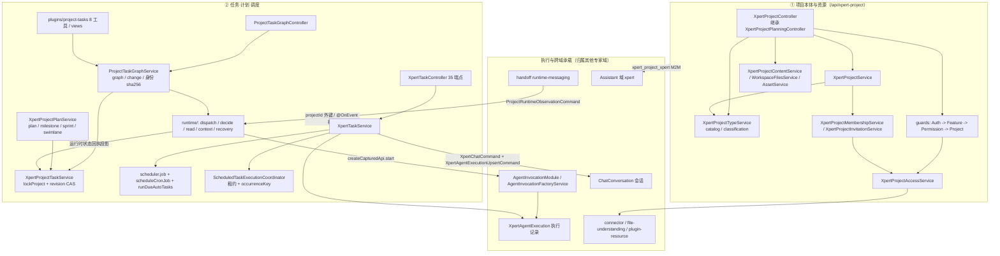

# 项目与任务协作域 · 架构（01-架构）

**本文引用的文件**
- [packages/server-ai/src/xpert-project/project.module.ts](file://packages/server-ai/src/xpert-project/project.module.ts)
- [packages/server-ai/src/xpert-project/project-access.module.ts](file://packages/server-ai/src/xpert-project/project-access.module.ts)
- [packages/server-ai/src/xpert-project/project.controller.ts](file://packages/server-ai/src/xpert-project/project.controller.ts)
- [packages/server-ai/src/xpert-project/project-planning.controller.ts](file://packages/server-ai/src/xpert-project/project-planning.controller.ts)
- [packages/server-ai/src/xpert-project/project-task-graph.controller.ts](file://packages/server-ai/src/xpert-project/project-task-graph.controller.ts)
- [packages/server-ai/src/xpert-project/project-admin.controller.ts](file://packages/server-ai/src/xpert-project/project-admin.controller.ts)
- [packages/server-ai/src/xpert-project/project-invitation.controller.ts](file://packages/server-ai/src/xpert-project/project-invitation.controller.ts)
- [packages/server-ai/src/xpert-project/project.service.ts](file://packages/server-ai/src/xpert-project/project.service.ts)
- [packages/server-ai/src/xpert-project/project.subscriber.ts](file://packages/server-ai/src/xpert-project/project.subscriber.ts)
- [packages/server-ai/src/xpert-project/entities/project.entity.ts](file://packages/server-ai/src/xpert-project/entities/project.entity.ts)
- [packages/server-ai/src/xpert-project/entities/project.base.ts](file://packages/server-ai/src/xpert-project/entities/project.base.ts)
- [packages/server-ai/src/xpert-project/entities/project-task.entity.ts](file://packages/server-ai/src/xpert-project/entities/project-task.entity.ts)
- [packages/server-ai/src/xpert-project/entities/project-task-execution.entity.ts](file://packages/server-ai/src/xpert-project/entities/project-task-execution.entity.ts)
- [packages/server-ai/src/xpert-project/entities/project-task-conversation.entity.ts](file://packages/server-ai/src/xpert-project/entities/project-task-conversation.entity.ts)
- [packages/server-ai/src/xpert-project/entities/project-task.subscriber.ts](file://packages/server-ai/src/xpert-project/entities/project-task.subscriber.ts)
- [packages/server-ai/src/xpert-project/entities/project-invitation.entity.ts](file://packages/server-ai/src/xpert-project/entities/project-invitation.entity.ts)
- [packages/server-ai/src/xpert-project/services/project-type.service.ts](file://packages/server-ai/src/xpert-project/services/project-type.service.ts)
- [packages/server-ai/src/xpert-project/services/project-creation.ts](file://packages/server-ai/src/xpert-project/services/project-creation.ts)
- [packages/server-ai/src/xpert-project/services/project-access.service.ts](file://packages/server-ai/src/xpert-project/services/project-access.service.ts)
- [packages/server-ai/src/xpert-project/services/project-access-runtime.service.ts](file://packages/server-ai/src/xpert-project/services/project-access-runtime.service.ts)
- [packages/server-ai/src/xpert-project/services/project-membership.service.ts](file://packages/server-ai/src/xpert-project/services/project-membership.service.ts)
- [packages/server-ai/src/xpert-project/services/project-invitation.service.ts](file://packages/server-ai/src/xpert-project/services/project-invitation.service.ts)
- [packages/server-ai/src/xpert-project/services/project-plan.service.ts](file://packages/server-ai/src/xpert-project/services/project-plan.service.ts)
- [packages/server-ai/src/xpert-project/services/project-task.service.ts](file://packages/server-ai/src/xpert-project/services/project-task.service.ts)
- [packages/server-ai/src/xpert-project/services/project-task-graph.service.ts](file://packages/server-ai/src/xpert-project/services/project-task-graph.service.ts)
- [packages/server-ai/src/xpert-project/runtime/project-task-dispatch.service.ts](file://packages/server-ai/src/xpert-project/runtime/project-task-dispatch.service.ts)
- [packages/server-ai/src/xpert-project/runtime/project-runtime-observation.handler.ts](file://packages/server-ai/src/xpert-project/runtime/project-runtime-observation.handler.ts)
- [packages/server-ai/src/xpert-project/plugins/project-tasks/project-tasks.middleware.ts](file://packages/server-ai/src/xpert-project/plugins/project-tasks/project-tasks.middleware.ts)
- [packages/server-ai/src/xpert-project/views/project-tasks.provider.ts](file://packages/server-ai/src/xpert-project/views/project-tasks.provider.ts)
- [packages/server-ai/src/xpert-project/guards/project.guard.ts](file://packages/server-ai/src/xpert-project/guards/project.guard.ts)
- [packages/server-ai/src/xpert-project/guards/project-permission.guard.ts](file://packages/server-ai/src/xpert-project/guards/project-permission.guard.ts)
- [packages/server-ai/src/xpert-task/xpert-task.module.ts](file://packages/server-ai/src/xpert-task/xpert-task.module.ts)
- [packages/server-ai/src/xpert-task/xpert-task.service.ts](file://packages/server-ai/src/xpert-task/xpert-task.service.ts)
- [packages/server-ai/src/xpert-task/scheduled-task-execution.coordinator.ts](file://packages/server-ai/src/xpert-task/scheduled-task-execution.coordinator.ts)
- [packages/server/src/business-area/business-area.entity.ts](file://packages/server/src/business-area/business-area.entity.ts)
- [packages/contracts/src/ai/xpert-project.model.ts](file://packages/contracts/src/ai/xpert-project.model.ts)

## 目录
1. [专家域职责边界](#专家域职责边界)
2. [子专家划分说明](#子专家划分说明)
3. [跨子域共享文件清单](#跨子域共享文件清单)
4. [子模块清单](#子模块清单)
5. [分层结构](#分层结构)
6. [依赖关系](#依赖关系)
7. [关键不变量](#关键不变量)
8. [架构总览](#架构总览)
9. [组件详细分析](#组件详细分析)
10. [结论](#结论)

## 专家域职责边界
**做什么**：项目聚合根与项目类型的全生命周期（`XpertProjectService.createProject`/`archive`/`deleteProject`/`importProject`/`exportProject`、`XpertProjectTypeService.catalog`/`classification`）；成员、邀请与四层准入（`XpertProjectMembershipService.add`、`XpertProjectInvitationService.invite`、`guards/` 五件套）；项目资源与服务内容（助手 M2M 绑定、附件/工具集/知识库 M2M、`project.md` 与 `skills/` 卷内容、项目资产索引）；项目内任务图与执行派发（`XpertProjectTaskService`、`ProjectTaskGraphService`、`runtime/`）；独立于项目的定时/自动化任务与执行台账（`XpertTaskService`、`ScheduledTaskExecutionCoordinator`）；业务领域字典（`BusinessAreaService`）。

**不做什么**：不实现模型推理与 Agent 运行时；不拥有 Assistant（Xpert）定义与发布版本，只持有 M2M 关系与「当前版本」解析结果；不拥有会话与消息持久化；不拥有 Invocation 与执行账本——`xpert_project_task_execution` 注释逐字写明「Read projection from the associated Invocation, never a second runtime ledger.」；不负责队列投递（交由 `handoff/runtime-messaging`）。

**与 Assistant 域的分工**：项目只存 `xpert_project_xpert` 关系；可用性与发布校验一律回落到 `PublishedXpertAccessService.getAccessiblePublishedXpert`；项目内助手关系按「家族」而非版本快照比较（`XpertProjectXpertBindingService.normalize`/`resolveCurrentById`、`isSameXpertFamily`）；导出复用 `XpertExportCommand`。
**与对话域的分工**：会话行由对方持有，本域只写 `xpert_project_task_conversation` 链接与 `taskId`/`projectId` 引用；会话首发的项目创建由 `ConversationProjectService` 在对方时序内调用（源文件注释：「call before applying the Assistant principal」）。
**与 Agent 执行链的分工**：本域只做业务决策（图变更、派发意图、验收决策），执行由 `AgentInvocationModule`（`AgentInvocationFactoryService.resolveGroupTarget`/`resolveBackgroundTarget`/`createCapturedApi`）与 `XpertAgentExecution` 承载；运行时事实回流经 `ProjectRuntimeObservationCommand` → `ProjectRuntimeObservationHandler`。

章节来源：[project.service.ts](file://packages/server-ai/src/xpert-project/project.service.ts)（关键符号：XpertProjectService.createProject）、[project-task-execution.entity.ts](file://packages/server-ai/src/xpert-project/entities/project-task-execution.entity.ts)（关键符号：XpertProjectTaskExecution）、[project-runtime-observation.handler.ts](file://packages/server-ai/src/xpert-project/runtime/project-runtime-observation.handler.ts)（关键符号：ProjectRuntimeObservationHandler.execute）

## 子专家划分说明
① **项目本体与资源**：`entities/{project,project.base,project-membership,project-invitation,project-activity,project-asset,project-automation,project-automation-run,project-file,project-vcs}.ts`、`project.service.ts`、`services/{project-type,project-creation,project-managed-provisioning,project-access,project-access-runtime,project-membership,project-invitation,project-content,project-workspace-files,project-purge,project-resource-card,xpert-binding,conversation-project}.ts`、`guards/**`、`commands/**`、`project-access.module.ts`、`migrations/20260920-project-types.sql`。核心类：`XpertProjectService`、`XpertProjectTypeService`、`XpertProjectAccessService`。
② **任务·计划·调度**：`entities/{project-task,project-task-step,project-task-log,project-task-execution,project-task-conversation,project-plan,project-milestone,project-sprint,project-swimlane}.ts`、`services/{project-task.service,project-task-step.service,project-plan.service,project-task-graph.service,project-task-ownership,project-task-types,project-task-progress}.ts`、`runtime/**`、`plugins/project-tasks/**`、`views/project-tasks.provider.ts`、`project-task-graph.controller.ts`，以及 `xpert-task/**` 全部（`XpertTask`/`AutoTask`/`AutoTaskTemplate`/`XpertTaskTemplate`/`ScheduleNote`/`ScheduledTaskExecution` 六表 + 调度与模板例行）。核心类：`ProjectTaskGraphService`、`ProjectTaskDispatchService`、`XpertTaskService`、`ScheduledTaskExecutionCoordinator`。
③ **业务字典（旁挂）**——**不设独立子专家**，归 ① 子专家（`packages/server/src/business-area/**`）：数据上与项目/任务无外键耦合，仅在平台字典层被引用。

章节来源：[project-task-graph.service.ts](file://packages/server-ai/src/xpert-project/services/project-task-graph.service.ts)（关键符号：ProjectTaskGraphService.graph）、[scheduled-task-execution.coordinator.ts](file://packages/server-ai/src/xpert-task/scheduled-task-execution.coordinator.ts)（关键符号：ScheduledTaskExecutionCoordinator.claim）、[business-area.entity.ts](file://packages/server/src/business-area/business-area.entity.ts)（关键符号：BusinessArea）

## 跨子域共享文件清单

> 子专家资产：① [项目本体与资源子专家](file://.module-experts/后端专题/项目与任务协作专家/sub-experts/项目本体与资源子专家/implementation/01-架构.md) · ② [任务计划与调度子专家](file://.module-experts/后端专题/项目与任务协作专家/sub-experts/任务计划与调度子专家/implementation/01-架构.md)。下表**三处同源**（本表 ＋ 两子专家 §3），任一处改动须同步另两处。
以下 13 处同时被两个子域读写，任何一侧改动都必须双边复核：
1. `packages/server-ai/src/xpert-project/project.module.ts`：唯一装配点，控制器/provider/exports 混装两个子域。
2. `packages/server-ai/src/xpert-project/entities/project.entity.ts`：① 的聚合根，② 的任务图/行锁以它为串行化锚点。
3. `packages/server-ai/src/xpert-project/entities/project.base.ts`：两个子域实体共同基类（`projectId` + `deletedAt`）。
4. `packages/server-ai/src/xpert-project/project.controller.ts`：同一控制器既挂项目本体端点，也挂 `:id/plans|sprints|swimlanes` 计划端点。
5. `packages/server-ai/src/xpert-project/project-planning.controller.ts`：abstract 父类，同时声明 task 端点和 plan 端点，被 `XpertProjectController` 继承。
6. `packages/server-ai/src/xpert-project/project.service.ts`：既做项目 CRUD，也代理 `getTasks`/`createTasks`/`updateTask`/`reorderTasks`/`linkTaskConversation`/`createTaskExecution`/`claimTaskExecution`。
7. `packages/server-ai/src/xpert-project/services/project-plan.service.ts`：计划族属 ②，却被 ① 的控制器注入（`overview`/`create` 都会调用）。
8. `packages/server-ai/src/xpert-project/services/project-activity.service.ts`：两个子域都写 `project.*`/`task.*`/`plan.*` 活动。
9. `packages/server-ai/src/xpert-project/services/project-automation.service.ts`：对两个子域发 `triggerEvent`，现已整体下线。
10. `packages/server-ai/src/xpert-project/guards/**`（`project-auth`/`project-feature`/`project`/`project-permission`/`project-owner` + 装饰器）：两域共用准入。
11. `packages/server-ai/src/xpert-project/services/project-access.service.ts` 与 `services/project-access-runtime.service.ts`：运行时/插件侧共用授权 API。
12. `packages/server-ai/src/xpert-project/dto/project-workbench.dto.ts`：工作台投影字段横跨项目本体与任务视图。
13. `packages/server-ai/src/xpert-project/project.subscriber.ts`：加载期回填 `ownerId`/`owner`，两域读项目时都会经过。

章节来源：[project.module.ts](file://packages/server-ai/src/xpert-project/project.module.ts)（关键符号：XpertProjectModule）、[project-planning.controller.ts](file://packages/server-ai/src/xpert-project/project-planning.controller.ts)（关键符号：XpertProjectPlanningController）、[project-access.service.ts](file://packages/server-ai/src/xpert-project/services/project-access.service.ts)（关键符号：XpertProjectAccessService.resolveAccess）

## 子模块清单
| 目录 / 模块 | 模块类与入口 | 路由前缀 | 对外接口 |
|---|---|---|---|
| `xpert-project/` | `XpertProjectModule`（`project.module.ts`） | `/api/xpert-project` | 96 条（含继承 planning 23 条）+ 邀请 2 + 管理 1 |
| `xpert-project/`（任务图） | `ProjectTaskGraphController`（同模块注册） | `/api/xpert-project` | 3 条（`task-graph`/`task-executions/:id/target`） |
| `xpert-project/project-access.module.ts` | `XpertProjectAccessModule`（无 controller） | — | 提供 `ProjectAccessRuntimeService`、`XpertProjectAccessService`，被 sandbox/对话域/文件域复用 |
| `xpert-project/runtime/` | 无 Nest 模块，随主模块装配 | — | 5 command + 5 handler 的运行时 API |
| `xpert-project/plugins/project-tasks/` | `ProjectTasksMiddleware` + `ProjectTasksCapabilityProvider` | — | Agent 中间件策略 `project-tasks`，8 个工具 |
| `xpert-task/` | `XpertTaskModule`（`xpert-task.module.ts`） | `/api/xpert-task` | 35 条自声明端点 |
| `packages/server/src/business-area/` | `BusinessAreaModule` | `/api/business-area` | 5 条（GET/GET:id/POST/PUT/DELETE） |
| 迁移 | `xpert-project/migrations/*.sql` | — | 5 个 SQL，只覆盖 project 主表与 task/task_execution |

章节来源：[project.module.ts](file://packages/server-ai/src/xpert-project/project.module.ts)（关键符号：XpertProjectModule）、[xpert-task.module.ts](file://packages/server-ai/src/xpert-task/xpert-task.module.ts)（关键符号：XpertTaskModule）、[business-area.module.ts](file://packages/server/src/business-area/business-area.module.ts)（关键符号：BusinessAreaModule）

## 分层结构
- **控制器层**：`XpertProjectController`（继承 `XpertProjectPlanningController`：项目本体 + 计划族端点）、`XpertProjectInvitationController`（token 驱动，无项目守卫）、`XpertProjectAdminController`（组织管理员干预）、`ProjectTaskGraphController`、`XpertTaskController`（继承 `CrudController`）、`BusinessAreaController`。真实路由合计 142 条（102 + 35 + 5）。
- **服务层**：项目本体 12 个 service，任务/计划侧 `XpertProjectTaskService`、`XpertProjectTaskGraphService`、`XpertProjectPlanService`、`XpertProjectTaskStepService`；`xpert-task` 侧唯一 god service `XpertTaskService`。
- **运行时（`runtime/`）**：`ProjectTaskDispatchService`（派发）、`ProjectTaskDecisionService`（验收决策）、`ProjectTaskRuntimeReadService`（读模型）、`ProjectTaskRuntimeContextService`（scope 解析）、`ProjectTaskRuntimeHandlers`（5 个 handler）、`ProjectRuntimeObservationHandler`（跨域观察）、`ProjectTaskDispatchRecoveryService`（补偿扫描）、`project-task-evidence`/`project-task-specification`（证据与规格快照）。
- **项目任务插件（`plugins/project-tasks/`）**：`ProjectTasksMiddleware` 暴露 8 个工具（`project_update_task_plan`/`project_list_tasks`/`project_create_tasks`/`project_update_tasks`/`project_decide_task`/`project_dispatch_task`/`project_get_task`/`project_list_task_runtimes`），实现在 `tools/{create,list,update,runtime}.ts`。
- **实体（`entities/`）**：18 张表 + 1 个 abstract 基类 + 2 个 subscriber。
- **守卫（`guards/`）**：`XpertProjectAuthGuard` → `XpertProjectFeatureGuard` → `XpertProjectPermissionGuard`（类级三点）＋ 方法级 `XpertProjectGuard`/`XpertProjectOwnerGuard`。
- **命令（`commands/`）**：域内 3 个命令 handler（`ExportProjectHandler`、`EnsureXpertProjectHandler`、`AssertProjectAssistantAccessHandler`）；`GetVcsCredentialsCommand` 整文件注释掉。
- **视图（`views/`）**：`ProjectTasksViewProvider`（`platform.project-tasks`）、`xpert-task` 侧 `SchedulerDetailViewProvider`（`platform.scheduler`）。
- **调度运行时（`xpert-task/`）**：`TaskSchedulerProcessor`（Bull 消费者）、`scheduleCronJob`（进程内 cron 主路径）、`runDueAutoTasks`/`recoverExpiredScheduledTaskExecutions`（`@Cron` 扫描）、`ScheduledTaskExecutionCoordinator`（租约）、`template-routines/**`。

章节来源：[project.controller.ts](file://packages/server-ai/src/xpert-project/project.controller.ts)（关键符号：XpertProjectController）、[project-tasks.middleware.ts](file://packages/server-ai/src/xpert-project/plugins/project-tasks/project-tasks.middleware.ts)（关键符号：ProjectTasksMiddleware）、[xpert-task.service.ts](file://packages/server-ai/src/xpert-task/xpert-task.service.ts)（关键符号：XpertTaskService.scheduleCronJob）

## 依赖关系
**出向（本域依赖）**：`@xpert-ai/server-core`（`TenantOrganizationAwareCrudService`、`RequestContext`、`TenantModule`/`RedisModule`/`FeatureModule`/`IntegrationModule`/`UserModule`/`UserOrganizationModule`/`OrganizationModule`/`EmailModule`、`LOADED_PLUGINS`）、`@xpert-ai/plugin-sdk`（`ProjectTypeProviderRegistry`、`ProjectTaskProviderRegistry`、`AgentInvocation`、`ProjectTasksRuntimeCapability`）、`@xpert-ai/contracts`；跨域出向共 7 处：`xpert`（`XpertModule`、`Xpert` 实体、`PublishedXpertAccessService`、`isSameXpertFamily`、`FindXpertQuery`、`XpertExportCommand`）、`chat-conversation`（`ChatConversation`、`ChatConversationThread`、`ChatConversationUpsertCommand`、`FindChatConversationQuery`、`AssertChatConversationAccessQuery`）、`agent-invocation`（`AgentInvocationModule`、`AgentInvocationFactoryService`、`AgentInvocationEntity`、`agentInvocationId`/`sameInvocationData`、`AgentInvocationAuthorizationError`）、`xpert-agent-execution`（`XpertAgentExecution`、`XpertAgentExecutionUpsertCommand`）、`connector`（`ConnectorModule` + `ConnectorService.deleteProjectBindings`）、`file-understanding`（`FileAsset`、`GetOwnedStorageFileQuery`、`FileAssetDeletionService`、`AttachFileToConversationCommand`）、`plugin-resource`（`PluginApplicationInstallation`、`effectiveLoadedPlugins`）；另有 `skill-repository`、`shared/volume`（`VOLUME_CLIENT`）、`chat-group`（`AuthorizeGroupTaskCallerCommand`）、`handoff/runtime-messaging`（`ProjectRuntimeObservationCommand`、`AgentRuntimeDelivery`/`AgentRuntimeInbox`、`RequestRuntimeResultCheckCommand`）。
**入向（依赖本域）**：`app.module.ts`（同时注册 `XpertProjectModule` 与 `XpertTaskModule`）；`xpert-task`（`forwardRef(() => XpertProjectModule)` + 「项目任务可见性/项目 run-as」逻辑）；`chat`、`ai`、`chat-group`、`xpert`（`xpert.module.ts` 引入 `XpertProjectModule`）；`sandbox`、`file-understanding`、`chat-conversation`（引入 `XpertProjectAccessModule`）；`chat-conversation/conversation-map`、`conversation-branch`（引入 `XpertProjectModule`）；`xpert/template-setup` 派发 `TemplateRoutinesCommand`/`TemplateActivityCommand` 到 `xpert-task`；`plugin-resource/template-installation`、`agent-evolution`、`connector` 引用本域实体/服务。

章节来源：[project.module.ts](file://packages/server-ai/src/xpert-project/project.module.ts)（关键符号：XpertProjectModule 的 imports/exports）、[xpert-task.module.ts](file://packages/server-ai/src/xpert-task/xpert-task.module.ts)（关键符号：XpertTaskModule 的 forwardRef）、[project-access.module.ts](file://packages/server-ai/src/xpert-project/project-access.module.ts)（关键符号：XpertProjectAccessModule）

## 关键不变量
1. **四层准入不可绕过**：控制器类级 `@Public()` 是「跳过全局 JWT 守卫」而非放行，真正准入由 `@UseGuards(XpertProjectAuthGuard, XpertProjectFeatureGuard, XpertProjectPermissionGuard)` + `@ProjectPermission(XPERT_PROJECT_VIEW)` 提供，方法级再叠加 `XpertProjectGuard`/`XpertProjectOwnerGuard`；授权的唯一业务入口是 `XpertProjectAccessService.resolveAccess/assertCanRead/assertCanUse/assertCanEdit/assertCanManage/assertCanPurge`。
2. **任务幂等键与乐观锁**：`xpert_project_task` 上有 `@Index(['projectId','providerKey','sourceKey'], { unique: true })` 与 `@VersionColumn({ default: 1 }) revision`；所有状态写入都以 `revision` 做 CAS（观察投影与决策服务均带 `revision: task.revision`）。
3. **执行账本三唯一索引**：`xpert_project_task_execution` 同时有 `IDX_project_task_execution_invocation(invocationId)`、`IDX_project_task_execution_dispatch(projectId,createdById,dispatchRequestId)`、`(taskId,sourceKey)`，且 `dispatchIntent` 为 `select: false`（注释：「Server-only recovery intent; never serialize credentials, routing or configuration to task views.」）。
4. **任务↔会话链接唯一**：`xpert_project_task_conversation` 用 `@Unique(projectId,taskId,conversationId,relationType)` 约束四种关系（origin/discussion/execution/review），`linkConversation` 先查后插做幂等。
5. **项目类型快照在创建时固化**：`classification()` 产出 `{applicationKey, projectTypeKey, applicationInstallationId, projectTypeSnapshot}`；快照只用于展示与兼容判定（源文件注释：「display snapshots never authorize app execution.」），可用性一律以 `resolve()` 对「当前已加载插件」重解析为准。
6. **`XpertTask` 的调度与 `runtimeState`**：状态迁移集中收敛在 `schedule/pause/archive/unarchive/updateTask`，`unarchive` 落到 `PAUSED` 且不排程；每次触发都把幂等键写进 `runtimeState`（`resolveTaskRuntimeState` + `XPERT_TASK_SCHEDULE_IDEMPOTENCY_KEY`）。
7. **双向模块依赖以 `forwardRef` 明确**：`xpert-task.module.ts` 用 `forwardRef(() => XpertProjectModule)`，`project.module.ts` 反向 `forFeature` 引入 `XpertTask` 实体并以 `forwardRef(() => XpertModule/XpertAgentModule/SkillRepositoryModule)` 打破环；跨模块读依赖 `XpertProjectAccessModule` 这一薄模块而非主模块，避免装配环放大。
8. **`@OnEvent` 是唯一的跨域撤权通道**：`XpertProjectMembershipService.remove` 先批量 `pause` `XpertTask` 再 `emitAsync('xpert-project.member-removed')`，`XpertTaskService.pauseProjectTasksForRemovedMember`/`pauseProjectTasksForRemovedXpert` 消费并同步删除内存 cron job；两处都跳过 `ARCHIVED`，避免复活已归档任务。

章节来源：[project.controller.ts](file://packages/server-ai/src/xpert-project/project.controller.ts)（关键符号：XpertProjectController 的类级装饰器）、[project-task.entity.ts](file://packages/server-ai/src/xpert-project/entities/project-task.entity.ts)（关键符号：XpertProjectTask.revision）、[project-type.service.ts](file://packages/server-ai/src/xpert-project/services/project-type.service.ts)（关键符号：XpertProjectTypeService.classification）、[project-membership.service.ts](file://packages/server-ai/src/xpert-project/services/project-membership.service.ts)（关键符号：XpertProjectMembershipService.remove）

## 架构总览

图表来源：[project.module.ts](file://packages/server-ai/src/xpert-project/project.module.ts)（关键符号：XpertProjectModule）、[project-task-dispatch.service.ts](file://packages/server-ai/src/xpert-project/runtime/project-task-dispatch.service.ts)（关键符号：ProjectTaskDispatchService.dispatch）、[project-runtime-observation.handler.ts](file://packages/server-ai/src/xpert-project/runtime/project-runtime-observation.handler.ts)（关键符号：ProjectRuntimeObservationHandler.execute）、[xpert-task.service.ts](file://packages/server-ai/src/xpert-task/xpert-task.service.ts)（关键符号：XpertTaskService.createPersistedTaskChatRun）

## 组件详细分析
### 项目本体与资源
`XpertProjectService` 继承 `TenantOrganizationAwareCrudService`，`createProject` 先解析全部初始助手再走 `createProjectWithAssistants`（身份、初始成员、内容初始化分别落点）；`update` 拒绝 advanced→simple 降级；`archive` 写 `status='archived'`，`assertProjectWritable` 随后拒绝对归档项目的任何编辑；物理删除前必须 `role==='owner' && status==='archived'`（`assertCanPurge`）。资源挂载在 `XpertProject` 上以 5 组 M2M 表达（`xperts`/`attachments`/`toolsets`/`knowledges` + 已弃用 `members`），内容落在共享卷（`XpertProjectContentService.initialize`）。
章节来源：[project.service.ts](file://packages/server-ai/src/xpert-project/project.service.ts)（关键符号：XpertProjectService.archive）、[project-creation.ts](file://packages/server-ai/src/xpert-project/services/project-creation.ts)（关键符号：createProjectWithAssistants）、[project-content.service.ts](file://packages/server-ai/src/xpert-project/services/project-content.service.ts)（关键符号：XpertProjectContentService.initialize）

### 任务图与执行派发
图侧以「provider 快照 → 确定性任务身份」建模：`projectTaskIdentity(projectId, provider, key)` 用 sha256 派生稳定 UUID，`ProjectTaskGraphService.graph` 在项目行悲观锁内取快照并落库，`change` 负责图变更；执行侧 `ProjectTaskDispatchService.dispatch` 先授权、再在同一事务里锁定项目行、校验 `expectedRevision`、生成规格快照、检查前驱依赖与在途尝试，最后写 `dispatchState='pending'` 的执行行并 `submit`。回执方向由 `ProjectRuntimeObservationHandler` 完成「Invocation → 任务状态」的单向投影。
章节来源：[project-task-graph.service.ts](file://packages/server-ai/src/xpert-project/services/project-task-graph.service.ts)（关键符号：ProjectTaskGraphService.graph）、[project-task-dispatch.service.ts](file://packages/server-ai/src/xpert-project/runtime/project-task-dispatch.service.ts)（关键符号：ProjectTaskDispatchService.submit）
### 计划族与独立任务
`XpertProjectPlanService` 维护 plan/milestone/sprint/swimlane 四级（`ensureDefaults` 保证「Default plan + Uncategorized」存在；simple 模式只允许默认计划与默认里程碑；sprint 建时按 `strategyType` 生成默认泳道）。`xpert-task` 侧是另一套模型：`XpertTask` 行 + 6 张表 + 三套调度机制（Bull 一次性入队、进程内 cron、`@Cron` 扫描），两者只通过 `projectId` 外键与两个 `@OnEvent` 耦合。
章节来源：[project-plan.service.ts](file://packages/server-ai/src/xpert-project/services/project-plan.service.ts)（关键符号：XpertProjectPlanService.ensureDefaults）、[xpert-task.service.ts](file://packages/server-ai/src/xpert-task/xpert-task.service.ts)（关键符号：XpertTaskService.onModuleInit）
### 插件与视图扩展
`ProjectTasksMiddleware` 以 Agent 中间件策略 `project-tasks` 暴露 8 个工具，决策/派发不直接改库而是走命令（`DecideProjectTaskCommand`/`DispatchProjectTaskCommand`）；`ProjectTasksViewProvider` 与 `SchedulerDetailViewProvider` 分别注册 `platform.project-tasks`（project/agent 双 host）与 `platform.scheduler`（agent host、`requiredFeatures: ['scheduler']`）视图，动作集合覆盖 `save|pause|resume|execution-target`。
章节来源：[project-tasks.middleware.ts](file://packages/server-ai/src/xpert-project/plugins/project-tasks/project-tasks.middleware.ts)（关键符号：ProjectTasksMiddleware）、[project-tasks.provider.ts](file://packages/server-ai/src/xpert-project/views/project-tasks.provider.ts)（关键符号：ProjectTasksViewProvider.getViewManifests）

## 结论
本域的结构主线是「两套任务模型 + 一个共享准入」：项目本体靠聚合根 + M2M + 卷内容表达资源，项目内任务靠 provider 快照 + `revision` CAS + 执行账本表达执行，`xpert-task` 则用独立六表与三套调度机制承载跨项目的定时与自动化诉求。三个一致性支点值得长期守住：授权只经 `XpertProjectAccessService`/`ProjectAccessRuntimeService`；写入只经带项目行锁 + `revision` CAS 的服务方法；执行事实只认 Invocation，任务状态仅由 `ProjectRuntimeObservationHandler` 单向投影。风险集中在装配与历史包袱：控制器继承导致端点数虚高（含 4 条注释路由）、`@VersionColumn` 仅任务表一处而 `XpertTask` 无版本列、Legacy 自动化与 VCS/File 三处 `@deprecated` 实体仍留在 `forFeature` 之外却可查询。
章节来源：[project-access.service.ts](file://packages/server-ai/src/xpert-project/services/project-access.service.ts)（关键符号：XpertProjectAccessService.assertCanEdit）、[project-task.entity.ts](file://packages/server-ai/src/xpert-project/entities/project-task.entity.ts)（关键符号：XpertProjectTask）、[project-automation.service.ts](file://packages/server-ai/src/xpert-project/services/project-automation.service.ts)（关键符号：XpertProjectAutomationService.triggerEvent）
