# 项目与任务协作域 · 数据流转

> 只读梳理（commit `80f5676fd`）。范围：`packages/server-ai/src/xpert-project/**`（实测 18 张表、102 条真实路由、9 个 handler（定义 9 / 装配 8））、`packages/server-ai/src/xpert-task/**`（6 张表、35 个自声明端点）、`packages/server/src/business-area/**`（1 张 closure-table 表），合计 **25 张表**（18 + 6 + 1）；HTTP 前缀 `/api/xpert-project`、`/api/xpert-task`。引用为仓库根相对路径；未能证实处标 `[推测]`。

**本文引用的文件**

- [xpert-project/project.controller.ts](file://packages/server-ai/src/xpert-project/project.controller.ts)
- [xpert-project/project-planning.controller.ts](file://packages/server-ai/src/xpert-project/project-planning.controller.ts)
- [xpert-project/project-task-graph.controller.ts](file://packages/server-ai/src/xpert-project/project-task-graph.controller.ts)
- [xpert-project/project-invitation.controller.ts](file://packages/server-ai/src/xpert-project/project-invitation.controller.ts)
- [xpert-project/project.service.ts](file://packages/server-ai/src/xpert-project/project.service.ts)
- [xpert-project/project.module.ts](file://packages/server-ai/src/xpert-project/project.module.ts)
- [xpert-project/services/project-access.service.ts](file://packages/server-ai/src/xpert-project/services/project-access.service.ts)
- [xpert-project/services/project-membership.service.ts](file://packages/server-ai/src/xpert-project/services/project-membership.service.ts)
- [xpert-project/services/project-invitation.service.ts](file://packages/server-ai/src/xpert-project/services/project-invitation.service.ts)
- [xpert-project/services/project-plan.service.ts](file://packages/server-ai/src/xpert-project/services/project-plan.service.ts)
- [xpert-project/services/project-task.service.ts](file://packages/server-ai/src/xpert-project/services/project-task.service.ts)
- [xpert-project/services/project-task-graph.service.ts](file://packages/server-ai/src/xpert-project/services/project-task-graph.service.ts)
- [xpert-project/services/project-task-ownership.ts](file://packages/server-ai/src/xpert-project/services/project-task-ownership.ts)
- [xpert-project/services/project-activity.service.ts](file://packages/server-ai/src/xpert-project/services/project-activity.service.ts)
- [xpert-project/services/project-asset.service.ts](file://packages/server-ai/src/xpert-project/services/project-asset.service.ts)
- [xpert-project/services/project-content.service.ts](file://packages/server-ai/src/xpert-project/services/project-content.service.ts)
- [xpert-project/services/project-type.service.ts](file://packages/server-ai/src/xpert-project/services/project-type.service.ts)
- [xpert-project/services/project-purge.service.ts](file://packages/server-ai/src/xpert-project/services/project-purge.service.ts)
- [xpert-project/services/project-automation.service.ts](file://packages/server-ai/src/xpert-project/services/project-automation.service.ts)
- [xpert-project/services/project-automation-scheduler.service.ts](file://packages/server-ai/src/xpert-project/services/project-automation-scheduler.service.ts)
- [xpert-project/services/conversation-project.service.ts](file://packages/server-ai/src/xpert-project/services/conversation-project.service.ts)
- [xpert-project/runtime/project-task-dispatch.service.ts](file://packages/server-ai/src/xpert-project/runtime/project-task-dispatch.service.ts)
- [xpert-project/runtime/project-task-dispatch-recovery.service.ts](file://packages/server-ai/src/xpert-project/runtime/project-task-dispatch-recovery.service.ts)
- [xpert-project/runtime/project-task-decision.service.ts](file://packages/server-ai/src/xpert-project/runtime/project-task-decision.service.ts)
- [xpert-project/runtime/project-runtime-observation.handler.ts](file://packages/server-ai/src/xpert-project/runtime/project-runtime-observation.handler.ts)
- [xpert-project/runtime/project-task-invocation-view.ts](file://packages/server-ai/src/xpert-project/runtime/project-task-invocation-view.ts)
- [xpert-project/runtime/project-task-specification.ts](file://packages/server-ai/src/xpert-project/runtime/project-task-specification.ts)
- [xpert-task/xpert-task.service.ts](file://packages/server-ai/src/xpert-task/xpert-task.service.ts)
- [xpert-task/xpert-task.controller.ts](file://packages/server-ai/src/xpert-task/xpert-task.controller.ts)
- [xpert-task/xpert-task.module.ts](file://packages/server-ai/src/xpert-task/xpert-task.module.ts)
- [xpert-task/scheduler.job.ts](file://packages/server-ai/src/xpert-task/scheduler.job.ts)
- [xpert-task/scheduled-task-execution.coordinator.ts](file://packages/server-ai/src/xpert-task/scheduled-task-execution.coordinator.ts)
- [xpert-task/template-routines/template-routines.handler.ts](file://packages/server-ai/src/xpert-task/template-routines/template-routines.handler.ts)
- [handoff/runtime-messaging/runtime-observation-monitor.service.ts](file://packages/server-ai/src/handoff/runtime-messaging/runtime-observation-monitor.service.ts)
- [handoff/runtime-messaging/runtime-message.commands.ts](file://packages/server-ai/src/handoff/runtime-messaging/runtime-message.commands.ts)
- [contracts/src/ai/xpert-project.model.ts](file://packages/contracts/src/ai/xpert-project.model.ts)
- [contracts/src/ai/xpert-task.model.ts](file://packages/contracts/src/ai/xpert-task.model.ts)
- [contracts/src/schedule.ts](file://packages/contracts/src/schedule.ts)

## 目录

- [总览与读写面](#总览与读写面)
- [链路一 项目创建链](#链路一-项目创建链)
- [链路二 成员与邀请链](#链路二-成员与邀请链)
- [链路三 资源挂载链](#链路三-资源挂载链)
- [链路四 项目内任务链](#链路四-项目内任务链)
- [链路五 执行派发与投影链](#链路五-执行派发与投影链)
- [链路六 任务与会话链](#链路六-任务与会话链)
- [链路七 计划族链](#链路七-计划族链)
- [链路八 活动流链](#链路八-活动流链)
- [链路九 独立任务调度链](#链路九-独立任务调度链)
- [链路十 run-as 提案链](#链路十-run-as-提案链)
- [状态机汇总](#状态机汇总)
- [本域写 vs 跨域写](#本域写-vs-跨域写)
- [已知风险](#已知风险)

## 总览与读写面

三类持久面并存：项目域 18 表（4 张 M2M 联接表另计）、任务域 6 表、`business_area` 1 表。**两套任务模型**（`xpert_project_task` 与 `xpert_task`）只通过 `projectId` 外键与 `xpert-project.member-removed` / `xpert-project.xpert-removed` 两个事件耦合。

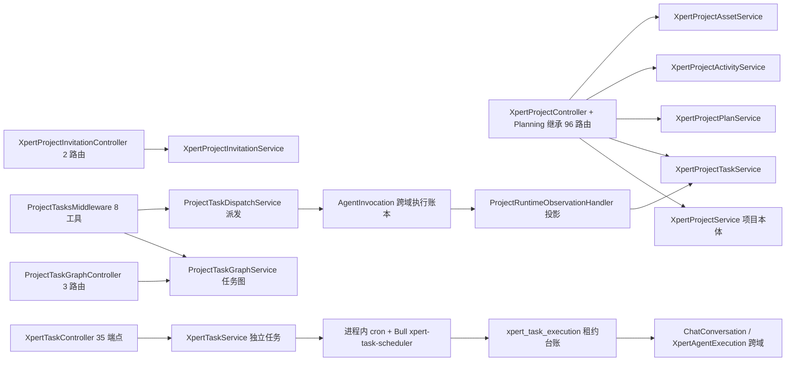

图表来源：[project.controller.ts](file://packages/server-ai/src/xpert-project/project.controller.ts)、[project-task-graph.service.ts](file://packages/server-ai/src/xpert-project/services/project-task-graph.service.ts)、[xpert-task.service.ts](file://packages/server-ai/src/xpert-task/xpert-task.service.ts)

章节来源：[project.module.ts](file://packages/server-ai/src/xpert-project/project.module.ts)（关键符号：XpertProjectModule / TypeOrmModule.forFeature）、[xpert-task.module.ts](file://packages/server-ai/src/xpert-task/xpert-task.module.ts)（关键符号：XpertTaskModule / BullModule.registerQueue）

## 链路一 项目创建链

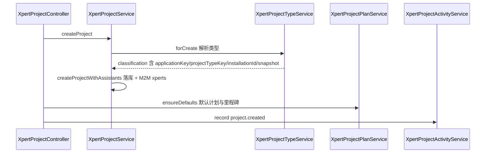

图表来源：[project.controller.ts](file://packages/server-ai/src/xpert-project/project.controller.ts)、[project-type.service.ts](file://packages/server-ai/src/xpert-project/services/project-type.service.ts)、[project.service.ts](file://packages/server-ai/src/xpert-project/project.service.ts)

- 类型解析在**创建瞬间固化**：`XpertProjectTypeService.forCreate` 产出 `XpertProjectClassification`（`applicationKey` / `projectTypeKey` / `applicationInstallationId` / `projectTypeSnapshot`）；`resolve()` 只认「活跃注册」，注释明写快照不能复活不可用类型。
- 索引 `IDX_project_application_type(tenantId, organizationId, applicationKey, projectTypeKey, status)` 支撑「按应用+类型+状态」的目录/生命周期查询；迁移 `20260920-project-types.sql` 的 `CK_project_type_identity` 保证两个类型键**同时为 NULL 或同时非空**。
- 直选能力被**有意忽略**：`void toolsetIds` / `void knowledgebaseIds`，payload 注释「Deprecated direct capability selections are intentionally ignored」。
- 会话内创建走 `ConversationProjectService.prepare`：会话行 `pessimistic_write` 锁内建项目 + M2M + `conversation.projectId`，`settings.managementMode='simple'` 与 `conversationBootstrap` 一起提交；提交后 `content.initialize` 落 `project.md`（幂等，可重试不重复建项目）。
- 插件 provisioning 用 `ensureManagedProject`（调用方 id 幂等，owner 恒为认证用户）。

章节来源：[project.service.ts](file://packages/server-ai/src/xpert-project/project.service.ts)（关键符号：XpertProjectService.createProject / createWithInitialAssistants / ensureManagedProject）、[conversation-project.service.ts](file://packages/server-ai/src/xpert-project/services/conversation-project.service.ts)（关键符号：ConversationProjectService.prepare / confirm）

## 链路二 成员与邀请链

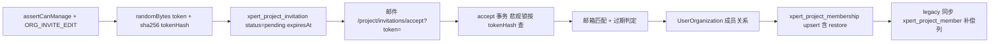

图表来源：[project-invitation.service.ts](file://packages/server-ai/src/xpert-project/services/project-invitation.service.ts)、[project-membership.service.ts](file://packages/server-ai/src/xpert-project/services/project-membership.service.ts)

- 邀请：需 `ORG_INVITE_EDIT` 且项目必须有 Organization；token 为 `randomBytes(32).toString('base64url')`，库内只存 `tokenHash`（`select:false` + `@Exclude`）；`expiresAt = now + organization.inviteExpiryPeriod || 14 天`；同 `(projectId, normalizedEmail, pending)` 复用同一行（由部分唯一索引 `IDX_xpert_project_invitation_pending` 兜底）。
- 接受：要求 verified user；事务内 `pessimistic_write` + `tokenHash` 查询 → 邮箱一致性 → 已 `accepted` 时幂等返回既有成员行 → 过期写 `expired` → 再 upsert 成员行（软删行 restore）。
- 成员服务 `add` 校验「owner 不重复入成员表」「必须是本组织活跃成员」，并同步写 legacy `xpert_project_member`；移除成员时先批量 `pause` 该用户的 `XpertTask`，再 `emitAsync('xpert-project.member-removed')`。
- legacy 4 列（`legacyMembershipSyncedAt/Attempts/LastError/NextAttemptAt`）由 `@Interval(60s)` 重试，退避上限 1 小时。

章节来源：[project-invitation.service.ts](file://packages/server-ai/src/xpert-project/services/project-invitation.service.ts)（关键符号：XpertProjectInvitationService.invite / accept / decline）、[project-membership.service.ts](file://packages/server-ai/src/xpert-project/services/project-membership.service.ts)（关键符号：XpertProjectMembershipService.add / list）

## 链路三 资源挂载链

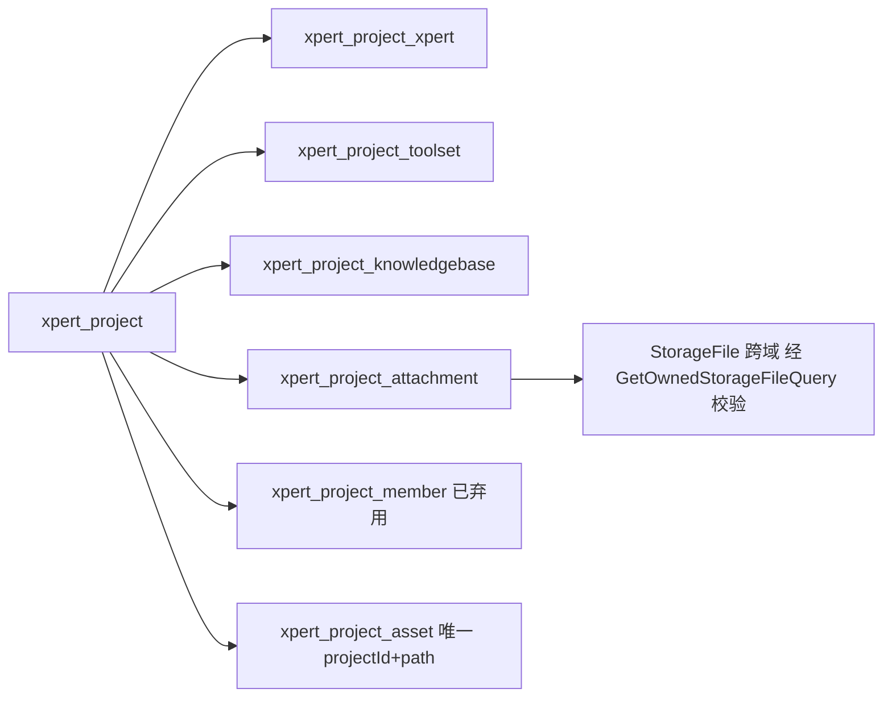

图表来源：[project.entity.ts](file://packages/server-ai/src/xpert-project/entities/project.entity.ts)、[project-asset.service.ts](file://packages/server-ai/src/xpert-project/services/project-asset.service.ts)、[project.service.ts](file://packages/server-ai/src/xpert-project/project.service.ts)

- 四张在用联接表由 `@JoinTable` 声明；`xpert_project_member` 标注 `@deprecated Legacy relation … no startup backfill is performed`，唯一补救在邀请表的 legacy 补偿列。
- 附件写入：`addAttachments` 先 diff 现有 id，再对每个新 id 走 `GetOwnedStorageFileQuery`（**拥有权校验**）后整体 `save`；`delAttachment` 额外发 `StorageFileDeleteCommand`。
- 资产索引：`XpertProjectAssetService.createAsset` 以 `(projectId, path)` 唯一键做 upsert（`withDeleted` 命中则 recover + 复用），`source ∈ upload|ai_output|conversation|import`、`status ∈ available|processing|failed`；`project.controller.ts` 的资产端点与 AI 产出回路都写该表并记录活动。
- 弃用面：`XpertProjectFile`（类注释指向 file volume / FileAsset 投影）与 `XpertProjectVCS`（`@deprecated use CodeXpert instead`）**未注册进 forFeature**；`XpertProjectFileService` 全仓无引用，VCS 路由被整段注释。

章节来源：[project.entity.ts](file://packages/server-ai/src/xpert-project/entities/project.entity.ts)（关键符号：XpertProject / @JoinTable xpert_project_xpert / members 弃用注释）、[project-asset.service.ts](file://packages/server-ai/src/xpert-project/services/project-asset.service.ts)（关键符号：XpertProjectAssetService.createAsset）

## 链路四 项目内任务链

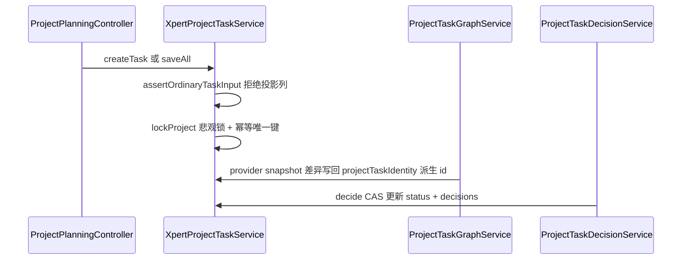

图表来源：[project-planning.controller.ts](file://packages/server-ai/src/xpert-project/project-planning.controller.ts)、[project-task.service.ts](file://packages/server-ai/src/xpert-project/services/project-task.service.ts)、[project-task-graph.service.ts](file://packages/server-ai/src/xpert-project/services/project-task-graph.service.ts)

- 幂等与身份：`unique(projectId, providerKey, sourceKey)`；provider 投影任务 id 由 `projectTaskIdentity(projectId, provider, key)` 的 sha256 **派生为稳定 UUID**（`8-4-5a-…` 形态），snapshot 与现有行按 `providerKey` 比差。
- 写保护：`assertOrdinaryTaskInput` 拒绝 `providerKey/sourceKey/sourceRevision/revision/parentTaskId/predecessorIds/planned*/estimatedDurationMs/diagnostic/executions/decisions/conversations`；provider 巡检行（有 `providerKey`）连 `setStatus` 都被 `assertOrdinaryTask` 拦下。
- 步骤与隐式完成：`updateTaskSteps` 在项目锁内按 `stepIndex` 匹配步骤、`notes` 追加式拼接；**当任务无任何带 invocationId 的执行行且所有步骤 done 时**任务隐式置 `done`。
- 失败/完成护栏：`assertBusinessStatus` 在有 `invocationId` 的执行行存在时，直接写 `done/completed` 抛 `DecisionRequired`，必须走决策链。
- 读路径副作用：`XpertProjectTaskSubscriber.afterLoad` 就地按 `stepIndex` 排序 `steps`，序列化顺序不可依赖。

章节来源：[project-task.service.ts](file://packages/server-ai/src/xpert-project/services/project-task.service.ts)（关键符号：XpertProjectTaskService.saveAll / updateTaskSteps / assertBusinessStatus）、[project-task-ownership.ts](file://packages/server-ai/src/xpert-project/services/project-task-ownership.ts)（关键符号：assertOrdinaryTask / assertOrdinaryTaskInput）

## 链路五 执行派发与投影链

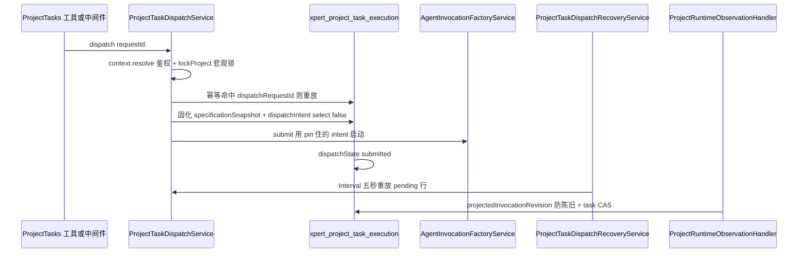

图表来源：[project-task-dispatch.service.ts](file://packages/server-ai/src/xpert-project/runtime/project-task-dispatch.service.ts)、[project-task-dispatch-recovery.service.ts](file://packages/server-ai/src/xpert-project/runtime/project-task-dispatch-recovery.service.ts)、[project-runtime-observation.handler.ts](file://packages/server-ai/src/xpert-project/runtime/project-runtime-observation.handler.ts)

- 幂等边界三条注释逐字：「Authorization precedes both reservation and idempotent replay.」「commit the attempt and pinned intent before invoking an adapter」「Replays keep the original scope; unknown or missing receipts never permit another launch」；命中已有 `dispatchRequestId` 时做 `sameInvocationData` 全量比对，不一致抛 Conflict。
- 唯一索引三件套：`IDX_project_task_execution_invocation(invocationId)`、`IDX_project_task_execution_dispatch(projectId, createdById, dispatchRequestId)`、`(taskId, sourceKey)`；`invocationId` 由 `agentInvocationId(scope, callId)` 派生，重放绝不新造 callId。
- 提交前校验：`expectedRevision` CAS、`kind==='task'` 且状态 ∈ `['todo','in_progress','blocked','review']`、`predecessorIds` 必须全部 `done|completed`、同项目未终态 invocation 即 Busy。
- 固化与出网：`createProjectTaskSpecificationSnapshot` 生成规范化规范 + `sha256:` digest（排序 steps、排除 progress/revision）；`dispatchIntent`（`select:false`）含 prompt/target/replyTo/projectTask 引用，注释要求「never serialize credentials, routing or configuration to task views」。
- 投影：跨域 `ProjectRuntimeObservationCommand`（由 `RuntimeObservationMonitorService` 等发出）→ handler 内项目锁 + attempt↔invocation 匹配 → `runtimeTaskStatus` 三映射 → 仅在 `["todo","in_progress","review","blocked"]` 且 digest 未变时 CAS 递增 `revision`；`projectedInvocationRevision` 防止旧观察覆盖新事实。
- 读侧只做投影：`projectTaskInvocationView` 注释「Read projection only. The legacy attempt status never replaces the full Invocation status」；`ProjectTaskRuntimeReadService.get` 额外读 `AgentRuntimeDelivery/Inbox` 与 `reviewReport`，不落库。

章节来源：[project-task-dispatch.service.ts](file://packages/server-ai/src/xpert-project/runtime/project-task-dispatch.service.ts)（关键符号：ProjectTaskDispatchService.dispatch / submit / intent）、[project-task-invocation-view.ts](file://packages/server-ai/src/xpert-project/runtime/project-task-invocation-view.ts)（关键符号：projectTaskInvocationView / observeProjectTaskInvocations）

## 链路六 任务与会话链

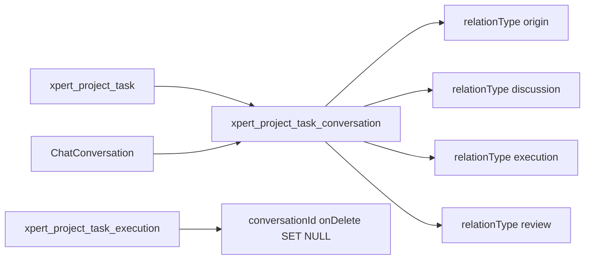

图表来源：[project-task-conversation.entity.ts](file://packages/server-ai/src/xpert-project/entities/project-task-conversation.entity.ts)、[project-task.service.ts](file://packages/server-ai/src/xpert-project/services/project-task.service.ts)、[project-task-execution.entity.ts](file://packages/server-ai/src/xpert-project/entities/project-task-execution.entity.ts)

- 链接表约束：`@Unique('UQ_project_task_conversation_relation', ['projectId','taskId','conversationId','relationType'])`，默认 `relationType='discussion'`，附 `isPrimary` / `sourceMessageId` / `sourceExecutionId`；任务与会话两侧 FK 均 `CASCADE`。
- 写入点：`XpertProjectTaskService.linkConversation` 先校验 `conversation.projectId === projectId`，再按四元组 `findOne` 幂等返回，避免重复行。
- 派发侧另有一条**弱引用**：attempt 行保存 `conversationId`（`onDelete: 'SET NULL'`）与 `threadId`，与链接表互为补充（链接表管「任务讨论过哪些会话」，attempt 管「这次执行发生在哪个线程」）。
- `xpert-task` 域反向持有 `ChatConversation.taskId`（`onDelete: 'SET NULL'`），与本域链接表无关，注意不要混用两套关联。

章节来源：[project-task-conversation.entity.ts](file://packages/server-ai/src/xpert-project/entities/project-task-conversation.entity.ts)（关键符号：XpertProjectTaskConversation / UQ_project_task_conversation_relation）、[project-task.service.ts](file://packages/server-ai/src/xpert-project/services/project-task.service.ts)（关键符号：XpertProjectTaskService.linkConversation / listTaskRelations）

## 链路七 计划族链

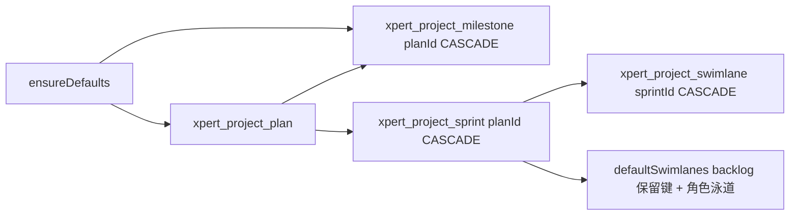

图表来源：[project-plan.service.ts](file://packages/server-ai/src/xpert-project/services/project-plan.service.ts)、[project-plan.entity.ts](file://packages/server-ai/src/xpert-project/entities/project-plan.entity.ts)

- **无 `@Tree`/closure-table**：层级完全靠显式 FK（plan → milestone / sprint → swimlane）；读取靠 `relations: ['milestones','sprints','sprints.swimlanes']`。
- 默认族：`ensureDefaults` 建 `Default plan`（`active`/`board`/order 0）+ `Uncategorized` 里程碑；`createPlan/createMilestone` 在 `settings.managementMode !== 'advanced'` 时只允许这两个保留名。
- 冲刺：`createSprint` 强制 advanced 模式，`strategyType` 默认 `software_delivery`，创建后立即写入 `defaultSwimlanes`——`backlog`（kind `backlog`，保留键）＋按策略决定的执行泳道（`planning/coding/review/release` 或 `research/analysis/visualization`），并把 `sourceStrategyType` 固化到每条泳道；`updateSprint` 拒绝改 `strategyType`。
- 泳道：`createSwimlane` 允许的空缺值有默认（`concurrencyLimit=1`、`wipLimit=0`、`environmentType='browser'`、`agentRole='operator'`）；`key==='backlog'` 与把 backlog 改成 execution 都被拒；排序字段为 `sortOrder`。

章节来源：[project-plan.service.ts](file://packages/server-ai/src/xpert-project/services/project-plan.service.ts)（关键符号：XpertProjectPlanService.ensureDefaults / createSprint / defaultSwimlanes）、[project-swimlane.entity.ts](file://packages/server-ai/src/xpert-project/entities/project-swimlane.entity.ts)（关键符号：XpertProjectSwimlane / sortOrder / sourceStrategyType）

## 链路八 活动流链

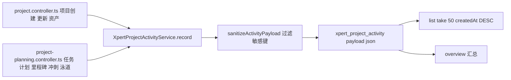

图表来源：[project-activity.service.ts](file://packages/server-ai/src/xpert-project/services/project-activity.service.ts)、[project.controller.ts](file://packages/server-ai/src/xpert-project/project.controller.ts)

- 唯一写入口：`XpertProjectActivityService.record`，落库前经 `sanitizeActivityPayload` 剔除键名匹配 `token|secret|password|prompt|authorization|apiKey` 的字段（递归处理对象/数组）。
- 写点分布（结构计数）：`project.controller.ts` 4 处（项目创建、更新、创建资产、资产回写循环）；`project-planning.controller.ts` 8 处（任务创建/更新、计划、里程碑、冲刺、泳道等），其中部分为 `void` 的 fire-and-forget。
- 读点：`list(projectId, take=50)` 按 `createdAt DESC`；`GET /:id/overview` 一次性返回 projects/plans/tasks/assets/activities/automations 汇总。
- 无定时任务、无外发通道，`payload` 为 `json` 列；`actor` 只在 contracts 类型上存在，实体侧只有 `createdById`。

章节来源：[project-activity.service.ts](file://packages/server-ai/src/xpert-project/services/project-activity.service.ts)（关键符号：XpertProjectActivityService.record / sanitizeActivityPayload）、[project-planning.controller.ts](file://packages/server-ai/src/xpert-project/project-planning.controller.ts)（关键符号：XpertProjectPlanningController.createTask / planningActivity.record）

## 链路九 独立任务调度链

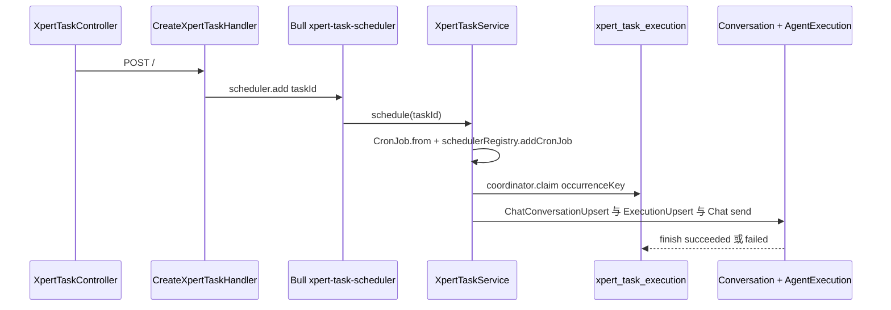

图表来源：[xpert-task.service.ts](file://packages/server-ai/src/xpert-task/xpert-task.service.ts)、[scheduler.job.ts](file://packages/server-ai/src/xpert-task/scheduler.job.ts)、[scheduled-task-execution.coordinator.ts](file://packages/server-ai/src/xpert-task/scheduled-task-execution.coordinator.ts)

- 三套机制并存：①Bull 队列只做**一次性入队**（唯一生产点在 `create.handler.ts` 的 `scheduler.add({ taskId })`）；②进程内 cron 是主调度（`CronJob.from({cronTime, timeZone})` + `schedulerRegistry.addCronJob(task.id)`，`Once` 置 `runOnce`，`onModuleInit` 重建 `SCHEDULED` 任务）；③定时扫描 `@Cron('30 * * * * *') recoverExpiredScheduledTaskExecutions` 与 `@Cron('0 * * * * *') runDueAutoTasks`。无 Bull repeatable。
- 幂等与租约：`coordinator.claim(task, buildScheduleOccurrenceKey(task, scheduledAt), scheduledAt)` → `xpert_task_execution` 的 `uq_xpert_task_execution_occurrence(taskId, occurrenceKey)`；`insertIfAbsent` 用 `orIgnore()`，租约 5 分钟，owner 取 `XPERT_INSTANCE_ID || HOSTNAME || randomUUID`；终态或未过期租约直接返回 null，过期则 `attempt+1` 抢租。
- 执行账本：`createPersistedTaskChatRun` 顺序为 `ChatConversationUpsertCommand({status:'idle', taskId, projectId, from:'job'})` → `XpertAgentExecutionUpsertCommand({status:RUNNING, threadId})` → `XpertChatCommand({action:'send', from:'job', execution:{id}, streamPersistence})`；xpert-task **只持有** `conversationId/executionId`，`observable` 的 `complete/error` 回调才写 `finish(SUCCEEDED|FAILED)`。
- 回写：每次执行把 `__idempotency_key`（`XPERT_TASK_SCHEDULE_IDEMPOTENCY_KEY`）注入 `runtimeState` 后再发；`status` 与 `runtimeState` 是两个独立列，运行不改变 `status`。
- 自动任务：`runDueAutoTasks` 在 Redis 锁 `scheduler:xpert-auto-task`（TTL 5 分钟）下取 `enabled=true AND nextRunAt<=now` 前 20 条；`frequency==='once'` 执行后 `enabled=false, nextRunAt=null`，`nextRunAt` 由 `computeAutoTaskNextRunAt` 按 `timeZone` 计算。
- 模板例行：`TemplateRoutinesHandler` 用 `uuid v5([tenantId,userId,assistantId,key])` 生成稳定 id，`pg_advisory_xact_lock` 串行化，**先以 PAUSED 落库**再切状态；注释「Import never schedules work; only an explicit authenticated update can enable a routine」。

章节来源：[xpert-task.service.ts](file://packages/server-ai/src/xpert-task/xpert-task.service.ts)（关键符号：XpertTaskService.scheduleCronJob / createPersistedTaskChatRun / runDueAutoTasks / recoverExpiredScheduledTaskExecutions）、[scheduled-task-execution.coordinator.ts](file://packages/server-ai/src/xpert-task/scheduled-task-execution.coordinator.ts)（关键符号：ScheduledTaskExecutionCoordinator.claim / markRunning / refreshLease / finish）

## 链路十 run-as 提案链

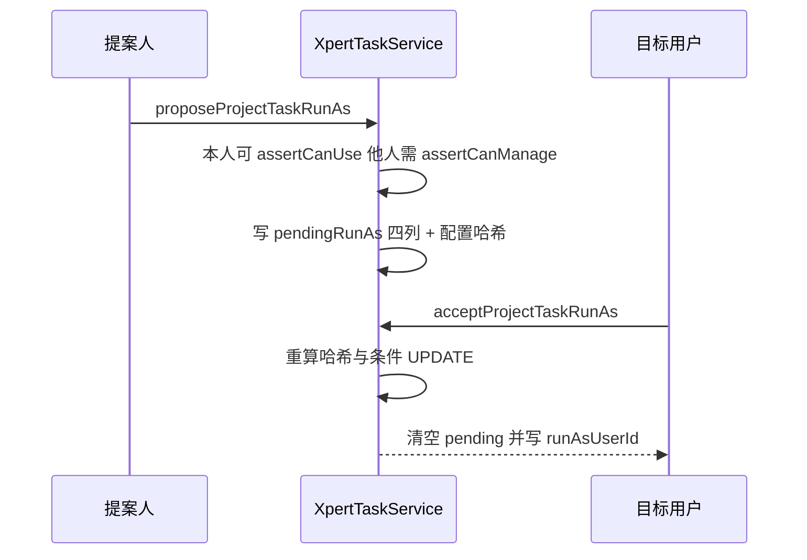

图表来源：[xpert-task.service.ts](file://packages/server-ai/src/xpert-task/xpert-task.service.ts)、[contracts/src/ai/xpert-task.model.ts](file://packages/contracts/src/ai/xpert-task.model.ts)

- 提案：模板任务必须有项目与助手；`actorId === currentRunAsUserId` 时只需 `assertCanUse`，否则 `assertCanManage`；目标必须 ≠ 当前 run-as；成功写 `pendingRunAsUserId/RequestedById/RequestedAt/ConfigurationHash` 四列。
- 配置哈希 = `buildProjectTaskRunAsConfigurationHash`（`xpertId` + 排序后的 connectorBindingIds，sha256）；`assertProjectTaskRunAsTarget` 同时解析项目当前助手版本。
- 接受：**仅 pending 目标本人**可接受（否则 403）；重算哈希不一致 → `ProjectTaskRunAsProposalChanged`；随后用 `{id, pendingRunAsUserId, pendingRunAsConfigurationHash}` 做条件 UPDATE，`affected !== 1` 再抛一次 `ProposalChanged`（两步确认 + CAS）。
- 失效：`invalidatePendingRunAsProposalForConfigurationChange` 在 `update` 时比较哈希，配置变更即清空 pending 四列（同样条件 UPDATE）。
- 执行期身份：调度与恢复路径统一取 `task.runAsUser ?? task.createdBy` 作为 actor；接受后若 `status === SCHEDULED` 会 `rescheduleTask` 重建 job。

章节来源：[xpert-task.service.ts](file://packages/server-ai/src/xpert-task/xpert-task.service.ts)（关键符号：proposeProjectTaskRunAs / acceptProjectTaskRunAs / buildProjectTaskRunAsConfigurationHash / invalidatePendingRunAsProposalForConfigurationChange）、[xpert-task.controller.ts](file://packages/server-ai/src/xpert-task/xpert-task.controller.ts)（关键符号：XpertTaskController run-as proposal / accept 端点）

## 状态机汇总

- **项目**：`active|deprecated|archived`（`packages/contracts/src/ai/xpert-project.model.ts`）；`archive()` 显式写 `archived`（`packages/server-ai/src/xpert-project/project.service.ts`）；`assertProjectWritable` 拒绝 archived 编辑（`services/project-access.service.ts`）；物理 purge 需 `role==='owner' && status==='archived'`（`services/project-access.service.ts`）。合法迁移：`active|deprecated → archived`（无反向路径）。
- **项目任务**：列级 enum 10 值 `todo|in_progress|review|paused|done|blocked|cancelled|pending|completed|failed`（`entities/project-task.entity.ts`）；对外类型只有 7 值（`contracts/src/ai/xpert-project.model.ts`）。自动推进仅 3 种映射：`succeeded→review`、`failed→blocked`、`running && progress.startedAt→in_progress`（`runtime/project-runtime-observation.handler.ts`），且仅在 `["todo","in_progress","review","blocked"]` 内且 CAS 命中时提交；业务决策 `accept→done` / 否则 `→todo` 并追加 decisions（`runtime/project-task-decision.service.ts`）；`providerKey` 非空的行禁走通用状态写入（`services/project-task-ownership.ts`）。
- **任务步骤**：`pending|running|done|failed`，默认 `pending`（`entities/project-task-step.entity.ts`）；全部 done 且无带 invocationId 的执行行时任务隐式 `done`（`services/project-task.service.ts`）。
- **执行尝试**：`queued|running|succeeded|failed|cancelled`，默认 `queued`（`entities/project-task-execution.entity.ts`）；派发位 `dispatchState ∈ pending|submitted`，默认空（`:30`）；只有 Invocation 终态才允许同项目新派发。
- **计划 / 里程碑 / 冲刺 / 泳道**：`draft|active|completed|archived` 默认 active（`entities/project-plan.entity.ts`）；`planned|in_progress|completed|blocked` 默认 planned（`entities/project-milestone.entity.ts`）；`planned|running|review|done` 默认 planned（`entities/project-sprint.entity.ts`）；`backlog|execution` 默认 execution（`entities/project-swimlane.entity.ts`）；均无代码内自动迁移，靠 API 直接赋值。
- **资产 / 自动化运行**：资产 `available|processing|failed` 默认 available（`entities/project-asset.entity.ts`）；自动化运行 `queued|running|succeeded|failed|cancelled` 默认 queued（`entities/project-automation-run.entity.ts`），但唯一写入方把行一律写成 `failed`（`services/project-automation.processor.ts`）。
- **邀请 / 成员**：`pending|accepted|declined|revoked|expired` 默认 pending（`entities/project-invitation.entity.ts`）；`pending → accepted`（accept）、`pending → declined`（decline）、过期 `pending → expired`（`services/project-invitation.service.ts`）已证实；`revoked` 未找到写入点 `[推测]`。成员角色 `manager|editor|member`（`entities/project-membership.entity.ts`），移除走 `removedAt` + `deletedAt` 软删。
- **独立任务**：`paused|archived|scheduled`（`packages/contracts/src/schedule.ts`）；`schedule→SCHEDULED+statusReason=null`（`xpert-task.service.ts`）、`pause→PAUSED`（:1309）、`archive→ARCHIVED`（:1316）、**`unarchive→PAUSED` 且不排程**（:1323）；`softDeleteHttpTask = pause + softRemove`（:278）、`recoverHttpTask` 只恢复软删记录不重建 job（:284）。
- **调度执行台账**：`pending|running|succeeded|failed`（`xpert-task/scheduled-task-execution.entity.ts`）；`claim` 遇终态或未过期租约返回 null，过期接管 `attempt+1`；`finish` 在 RUNNING 丢失时回退 PENDING 再补写一次（`scheduled-task-execution.coordinator.ts`），终态语义被弱化。
- **自动任务频率与便签**：`once|daily|weekly` 默认 daily（`xpert-task/auto-task.entity.ts`）；便签 `type ∈ note|task`、`status ∈ pending|done`（`xpert-task/schedule-note.entity.ts`）。

章节来源：[xpert-project.model.ts](file://packages/contracts/src/ai/xpert-project.model.ts)（关键符号：TXpertProjectStatus / TXpertProjectTaskStatus / TXpertProjectInvitationStatus）、[schedule.ts](file://packages/contracts/src/schedule.ts)（关键符号：ScheduleTaskStatus / TaskFrequency）

## 本域写 vs 跨域写

| 列 / 事实 | 写入方 | 说明 |
|---|---|---|
| 项目、任务、步骤、计划族、成员、邀请、活动、资产 | 本域（`xpert-project`） | 全部经本域 service，含项目行悲观锁与 `@VersionColumn` 任务版本 |
| `xpert_task.*`、`xpert_task_execution.*` | 本域（`xpert-task`） | 状态与租约由 `XpertTaskService` / coordinator 独占写 |
| `xpert_project_task_execution.projectedTaskRevision` / `projectedInvocationRevision` / `dispatchState` | 本域运行时 | 派发写 `pending`，提交写 `submitted`，观察回填投影版本 |
| `xpert_project_task_execution.invocationStatus` / `runtimeStartedAt` / `runtimeCompletedAt` | **跨域投影**（读时计算） | 由 `AgentInvocationEntity` 读投影派生，不落库（`project-task-invocation-view.ts`） |
| `xpert_project_task.status`（自动推进） | 跨域触发、本域落库 | 由 handoff 的 `ProjectRuntimeObservationCommand` 触发，实际 UPDATE 在本域 handler 内 |
| `AgentInvocation` 行 | 跨域（`agent-invocation`） | 本域只 pin 出 `invocationId` 与 `dispatchIntent` |
| `ChatConversation.projectId/taskId/xpertId` | 本域经跨域命令写 | 项目创建与 `xpert-task` 执行各写一部分（`conversation-project.service.ts`、`ChatConversationUpsertCommand`） |
| `XpertAgentExecution` 行 | 跨域（`xpert-agent-execution`） | `xpert-task` 只持有 `execution.id` 并作为 `runId` 透传 |
| `FileAsset` 行 | 跨域（`file-understanding`） | 本域 purge 时经 `FileAssetDeletionService` 清理，不直接改行 |

章节来源：[project-task-ownership.ts](file://packages/server-ai/src/xpert-project/services/project-task-ownership.ts)（关键符号：assertNativeExecutionInput 的 host-owned 列清单）、[project-task-invocation-view.ts](file://packages/server-ai/src/xpert-project/runtime/project-task-invocation-view.ts)（关键符号：projectTaskInvocationView）

## 已知风险

1. **两套任务模型并存**：`xpert_project_task`（本域运行时、provider 快照、Invocation 派发）与 `xpert_task`（cron 排程、自动任务、台账）只靠 `projectId` + 两个事件耦合；同一「项目任务」概念在两侧状态机、可见性与权限口径完全不同，容易串写。
2. **项目行悲观锁成全局串行点**：`project-task.service.ts`、`project-task-graph.service.ts`（注释「Serialize snapshot acquisition too」）、`project-task-dispatch.service.ts`、`project-task-decision.service.ts`、`project-runtime-observation.handler.ts` 都先锁项目行，热点项目上「快照、派发、决策、观察」互相排队。
3. **legacy 成员关系无回填**：`xpert_project_member` 已弃用但不清理，邀请表用 4 列补偿 + `@Interval(60s)` 重试，长期存在两套成员事实。
4. **旧版自动化成死代码**：`createAutomation/updateAutomation/removeAutomation/run` 全部抛 `GoneException`，`triggerEvent` 返回 `[]`，`scan()` 直接 `return`；但 `xpert_project_automation` / `_automation_run` 两张表与 `XpertProjectAutomationProcessor` 仍在装配中（processor 只把运行写成 `failed`）。
5. **派发恢复依赖 `select:false` 列**：`dispatchIntent` 默认不返回，恢复器与幂等比对必须显式 `addSelect`；漏加会直接抛 `Invalid`。
6. **冲突兜底靠 CAS 注释点名**：`project-runtime-observation.handler.ts` 明写「Some legacy task writers do not take the Project lock. CAS also fences their concurrent decisions.」——即存在绕过项目锁的历史写入路径。
7. **HTTP 与调度器两套可见性**：`findHttpAccessible` 才做项目成员校验，内部调度/恢复走 `findAll/findOne`；`query.handler` 在本地 `SchedulerRegistry` 取不到 job 时把返回状态**伪造成 PAUSED**，与库内 `status` 可能不一致。
8. **异常态残留**：`XpertProjectTaskStepService`、`XpertProjectFileService` 等 provider 全仓无引用；`XpertProjectFile`、`XpertProjectVCS` 未注册进 forFeature，VCS 相关路由整段注释，端点统计容易虚高。

章节来源：[project-runtime-observation.handler.ts](file://packages/server-ai/src/xpert-project/runtime/project-runtime-observation.handler.ts)（关键符号：ProjectRuntimeObservationHandler CAS 注释）、[project-automation.service.ts](file://packages/server-ai/src/xpert-project/services/project-automation.service.ts)（关键符号：XpertProjectAutomationService legacyProjectAutomationDisabled）、[project-automation-scheduler.service.ts](file://packages/server-ai/src/xpert-project/services/project-automation-scheduler.service.ts)（关键符号：XpertProjectAutomationSchedulerService.scan）
