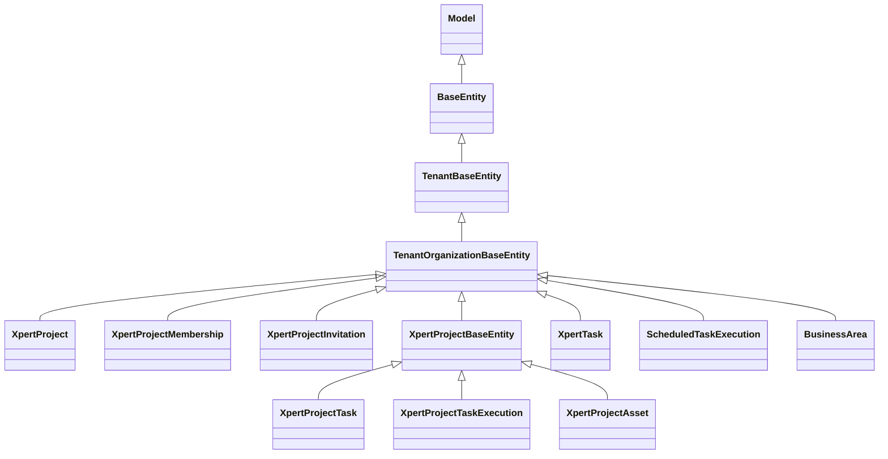

# 项目与任务协作域 · 数据模型

> 只读梳理（commit `80f5676fd`），引用为仓库根相对路径。口径：`xpert-project` 实测 **18 张表**（口径变更：早期索引记 20 → 实测 18），`xpert-task` **6 张**，`business-area` **1 张**，合计 **25 张**（18 + 6 + 1）；另有 4 张 M2M 联接表 + 1 张弃用联接表由 `@JoinTable` 声明，不计入 25。列极多者只列关键列与约束。

**本文引用的文件**

- [server/src/core/entities/base.entity.ts](file://packages/server/src/core/entities/base.entity.ts)
- [server/src/core/entities/tenant-base.entity.ts](file://packages/server/src/core/entities/tenant-base.entity.ts)
- [server/src/core/entities/tenant-organization-base.entity.ts](file://packages/server/src/core/entities/tenant-organization-base.entity.ts)
- [xpert-project/entities/project.base.ts](file://packages/server-ai/src/xpert-project/entities/project.base.ts)
- [xpert-project/entities/project.entity.ts](file://packages/server-ai/src/xpert-project/entities/project.entity.ts)
- [xpert-project/entities/project-membership.entity.ts](file://packages/server-ai/src/xpert-project/entities/project-membership.entity.ts)
- [xpert-project/entities/project-invitation.entity.ts](file://packages/server-ai/src/xpert-project/entities/project-invitation.entity.ts)
- [xpert-project/entities/project-activity.entity.ts](file://packages/server-ai/src/xpert-project/entities/project-activity.entity.ts)
- [xpert-project/entities/project-task.entity.ts](file://packages/server-ai/src/xpert-project/entities/project-task.entity.ts)
- [xpert-project/entities/project-task-step.entity.ts](file://packages/server-ai/src/xpert-project/entities/project-task-step.entity.ts)
- [xpert-project/entities/project-task-log.entity.ts](file://packages/server-ai/src/xpert-project/entities/project-task-log.entity.ts)
- [xpert-project/entities/project-task-execution.entity.ts](file://packages/server-ai/src/xpert-project/entities/project-task-execution.entity.ts)
- [xpert-project/entities/project-task-conversation.entity.ts](file://packages/server-ai/src/xpert-project/entities/project-task-conversation.entity.ts)
- [xpert-project/entities/project-plan.entity.ts](file://packages/server-ai/src/xpert-project/entities/project-plan.entity.ts)
- [xpert-project/entities/project-milestone.entity.ts](file://packages/server-ai/src/xpert-project/entities/project-milestone.entity.ts)
- [xpert-project/entities/project-sprint.entity.ts](file://packages/server-ai/src/xpert-project/entities/project-sprint.entity.ts)
- [xpert-project/entities/project-swimlane.entity.ts](file://packages/server-ai/src/xpert-project/entities/project-swimlane.entity.ts)
- [xpert-project/entities/project-asset.entity.ts](file://packages/server-ai/src/xpert-project/entities/project-asset.entity.ts)
- [xpert-project/entities/project-automation.entity.ts](file://packages/server-ai/src/xpert-project/entities/project-automation.entity.ts)
- [xpert-project/entities/project-automation-run.entity.ts](file://packages/server-ai/src/xpert-project/entities/project-automation-run.entity.ts)
- [xpert-project/entities/project-file.entity.ts](file://packages/server-ai/src/xpert-project/entities/project-file.entity.ts)
- [xpert-project/entities/project-vcs.entity.ts](file://packages/server-ai/src/xpert-project/entities/project-vcs.entity.ts)
- [xpert-project/project.module.ts](file://packages/server-ai/src/xpert-project/project.module.ts)
- [xpert-project/migrations/20260920-project-types.sql](file://packages/server-ai/src/xpert-project/migrations/20260920-project-types.sql)
- [xpert-project/migrations/20260929-project-task-graph.sql](file://packages/server-ai/src/xpert-project/migrations/20260929-project-task-graph.sql)
- [xpert-project/migrations/20261006-project-task-runtime.sql](file://packages/server-ai/src/xpert-project/migrations/20261006-project-task-runtime.sql)
- [xpert-task/xpert-task.entity.ts](file://packages/server-ai/src/xpert-task/xpert-task.entity.ts)
- [xpert-task/xpert-task-template.entity.ts](file://packages/server-ai/src/xpert-task/xpert-task-template.entity.ts)
- [xpert-task/auto-task.entity.ts](file://packages/server-ai/src/xpert-task/auto-task.entity.ts)
- [xpert-task/auto-task-template.entity.ts](file://packages/server-ai/src/xpert-task/auto-task-template.entity.ts)
- [xpert-task/schedule-note.entity.ts](file://packages/server-ai/src/xpert-task/schedule-note.entity.ts)
- [xpert-task/scheduled-task-execution.entity.ts](file://packages/server-ai/src/xpert-task/scheduled-task-execution.entity.ts)
- [business-area/business-area.entity.ts](file://packages/server/src/business-area/business-area.entity.ts)
- [business-area/business-area.service.ts](file://packages/server/src/business-area/business-area.service.ts)
- [contracts/src/ai/xpert-project.model.ts](file://packages/contracts/src/ai/xpert-project.model.ts)

## 目录

- [实体基类分层](#实体基类分层)
- [项目本体与治理表](#项目本体与治理表)
- [项目任务族表](#项目任务族表)
- [计划族表](#计划族表)
- [资源、自动化与弃用表](#资源自动化与弃用表)
- [任务域表](#任务域表)
- [业务域表](#业务域表)
- [建模边界](#建模边界)
- [校验规则](#校验规则)
- [迁移与 seed 惯例](#迁移与-seed-惯例)
- [未确认项](#未确认项)

## 实体基类分层

图表来源：[base.entity.ts](file://packages/server/src/core/entities/base.entity.ts)、[tenant-organization-base.entity.ts](file://packages/server/src/core/entities/tenant-organization-base.entity.ts)、[project.base.ts](file://packages/server-ai/src/xpert-project/entities/project.base.ts)

- `TenantOrganizationBaseEntity` 提供 `tenantId` / `organizationId`（任务域 6 表全部继承它）。
- `XpertProjectBaseEntity`（**abstract，无表**）额外给出 `projectId`（`ManyToOne(XpertProject) onDelete: 'CASCADE'`）与 `deletedAt`（`@DeleteDateColumn`）——项目域 **15 个实体类**共用该基类（其中 `xpert_project_file`、`xpert_project_vcs` 未注册进 `forFeature`，故实际注册 13 张），是两子域的共享基类。
- 隔离口径：项目域表共同以 `projectId` 收敛，不依赖 `workspaceId`；`XpertProject.workspaceId` 仍存在但注释为 `@deprecated`（`IXpertProject` 侧同样标注）。
- `business_area` 是本批唯一使用 `@Tree('closure-table')` 的表。

章节来源：[project.base.ts](file://packages/server-ai/src/xpert-project/entities/project.base.ts)（关键符号：XpertProjectBaseEntity / projectId / deletedAt）、[business-area.entity.ts](file://packages/server/src/business-area/business-area.entity.ts)（关键符号：BusinessArea / Tree closure-table）

## 项目本体与治理表

| 表 | 实体类（文件） | 关键列与约束 | 生产方 | 主要消费方 | 用途 |
|---|---|---|---|---|---|
| `xpert_project` | `XpertProject`（project.entity.ts） | `applicationKey(320)` / `projectTypeKey(100)` / `applicationInstallationId(uuid)` / `projectTypeSnapshot(jsonb)` / `name` / `avatar` / `description` / `status` / `settings` / `ownerId`；索引 `IDX_project_application_type(tenantId,organizationId,applicationKey,projectTypeKey,status)`；FK `workspaceId → XpertWorkspace` `onDelete: 'RESTRICT'`；OneToOne `copilotModel`（cascade）、`vcs`（cascade，弃用）；OneToMany `tasks/plans/activities/assets/automations/memberships` | `XpertProjectService.createProject`、`ConversationProjectService.prepare`、`ensureManagedProject`、`duplicate`、`importProject` | `XpertProjectAccessService`、各 guard、任务图/派发/决策（取项目行锁）、`xpert-task` 可见性子查询 | 项目聚合根与交付记录（必须比 Workspace 活得久） |
| `xpert_project_membership` | `XpertProjectMembership` | `@Index IDX_xpert_project_membership_unique(projectId,userId)` 唯一；`role varchar(20) default 'member'` / `joinedAt` 默认 `CURRENT_TIMESTAMP` / `removedAt` / `deletedAt`；FK `project CASCADE`、`user CASCADE`、`invitedBy SET NULL` | 成员服务 `add`、邀请 `accept`、组织管理员干预 | `resolveAccess`（成员即角色来源）、成员列表、`xpert-task` 权限 | 项目成员与角色（owner 不入此表） |
| `xpert_project_invitation` | `XpertProjectInvitation` | 部分唯一 `IDX_xpert_project_invitation_pending(projectId,normalizedEmail) WHERE status='pending' AND "deletedAt" IS NULL`；`IDX_xpert_project_invitation_token(tokenHash)` 唯一且 `tokenHash select:false` + `@Exclude`；`email(255)` / `normalizedEmail(255)` / `targetUserId SET NULL` / `role` / `status default 'pending'` / `expiresAt` / `invitedById RESTRICT` / `acceptedById SET NULL` / `acceptedAt` / `lastSentAt` / `legacyMembershipSync*` 4 列 / `deletedAt` | 邀请服务 `invite`；`accept` / `decline`；`@Interval(60s)` legacy 补偿 | 邀请控制器、`list`、legacy 同步器 | token 驱动加入项目（含过期与幂等重放） |
| `xpert_project_activity` | `XpertProjectActivity` | `type` / `entityType` / `entityId` / `summary text` / `payload json`；继承软删 `deletedAt` | `XpertProjectActivityService.record`（项目与计划两控制器） | `list(projectId, take=50)`、`/overview` 汇总 | 项目活动流（写入前脱敏） |

章节来源：[project.entity.ts](file://packages/server-ai/src/xpert-project/entities/project.entity.ts)（关键符号：XpertProject / IDX_project_application_type / ownerId）、[project-invitation.entity.ts](file://packages/server-ai/src/xpert-project/entities/project-invitation.entity.ts)（关键符号：XpertProjectInvitation / IDX_xpert_project_invitation_pending / tokenHash）

## 项目任务族表

| 表 | 实体类（文件） | 关键列与约束 | 生产方 | 主要消费方 | 用途 |
|---|---|---|---|---|---|
| `xpert_project_task` | `XpertProjectTask` | `@Index(projectId,providerKey,sourceKey)` 唯一；`decisions jsonb default '[]'`；`progress double precision`（`@Min(0)@Max(100)`）；`providerKey/sourceKey/sourceRevision`；**`@VersionColumn revision default 1`**；`kind default 'task'`（task/summary/milestone）；`parentTaskId`；`predecessorIds json default '[]'`；`plannedStartAt/EndAt`、`estimatedDurationMs`、`diagnostic`；`threadId` / `name` / `title` / `description` / `requirements jsonb default '[]'` / `type`；`status enum 10 值`；`priority enum 4 值`；`assigneeId` / `assigneeXpertId` / `dueDate` / `planId` / `milestoneId` / `column` / `order` / `startTime` / `endTime`；OneToMany `steps`（cascade）/`conversations`（cascade）/`executions`（cascade） | `XpertProjectTaskService.saveAll/createTask`、任务图 provider 快照回写、`duplicate` / `importProject` | 任务图服务、派发与决策服务、运行时观察投影、任务视图 provider | 项目任务图节点与业务任务账本 |
| `xpert_project_task_step` | `XpertProjectTaskStep` | `taskId`（可空，FK CASCADE）/ `stepIndex` / `description` / `notes default ''` / `status enum(pending,running,done,failed) default 'pending'` | `saveAll`（内嵌 steps）、`updateTaskSteps`、`importProject` | 运行时规范快照（title+steps → digest）、`afterLoad` 排序 | 任务步骤（隐式完成判定的输入） |
| `xpert_project_task_log` | `XpertProjectTaskLog` | `stepId`（FK CASCADE）/ `logType enum(input,output,error)` / `content text` | **未找到写入点**（实体与注册存在，无服务引用） | 未找到读取点 | 步骤输入/输出/错误日志（当前未接线） |
| `xpert_project_task_execution` | `XpertProjectTaskExecution` | 三个唯一索引：`IDX_project_task_execution_invocation(invocationId)`、`IDX_project_task_execution_dispatch(projectId,createdById,dispatchRequestId)`、`(taskId,sourceKey)`；`projectedTaskRevision` / `projectedInvocationRevision default -1` / `dispatchNextAttemptAt` / `dispatchError` / `invocationId` / `dispatchRequestId` / `dispatchState(pending,submitted)` / `specificationSnapshot jsonb` / `purpose jsonb` / **`dispatchIntent jsonb select:false`** / `attempt default 1` / `status enum(queued,running,succeeded,failed,cancelled) default 'queued'`；FK `taskId CASCADE`、`conversationId → ChatConversation SET NULL`；`invocationStatus/runtimeStartedAt/runtimeCompletedAt` 为**非列投影位** | `ProjectTaskDispatchService`（含恢复器重放）、`XpertProjectTaskService.createExecution/updateExecution/claimExecution` | 派发/决策/观察/读服务、任务卡片 | 一次执行尝试 + 派发意图 + 规范/投影版本（Invocation 的唯一投影行） |
| `xpert_project_task_conversation` | `XpertProjectTaskConversation` | `@Unique UQ_project_task_conversation_relation(projectId,taskId,conversationId,relationType)`；`relationType enum(origin,discussion,execution,review) default 'discussion'`；`isPrimary default false`；`sourceMessageId`；`sourceExecutionId`；FK task / conversation 均 CASCADE | `linkConversation`（幂等） | 任务关系查询 `listTaskRelations` | 任务与会话的多关系链接 |

章节来源：[project-task.entity.ts](file://packages/server-ai/src/xpert-project/entities/project-task.entity.ts)（关键符号：XpertProjectTask / revision / decisions / predecessorIds）、[project-task-execution.entity.ts](file://packages/server-ai/src/xpert-project/entities/project-task-execution.entity.ts)（关键符号：XpertProjectTaskExecution / dispatchIntent / IDX_project_task_execution_dispatch）

## 计划族表

| 表 | 实体类（文件） | 关键列与约束 | 生产方 | 主要消费方 | 用途 |
|---|---|---|---|---|---|
| `xpert_project_plan` | `XpertProjectPlan` | `name` / `description` / `status enum(draft,active,completed,archived) default 'active'` / `view enum(board,table,gantt,calendar,list) default 'board'` / `startDate` / `dueDate` / `order default 0`；OneToMany `milestones`、`sprints`（cascade） | `XpertProjectPlanService.ensureDefaults/createPlan`、`duplicate` / `importProject` | 计划列表、`/overview`、导出 DSL | 项目计划（simple 项目仅 Default plan） |
| `xpert_project_milestone` | `XpertProjectMilestone` | `planId`（FK CASCADE）/ `name` / `description` / `status enum(planned,in_progress,completed,blocked) default 'planned'` / `dueDate` / `order default 0` | `ensureDefaults`（Uncategorized）、`createMilestone`、`duplicate` / `importProject` | 计划树、导出 | 里程碑（simple 项目仅 Uncategorized） |
| `xpert_project_sprint` | `XpertProjectSprint` | `planId`（可空，FK CASCADE）/ `goal text` / `status enum(planned,running,review,done) default 'planned'` / `strategyType varchar default 'software_delivery'`（**不可变更**）/ `startAt` / `endAt` / `retrospective`；OneToMany `swimlanes`（cascade） | `createSprint`（advanced 模式） | 冲刺列表、泳道生成、导出 | 迭代容器（承载泳道策略） |
| `xpert_project_swimlane` | `XpertProjectSwimlane` | `sprintId`（FK CASCADE）/ `key` / `name` / `kind enum(backlog,execution) default 'execution'` / `priority default 0` / `weight default 1` / `concurrencyLimit default 0` / `wipLimit default 0` / `agentRole varchar default 'planner'` / `environmentType varchar default 'browser'` / `sortOrder default 0` / `sourceStrategyType default 'software_delivery'` | `createSprint` → `defaultSwimlanes`、`createSwimlane` | 泳道列表（按 `sortOrder`）、执行位分配 | 执行泳道/执行位（`backlog` 为保留键） |

章节来源：[project-plan.entity.ts](file://packages/server-ai/src/xpert-project/entities/project-plan.entity.ts)（关键符号：XpertProjectPlan / TXpertProjectPlanStatus）、[project-swimlane.entity.ts](file://packages/server-ai/src/xpert-project/entities/project-swimlane.entity.ts)（关键符号：XpertProjectSwimlane / kind / sourceStrategyType）

## 资源、自动化与弃用表

| 表 | 实体类（文件） | 关键列与约束 | 生产方 | 主要消费方 | 用途 |
|---|---|---|---|---|---|
| `xpert_project_asset` | `XpertProjectAsset` | `@Index(projectId,path)` 唯一；`parentId`（自引用 FK CASCADE）/ `name` / `path` / `kind enum(file,folder)` / `mimeType` / `size bigint` / `source enum(upload,ai_output,conversation,import) default 'upload'` / `taskId` / `conversationId` / `status enum(available,processing,failed) default 'available'` | `XpertProjectAssetService.createAsset`（资产端点、AI 产出回路）、`duplicate` / `importProject` | 资产 list/tree、`/overview` 计数、导出 | 项目资产索引（文件与文件夹树） |
| `xpert_project_automation` | `XpertProjectAutomation` | `name` / `enabled default false` / `trigger json`（`schedule|task.status_changed|asset.created|conversation.completed`）/ `actions json` / `lastRunAt` / `nextRunAt`；OneToMany `runs` | **已下线**：服务层全部 `GoneException`，仅历史行可查 | `list(includeRuns)`、`/overview` | 旧版项目自动化（只读遗留） |
| `xpert_project_automation_run` | `XpertProjectAutomationRun` | `automationId`（FK CASCADE）/ `status enum(queued,running,succeeded,failed,cancelled) default 'queued'` / `occurrenceKey` / `jobId` / `startedAt` / `completedAt` / `error` / `output json` | `XpertProjectAutomationProcessor.handle`（唯一写入方，一律写 `failed`） | `listRuns(take 100)` | 自动化运行记录（同样只读遗留） |
| `xpert_project_file` | `XpertProjectFile` | `filePath` / `fileType` / `url` / `contents` / `description`；`storageFileId` 为**非列**属性 | 无（`XpertProjectFileService` 全仓无引用） | 无 | 类注释 `@deprecated Use project file volume / FileAsset workspace projection instead.` |
| `xpert_project_vcs` | `XpertProjectVCS` | `integrationId`（FK `Integration SET NULL`）/ `auth json @Exclude` / `installationId` / `repository` | `VcsService`（provider 注册但 HTTP 路由整段注释） | 无 | 类注释 `@deprecated use CodeXpert instead` |

章节来源：[project-asset.entity.ts](file://packages/server-ai/src/xpert-project/entities/project-asset.entity.ts)（关键符号：XpertProjectAsset / source / status）、[project-automation-run.entity.ts](file://packages/server-ai/src/xpert-project/entities/project-automation-run.entity.ts)（关键符号：XpertProjectAutomationRun / occurrenceKey）

## 任务域表

| 表 | 实体类（文件） | 关键列与约束 | 生产方 | 主要消费方 | 用途 |
|---|---|---|---|---|---|
| `xpert_task` | `XpertTask` | `name(100)` / `schedule(50)` / `options json` / `timeZone` / `prompt` / `status varchar(20)`（`paused|archived|scheduled`）/ `statusReason text` / `runtimeState json` / `xpertId`（FK CASCADE）/ `agentKey` / `projectId uuid`（FK CASCADE）/ `runAsUserId`（FK `User RESTRICT`）/ `pendingRunAsUserId` + `pendingRunAsRequestedById` + `pendingRunAsRequestedAt` + `pendingRunAsConfigurationHash(64)` / **`deletedAt @DeleteDateColumn`**；OneToMany `conversations`（反向在 chat-conversation） | `CreateXpertTaskCommand` 处理器、`XpertTaskService.updateTask`、`TemplateRoutinesHandler`、run-as 提案/接受 | `XpertTaskService` 调度与执行、调度器视图 provider、`xpert-task` 控制器 | 定时/自动化任务主体，可挂项目（项目自动化改造后的唯一排程入口） |
| `xpert_task_template` | `XpertTaskTemplate` | `@Index uq_xpert_task_template_source_scope_key(source,tenantId,organizationId,createdById,key)` 唯一；`title(160)` / `prompt json`（字符串或 I18nObject）/ `defaultOptions json` / `icon(64)` / `builtin default false` | 模板端点、seed `[推测]` | `GET templates`、创建任务时套用 | 任务模板（内置 + 个人） |
| `auto_task` | `AutoTask` | `title(160)` / `description` / `prompt text` / `repo(255)` / `branch(255)` / `schedule(255)` / `frequency varchar(32) default 'daily'`（`once|daily|weekly`）/ `enabled default true` / `templateId` / `runAt` / `timeZone(64)` / `pushChannel(64)` / `params json` / `lastRunAt` / `nextRunAt` | 自动任务端点、`runDueAutoTasks` 回写 `lastRunAt/nextRunAt/enabled` | `runDueAutoTasks` 扫描、`GET auto-tasks` | 简化版（仓储式）自动任务 |
| `auto_task_template` | `AutoTaskTemplate` | `@Index uq_auto_task_template_scope_key(tenantId,organizationId,createdById,key)` 唯一；`key(120)` / `title(160)` / `description` / `prompt` / `defaultParams json` / `icon(64)` / `builtin default false` | service 内 seed（内置约 18 条 `[待核]`） | `GET auto-task-templates` | 自动任务模板 |
| `schedule_note` | `ScheduleNote` | `title(160)` / `content text` / `date date`（`YYYY-MM-DD`）/ `remindAt` / `type varchar(16) default 'note'`（`note|task`）/ `status varchar(16) default 'pending'`（`pending|done`） | 便签端点（POST/PUT/DELETE `schedule/notes`） | `GET schedule/day/:date`、`schedule/overview` | 日程便签（可关联 autoTask） |
| `xpert_task_execution` | `ScheduledTaskExecution` | `@Index uq_xpert_task_execution_occurrence(taskId,occurrenceKey)` 唯一；`@Index(status,leaseExpiresAt)`；`scheduledAt` / `status varchar(16) default 'pending'` / `ownerId(128)` / `leaseExpiresAt` / `attempt default 0` / `conversationId` / `executionId` / `startedAt` / `completedAt` / `lastError` / `failureCode(64)`，仅允许 `'LOCAL_RUNTIME_UNAVAILABLE'` | `ScheduledTaskExecutionCoordinator.claim/bindRun/finish`（`insertIfAbsent` 用 `orIgnore`） | `recoverExpiredScheduledTaskExecutions`、`/overview` 类统计 | 执行台账与租约（occurrenceKey 幂等） |

章节来源：[xpert-task.entity.ts](file://packages/server-ai/src/xpert-task/xpert-task.entity.ts)（关键符号：XpertTask / pendingRunAsConfigurationHash / deletedAt）、[scheduled-task-execution.entity.ts](file://packages/server-ai/src/xpert-task/scheduled-task-execution.entity.ts)（关键符号：ScheduledTaskExecution / uq_xpert_task_execution_occurrence / failureCode）

## 业务域表

| 表 | 实体类（文件） | 关键列与约束 | 生产方 | 主要消费方 | 用途 |
|---|---|---|---|---|---|
| `business_area` | `BusinessArea` | `@Tree('closure-table')`；`type varchar`（`BusinessType` 枚举）/ `name varchar(255)`（`@Index()`）/ `@TreeChildren children` / `@TreeParent({onDelete:'CASCADE'}) parent` / `parentId uuid` | `BusinessAreaService.createArea/updateArea` | 业务域控制器与上层业务分类 | 组织内业务域树（闭包表，本批唯一树形表） |

- 该表**不属于**项目域或任务域：本批范围内没有任何 `xpert-project` / `xpert-task` 代码引用它，属相邻业务分类基座。
- 服务侧不变量：名称去空必填；`parentId` 不允许指向自身或自己的后代（`validateParent` 沿 `parentId` 上溯检测）。

章节来源：[business-area.entity.ts](file://packages/server/src/business-area/business-area.entity.ts)（关键符号：BusinessArea / TreeParent / parentId）、[business-area.service.ts](file://packages/server/src/business-area/business-area.service.ts)（关键符号：BusinessAreaService.createArea / validateParent）

## 建模边界

- **跨域投影列（不落库）**：`XpertProjectTaskExecution` 上的 `invocationStatus` / `runtimeStartedAt` / `runtimeCompletedAt` 是运行时只读位，由 `projectTaskInvocationView` 从 `AgentInvocationEntity` 计算；注释「Read projection from the associated Invocation, never a second runtime ledger」。
- **投影版本列（本域落库）**：`projectedInvocationRevision`（default -1）与 `projectedTaskRevision` 由 `ProjectRuntimeObservationHandler` 写，用于「旧观察不得覆盖新事实」的比较；`dispatchState ∈ pending|submitted` 由派发与提交分别写。
- **JSON 快照语义**：`projectTypeSnapshot`（项目类型显示快照，仅展示，绝不授权）、`specificationSnapshot`（`specification` + `sha256:` `digest`，规范化时排序 steps 且排除 progress 与任务 revision）、`dispatchIntent`（主机侧恢复意图，`select:false`，含 prompt/target/replyTo，永不出网到任务视图）、`purpose`（执行目的，`implementation` / `review` 及其证据引用）。
- **身份快照列**：`sourceKey` / `providerKey` / `sourceRevision` 是 provider 侧来源身份，`taskId + sourceKey` 唯一；`invocationId` 由 `agentInvocationId(scope, callId)` 派生，重放不得新造。
- **软删边界**：项目域从属表统一带 `deletedAt`（`XpertProjectBaseEntity`）；任务域仅 `XpertTask` 有 `@DeleteDateColumn`，其余 5 表**没有软删**。
- **乐观锁边界**：全批**只有 `xpert_project_task.revision` 一个 `@VersionColumn`**（default 1）；任务域 6 表全部无版本列，靠条件 UPDATE + 租约表达并发。
- **双轨 file 面**：`xpert_project_asset`（本域索引）与 `XpertProjectFile`（弃用）并存，实际文件字节在 file volume / `FileAsset`（跨域）。

章节来源：[project-task-execution.entity.ts](file://packages/server-ai/src/xpert-project/entities/project-task-execution.entity.ts)（关键符号：invocationStatus / dispatchIntent / projectedInvocationRevision）、[project-task-specification.ts](file://packages/server-ai/src/xpert-project/runtime/project-task-specification.ts)（关键符号：createProjectTaskSpecificationSnapshot / digest）

## 校验规则

- **唯一索引**：`IDX_project_application_type`；`xpert_project_membership(projectId,userId)`；邀请 `(projectId,normalizedEmail) WHERE status='pending' AND "deletedAt" IS NULL` 部分唯一 + `tokenHash` 唯一；`xpert_project_task(projectId,providerKey,sourceKey)`；`xpert_project_task_execution` 三唯一；`UQ_project_task_conversation_relation` 四列；`xpert_project_asset(projectId,path)`；`xpert_task_template` 五列；`auto_task_template` 四列；`uq_xpert_task_execution_occurrence(taskId,occurrenceKey)`。
- **CHECK 约束**：`CK_project_type_identity` 要求 `applicationKey` 与 `projectTypeKey` 同为 NULL 或同非空且非空串（迁移 `20260920-project-types.sql`）。
- **枚举**：实体列多为 PG `enum`（任务 state/priority、步骤 status、执行 status、计划/里程碑/冲刺/泳道 kind、资产 kind/source/status、活动无枚举、自动化运行 status、任务域 status 为 `varchar` 非 enum）。
- **数值校验**：`xpert_project_task.progress` 用 `@IsNumber @Min(0) @Max(100)`；服务侧 `assertProjectTaskProgress` 同样拦截（`assertOrdinaryTaskInput` 调用）。
- **列级写保护**：`assertOrdinaryTaskInput` 拒绝通用写路径提供 13 个 provider/投影列；`assertNativeExecutionInput` 拒绝 native 端点提供 `invocationId/dispatchRequestId/dispatchState/dispatchIntent/purpose/specificationSnapshot` 等 host-owned 列，违者抛 `Owned`。
- **跨域值域**：`scheduled-task-oidc-token` 相关要求 `automationContext.oidcClientId` 必填；`scheduled_task_execution.failureCode` 只允许 `LOCAL_RUNTIME_UNAVAILABLE`。
- **服务级规则**：`validateProjectMemberRole`、邀请必须存在 Organization 且需 `ORG_INVITE_EDIT`、成员必须是本组织活跃用户、仅 owner 且 archived 可 purge、简单项目只能固定 lanes/默认计划对象。

章节来源：[project-task-ownership.ts](file://packages/server-ai/src/xpert-project/services/project-task-ownership.ts)（关键符号：assertOrdinaryTaskInput / assertNativeExecutionInput）、[20260920-project-types.sql](file://packages/server-ai/src/xpert-project/migrations/20260920-project-types.sql)（关键符号：CK_project_type_identity）

## 迁移与 seed 惯例

- 项目域 `migrations/` 仅 5 个 SQL，全部只覆盖 `xpert_project` 主表与 `xpert_project_task` / `xpert_project_task_execution`：`20260920-project-types.sql`（类型列 + CHECK + 索引）、`20260929-project-task-graph.sql`（provider 身份、revision、图字段 + 两个唯一索引）、`20261002-project-task-progress.sql`、`20261006-project-task-decisions.sql`、`20261006-project-task-runtime.sql`（runtime 列 + Invocation/dispatch 唯一索引，整体 `BEGIN/COMMIT`）。
- **未找到** membership / invitation / plan / milestone / sprint / swimlane / asset / activity / automation 的迁移 SQL；这些表结构与 5 个迁移未覆盖的列**依赖 TypeORM synchronize 建表**（`project.module.ts` 的 `forFeature` 列表即运行期模型清单）。
- `xpert-task` 域内**未找到任何 migration 文件**，6 张表同样依赖 synchronize；`auto_task_template` 内置条目由 service 内 seed 常量写入（约 18 条 `[待核]`，`builtin: true`）。
- 注册口径：`project.module.ts` 的 `forFeature` 共注册 **26 个实体**（其中本域 18 张 + 跨域 8 个）（含跨域 `PluginApplicationInstallation` / `FileAsset` / `XpertAgentExecution` / `ChatConversation` / `XpertTask` / `User` 等），**`XpertProjectFile` 与 `XpertProjectVCS` 未注册**；`xpert-task.module.ts` 注册 6 张自有表 + `ChatConversation` / `User`。

章节来源：[project.module.ts](file://packages/server-ai/src/xpert-project/project.module.ts)（关键符号：TypeOrmModule.forFeature 实体清单）、[20261006-project-task-runtime.sql](file://packages/server-ai/src/xpert-project/migrations/20261006-project-task-runtime.sql)（关键符号：IDX_project_task_execution_invocation）

## 未确认项

1. **表数口径变更记录（早期索引记 20 → 实测 18）**：`entities/` 下带 `@Entity(...)` 的文件共 18 个；`project.base.ts` 是 abstract 无表，`project.subscriber.ts`、`entities/project-task.subscriber.ts` 是 subscriber 非实体。早期 20 的口径 `[推测]` 把基类/subscriber 计入了实体数；本文件以 **实测 18** 为准。

0. **改表前必读**：逐表的生产方与消费方见 [C4-数据流向与消费.md](file://.module-experts/后端专题/项目与任务协作专家/C4-数据流向与消费.md)；表上的关键决策见 [C5-关键决策.md](file://.module-experts/后端专题/项目与任务协作专家/C5-关键决策.md)。
2. **`xpert_project_task_log` 无生产/消费方**：实体、注册、contracts 类型齐备，但仓库内未找到写入或读取代码（因此「步骤日志链」当前不成立）。
3. **`XpertProjectTaskStepService`、`XpertProjectFileService` 无引用**：前者只在自身文件出现且不在 `project.module.ts` providers 中；后者同样未注册，`XpertProjectFile` 表因此无写入路径。
4. **邀请 `revoked` 有明确写入点**：`DELETE /:id/invitations/:invitationId` 将 `invitation.status` 置 `revoked`（`XpertProjectInvitationService` 的撤销路径；非 `pending` 状态抛 400 `ProjectInvitationNotPending`）。`TXpertProjectInvitationStatus` 的其余取值与 `accept/decline/expired` 路径均已证实。
5. **`business_area.type` 的取值集合**：来自 contracts `BusinessType`，本文件未逐值核读该枚举（未确认具体成员）。
6. **`xpert_project_vcs` 的 `VcsService` 可达性**：`VcsService` 在 providers 中，但对应 HTTP 路由整段被注释，是否仍有内部调用未证实。
7. **任务域 seed 归属**：`auto_task_template` 内置条目与 `xpert_task_template` 内置模板的具体 seed 入口未逐文件追踪（前者在 `xpert-task.service.ts` 内证实，后者归属未确认）。

章节来源：[project.module.ts](file://packages/server-ai/src/xpert-project/project.module.ts)（关键符号：providers 数组未含 XpertProjectFileService）、[project-task-log.entity.ts](file://packages/server-ai/src/xpert-project/entities/project-task-log.entity.ts)（关键符号：XpertProjectTaskLog）、[project-invitation.entity.ts](file://packages/server-ai/src/xpert-project/entities/project-invitation.entity.ts)（关键符号：TXpertProjectInvitationStatus）
