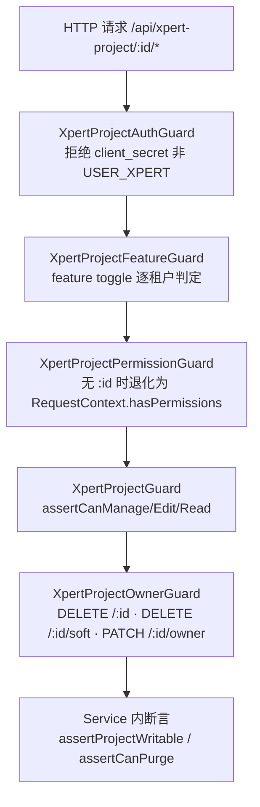

# 项目与任务协作专家 · 接口说明（05）

**本文引用的文件**

- [packages/server-ai/src/xpert-project/project.controller.ts](file://packages/server-ai/src/xpert-project/project.controller.ts)
- [packages/server-ai/src/xpert-project/project-planning.controller.ts](file://packages/server-ai/src/xpert-project/project-planning.controller.ts)
- [packages/server-ai/src/xpert-project/project-task-graph.controller.ts](file://packages/server-ai/src/xpert-project/project-task-graph.controller.ts)
- [packages/server-ai/src/xpert-project/project-invitation.controller.ts](file://packages/server-ai/src/xpert-project/project-invitation.controller.ts)
- [packages/server-ai/src/xpert-project/project-admin.controller.ts](file://packages/server-ai/src/xpert-project/project-admin.controller.ts)
- [packages/server-ai/src/xpert-project/project.module.ts](file://packages/server-ai/src/xpert-project/project.module.ts)
- [packages/server-ai/src/xpert-project/guards/index.ts](file://packages/server-ai/src/xpert-project/guards/index.ts)
- [packages/server-ai/src/xpert-project/guards/project-auth.guard.ts](file://packages/server-ai/src/xpert-project/guards/project-auth.guard.ts)
- [packages/server-ai/src/xpert-project/guards/project-feature.guard.ts](file://packages/server-ai/src/xpert-project/guards/project-feature.guard.ts)
- [packages/server-ai/src/xpert-project/guards/project.guard.ts](file://packages/server-ai/src/xpert-project/guards/project.guard.ts)
- [packages/server-ai/src/xpert-project/guards/project-permission.guard.ts](file://packages/server-ai/src/xpert-project/guards/project-permission.guard.ts)
- [packages/server-ai/src/xpert-project/guards/project-owner.guard.ts](file://packages/server-ai/src/xpert-project/guards/project-owner.guard.ts)
- [packages/server-ai/src/xpert-project/guards/project-permission.decorator.ts](file://packages/server-ai/src/xpert-project/guards/project-permission.decorator.ts)
- [packages/server-ai/src/xpert-project/services/project-access.service.ts](file://packages/server-ai/src/xpert-project/services/project-access.service.ts)
- [packages/server-ai/src/xpert-project/services/project-access-runtime.service.ts](file://packages/server-ai/src/xpert-project/services/project-access-runtime.service.ts)
- [packages/server-ai/src/xpert-project/services/project-invitation.service.ts](file://packages/server-ai/src/xpert-project/services/project-invitation.service.ts)
- [packages/server-ai/src/xpert-project/services/project-membership.service.ts](file://packages/server-ai/src/xpert-project/services/project-membership.service.ts)
- [packages/server-ai/src/xpert-project/services/project-content.service.ts](file://packages/server-ai/src/xpert-project/services/project-content.service.ts)
- [packages/server-ai/src/xpert-project/services/project-workspace-files.service.ts](file://packages/server-ai/src/xpert-project/services/project-workspace-files.service.ts)
- [packages/server-ai/src/xpert-project/services/project-plan.service.ts](file://packages/server-ai/src/xpert-project/services/project-plan.service.ts)
- [packages/server-ai/src/xpert-project/services/project-task-graph.service.ts](file://packages/server-ai/src/xpert-project/services/project-task-graph.service.ts)
- [packages/server-ai/src/xpert-project/services/project-automation.service.ts](file://packages/server-ai/src/xpert-project/services/project-automation.service.ts)
- [packages/server-ai/src/xpert-project/runtime/project-task-dispatch.service.ts](file://packages/server-ai/src/xpert-project/runtime/project-task-dispatch.service.ts)
- [packages/server-ai/src/xpert-project/runtime/project-task-decision.service.ts](file://packages/server-ai/src/xpert-project/runtime/project-task-decision.service.ts)
- [packages/server-ai/src/xpert-project/runtime/project-task-runtime.errors.ts](file://packages/server-ai/src/xpert-project/runtime/project-task-runtime.errors.ts)
- [packages/server-ai/src/xpert-project/runtime/project-runtime-observation.handler.ts](file://packages/server-ai/src/xpert-project/runtime/project-runtime-observation.handler.ts)
- [packages/server-ai/src/xpert-project/project-task-plan.schema.ts](file://packages/server-ai/src/xpert-project/project-task-plan.schema.ts)
- [packages/server-ai/src/xpert-project/entities/project-task-execution.entity.ts](file://packages/server-ai/src/xpert-project/entities/project-task-execution.entity.ts)
- [packages/server-ai/src/xpert-project/entities/project-invitation.entity.ts](file://packages/server-ai/src/xpert-project/entities/project-invitation.entity.ts)
- [packages/server-ai/src/xpert-task/xpert-task.controller.ts](file://packages/server-ai/src/xpert-task/xpert-task.controller.ts)
- [packages/server-ai/src/xpert-task/xpert-task.module.ts](file://packages/server-ai/src/xpert-task/xpert-task.module.ts)
- [packages/server-ai/src/xpert-task/dto/run-as.dto.ts](file://packages/server-ai/src/xpert-task/dto/run-as.dto.ts)
- [packages/server-ai/src/xpert-task/commands/handlers/create.handler.ts](file://packages/server-ai/src/xpert-task/commands/handlers/create.handler.ts)
- [packages/server/src/business-area/business-area.controller.ts](file://packages/server/src/business-area/business-area.controller.ts)
- [packages/server/src/business-area/business-area.module.ts](file://packages/server/src/business-area/business-area.module.ts)
- [packages/contracts/src/ai/xpert-project.model.ts](file://packages/contracts/src/ai/xpert-project.model.ts)
- [packages/contracts/src/schedule.ts](file://packages/contracts/src/schedule.ts)

## 目录

1. [一、总览：前缀、端点数与控制器分工](#一总览前缀端点数与控制器分工)
2. [二、XpertProjectController：项目本体、类型与生命周期](#二xpertprojectcontroller项目本体类型与生命周期)
3. [三、XpertProjectController：成员、邀请与所有权](#三xpertprojectcontroller成员邀请与所有权)
4. [四、XpertProjectController：资源绑定、内容与技能](#四xpertprojectcontroller资源绑定内容与技能)
5. [五、XpertProjectController：文件、资产、活动与自动化](#五xpertprojectcontroller文件资产活动与自动化)
6. [六、计划端点（继承自 XpertProjectPlanningController）](#六计划端点继承自-xpertprojectplanningcontroller)
7. [七、ProjectTaskGraphController：任务图](#七projecttaskgraphcontroller任务图)
8. [八、邀请与管理员控制器](#八邀请与管理员控制器)
9. [九、XpertTaskController：查询、CRUD 与生命周期](#九xperttaskcontroller查询crud-与生命周期)
10. [十、XpertTaskController：调度视图、便签、自动任务与模板](#十xperttaskcontroller调度视图便签自动任务与模板)
11. [十一、XpertTaskController：run-as 提案确认流](#十一xperttaskcontrollerrun-as-提案确认流)
12. [十二、business-area 控制器](#十二business-area-控制器)
13. [十三、鉴权与准入矩阵](#十三鉴权与准入矩阵)
14. [十四、错误语义](#十四错误语义)

## 一、总览：前缀、端点数与控制器分工

全局前缀 `api`，模块前缀由各自 `RouterModule.register` 给出（`/xpert-project`、`/xpert-task`、`/business-area`），实际路径为 `/api/xpert-project/*` 等。

| 控制器 | 前缀 | 真实路由 | 类级守卫与权限 |
|---|---|---|---|
| `XpertProjectController`（继承 `XpertProjectPlanningController`） | `/api/xpert-project` | **96**（自身 73 ＋ 继承 23） | `@Public()` ＋ `XpertProjectAuthGuard, XpertProjectFeatureGuard, XpertProjectPermissionGuard` ＋ `@ProjectPermission(XPERT_PROJECT_VIEW)` |
| `XpertProjectInvitationController` | `/api/xpert-project/invitations` | 2 | 仅 `@ApiBearerAuth` ＋ `TransformInterceptor`，无项目守卫 |
| `XpertProjectAdminController` | `/api/xpert-project` | 1 | `XpertProjectFeatureGuard` ＋ `PermissionGuard` ＋ `@Permissions(ORG_USERS_EDIT, ALL_ORG_EDIT)` |
| `ProjectTaskGraphController` | `/api/xpert-project` | 3 | 类级 `@UseGuards(XpertProjectGuard)`，方法级 `@ProjectPermission(VIEW/EDIT)` |
| `XpertTaskController` | `/api/xpert-task` | 35 | 无守卫，全部转调 service 的 `*HttpTask` 方法 |
| `BusinessAreaController` | `/api/business-area` | 5 | 读无守卫；写加 `RoleGuard` ＋ `@Roles(SUPER_ADMIN, ADMIN)` |

口径纠正（实测）：项目域「装饰器出现次数 106」含 **4 条注释掉的路由**（`:id/vcs` GET/PUT、`:id/github-installation`、`:id/github-installations`），故真实为 102；`CrudController` 基类的 10 条路由被同名方法全部覆盖，不新增端点数。**端点合计 137**＝项目域 102 ＋ 任务域 35；`business-area` 的 5 条单列于第十二节，不计入该口径（**含它合计 142**，与 C0 的「规模实测」一致）。

章节来源：[project.module.ts](file://packages/server-ai/src/xpert-project/project.module.ts)（关键符号：RouterModule.register / XpertProjectModule），[xpert-task.module.ts](file://packages/server-ai/src/xpert-task/xpert-task.module.ts)（关键符号：RouterModule.register），[project.controller.ts](file://packages/server-ai/src/xpert-project/project.controller.ts)（关键符号：XpertProjectController）

## 二、XpertProjectController：项目本体、类型与生命周期

除下表标注外，方法级均无额外守卫，靠类级三守卫 ＋ `@ProjectPermission` 判定。

| 方法 | 路径 | 权限 | 用途与关键行为 | 主要错误 |
|---|---|---|---|---|
| POST | `/import` | `XPERT_PROJECT_CREATE` | `importProject` 导入 DSL，返回 `XpertProjectDto` | 400 `Invalid project DSL` / `Project DSL requires a name` |
| GET | `/overview` | `XPERT_PROJECT_VIEW` | 无 `projectId` 时退化为 `findAllMy`；有则并发聚合 plans/tasks/assets/activities/automations | 403（`assertProjectAccess`） |
| POST | `/` | `XPERT_PROJECT_CREATE` | 201 创建；**忽略直选的 `toolsetIds`/`knowledgebaseIds`**（`void` 弃用处理） | 400 |
| GET | `/types` | `XPERT_PROJECT_VIEW` | 项目类型目录（可按 `xpertId` 过滤） | — |
| GET | `/type-entry` | `XPERT_PROJECT_VIEW` | 按 `applicationKey` 解析类型入口 | — |
| GET | `/available` | `XPERT_PROJECT_VIEW` | 某 Assistant 可用项目列表 | 400 `ProjectXpertIdRequired` |
| GET | `''` `/count` `/pagination` | `XPERT_PROJECT_VIEW` | 我的项目列表与计数（统一 `findAllMy`） | — |
| GET | `/my` | `XPERT_PROJECT_VIEW` | 我的项目（无方法级 `XpertProjectGuard`） | — |
| GET | `/:id` | `VIEW` ＋ `XpertProjectGuard` | 项目详情 | 403 `assertCanRead`；404 |
| PUT | `/:id` | `EDIT` ＋ `XpertProjectGuard` | 校验管道 `createProjectUpdateValidationPipe`，写活动 `project.updated` | 400；403 |
| PUT | `/:id/workspace` | `MANAGE` ＋ `XpertProjectGuard` | **恒定 400 拒绝**：项目不再绑定 Workspace | 400 `ProjectWorkspaceBindingDeprecated` |
| POST | `/:id/archive` | `MANAGE` ＋ `XpertProjectGuard` | 显式归档，写入 `status='archived'` | 403 |
| DELETE | `/:id/soft` | `MANAGE` ＋ `XpertProjectGuard` **+ `XpertProjectOwnerGuard`** | 软删（＝pause ＋ `softRemove`） | 403 |
| PUT | `/:id/recover` | `MANAGE` ＋ `XpertProjectGuard` | 软恢复（`softRecover({withDeleted})`，**不重建 job**） | 403 |
| DELETE | `/:id` | `MANAGE` ＋ `XpertProjectGuard, XpertProjectOwnerGuard` | **物理删除**（`XpertProjectService.deleteProject`：owner 守卫 ＋ `assertPlatformLifecycle` ＋ 事务内清 connector 绑定后删行） | 403；409（平台生命周期不允许） |
| POST | `/:id/duplicate` | `CREATE` ＋ Guard | 复制项目 | 403 |
| GET | `/:id/export` | `VIEW` | 导出 DSL（`ExportProjectCommand`） | 403 |
| PATCH | `/:id/owner` | `MANAGE` ＋ `XpertProjectGuard, XpertProjectOwnerGuard` | 转移所有权 | 403 |
| GET | `/:id/access` | `VIEW` ＋ Guard | 返回 `role` 与 `canRead/canEdit/canManage/canUse`（归档后 `canUse=false`） | 403 |

章节来源：[project.controller.ts](file://packages/server-ai/src/xpert-project/project.controller.ts)（关键符号：importDsl / overview / create / update / archive / delete / getAccess；**`XpertProjectPurgeService.purge` 不在本控制器路径上**，它由插件 provisioning 运行时调用，入参 `{projectId,xpertId}`，其 owner+archived 与文件占用 400 检查仅适用于该路径），[project-access.service.ts](file://packages/server-ai/src/xpert-project/services/project-access.service.ts)（关键符号：assertCanRead / assertCanEdit / assertCanManage / assertCanPurge / assertProjectWritable）

## 三、XpertProjectController：成员、邀请与所有权

| 方法 | 路径 | 权限 | 用途 | 主要错误 |
|---|---|---|---|---|
| GET | `/:id/members` | `VIEW` | `XpertProjectMembershipService.list` | 403 |
| PUT | `/:id/members` | `MANAGE` | 整体覆盖成员集合（`string[]`） | 403 |
| POST | `/:id/members` | `MANAGE` | 追加成员（`{userId, role}`） | 403；成员已存在 |
| PATCH | `/:id/members/:userId` | `MANAGE` | 改角色 | 403 |
| DELETE | `/:id/members/:userId` | `MANAGE` ＋ Guard | 204 移除成员（同步暂停其 `XpertTask` 并广播事件） | 403 |
| GET | `/:id/invitations` | `MANAGE` ＋ Guard | 邀请列表 | 403 |
| POST | `/:id/invitations` | `MANAGE` ＋ Guard | 发邀请（`{email, role}`），需要组织上下文 | 400 `ProjectOrganizationRequired` / `ProjectMemberAlreadyExists`；403 `OrganizationInvitePermissionRequired` |
| DELETE | `/:id/invitations/:invitationId` | `MANAGE` ＋ Guard | 撤销邀请 | 404 `ProjectInvitationNotFound`；400 `ProjectInvitationNotPending` |

角色口径：`TXpertProjectMemberRole='manager'|'editor'|'member'`，叠加 `'owner'` 得 `TXpertProjectAccessRole`；`canEdit=['owner','manager','editor']`、`canManage=['owner','manager']`。

章节来源：[project.controller.ts](file://packages/server-ai/src/xpert-project/project.controller.ts)（关键符号：getMembers / updateMembers / addMember / updateMemberRole / removeMember / transferOwnership / listInvitations / inviteMember / revokeInvitation），[project-membership.service.ts](file://packages/server-ai/src/xpert-project/services/project-membership.service.ts)（关键符号：list / add / remove / transferOwnership / interveneAsOrganizationAdministrator），[xpert-project.model.ts](file://packages/contracts/src/ai/xpert-project.model.ts)（关键符号：TXpertProjectMemberRole / TXpertProjectAccessRole）

## 四、XpertProjectController：资源绑定、内容与技能

| 方法 | 路径 | 权限 | 用途 |
|---|---|---|---|
| GET | `/:id/xperts` · `/:id/available-xperts` | `VIEW` / `MANAGE` | 已绑定 / 可绑定 Assistant 家族 |
| PUT | `/:id/xperts/:xpert` · PUT `/:id/assistant` | `MANAGE` | 绑定/切换 Assistant（走 `XpertProjectXpertBindingService.normalize`） |
| DELETE | `/:id/xperts/:xpert` | `MANAGE` | 解绑（会清 `XpertTask.xpertId`） |
| GET | `/:id/conversations` | `VIEW` | 经 `FindChatConversationQuery` 反查项目会话 |
| GET/PUT/DELETE | `/:id/toolsets[/:toolset]` | `VIEW` / `EDIT` | 工具集绑定 |
| GET/PUT/DELETE | `/:id/knowledges[/:kb]` | `VIEW` / `EDIT` | 知识库绑定 |
| GET/PUT | `/:id/content/instructions` | `VIEW` / `EDIT` | 项目 `project.md` 指令读写 |
| GET/POST/PATCH/DELETE | `/:id/content/skills`（含 `/install`、`/upload`、`/file`） | `VIEW` / `EDIT` | 技能清单、安装、上传（ZIP ≤ 25MB）、启停、卸载、技能内文件读写删 |

`PATCH :id/content/skills` 必须携带布尔 `enabled`，否则 400 `Error.ProjectSkillEnabledRequired`。受治理路径（`project.md`、`skills/`）不能走普通文件 API，否则 400。

章节来源：[project.controller.ts](file://packages/server-ai/src/xpert-project/project.controller.ts)（关键符号：listXperts / bindXpert / bindAssistant / listConversations / getProcjectSkills / installProjectSkill / uploadProjectSkills / setSkillEnabled），[project-content.service.ts](file://packages/server-ai/src/xpert-project/services/project-content.service.ts)（关键符号：isGovernedPath / readInstructions / updateInstructions / installSkill）

## 五、XpertProjectController：文件、资产、活动与自动化

| 方法 | 路径 | 权限 | 用途与关键行为 |
|---|---|---|---|
| GET | `/:id/activities` | `VIEW` | 活动流（`take` 控制条数） |
| GET/PUT/DELETE | `/:id/workspace/files` · `/:id/workspace/file[/upload]` | `VIEW` / `EDIT` | 项目工作区文件树、读、写、上传（≤ 10MB）、删 |
| GET | `/:id/assets` · `/:id/assets/tree` | `VIEW` | 资产分页（`take` 上限 200）与目录树 |
| POST/PUT/DELETE | `/:id/assets[/:assetId]` | `EDIT` | 资产创建/更新/删除；创建后异步记活动与 `triggerEvent('asset.created')` |
| GET | `/:id/automations` · `/:id/automations/runs` | `MANAGE` | 旧版自动化与运行记录**仍可读** |
| POST/PUT/DELETE | `/:id/automations[/:automationId]` · POST `.../run` | `MANAGE` | **全部 410 Gone**：`legacyProjectAutomationDisabled()` |
| GET | `/:id/files` | `VIEW` | 项目 volume 文件列表（`deepth`、`path`） |
| POST | `/:id/file/upload` | `EDIT` | 上传到 volume 并登记资产；受治理路径 400 |
| DELETE | `/:id/file` | `EDIT` | 删 volume 文件；受治理路径 400 |
| PUT | `/:id/attachments` · DELETE `/:id/attachments/:file` | `EDIT` | StorageFile 附件族 |

章节来源：[project.controller.ts](file://packages/server-ai/src/xpert-project/project.controller.ts)（关键符号：listActivities / listWorkspaceFiles / listAssets / createAsset / listAutomations / runAutomation / readFiles / uploadFile / addAttachments），[project-automation.service.ts](file://packages/server-ai/src/xpert-project/services/project-automation.service.ts)（关键符号：legacyProjectAutomationDisabled / triggerEvent）

## 六、计划端点（继承自 XpertProjectPlanningController）

`XpertProjectPlanningController` 是 **abstract 且未注册进 `controllers` 数组**，23 条路由通过 `XpertProjectController extends` 生效；每个方法自带 `@UseGuards(XpertProjectGuard)` ＋ `@ProjectPermission(...)`。

| 方法 | 路径 | 用途 |
|---|---|---|
| GET/POST | `/:id/tasks` | 任务分页 / 建任务（`planningProjects.createTasks`） |
| GET | `/:id/tasks/:taskId` · `/:id/tasks/:taskId/relations` | 单任务与关系图 |
| PUT | `/:id/tasks/order` · `/:id/tasks/batch` · `/:id/tasks/:taskId` | 重排 / 批量更新 / 单更新 |
| POST | `/:id/tasks/:taskId/conversations` | 关联会话（`linkTaskConversation`） |
| POST/PUT | `/:id/tasks/:taskId/executions[/:executionId]` | 创建/更新执行尝试 |
| GET/POST | `/:id/plans` | 计划列表 / 新建 |
| PUT/DELETE | `/:id/plans/:planId` | 计划更新 / 删除 |
| POST/PUT/DELETE | `/:id/plans/:planId/milestones[/:milestoneId]` | 里程碑增改删 |
| GET/POST | `/:id/plans/:planId/sprints` | 迭代列表 / 新建 |
| PUT | `/:id/sprints/:sprintId` | 迭代更新 |
| GET/POST | `/:id/sprints/:sprintId/swimlanes` | 泳道列表 / 新建 |
| PUT | `/:id/sprints/:sprintId/swimlanes/:swimlaneId` | 泳道更新 |

`GET :id/tasks/:taskId` 找不到时返回 404 `Project task not found`。

章节来源：[project-planning.controller.ts](file://packages/server-ai/src/xpert-project/project-planning.controller.ts)（关键符号：XpertProjectPlanningController / getTasks / createTask / reorderTasks / batchUpdateTasks / listPlans / createMilestone / listSprints / listSwimlanes），[project-plan.service.ts](file://packages/server-ai/src/xpert-project/services/project-plan.service.ts)（关键符号：list / ensureDefaults）

## 七、ProjectTaskGraphController：任务图

路由前缀同为 `/api/xpert-project`，类级 `@UseGuards(XpertProjectGuard)`，认证上下文由 `RequestContext.currentTenantId/getOrganizationId/currentUserId` 组装为 actor。

| 方法 | 路径 | 权限 | 用途与关键行为 |
|---|---|---|---|
| GET | `/:id/task-graph` | `XPERT_PROJECT_VIEW` | `ProjectTaskGraphService.graph` 读快照（可重放读模型，不启动 Agent） |
| PUT | `/:id/task-graph` | `XPERT_PROJECT_EDIT` | `projectTaskPlanSchema.safeParse` 校验后 `change()`；**必须带 `expectedRevision`**，仅投影计划字段（`parentTaskId/predecessorIds/plannedStartAt/plannedEndAt/estimatedDurationMs`） |
| GET | `/:id/task-executions/:executionId/target` | `XPERT_PROJECT_VIEW` | 解析执行目标（`resolveExecution`） |

`projectTaskPlanSchema` 为 `.strict()` Zod 对象：多余字段直接失败 → 400（`BadRequestException(result.error.issues)`）。

章节来源：[project-task-graph.controller.ts](file://packages/server-ai/src/xpert-project/project-task-graph.controller.ts)（关键符号：graph / change / target），[project-task-plan.schema.ts](file://packages/server-ai/src/xpert-project/project-task-plan.schema.ts)（关键符号：projectTaskPlanSchema），[project-task-graph.service.ts](file://packages/server-ai/src/xpert-project/services/project-task-graph.service.ts)（关键符号：graph / change / projectTaskIdentity）

## 八、邀请与管理员控制器

`XpertProjectInvitationController`（`@Controller('invitations')`）**无项目守卫，token 驱动、服务层校验**：

| 方法 | 路径 | 用途 | 主要错误 |
|---|---|---|---|
| POST | `/accept` | `invitationService.accept(token)`：校验 pending、未过期、邮箱匹配后落成员 | 400 `ProjectInvitationTokenRequired` / `ProjectInvitationInvalid` / `ProjectOrganizationRequired`；403 `VerifiedUserRequired` / `ProjectInvitationEmailMismatch` |
| POST | `/decline` | 200 拒绝邀请（token 校验同上） | 400 `ProjectInvitationInvalid`；403 `AuthenticatedUserRequired` / `EmailMismatch` |

`XpertProjectAdminController`（`@UseGuards(XpertProjectFeatureGuard, PermissionGuard)` ＋ `@Permissions(ORG_USERS_EDIT, ALL_ORG_EDIT)`）：

| 方法 | 路径 | 用途 |
|---|---|---|
| POST | `/:id/admin/intervene` | 200 组织管理员以显式理由加入项目（`interveneAsOrganizationAdministrator(projectId, reason)`，管道 `createProjectAdminInterventionValidationPipe` 校验 reason） |

章节来源：[project-invitation.controller.ts](file://packages/server-ai/src/xpert-project/project-invitation.controller.ts)（关键符号：accept / decline），[project-invitation.service.ts](file://packages/server-ai/src/xpert-project/services/project-invitation.service.ts)（关键符号：invite / accept / decline / revoke / list），[project-admin.controller.ts](file://packages/server-ai/src/xpert-project/project-admin.controller.ts)（关键符号：intervene）

## 九、XpertTaskController：查询、CRUD 与生命周期

`@Controller()` 空前缀 ＋ 模块路由 `/xpert-task`。控制器不做鉴权，全部转调 `XpertTaskService` 的 HTTP 边界方法（`findHttpAccessible`、`*HttpTask`）；内部调度器仍用 `findAll/findOne`，**绕过 HTTP 可见性**。

| 主题 | 方法 路径 | 用途与关键行为 |
|---|---|---|
| 查询/列表 | GET `/count`、`/pagination`、`/`、`/my`、`/total`、`/by-ids`、`/:id` | 均走 `findHttpAccessible`（`/my`、`/total`、`/by-ids` 均追加 `createdById=当前用户`，并在 service 内做项目成员校验）；`/:id` 用 `UUIDValidationPipe` |
| 创建 | POST `/` | 转 `CreateXpertTaskCommand`（runAs 必须本人、Trial 上限 10、agentKey 校验、`schedule` 置 null、入队 `xpert-task-scheduler`） |
| 更新 | PUT `/:id` | `status=SCHEDULED` 时先清 `statusReason` 再 `rescheduleTask`，否则 `deleteJob` |
| 生命周期 | PUT `/:id/schedule`、`/:id/pause`、`/:id/archive`、`/:id/unarchive` | 重新解析项目 Xpert、预检 connector 后重排；pause/archive 先 `deleteJob`；**`unarchive` 落 `PAUSED` 且不排程** |
| 测试 | POST `/:id/test` | 立即试跑（`test` 走 service 边界） |
| 删除/恢复 | DELETE `/:id/soft`、PUT `/:id/recover`、DELETE `/:id` | `soft`＝pause＋`softRemove`；`recover`＝`softRecover({withDeleted})`（**不重建 job**）；`DELETE /:id` 为 202 硬删（先 `deleteJob` 再 `remove`） |

状态枚举：`ScheduleTaskStatus='paused'|'archived'|'scheduled'`；`TaskFrequency='Once'|'Daily'|'Weekly'|'Monthly'|'Yearly'`。

章节来源：[xpert-task.controller.ts](file://packages/server-ai/src/xpert-task/xpert-task.controller.ts)（关键符号：findAll / findMyAll / getAllByIds / create / update / schedule / pause / archive / unarchive / test / softRemove / delete / softRecover），[create.handler.ts](file://packages/server-ai/src/xpert-task/commands/handlers/create.handler.ts)（关键符号：CreateXpertTaskHandler.execute），[schedule.ts](file://packages/contracts/src/schedule.ts)（关键符号：ScheduleTaskStatus / TaskFrequency）

## 十、XpertTaskController：调度视图、便签、自动任务与模板

| 主题 | 方法 路径 | 用途 |
|---|---|---|
| 调度视图 | GET `/schedule/capabilities/:xpertId`（可选 `agentKey`） | 助手/Agent 的调度能力 |
| 调度视图 | GET `/schedule/overview`（`from`/`to`） | 全局调度概览 |
| 调度视图 | GET `/schedule/day/:date` | 按日调度明细 |
| 日程便签 | POST `/schedule/notes`、PUT `/schedule/notes/:id`、DELETE `/schedule/notes/:id` | `ScheduleNote` 增改删（`type=note|task`、`status=pending|done`） |
| 自动任务 | GET/POST `/auto-tasks`、PUT/DELETE `/auto-tasks/:id` | `AutoTask` 增删改查（`frequency=once|daily|weekly`） |
| 自动任务模板 | GET/POST `/auto-task-templates` | 模板列表（内置 18 条 seed `[待核：未逐条计数]`）与新建 |
| 任务模板 | GET/POST `/templates`、PUT/DELETE `/templates/:id` | `source` 区分内置/个人；唯一键 `(source,tenantId,organizationId,createdById,key)` |

自动任务由 `@Cron('0 * * * * *')` 扫描（Redis 锁 `scheduler:xpert-auto-task`），`frequency='once'` 执行后置 `enabled=false, nextRunAt=null`。

章节来源：[xpert-task.controller.ts](file://packages/server-ai/src/xpert-task/xpert-task.controller.ts)（关键符号：getScheduleCapabilities / getScheduleOverview / getScheduleDay / createScheduleNote / listAutoTasks / listAutoTaskTemplates / listXpertTaskTemplates）

## 十一、XpertTaskController：run-as 提案确认流

| 方法 | 路径 | 守卫与校验 | 语义 |
|---|---|---|---|
| POST | `/:id/run-as/proposal` | `UUIDValidationPipe` ＋ `createXpertTaskRunAsProposalValidationPipe()`（`forbidNonWhitelisted`） | 提案写 `pendingRunAsUserId/RequestedById/RequestedAt` ＋ `pendingRunAsConfigurationHash`（由 `xpertId` ＋ connector 绑定集合派生） |
| POST | `/:id/run-as/accept` | 仅 `UUIDValidationPipe` | 重算 hash 并做条件 UPDATE；`affected !== 1` 即失效；成功后清空 pending 字段、`runAsUserId=当前用户`，若 `status=SCHEDULED` 则 `rescheduleTask` |

约束：仅 pending 指定的本人可接受；配置变更（如换 Xpert、改 connector 绑定）会主动使提案失效（`invalidatePendingRunAsProposalForConfigurationChange`）。

章节来源：[xpert-task.controller.ts](file://packages/server-ai/src/xpert-task/xpert-task.controller.ts)（关键符号：proposeRunAs / acceptRunAs），[run-as.dto.ts](file://packages/server-ai/src/xpert-task/dto/run-as.dto.ts)（关键符号：XpertTaskRunAsProposalDTO / createXpertTaskRunAsProposalValidationPipe）

## 十二、business-area 控制器

`@Controller()` 无控制器级前缀，模块路由 `/business-area` → 实际 `/api/business-area`。

| 方法 | 路径 | 守卫 | 用途 |
|---|---|---|---|
| GET | `''` | 无 | 全量列表（`IPagination<BusinessArea>`） |
| GET | `/:id` | 无 | 单个（`UUIDValidationPipe`） |
| POST | `''` | `RoleGuard` ＋ `@Roles(SUPER_ADMIN, ADMIN)` | 新建（closure-table 树） |
| PUT | `/:id` | 同上 | 更新 |
| DELETE | `/:id` | 同上 | 202 删除 |

章节来源：[business-area.controller.ts](file://packages/server/src/business-area/business-area.controller.ts)（关键符号：findAll / findOne / createArea / updateArea / deleteArea），[business-area.module.ts](file://packages/server/src/business-area/business-area.module.ts)（关键符号：RouterModule.register / BusinessAreaModule）

## 十三、鉴权与准入矩阵

四层项目守卫的判定与适用面：

| 守卫 | 判定依据 | 适用面 |
|---|---|---|
| `XpertProjectAuthGuard` | 继承 `ApiKeyOrClientSecretAuthGuard`；拒绝 `client_secret` 且非 `USER_XPERT` 绑定的主体 | 类级，仅 `XpertProjectController` |
| `XpertProjectFeatureGuard` | 环境 toggle ＋ `Feature/FeatureOrganization` 逐租户/组织判定；**feature 未 seed 时放行** | 类级（主控制器）＋ `XpertProjectAdminController` |
| `XpertProjectPermissionGuard` | 无 `:id` 参数时退化为 `RequestContext.hasPermissions` | 类级 |
| `XpertProjectGuard` | 读 `XPERT_PROJECT_PERMISSION` metadata，调 `assertCanManage / assertCanEdit / assertCanRead` | 方法级（主控制器、planning 继承方法、task-graph 类级） |
| `XpertProjectOwnerGuard` | `role !== 'owner'` → 403 | `DELETE /:id`、`DELETE /:id/soft`、`PATCH /:id/owner`（3 处） |

**无守卫、靠 service 断言的端点**：`/api/xpert-project/invitations/*`（token 驱动，`XpertProjectInvitationService` 内部校验 pending/过期/邮箱）；`/api/xpert-task/*` 全部 35 条（`findHttpAccessible` 与 `*HttpTask` 在 service 层做项目成员与归属校验）。因此**绕过 service 直查仓库即越权**。

图表来源：[guards/index.ts](file://packages/server-ai/src/xpert-project/guards/index.ts)（关键符号：XpertProjectAuthGuard / XpertProjectFeatureGuard / XpertProjectGuard / XpertProjectOwnerGuard / XpertProjectPermissionGuard），[project-access.service.ts](file://packages/server-ai/src/xpert-project/services/project-access.service.ts)（关键符号：resolveAccess / assertProjectWritable）

插件/运行时侧另有一套准入 API（无 HTTP）：`ProjectAccessRuntimeService.listReadable/assertManage/assertEdit` 与 `AssertProjectAssistantAccessCommand`。

章节来源：[project.guard.ts](file://packages/server-ai/src/xpert-project/guards/project.guard.ts)（关键符号：XpertProjectGuard.canActivate），[project-permission.guard.ts](file://packages/server-ai/src/xpert-project/guards/project-permission.guard.ts)（关键符号：XpertProjectPermissionGuard.canActivate），[project-auth.guard.ts](file://packages/server-ai/src/xpert-project/guards/project-auth.guard.ts)（关键符号：XpertProjectAuthGuard.canActivate），[project-feature.guard.ts](file://packages/server-ai/src/xpert-project/guards/project-feature.guard.ts)（关键符号：XpertProjectFeatureGuard.canActivate），[project-owner.guard.ts](file://packages/server-ai/src/xpert-project/guards/project-owner.guard.ts)（关键符号：XpertProjectOwnerGuard.canActivate），[project-permission.decorator.ts](file://packages/server-ai/src/xpert-project/guards/project-permission.decorator.ts)（关键符号：ProjectPermission），[project-access-runtime.service.ts](file://packages/server-ai/src/xpert-project/services/project-access-runtime.service.ts)（关键符号：listReadable / assertManage / assertEdit）

## 十四、错误语义

- **运行时错误码映射**：`projectTaskRuntimeError(code)` 统一抛 `HttpException`，状态码规则为 `Scope→403`、`NotFound→404`、`Invalid→400`，**其余全部 409**（`Conflict / Busy / Dependencies / State / Owned / Evidence / DecisionRequired`）。文案键为 `server-ai:Error.ProjectTaskRuntime<Code>`。
- **幂等键冲突（派发）**：`dispatchRequestId` 在 `XpertProjectTaskExecution` 上有唯一索引 `IDX_project_task_execution_dispatch(projectId, createdById, dispatchRequestId)`；同 `requestId` 重放时若 `input`/`caller`/`replyTo.threadId`/`target` 任一不一致 → 409 `Conflict`，一致则直接返回原执行行（不重新授权、不重新启动）。授权先于预约与幂等重放。
- **重放保护**：`XpertProjectTaskExecution` 另有唯一索引 `IDX_project_task_execution_invocation(invocationId)`；`dispatchIntent` 为 `select:false` 的服务端恢复意图，**永不出现在任务视图**。
- **乐观锁 409**：任务行有 `@VersionColumn revision`。`PUT /:id/task-graph` 与派发都要求 `expectedRevision`，`task.revision !== expectedRevision` → 409 `Conflict`；`ProjectRuntimeObservationHandler` 另有 CAS 兜底，用于拦没有取项目锁的历史写入者。
- **决策幂等**：`decisions` 为 append-only jsonb；同 `requestId` 且 actor/内容一致返回原决策，不一致 → 409 `Conflict`。
- **邀请失效**：`pending` 之外或已过期 → 400 `Error.ProjectInvitationInvalid`；邮箱不匹配 → 403 `Error.ProjectInvitationEmailMismatch`；撤销非 pending → 400 `Error.ProjectInvitationNotPending`；`tokenHash` 为 `select:false` 且唯一，不落库明文。过期状态与 `expiresAt` 由 `XpertProjectInvitation` 维护，另有 60s `@Interval` 历史成员同步重试（1h 退避上限）。
- **run-as 提案过期**：无提案 → 400 `Error.ProjectTaskRunAsProposalMissing`；非本人 → 403 `Error.ProjectTaskRunAsProposalTargetOnly`；配置 hash 变化或条件 UPDATE `affected !== 1` → 400 `Error.ProjectTaskRunAsProposalChanged`。
- **归档与删除**：archived 项目拒绝编辑（`assertProjectWritable`）；HTTP `DELETE /:id` 走 `XpertProjectService.deleteProject`（owner 守卫 ＋ `assertPlatformLifecycle` ＋ 事务删行），**不检查文件占用状态**；`owner` ＋ `archived` 断言与「存在 `uploaded/scanning/parsing/processing/queued` 文件时 400」属 `XpertProjectPurgeService.purge`——它由插件 provisioning 运行时调用（入参 `{projectId,xpertId}`），不在 HTTP 控制器路径上。
- **旧版自动化**：`POST /:id/automations/*` 与 `run` 统一 410 `GoneException`，提示改写为定时 Xpert 任务；`triggerEvent()` 恒返回 `[]`。
- **Workspace 绑定**：`PUT /:id/workspace` 恒定 400（不是 403/404），项目实体侧外键为 `onDelete: RESTRICT`。

章节来源：[project-task-runtime.errors.ts](file://packages/server-ai/src/xpert-project/runtime/project-task-runtime.errors.ts)（关键符号：ProjectTaskRuntimeErrorCode / projectTaskRuntimeError），[project-task-dispatch.service.ts](file://packages/server-ai/src/xpert-project/runtime/project-task-dispatch.service.ts)（关键符号：ProjectTaskDispatchService.dispatch / sameInvocationData），[project-task-decision.service.ts](file://packages/server-ai/src/xpert-project/runtime/project-task-decision.service.ts)（关键符号：ProjectTaskDecisionService.decide），[project-task-execution.entity.ts](file://packages/server-ai/src/xpert-project/entities/project-task-execution.entity.ts)（关键符号：dispatchRequestId / dispatchIntent / dispatchState），[project-invitation.entity.ts](file://packages/server-ai/src/xpert-project/entities/project-invitation.entity.ts)（关键符号：tokenHash / expiresAt / role），[project-runtime-observation.handler.ts](file://packages/server-ai/src/xpert-project/runtime/project-runtime-observation.handler.ts)（关键符号：ProjectRuntimeObservationHandler）
