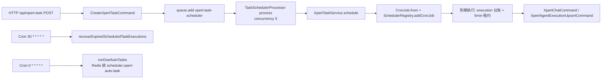

# 项目与任务协作专家 · 运维说明（07）

**本文引用的文件**

- [packages/server-ai/src/xpert-project/project.module.ts](file://packages/server-ai/src/xpert-project/project.module.ts)
- [packages/server-ai/src/xpert-project/migrations/20260920-project-types.sql](file://packages/server-ai/src/xpert-project/migrations/20260920-project-types.sql)
- [packages/server-ai/src/xpert-project/migrations/20260929-project-task-graph.sql](file://packages/server-ai/src/xpert-project/migrations/20260929-project-task-graph.sql)
- [packages/server-ai/src/xpert-project/migrations/20261002-project-task-progress.sql](file://packages/server-ai/src/xpert-project/migrations/20261002-project-task-progress.sql)
- [packages/server-ai/src/xpert-project/migrations/20261006-project-task-decisions.sql](file://packages/server-ai/src/xpert-project/migrations/20261006-project-task-decisions.sql)
- [packages/server-ai/src/xpert-project/migrations/20261006-project-task-runtime.sql](file://packages/server-ai/src/xpert-project/migrations/20261006-project-task-runtime.sql)
- [packages/server-ai/src/xpert-task/xpert-task.module.ts](file://packages/server-ai/src/xpert-task/xpert-task.module.ts)
- [packages/server-ai/src/xpert-task/scheduler.job.ts](file://packages/server-ai/src/xpert-task/scheduler.job.ts)
- [packages/server-ai/src/xpert-task/xpert-task.service.ts](file://packages/server-ai/src/xpert-task/xpert-task.service.ts)
- [packages/server-ai/src/xpert-task/scheduled-task-execution.coordinator.ts](file://packages/server-ai/src/xpert-task/scheduled-task-execution.coordinator.ts)
- [packages/server-ai/src/xpert-task/scheduled-task-oidc-token.ts](file://packages/server-ai/src/xpert-task/scheduled-task-oidc-token.ts)
- [packages/server-ai/src/xpert-task/commands/handlers/create.handler.ts](file://packages/server-ai/src/xpert-task/commands/handlers/create.handler.ts)
- [packages/server-ai/src/xpert-task/commands/handlers/query.handler.ts](file://packages/server-ai/src/xpert-task/commands/handlers/query.handler.ts)
- [packages/server-ai/src/xpert-project/services/project-invitation.service.ts](file://packages/server-ai/src/xpert-project/services/project-invitation.service.ts)
- [packages/server-ai/src/xpert-project/runtime/project-runtime-observation.handler.ts](file://packages/server-ai/src/xpert-project/runtime/project-runtime-observation.handler.ts)
- [packages/server-ai/src/xpert-project/runtime/project-task-dispatch.service.ts](file://packages/server-ai/src/xpert-project/runtime/project-task-dispatch.service.ts)
- [packages/server-ai/src/handoff/runtime-messaging/migrations/20261006-runtime-reliable-replies.sql](file://packages/server-ai/src/handoff/runtime-messaging/migrations/20261006-runtime-reliable-replies.sql)
- [packages/server-ai/project.json](file://packages/server-ai/project.json)
- [package.json](file://package.json)

## 目录

1. [一、构建与运行入口](#一构建与运行入口)
2. [二、数据库迁移（5 份 SQL 逐条）](#二数据库迁移5-份-sql-逐条)
3. [三、调度运维](#三调度运维)
4. [四、跨域依赖与循环引用](#四跨域依赖与循环引用)
5. [五、日志与排障入口](#五日志与排障入口)
6. [六、常见故障与处置](#六常见故障与处置)

## 一、构建与运行入口

| 入口 | 命令 / 配置 | 说明 |
|---|---|---|
| 构建 server-ai | `nx build server-ai`（`@nx/js:tsc`） | 输出 `dist/packages/server-ai`；`dependsOn` 含 `build-remote-components` |
| 前端远程组件 | `nx run server-ai:build-remote-components` | `node packages/server-ai/scripts/build-remote-components.mjs`，产出 `src/**/remote-components/**/app.{js,css}` |
| 本地起后端 | `pnpm start:api`（`b:p:all` ＋ `nx serve api`）或 `pnpm start:api:dev`（nodemon） | 本模块随宿主启动，无独立进程 |
| 路由前缀 | `/api/xpert-project`、`/api/xpert-task`（`RouterModule.register`） | 全局前缀 `api` |
| 迁移执行 | **仓库无迁移脚本**（根 `package.json` 仅 `migrate:knowledge-filter-v2` 针对知识库） | 5 份 SQL 需由发布流程**手工按序执行** |

`server-ai` 的 `project.json` 未声明自定义 env schema；本域相关变量在运行期从 `process.env` 读取（见第三节）。

章节来源：[project.json](file://packages/server-ai/project.json)（关键符号：server-ai.targets.build / build-remote-components / test），[project.module.ts](file://packages/server-ai/src/xpert-project/project.module.ts)（关键符号：RouterModule.register / XpertProjectModule），[package.json](file://package.json)（关键符号：scripts.start:api / scripts.migrate:knowledge-filter-v2）

## 二、数据库迁移（5 份 SQL 逐条）

| # | 文件 | 引入内容 | 事务 | 注释要点（逐字口径） |
|---|---|---|---|---|
| 1 | `20260920-project-types.sql` | `xpert_project` 加 `applicationKey`/`projectTypeKey`/`applicationInstallationId`/`projectTypeSnapshot`；`CK_project_type_identity`（两者同为 NULL 或同非空且非空串）；索引 `IDX_project_application_type(tenantId,organizationId,applicationKey,projectTypeKey,status)` | **无 BEGIN/COMMIT**，注释要求「在事务内运行」 | “Run in a transaction before deploying the new host and plugin versions.”；“NULL pairs intentionally retain unknown legacy provenance.” |
| 2 | `20260929-project-task-graph.sql` | `xpert_project_task` 加 `providerKey/sourceKey/sourceRevision/revision NOT NULL DEFAULT 1/kind DEFAULT 'task'/parentTaskId/predecessorIds json/plannedStartAt/plannedEndAt/estimatedDurationMs/diagnostic`；唯一索引 `project_task_provider_source(projectId,providerKey,sourceKey)`；`xpert_project_task_execution` 加 `sourceKey` ＋ 唯一索引 `project_task_execution_source(taskId,sourceKey)` | 无 | “Additive migration; does not change existing task identity, state or history.” |
| 3 | `20261002-project-task-progress.sql` | 仅 `xpert_project_task.progress double precision`（**无默认值**） | 无 | “Existing tasks have unknown progress until their owner supplies a measurement.”；“Progress does not change task status or execution history.” |
| 4 | `20261006-project-task-decisions.sql` | 仅 `xpert_project_task.decisions jsonb NOT NULL DEFAULT '[]'` | 无 | “Append-only business decisions; generic task writers cannot supply this column.” |
| 5 | `20261006-project-task-runtime.sql` | `xpert_project_task.requirements jsonb NOT NULL DEFAULT '[]'`；`xpert_project_task_execution` 加 `invocationId/dispatchRequestId/dispatchState/specificationSnapshot/purpose/dispatchIntent`；唯一索引 `IDX_project_task_execution_invocation(invocationId)`、`IDX_project_task_execution_dispatch(projectId,createdById,dispatchRequestId)` | **显式 BEGIN…COMMIT** | “Apply before deploying the host. Old attempts remain native; no runtime identity is inferred.” |

**执行顺序与回滚注意**

1. 顺序：`20260920` → `20260929` → `20261002` → `20261006-decisions` → `20261006-runtime`。第 5 份完成后，**才能**执行 `handoff/runtime-messaging/migrations/20261006-runtime-reliable-replies.sql`（该文件明写先跑本域的 runtime 迁移），随后重启新版宿主。
2. 全部语句使用 `ADD COLUMN IF NOT EXISTS` / `CREATE INDEX IF NOT EXISTS`，可重复执行；仅 `CK_project_type_identity` 用 `DO $$ … pg_constraint` 做存在性判断，也幂等。
3. 回滚应用版本时**优先保留新增列**（历史行语义为「未知」）；若必须回滚 DDL，先 `DROP INDEX`（`IDX_project_task_execution_dispatch`、`IDX_project_task_execution_invocation`、`project_task_execution_source`、`project_task_provider_source`、`IDX_project_application_type`）再 `DROP COLUMN`，最后删 `CK_project_type_identity`。
4. 第 2 份的两个唯一索引在**历史数据已有重复 `(projectId,providerKey,sourceKey)` / `(taskId,sourceKey)`** 时会直接失败，需先清理重复再重跑。
5. 第 1 份虽然注释要求事务，但文件**不含** `BEGIN/COMMIT`——手工执行时必须自行包事务，否则 `CHECK` 约束与索引可能中途失败留下半成品。

章节来源：[20260920-project-types.sql](file://packages/server-ai/src/xpert-project/migrations/20260920-project-types.sql)，[20260929-project-task-graph.sql](file://packages/server-ai/src/xpert-project/migrations/20260929-project-task-graph.sql)，[20261002-project-task-progress.sql](file://packages/server-ai/src/xpert-project/migrations/20261002-project-task-progress.sql)，[20261006-project-task-decisions.sql](file://packages/server-ai/src/xpert-project/migrations/20261006-project-task-decisions.sql)，[20261006-project-task-runtime.sql](file://packages/server-ai/src/xpert-project/migrations/20261006-project-task-runtime.sql)

## 三、调度运维

**三套触发机制并存**（无 Bull repeatable）：

1. **Bull 一次性入队**：队列 `xpert-task-scheduler`（`BullModule.registerQueue`）；消费者 `TaskSchedulerProcessor`（`@Processor({name:'xpert-task-scheduler'})` ＋ `@Process({concurrency:5})`）→ `service.schedule(taskId)`；**唯一生产点**是 `CreateXpertTaskHandler` 的 `queue.add({ taskId })`。
2. **进程内 cron（主调度）**：`scheduleCronJob` 用 `cron` 包 `CronJob.from({cronTime, timeZone: task.timeZone || 'UTC'})` ＋ `schedulerRegistry.addCronJob(task.id, job)`；`onModuleInit` 启动时对 `status=SCHEDULED` 且 `options || schedule` 的任务重建 job；**`SchedulerRegistry` 是进程内内存**，重启/多副本各存一份。
3. **定时扫描**：`@Cron('30 * * * * *')` 的 `recoverExpiredScheduledTaskExecutions`（恢复过期租约）；`@Cron('0 * * * * *')` 的 `runDueAutoTasks`，在 Redis 锁 `scheduler:xpert-auto-task`（TTL 5 分钟）下取 `enabled=true AND nextRunAt<=now` 的前 20 条。

**多副本注意事项**

- 每个副本都会重建同一 taskId 的 cron job ⇒ 同一任务可能被两个副本同时触发；**重叠靠执行台账兜底**：`scheduled_task_execution` 唯一约束 `uq_xpert_task_execution_occurrence(taskId, occurrenceKey)`（`.orIgnore()` 插入）＋ coordinator 的条件 UPDATE 抢租。
- 租约参数：`SCHEDULED_TASK_LEASE_MS = 5 * 60 * 1000`；`ownerId = XPERT_INSTANCE_ID || HOSTNAME || randomUUID`（截断 128）；执行期每 60s 续租（`SCHEDULED_TASK_HEARTBEAT_MS`）；`markRunning/bindRun/refreshLease` 均为 owner ＋ status 条件更新，失败抛 `lease was lost`。
- `AUTO_TASK_CRON_LOCK_TTL` 与租约同为 5 分钟 ⇒ **锁过期与租约到期同刻**，长批次扫描存在重叠窗口；如批量扫描耗时接近 5 分钟，应缩短批次或提高该锁 TTL。
- **必须显式设置 `XPERT_INSTANCE_ID`**：否则多副本共用 `HOSTNAME` 或随机 UUID，排障时无法把 `ownerId` 对应到实例。
- `SchedulerRegistry` 不跨副本 ⇒ `QueryXpertTaskHandler` 在其他副本/重启后会取不到 cron job，并把返回体 `status` 伪造成 `PAUSED`（与 DB 状态可能不一致），**排障时不要只看这个字段**。

**OIDC 令牌**

- 用途（源码注释）：无浏览器请求的定时任务，MCP 资源若使用 `current_user_oidc` 仍需委托用户访问令牌；宿主铸造短时效 actor token 并通过既有 env key 暴露给 MCP header 模板。
- 铸造条件：`options.automationContext` 存在且 `context.env.oidc_token` 缺失；写入 `context.env.oidc_token`；`act.sub='xpert_task'`，委托用户 = `runAsUserId ?? createdById ?? user.id`。
- 有效期/受众：`XPERT_TASK_OIDC_TOKEN_TTL_SECONDS`（非法或 ≤0 视为未设置）、`XPERT_TASK_OIDC_TOKEN_AUDIENCE`（逗号分隔多受众）；`automationContext.oidcClientId` **必填**，否则抛 `automationContext.oidcClientId is required to run scheduled MCP task calls`；缺 tenant/user/task 抛 `scheduled actor token task call is missing tenant, user, or task identity`。
- **轮换**：令牌每次执行重新 `mint`，无常驻缓存 ⇒ 轮换手段是调小 TTL 并轮换 `JWT_SECRET`；缩短 TTL 后需确认长任务的 MCP 调用在前半段完成。

**`scheduled_task_execution` 堆积**

- 未找到任何 TTL/清理任务：表只做状态与租约更新（`finish` 写 `leaseExpiresAt=null, completedAt, lastError, failureCode`），**没有删除逻辑** ⇒ 长期运行会持续增长，需自建清理（例如按 `completedAt < now() - interval '90 days'` 分片删除）。
- 排查：`SELECT status, count(*) FROM xpert_task_execution GROUP BY status;`；卡 `running` 且 `leaseExpiresAt < now()` 的行会被 `@Cron('30 * * * * *')` 在下一分钟接管（attempt+1）。

章节来源：[scheduler.job.ts](file://packages/server-ai/src/xpert-task/scheduler.job.ts)（关键符号：TaskSchedulerProcessor.process / TSchedulerType），[xpert-task.service.ts](file://packages/server-ai/src/xpert-task/xpert-task.service.ts)（关键符号：scheduleCronJob / onModuleInit / recoverExpiredScheduledTaskExecutions / runDueAutoTasks / AUTO_TASK_CRON_LOCK_KEY），[scheduled-task-execution.coordinator.ts](file://packages/server-ai/src/xpert-task/scheduled-task-execution.coordinator.ts)（关键符号：SCHEDULED_TASK_LEASE_MS / TypeOrmScheduledTaskExecutionStore.claimExpired / refreshLease），[scheduled-task-oidc-token.ts](file://packages/server-ai/src/xpert-task/scheduled-task-oidc-token.ts)（关键符号：createScheduledTaskOidcToken / readTokenAudience / readTokenTtlSeconds），[xpert-task.module.ts](file://packages/server-ai/src/xpert-task/xpert-task.module.ts)（关键符号：BullModule.registerQueue / xpert-task-scheduler）

## 四、跨域依赖与循环引用

- **依赖 `AgentInvocationModule` / `XpertAgentExecution`**：`project.module.ts` 直接 import `AgentInvocationModule`；派发（`ProjectTaskDispatchService`）与决策（`ProjectTaskDecisionService`）都通过 `AgentInvocationFactoryService` 解析目标并发起调用，配置/权限错误由 `AgentInvocationAuthorizationError` 透出。**若 Invocation 域不可用，本域的任务图读、计划端点仍可用，但派发与决策必然失败**（表现为 409 族运行时错误而非 5xx）。
- **反向依赖**：跨域 `ProjectRuntimeObservationCommand` 由 handoff 模块发出、本域 `ProjectRuntimeObservationHandler` 消费——它只把 Invocation 事实投影回任务状态（`succeeded→review`、`failed→blocked`、`running+startedAt→in_progress`），**运行期成功不会覆盖业务的验收结论**。观测链路阻塞时任务状态会停在原值，不会误判完成。
- **`forwardRef` 循环依赖**：`project.module.ts` 对 `SkillRepositoryModule`、`SkillRepositoryIndexModule`、`XpertAgentModule`、`XpertModule` 使用 `forwardRef`；`xpert-task.module.ts` 对 `XpertProjectModule` 使用 `forwardRef`。部署含义：**这两侧必须同批发布**（旧的 `XpertProjectModule` 与新 `XpertTaskModule` 混跑时，`forwardRef` 解析到的 provider 集合可能缺项，导致启动期 DI 报错或事件监听缺失）；滚动升级时建议按「先项目域、后任务域」的同批窗口完成，避免长时间混合版本。
- **事件耦合**：项目域发出的 `xpert-project.member-removed`、`xpert-project.xpert-removed` 由 `xpert-task` 侧 `@OnEvent` 消费（同步删除内存 job）；成员移除时先批量 pause `XpertTask` 再广播。

章节来源：[project.module.ts](file://packages/server-ai/src/xpert-project/project.module.ts)（关键符号：imports.AgentInvocationModule / forwardRef / TypeOrmModule.forFeature），[project-runtime-observation.handler.ts](file://packages/server-ai/src/xpert-project/runtime/project-runtime-observation.handler.ts)（关键符号：ProjectRuntimeObservationHandler.execute），[project-task-dispatch.service.ts](file://packages/server-ai/src/xpert-project/runtime/project-task-dispatch.service.ts)（关键符号：AgentInvocationFactoryService / resolveBackgroundTarget），[xpert-task.module.ts](file://packages/server-ai/src/xpert-task/xpert-task.module.ts)（关键符号：forwardRef(XpertProjectModule)）

图表来源：[scheduler.job.ts](file://packages/server-ai/src/xpert-task/scheduler.job.ts)（关键符号：TaskSchedulerProcessor.process），[create.handler.ts](file://packages/server-ai/src/xpert-task/commands/handlers/create.handler.ts)（关键符号：InjectQueue('xpert-task-scheduler')），[xpert-task.service.ts](file://packages/server-ai/src/xpert-task/xpert-task.service.ts)（关键符号：scheduleCronJob / recoverExpiredScheduledTaskExecutions / runDueAutoTasks）

## 五、日志与排障入口

| 症状 | 观测入口 | 判据 |
|---|---|---|
| 定时任务卡住 | `xpert_task_execution`（`status='running'` 且 `leaseExpiresAt < now()`）＋ `Logger.error('Scheduled task recovery failed: <id> <msg>')` | 下一分钟的 `@Cron('30 * * * * *')` 会接管；反复失败看 `lastError`/`failureCode`（当前类型只允许 `LOCAL_RUNTIME_UNAVAILABLE`） |
| 任务未执行但状态为 scheduled | `SchedulerRegistry.getCronJob(taskId)` 是否命中（仅本副本） | 未命中 ⇒ 重启后 `onModuleInit` 未重建（该任务既无 `options` 也无 `schedule`）或运行在其他副本 |
| 派发未回执 | `XpertProjectTaskExecution.dispatchState` / `dispatchRequestId` / `invocationId`；`GET /api/xpert-project/:id/task-executions/:executionId/target` | 有 `invocationId` 无状态推进 ⇒ Invocation/handoff 侧问题；`dispatchIntent` 为 `select:false`，恢复重放走服务端，人工不得从视图推断意图 |
| 回执重放/重复派发 | 唯一索引 `IDX_project_task_execution_dispatch`、`IDX_project_task_execution_invocation` | 同 `dispatchRequestId` 但意图不同 ⇒ 409 `Conflict`，属**防护生效**而非故障 |
| 邀请失效 | `Error.ProjectInvitationInvalid`（400）/`EmailMismatch`（403）/`NotPending`（400） | 历史成员同步由 60s `@Interval` 重试、退避上限 1h；`tokenHash` 为 `select:false`，日志里不应出现明文 token |
| run-as 提案异常 | `Error.ProjectTaskRunAsProposalMissing`（400）/`TargetOnly`（403）/`Changed`（400） | `Changed` 正常来源于配置（Xpert/connector）变更导致 hash 不匹配，需重新提案 |
| 自动化 410 | `POST /api/xpert-project/:id/automations/*` 返回 `GoneException` | 预期行为：旧版自动化已下线，应改建定时 Xpert 任务 |
| 事件未生效 | `xpert-project.member-removed` / `xpert-project.xpert-removed` 监听端日志 | 监听缺失通常意味着 `forwardRef` 解析异常或混合版本部署 |

章节来源：[xpert-task.service.ts](file://packages/server-ai/src/xpert-task/xpert-task.service.ts)（关键符号：recoverExpiredScheduledTaskExecutions / invalidatePendingRunAsProposalForConfigurationChange），[project-task-dispatch.service.ts](file://packages/server-ai/src/xpert-project/runtime/project-task-dispatch.service.ts)（关键符号：ProjectTaskDispatchService.dispatch / dispatchRequestId），[project-invitation.service.ts](file://packages/server-ai/src/xpert-project/services/project-invitation.service.ts)（关键符号：accept / decline / revoke / legacy 同步 Interval），[query.handler.ts](file://packages/server-ai/src/xpert-task/commands/handlers/query.handler.ts)（关键符号：QueryXpertTaskHandler.execute）

## 六、常见故障与处置

| 故障 | 根因（结构事实） | 处置 |
|---|---|---|
| 同一任务被执行两次 | 多副本各自持有 cron job；`SchedulerRegistry` 是进程内内存 | 依赖 `uq_xpert_task_execution_occurrence` ＋ 租约去重；确认 `XPERT_INSTANCE_ID` 已设置，避免 ownerId 冲突 |
| 任务显示 `paused` 但 DB 是 `scheduled` | `QueryXpertTaskHandler` 取不到本地 cron job 时改写返回体 status | 以 DB `status` 与 `xpert_task_execution` 为准；重启后用 `schedule` 重新排程 |
| 恢复软删任务后不执行 | `PUT /:id/recover` 只 `softRecover`，**不重建 job** | 恢复后显式调用 `PUT /:id/schedule` |
| `unarchive` 后仍不跑 | `unarchive` 语义即 `→ PAUSED` 且不排程 | 需再调 `schedule` |
| 项目无法编辑 | 项目已 `archived`（`assertProjectWritable` 拒绝） | 先 recover/保持 active；物理删除仅在 owner ＋ archived 时可用 |
| `DELETE /:id` 返回 400 | 存在 `uploaded/scanning/parsing/processing/queued` 状态的文件资产 | 等待文件流水线结束再 purge |
| MCP 调用 401/403 | `automationContext.oidcClientId` 缺失或 token 过期 | 补 `oidcClientId`；检查 `XPERT_TASK_OIDC_TOKEN_TTL_SECONDS` / `_AUDIENCE` |
| 迁移失败在半途 | `20260920` 文件不含 `BEGIN/COMMIT` | 手工包事务重跑（全部语句幂等）；先清理重复键再建唯一索引 |
| 升级后启动 DI 报错 | `forwardRef` 两端版本不一致 | 同批发布项目域与任务域，按第四节的顺序窗口滚动 |

章节来源：[xpert-task.service.ts](file://packages/server-ai/src/xpert-task/xpert-task.service.ts)（关键符号：pause / archive / unarchive / softRecover / findHttpAccessible），[query.handler.ts](file://packages/server-ai/src/xpert-task/commands/handlers/query.handler.ts)（关键符号：QueryXpertTaskHandler.execute），[project-access.service.ts](file://packages/server-ai/src/xpert-project/services/project-access.service.ts)（关键符号：assertProjectWritable / assertCanPurge），[20260920-project-types.sql](file://packages/server-ai/src/xpert-project/migrations/20260920-project-types.sql)，[20261006-runtime-reliable-replies.sql](file://packages/server-ai/src/handoff/runtime-messaging/migrations/20261006-runtime-reliable-replies.sql)
