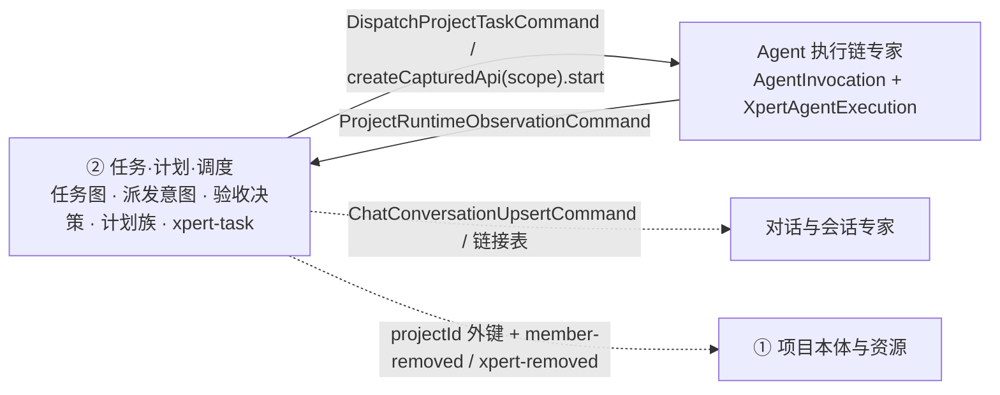

# 任务·计划·调度子专家 —— C0 使用总览

> **资产基线**：`2026-10-16 · commit 80f5676fd`（批次 5 首专家），继承父域 [C0-使用总览.md](file://.module-experts/后端专题/项目与任务协作专家/C0-使用总览.md)。**范围**：`xpert-project` 的项目内任务图与执行派发运行时（`project-task*`、`plan/milestone/sprint/swimlane`、`runtime/**`、`plugins/project-tasks/**`、`views/**`）＋ `packages/server-ai/src/xpert-task/**` 全部（6 表 / 35 端点 / 三套调度）；HTTP 前缀 `/api/xpert-project`、`/api/xpert-task`。项目本体与资源（成员、邀请、准入、资源挂载、字典）归 [子专家①](file://.module-experts/后端专题/项目与任务协作专家/sub-experts/项目本体与资源子专家/C0-使用总览.md)。未证实处标 `[推测]`。

**本文引用的文件**（相对仓库根，链接均为 `file://`）

- [packages/server-ai/src/xpert-project/project-task-graph.controller.ts](file://packages/server-ai/src/xpert-project/project-task-graph.controller.ts)
- [packages/server-ai/src/xpert-project/project-planning.controller.ts](file://packages/server-ai/src/xpert-project/project-planning.controller.ts)
- [packages/server-ai/src/xpert-project/project-task-plan.schema.ts](file://packages/server-ai/src/xpert-project/project-task-plan.schema.ts)
- [packages/server-ai/src/xpert-project/services/project-task.service.ts](file://packages/server-ai/src/xpert-project/services/project-task.service.ts)
- [packages/server-ai/src/xpert-project/services/project-task-graph.service.ts](file://packages/server-ai/src/xpert-project/services/project-task-graph.service.ts)
- [packages/server-ai/src/xpert-project/services/project-task-ownership.ts](file://packages/server-ai/src/xpert-project/services/project-task-ownership.ts)
- [packages/server-ai/src/xpert-project/services/project-plan.service.ts](file://packages/server-ai/src/xpert-project/services/project-plan.service.ts)
- [packages/server-ai/src/xpert-project/runtime/project-task-dispatch.service.ts](file://packages/server-ai/src/xpert-project/runtime/project-task-dispatch.service.ts)
- [packages/server-ai/src/xpert-project/runtime/project-task-decision.service.ts](file://packages/server-ai/src/xpert-project/runtime/project-task-decision.service.ts)
- [packages/server-ai/src/xpert-project/runtime/project-runtime-observation.handler.ts](file://packages/server-ai/src/xpert-project/runtime/project-runtime-observation.handler.ts)
- [packages/server-ai/src/xpert-project/runtime/project-task-dispatch-recovery.service.ts](file://packages/server-ai/src/xpert-project/runtime/project-task-dispatch-recovery.service.ts)
- [packages/server-ai/src/xpert-project/entities/project-task.entity.ts](file://packages/server-ai/src/xpert-project/entities/project-task.entity.ts)
- [packages/server-ai/src/xpert-project/entities/project-task-execution.entity.ts](file://packages/server-ai/src/xpert-project/entities/project-task-execution.entity.ts)
- [packages/server-ai/src/xpert-project/plugins/project-tasks/project-tasks.middleware.ts](file://packages/server-ai/src/xpert-project/plugins/project-tasks/project-tasks.middleware.ts)
- [packages/server-ai/src/xpert-project/views/project-tasks.provider.ts](file://packages/server-ai/src/xpert-project/views/project-tasks.provider.ts)
- [packages/server-ai/src/xpert-task/xpert-task.controller.ts](file://packages/server-ai/src/xpert-task/xpert-task.controller.ts)
- [packages/server-ai/src/xpert-task/xpert-task.service.ts](file://packages/server-ai/src/xpert-task/xpert-task.service.ts)
- [packages/server-ai/src/xpert-task/scheduled-task-execution.coordinator.ts](file://packages/server-ai/src/xpert-task/scheduled-task-execution.coordinator.ts)

## 目录

1. [定位](#定位)
2. [何时找这个子专家](#何时找这个子专家)
3. [能力清单表](#能力清单表)
4. [边界](#边界)
5. [已知问题与常见坑](#已知问题与常见坑)
6. [延伸阅读](#延伸阅读)

## 定位

本子专家负责 **「任务怎么被拆、依赖怎么表达、谁来执行、什么算完成、周期任务怎么排」**：项目内任务图（`XpertProjectTaskService`、`ProjectTaskGraphService`、`projectTaskIdentity`）、步骤与进度（`updateTaskSteps`、`assertProjectTaskProgress`）、执行派发运行时（`runtime/**`：派发意图固化、Invocation 提交、回执投影、验收决策、读模型、补偿扫描、资源卡）、计划族（`XpertProjectPlanService`，plan → milestone / sprint → swimlane）、独立任务体系（`XpertTaskService` + `xpert_task*` 六表 + 三套调度机制），以及 Agent 工具与视图面。

**一句话口径**：本子专家只做**业务决策**（图变更、派发意图、验收决策、周期排程），**执行由 `AgentInvocation` / `XpertAgentExecution` 承载**——任务行的 `invocationStatus`/`runtimeStartedAt`/`runtimeCompletedAt` 是**非持久化读投影**（注释逐字：「Read projection from the associated Invocation, never a second runtime ledger.」），任务状态只被单向投影，业务完成必须显式验收；持久面＝项目内 9 表（task/step/log/execution/conversation + plan/milestone/sprint/swimlane）＋ `xpert-task` 6 表（`xpert_task`/`xpert_task_template`/`auto_task`/`auto_task_template`/`schedule_note`/`xpert_task_execution`）＝ 15 张。

章节来源：[project-task.service.ts](file://packages/server-ai/src/xpert-project/services/project-task.service.ts)（关键符号：XpertProjectTaskService.lockProject / saveAll）、[project-task-execution.entity.ts](file://packages/server-ai/src/xpert-project/entities/project-task-execution.entity.ts)（关键符号：invocationStatus 读投影注释 / dispatchIntent）、[xpert-task.service.ts](file://packages/server-ai/src/xpert-task/xpert-task.service.ts)（关键符号：XpertTaskService.scheduleCronJob）

## 何时找这个子专家

- 要**建/改项目内任务与依赖**：`createTask`/`saveAll`/`updateTask`/`batchUpdate`/`reorder`；`predecessorIds`/`parentTaskId`/`plannedStartAt`/`estimatedDurationMs` 只能经 `PUT /:id/task-graph` 写入。
- 要**改任务图与执行导航**：`ProjectTaskGraphService.graph/readGraph/change/resolveExecution`、`projectTaskIdentity` 的 sha256 派生身份、`validateProjectTaskGraph` 的三类图错误。
- 要**改步骤与进度**：`updateTaskSteps` 按 `stepIndex` 就地合并（`notes` 追加）、`assertProjectTaskProgress` 的 0–100 边界、全 `done` 且无带 `invocationId` 执行时的隐式 `done`。
- 要**派发执行与排障回执**：`DispatchProjectTaskCommand` 的 `dispatchRequestId` 幂等、`dispatchState` 的 `pending → submitted`、`@Interval(5000)` 补偿扫描、`GET /:id/task-executions/:executionId/target`。
- 要**做验收决策**：`ProjectTaskDecisionService.decide`（`assertCanEdit` + 项目锁 + `expectedRevision` + `requestId` 幂等 + review 证据校验，accept → `done`）。
- 要**改任务↔会话链接**：四元组 `origin|discussion|execution|review`、`linkConversation` 先查后插幂等、`listTaskRelations`。
- 要**改计划族**：`ensureDefaults`（Default plan + Uncategorized）、`defaultSwimlanes`、`strategyType` 创建后不可改、`backlog` 保留泳道键、simple/advanced 模式约束。
- 要**改独立任务 CRUD 与生命周期**（`/api/xpert-task` 35 端点）：创建/排程/暂停/归档/软删恢复/试跑，`unarchive` 落 `PAUSED` 且不排程。
- 要**改调度视图与日程便签**：`schedule/overview`、`schedule/day/:date`、`schedule/capabilities/:xpertId`、`schedule/notes` 三件套。
- 要**改自动任务、自动任务模板与任务模板**：`runDueAutoTasks` 的 Redis 锁扫描、`once` 执行后自动停用、模板按 `source` 区分内置与个人。
- 要**改 run-as 提案确认流**：`pendingRunAs*` 四列 + `buildProjectTaskRunAsConfigurationHash` + 提名本人 accept + 配置变更自动作废。
- 要**排查**：`expectedRevision` 409、租约过期接管 `attempt+1`、`query.handler` 取不到本地 cron job 时伪 `PAUSED`、「恢复后不排程」。

章节来源：[project-task-graph.service.ts](file://packages/server-ai/src/xpert-project/services/project-task-graph.service.ts)（关键符号：graph / change / projectTaskIdentity）、[project-task-dispatch.service.ts](file://packages/server-ai/src/xpert-project/runtime/project-task-dispatch.service.ts)（关键符号：ProjectTaskDispatchService.dispatch / submit）、[project-plan.service.ts](file://packages/server-ai/src/xpert-project/services/project-plan.service.ts)（关键符号：ensureDefaults / defaultSwimlanes）

## 能力清单表

| 能力 | 入口 | 一句话 |
|---|---|---|
| 项目内任务 CRUD / 批量 / 重排 | `/:id/tasks*`（含 `/order`、`/batch`、`/:taskId`） | 统一骨架 `assertOrdinaryTaskInput → lockProject → assertOrdinaryTask → assertBusinessStatus` |
| 任务图与执行目标解析 | `GET/PUT /:id/task-graph`、`GET /:id/task-executions/:executionId/target` | 节点 id 由 sha256 派生、跨快照稳定；图变更必须带 `expectedRevision` |
| 步骤与进度 | `updateTaskSteps`、`assertProjectTaskProgress` | `stepIndex` 就地合并；全 `done` 且无带 `invocationId` 执行时任务隐式 `done` |
| 执行派发（命令/工具面） | `DispatchProjectTaskCommand`；`project_dispatch_task` 工具 | 授权先于预约与重放；规格与意图被钉死，重放不新造 callId |
| 验收决策 | `DecideProjectTaskCommand`；`project_decide_task` 工具 | accept 把任务 CAS 成 `done` 并 append `decisions`，否则回 `todo` |
| 执行读模型与资源卡 | `GET /:id/tasks/:taskId/executions[/:executionId]`、`ProjectTaskRuntimeReadService`、`ProjectTaskCardProvider` | 读投影从 Invocation 派生；id/scope 不匹配时降级 `queued`/`unknown` |
| 任务↔会话链接 | `POST /:id/tasks/:taskId/conversations`、`GET /:id/tasks/:taskId/relations` | 四元组唯一；`origin`/`discussion`/`execution`/`review` |
| 计划与里程碑 | `/:id/plans*`、`/:id/plans/:planId/milestones*` | `ensureDefaults` 保证 Default plan + Uncategorized；simple 模式只允许默认对象 |
| 冲刺与泳道 | `/:id/plans/:planId/sprints`、`/:id/sprints/:sprintId[/swimlanes*]` | 冲刺强制 advanced 且 `strategyType` 不可改；`backlog` 为保留键 |
| 独立任务 CRUD 与生命周期 | `/api/xpert-task`（`/count`、`/pagination`、`/my`、`/total`、`/by-ids`、`/:id`、`/:id/test`、`/:id/schedule\|pause\|archive\|unarchive\|recover\|soft`） | 三套调度机制并存；读走 `findHttpAccessible`，内部调度器绕开 HTTP 可见性 |
| 调度视图与日程便签 | `/api/xpert-task/schedule/*` | `overview`/`day/:date`/`capabilities/:xpertId` 与便签三件套无调度副作用 |
| 自动任务与自动任务模板 | `/auto-tasks*`、`/auto-task-templates*` | `@Cron('0 * * * * *')` 在 Redis 锁下扫描；`once` 执行后 `enabled=false` |
| 任务模板 | `/templates*` | 唯一键 `(source,tenantId,organizationId,createdById,key)` 区分内置与个人 |
| run-as 提案确认流 | `POST /:id/run-as/proposal`、`POST /:id/run-as/accept` | 两步确认 + 配置 hash 条件更新；配置变更自动作废未确认提案 |
| Agent 工具与视图面 | `project-tasks` 中间件 8 工具、`platform.project-tasks`、`platform.scheduler` | 命令入口 + 视图/远程组件入口，不直改库 |

章节来源：[project-task-graph.controller.ts](file://packages/server-ai/src/xpert-project/project-task-graph.controller.ts)（关键符号：ProjectTaskGraphController.graph / change / target）、[project-tasks.middleware.ts](file://packages/server-ai/src/xpert-project/plugins/project-tasks/project-tasks.middleware.ts)（关键符号：ProjectTasksMiddleware / ProjectToolEnum）、[xpert-task.controller.ts](file://packages/server-ai/src/xpert-task/xpert-task.controller.ts)（关键符号：schedule / pause / unarchive / proposeRunAs / acceptRunAs）

## 边界

**做什么**：项目内任务图与图语义、步骤与进度、执行派发意图与验收决策、执行读模型与资源卡、计划族四级结构、独立任务的 CRUD/生命周期/三套调度/执行台账租约/自动任务/模板/便签/run-as、以及 Agent 工具与视图面。

**不做什么（与子专家①及相邻专家域的分工）**

- **不含项目本体、成员、邀请、资源挂载、准入与字典**：`xpert_project`/`_membership`/`_invitation`/`_asset`/`_activity`/`business_area` 与 `guards/**` 归 [子专家①](file://.module-experts/后端专题/项目与任务协作专家/sub-experts/项目本体与资源子专家/C0-使用总览.md)；本子专家只调 ① 的 `assertCan*` 与项目行锁。
- **执行账本归 Agent 执行链专家**：`AgentInvocation` 与 `XpertAgentExecution` 的写入与状态机不在本域；本域只 pin `invocationId` 与 `dispatchIntent`，并做单向回执投影。
- **不含会话与消息持久化**：只写 `xpert_project_task_conversation` 链接与 `ChatConversation.taskId`/`projectId` 引用，经 `ChatConversationUpsertCommand` 跨域写入。
- **不含队列物理投递与沙箱执行后端**：投递走 `handoff/runtime-messaging`，执行后端由沙箱域提供；本域只发意图并把失败分为 `dispatch_blocked`（终态）与 `dispatch_unavailable`（60 s 重试）。
- **两套任务体系不可互换**：`xpert_project_task*`（provider 快照 + `revision` CAS + Invocation 投影）与 `xpert_task*`（cron + 租约台账）是两套表与两套运行时，只靠 `projectId` 外键与两个 `@OnEvent` 耦合。

图表来源：[project-task-dispatch.service.ts](file://packages/server-ai/src/xpert-project/runtime/project-task-dispatch.service.ts)（关键符号：ProjectTaskDispatchService.dispatch / submit）、[project-runtime-observation.handler.ts](file://packages/server-ai/src/xpert-project/runtime/project-runtime-observation.handler.ts)（关键符号：ProjectRuntimeObservationHandler.execute）、[xpert-task.service.ts](file://packages/server-ai/src/xpert-task/xpert-task.service.ts)（关键符号：createPersistedTaskChatRun / pauseProjectTasksForRemovedMember）

章节来源：[project-task-execution.entity.ts](file://packages/server-ai/src/xpert-project/entities/project-task-execution.entity.ts)（关键符号：IDX_project_task_execution_dispatch / dispatchState）、[project-task-dispatch-recovery.service.ts](file://packages/server-ai/src/xpert-project/runtime/project-task-dispatch-recovery.service.ts)（关键符号：ProjectTaskDispatchRecoveryService.recover）、[scheduled-task-execution.coordinator.ts](file://packages/server-ai/src/xpert-task/scheduled-task-execution.coordinator.ts)（关键符号：ScheduledTaskExecutionCoordinator.claim）

## 已知问题与常见坑

1. **两套任务体系别改错表**：`xpert_project_task*` 是项目内任务（provider 快照 + `revision` CAS + Invocation 投影），`xpert_task*` 是独立周期调度（cron + 租约台账）；两者状态机、可见性与权限口径完全不同。
   - 契约来源：[project-task.service.ts](file://packages/server-ai/src/xpert-project/services/project-task.service.ts)、[xpert-task.service.ts](file://packages/server-ai/src/xpert-task/xpert-task.service.ts)。
2. **任务图幂等键 `unique(projectId, providerKey, sourceKey)`**：provider 投影任务的 id 由 `projectTaskIdentity(projectId, provider, key)` 的 sha256 派生为稳定 UUID；手工改这三列会破坏重放稳定性与依赖边指向。
   - 契约来源：[project-task.entity.ts](file://packages/server-ai/src/xpert-project/entities/project-task.entity.ts)、[project-task-graph.service.ts](file://packages/server-ai/src/xpert-project/services/project-task-graph.service.ts)。
3. **`@VersionColumn revision` 乐观锁只此一处**：`PUT /:id/task-graph`、派发与决策都要 `expectedRevision`，不匹配即 409 `Conflict`；`XpertTask` 无版本列，run-as 只能用配置 hash 条件更新（语义更弱）。
   - 契约来源：[project-task.entity.ts](file://packages/server-ai/src/xpert-project/entities/project-task.entity.ts)、[xpert-task.service.ts](file://packages/server-ai/src/xpert-task/xpert-task.service.ts)。
4. **执行派发三唯一索引**：`IDX_project_task_execution_invocation(invocationId)`、`IDX_project_task_execution_dispatch(projectId,createdById,dispatchRequestId)`、`(taskId,sourceKey)`——同 `dispatchRequestId` 但意图/scope/target 不一致即 409 `Conflict`（防护生效而非故障）。
   - 契约来源：[project-task-execution.entity.ts](file://packages/server-ai/src/xpert-project/entities/project-task-execution.entity.ts)、[project-task-dispatch.service.ts](file://packages/server-ai/src/xpert-project/runtime/project-task-dispatch.service.ts)。
5. **`dispatchIntent(select:false)` 是服务端恢复意图**：含 prompt/target/replyTo；恢复链与备份、数据修复脚本必须显式 `addSelect('attempt.dispatchIntent')`，否则补偿不可用；它绝不可序列化到任务视图。
   - 契约来源：[project-task-execution.entity.ts](file://packages/server-ai/src/xpert-project/entities/project-task-execution.entity.ts)、[project-task-dispatch-recovery.service.ts](file://packages/server-ai/src/xpert-project/runtime/project-task-dispatch-recovery.service.ts)。
6. **`dispatchState` 状态机只有一位持久迁移**：`pending`（意图与尝试已提交，扫描器重放）→ `submitted`（已拿到启动回执，由 `submit` CAS 推进）；`invocationStatus` 等是读投影，别指望在库里查到。
   - 契约来源：[project-task-dispatch.service.ts](file://packages/server-ai/src/xpert-project/runtime/project-task-dispatch.service.ts)、[project-task-invocation-view.ts](file://packages/server-ai/src/xpert-project/runtime/project-task-invocation-view.ts)。
7. **`projectedTaskRevision` 回投影**：状态推进同时要求「最新尝试 + 非 provider 普通任务 + `projectedTaskRevision === task.revision` + 状态在 `todo/in_progress/review/blocked` + 规格 digest 未变」；`projectedInvocationRevision` 防「旧观察覆盖新事实」。
   - 契约来源：[project-runtime-observation.handler.ts](file://packages/server-ai/src/xpert-project/runtime/project-runtime-observation.handler.ts)、[project-task-specification.ts](file://packages/server-ai/src/xpert-project/runtime/project-task-specification.ts)。
8. **任务↔会话唯一四元组**：`UQ_project_task_conversation_relation(projectId,taskId,conversationId,relationType)`，`relationType ∈ origin|discussion|execution|review`（默认 `discussion`）；执行行的 `conversationId` 是 `SET NULL` 弱引用，语义不同不可混用。
   - 契约来源：[project-task-conversation.entity.ts](file://packages/server-ai/src/xpert-project/entities/project-task-conversation.entity.ts)、[project-task.service.ts](file://packages/server-ai/src/xpert-project/services/project-task.service.ts)。
9. **调度 `status` vs `runtimeState` 职责分离**：`XpertTask.status ∈ paused|archived|scheduled` 是排程状态；每次触发把幂等键 `XPERT_TASK_SCHEDULE_IDEMPOTENCY_KEY` 写进 `runtimeState`，**运行不改变 `status`**。
   - 契约来源：[xpert-task.entity.ts](file://packages/server-ai/src/xpert-task/xpert-task.entity.ts)、[xpert-task.service.ts](file://packages/server-ai/src/xpert-task/xpert-task.service.ts)。
10. **自动任务启停语义**：`AutoTask.enabled` 默认 true、`frequency ∈ once|daily|weekly`；`runDueAutoTasks` 在 Redis 锁 `scheduler:xpert-auto-task` 下取前 20 条，`once` 执行后置 `enabled=false, nextRunAt=null`。
    - 契约来源：[auto-task.entity.ts](file://packages/server-ai/src/xpert-task/auto-task.entity.ts)、[xpert-task.service.ts](file://packages/server-ai/src/xpert-task/xpert-task.service.ts)。
11. **run-as 是两步确认**：`proposal` 只写 `pendingRunAs*` 四列 + 配置 hash；`accept` 必须由被提名人本人触发并做条件 UPDATE，`affected !== 1` 即 `ProjectTaskRunAsProposalChanged`；配置变更自动作废提案。
    - 契约来源：[xpert-task.service.ts](file://packages/server-ai/src/xpert-task/xpert-task.service.ts)、[xpert-task.controller.ts](file://packages/server-ai/src/xpert-task/xpert-task.controller.ts)。
12. **`forwardRef` 循环须同批发布**：`xpert-task.module.ts` 反向 `forwardRef(() => XpertProjectModule)`；混版本部署时 DI 解析缺项会导致启动报错或撤权事件监听缺失（任务被移除成员后仍在排程）。
    - 契约来源：[xpert-task.module.ts](file://packages/server-ai/src/xpert-task/xpert-task.module.ts)、[project.module.ts](file://packages/server-ai/src/xpert-project/project.module.ts)。

章节来源：[project-task-ownership.ts](file://packages/server-ai/src/xpert-project/services/project-task-ownership.ts)（关键符号：assertOrdinaryTaskInput / assertNativeExecutionInput）、[scheduled-task-execution.entity.ts](file://packages/server-ai/src/xpert-task/scheduled-task-execution.entity.ts)（关键符号：uq_xpert_task_execution_occurrence / leaseExpiresAt）、[project-plan.service.ts](file://packages/server-ai/src/xpert-project/services/project-plan.service.ts)（关键符号：XpertProjectPlanService.ensureDefaults）

## 延伸阅读

- 逐端点明细与错误码全集（任务图 3 条、继承 planning 23 条、`xpert-task` 35 条）：父域 [implementation/05-接口.md](file://.module-experts/后端专题/项目与任务协作专家/implementation/05-接口.md)
- Recipe（建任务与依赖 / 派发与回执 / 计划族 / 会话链接 / 周期任务 / 自动任务 / run-as / 排障）：父域 [C2-使用流程.md](file://.module-experts/后端专题/项目与任务协作专家/C2-使用流程.md) Recipe 4–11
- 表结构与消费方（15 张表、三唯一索引与投影位）：父域 [C4-数据流向与消费.md](file://.module-experts/后端专题/项目与任务协作专家/C4-数据流向与消费.md) 子域二
- 决策与逐字注释证据（两套任务体系、派发账本、幂等键、乐观锁、会话多关系、单向投影）：父域 [C5-关键决策.md](file://.module-experts/后端专题/项目与任务协作专家/C5-关键决策.md) D1 / D3 / D4 / D6 / D7 / D12
- 本子专家端点分组、服务契约与派发运行时契约：[C1-能力契约.md](file://.module-experts/后端专题/项目与任务协作专家/sub-experts/任务计划与调度子专家/C1-能力契约.md)
- 实现层（派发链、调度链、状态机与 31 个 spec）：[01-架构.md](file://.module-experts/后端专题/项目与任务协作专家/sub-experts/任务计划与调度子专家/implementation/01-架构.md)、[02-实现.md](file://.module-experts/后端专题/项目与任务协作专家/sub-experts/任务计划与调度子专家/implementation/02-实现.md)、[03-数据流转.md](file://.module-experts/后端专题/项目与任务协作专家/sub-experts/任务计划与调度子专家/implementation/03-数据流转.md)、[06-测试.md](file://.module-experts/后端专题/项目与任务协作专家/sub-experts/任务计划与调度子专家/implementation/06-测试.md)

章节来源：[project-task-dispatch.command.ts](file://packages/server-ai/src/xpert-project/runtime/project-task-dispatch.command.ts)（关键符号：DispatchProjectTaskCommand / DecideProjectTaskCommand）、[views/project-tasks.provider.ts](file://packages/server-ai/src/xpert-project/views/project-tasks.provider.ts)（关键符号：ProjectTasksViewProvider）、[xpert-task.service.ts](file://packages/server-ai/src/xpert-task/xpert-task.service.ts)（关键符号：buildScheduleOccurrenceKey）
