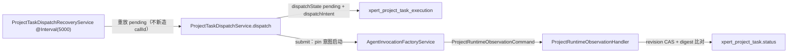

# 任务·计划·调度子专家 —— C1 能力契约

> **资产基线**：`2026-10-16 · commit 80f5676fd`（批次 5 首专家），继承父域 [C1-能力契约.md](file://.module-experts/后端专题/项目与任务协作专家/C1-能力契约.md)；**逐端点明细**（完整字段、分页、错误码全集）见父域 [implementation/05-接口.md](file://.module-experts/后端专题/项目与任务协作专家/implementation/05-接口.md)，本文不复制。项目本体、成员、邀请与准入契约见 [子专家① C1](file://.module-experts/后端专题/项目与任务协作专家/sub-experts/项目本体与资源子专家/C1-能力契约.md)。

**本文引用的文件**（相对仓库根，链接均为 `file://`）

- [packages/server-ai/src/xpert-project/project-task-graph.controller.ts](file://packages/server-ai/src/xpert-project/project-task-graph.controller.ts)
- [packages/server-ai/src/xpert-project/project-task-plan.schema.ts](file://packages/server-ai/src/xpert-project/project-task-plan.schema.ts)
- [packages/server-ai/src/xpert-project/services/project-task.service.ts](file://packages/server-ai/src/xpert-project/services/project-task.service.ts)
- [packages/server-ai/src/xpert-project/services/project-task-graph.service.ts](file://packages/server-ai/src/xpert-project/services/project-task-graph.service.ts)
- [packages/server-ai/src/xpert-project/services/project-task-ownership.ts](file://packages/server-ai/src/xpert-project/services/project-task-ownership.ts)
- [packages/server-ai/src/xpert-project/services/project-tasks/**（services）](file://packages/server-ai/src/xpert-project/services/project-task-progress.ts)
- [packages/server-ai/src/xpert-project/services/project-plan.service.ts](file://packages/server-ai/src/xpert-project/services/project-plan.service.ts)
- [packages/server-ai/src/xpert-project/runtime/project-task-dispatch.service.ts](file://packages/server-ai/src/xpert-project/runtime/project-task-dispatch.service.ts)
- [packages/server-ai/src/xpert-project/runtime/project-task-dispatch.schema.ts](file://packages/server-ai/src/xpert-project/runtime/project-task-dispatch.schema.ts)
- [packages/server-ai/src/xpert-project/runtime/project-task-decision.service.ts](file://packages/server-ai/src/xpert-project/runtime/project-task-decision.service.ts)
- [packages/server-ai/src/xpert-project/runtime/project-runtime-observation.handler.ts](file://packages/server-ai/src/xpert-project/runtime/project-runtime-observation.handler.ts)
- [packages/server-ai/src/xpert-project/entities/project-task.entity.ts](file://packages/server-ai/src/xpert-project/entities/project-task.entity.ts)
- [packages/server-ai/src/xpert-project/entities/project-task-execution.entity.ts](file://packages/server-ai/src/xpert-project/entities/project-task-execution.entity.ts)
- [packages/server-ai/src/xpert-task/xpert-task.controller.ts](file://packages/server-ai/src/xpert-task/xpert-task.controller.ts)
- [packages/server-ai/src/xpert-task/xpert-task.service.ts](file://packages/server-ai/src/xpert-task/xpert-task.service.ts)
- [packages/server-ai/src/xpert-task/scheduled-task-execution.coordinator.ts](file://packages/server-ai/src/xpert-task/scheduled-task-execution.coordinator.ts)

## 目录

1. [§1 HTTP 入口索引](#§1-http-入口索引)
2. [§2 服务契约](#§2-服务契约)
3. [§3 派发运行时契约](#§3-派发运行时契约)
4. [§4 示例](#§4-示例)
5. [§5 契约来源](#§5-契约来源)

## §1 HTTP 入口索引

项目域 `/api/xpert-project`（`XpertProjectController` 继承 `XpertProjectPlanningController`）与独立域 `/api/xpert-task`（`XpertTaskController`，`@Controller()` 空前缀 + `RouterModule.register({ path: '/xpert-task' })`）；下表按主题合并同构行，`/api/xpert-project` 前缀已省略。

| 主题 · 方法与路径 | 守卫 | 用途 |
|---|---|---|
| 任务图（3 条）：`GET /:id/task-graph`、`PUT /:id/task-graph`、`GET /:id/task-executions/:executionId/target` | 类级 `XpertProjectGuard` + 方法级 `@ProjectPermission(VIEW/EDIT)` | 图快照 / 图变更（必带 `expectedRevision`）/ 执行目标解析 |
| 项目内任务（继承 planning）：`GET/POST/PUT /:id/tasks`、`/tasks/order`、`/tasks/batch`、`/tasks/:taskId`、`/tasks/:taskId/relations`、`/tasks/:taskId/conversations`、`/tasks/:taskId/executions[/:executionId]` | `@ProjectPermission` + `XpertProjectGuard` | 分页 / 创建 / 更新 / 重排 / 批量 / 关系 / 会话链接 / 执行尝试 |
| 计划族（继承 23 条）：`/:id/plans*`、`/:id/plans/:planId/milestones*`、`/:id/plans/:planId/sprints`、`/:id/sprints/:sprintId[/swimlanes*]` | `XpertProjectGuard` + VIEW/EDIT | 计划族 CRUD；simple 模式只允许默认计划与默认里程碑 |
| `xpert-task` CRUD 与读取：`GET/POST/PUT/DELETE /api/xpert-task`、`/count`、`/pagination`、`/my`、`/total`、`/by-ids`、`/:id`、`/:id/test` | **无守卫**（service 层 `findHttpAccessible`/`*HttpTask`） | 创建 / 查询 / 试跑 |
| `xpert-task` 生命周期：`PUT /:id/schedule`、`/pause`、`/archive`、`/unarchive`、`/:id/recover`、`DELETE /:id/soft`、`DELETE /:id` | **无守卫**（`assertHttpMutationAccess`） | 状态迁移；硬删 202，先 `deleteJob` 再 `remove` |
| 调度视图：`GET /api/xpert-task/schedule/overview`、`/schedule/day/:date`、`/schedule/capabilities/:xpertId` | **无守卫** | run 列表、按日视图、助手调度能力 |
| 日程便签：`POST/PUT/DELETE /api/xpert-task/schedule/notes[/:id]` | **无守卫** | 便签三件套（无调度副作用） |
| 自动任务：`GET/POST /api/xpert-task/auto-tasks`、`PUT/DELETE /auto-tasks/:id` | **无守卫** | 仓储式自动任务；由 `@Cron('0 * * * * *')` 扫描 |
| 自动任务模板：`GET/POST /auto-task-templates`、`PUT/DELETE /auto-task-templates/:id` | **无守卫** | 内置 seed + 自定义模板 |
| 任务模板：`GET/POST /templates`、`PUT/DELETE /templates/:id` | **无守卫** | `source` 区分内置与个人（`uq_xpert_task_template_source_scope_key`） |
| run-as：`POST /:id/run-as/proposal`、`POST /:id/run-as/accept` | **无守卫**（另有 `createXpertTaskRunAsProposalValidationPipe`） | 两步确认与配置 hash 条件更新 |

**逐端点明细见父域 [implementation/05-接口.md](file://.module-experts/后端专题/项目与任务协作专家/implementation/05-接口.md)**（含每条的权限点、主要错误与状态码）。

章节来源：[project-task-graph.controller.ts](file://packages/server-ai/src/xpert-project/project-task-graph.controller.ts)（关键符号：graph / change / target）、[project-planning.controller.ts](file://packages/server-ai/src/xpert-project/project-planning.controller.ts)（关键符号：XpertProjectPlanningController.getTasks / reorderTasks / listPlans / listSwimlanes）、[xpert-task.controller.ts](file://packages/server-ai/src/xpert-task/xpert-task.controller.ts)（关键符号：XpertTaskController extends CrudController）

## §2 服务契约

| 服务 / 关键方法 | 用途 | 参数行为语义 · 异常 |
|---|---|---|
| `ProjectTaskGraphService.graph/readGraph/change/resolveExecution`；`projectTaskIdentity(projectId, provider, key)` | 图快照、图变更与执行导航 | `graph` 在项目行锁内调 provider `snapshot` 并落库（旧快照不能覆盖新快照）；`change` 先取图再比 `current.revision !== input.expectedRevision` → 409 `ProjectTaskRevisionConflict`；节点 id 由 sha256 派生 UUID、跨快照稳定；404 `ProjectTaskNotFound` |
| `XpertProjectTaskService.createTask/saveAll/updateTask/batchUpdate/reorder/updateTaskSteps/linkConversation/listTaskRelations/createExecution/claimExecution/lockProject` | 项目任务与步骤写路径（项目行锁唯一持有者） | 骨架统一为 `assertOrdinaryTaskInput → lockProject(pessimistic_write) → assertOrdinaryTask → assertBusinessStatus → 保存`；`reorder` 只改 `order`/`column`；400 `Owned`/`ProjectTaskProviderCommandRequired`、409 `DecisionRequired`/`Conflict` |
| `project-task-ownership`：`assertOrdinaryTask` / `assertOrdinaryTaskInput` / `assertNativeExecutionInput` | 三道属主列断言 | 拒外部写 `providerKey`/`sourceKey`/`revision`/`predecessorIds`/`executions`/`decisions`/`conversations`，以及 host-owned 的 `invocationId`/`dispatchState`/`dispatchRequestId`/`dispatchIntent`/`purpose`/`specificationSnapshot`/`attempt`（违者 `Owned`） |
| `project-task-progress`：`assertProjectTaskProgress`；`project-task-types`：`registeredProjectTaskTypes`；`project-task-runtime-timing`：`projectTaskRuntimeTiming` | 进度、业务类型与运行时时间的规范化边界 | 进度限 0–100；类型 key 必须带 provider 前缀且不重复、icon 取自注册枚举；墙钟结束不可由耗时跨暂停重建 |
| `XpertProjectPlanService.list/ensureDefaults/createPlan/createMilestone/createSprint/createSwimlane/updateSwimlane/updateSprint(defaultSwimlanes)` | 计划族四级结构 | `ensureDefaults` 保证「Default plan + Uncategorized」存在；simple 模式只允许这两个默认对象；`createSprint` 强制 advanced 并在同一次调用写 `defaultSwimlanes`（保留 `backlog` + 按 `strategyType` 生成）；`updateSprint` 禁改 `strategyType`；400「Sprints require advanced project mode」 |
| `XpertTaskService.*HttpTask` 族（`updateHttpTask`/`scheduleHttpTask`/`pauseHttpTask`/`archiveHttpTask`/`unarchiveHttpTask`/`testHttpTask`/`deleteHttpTask`/`softDeleteHttpTask`/`recoverHttpTask`）+ `proposeProjectTaskRunAs`/`acceptProjectTaskRunAs` | 独立任务 HTTP 边界与状态迁移 | 每个 `*HttpTask` 先 `assertHttpMutationAccess`；`schedule` 重解析项目当前助手版本 + connector 预检后置 `SCHEDULED` 并清 `statusReason`；`pause`/`archive` 先 `deleteJob`；**`unarchive` 落 `PAUSED` 且不排程**；`recoverHttpTask` 只软恢复、不重建 job；403；400（`ProjectTaskRunAsProposalMissing`/`Changed`）、403（`TargetOnly`） |
| `XpertTaskService` 调度组件：`scheduleCronJob`/`rescheduleTask`/`onModuleInit`/`createPersistedTaskChatRun`/`resolveScheduledOccurrence`/`buildScheduleOccurrenceKey`/`runDueAutoTasks`/`executeAutoTask`/`recoverExpiredScheduledTaskExecutions` | 三套调度机制与执行编排 | 进程内 cron 为主路径（`CronJob.from({cronTime, timeZone})` + `schedulerRegistry.addCronJob`）；`onModuleInit` 只重建 `status=SCHEDULED` 且 `options || schedule` 存在的任务；执行顺序 `ChatConversationUpsertCommand` → `XpertAgentExecutionUpsertCommand` → `XpertChatCommand` |
| `ScheduledTaskExecutionCoordinator.claim/markRunning/bindRun/refreshLease/finish` | 执行台账与租约 | `insertIfAbsent` 用 `.orIgnore()` 满足 `uq_xpert_task_execution_occurrence(taskId, occurrenceKey)`；租约 5 分钟、`ownerId = XPERT_INSTANCE_ID \|\| HOSTNAME \|\| randomUUID`；终态或未过期租约返回 `null`，过期接管 `attempt+1`；条件更新失败抛 `lease was lost` |
| `TemplateRoutinesHandler` / `TaskSchedulerProcessor.process` / `ProjectTasksMiddleware` / `ProjectTasksViewProvider` / `SchedulerDetailViewProvider` | 模板例行、Bull 消费者、Agent 工具与视图面 | 例行任务 id 用 `uuid v5([tenantId,userId,assistant.id,key])`，启用前要求 onboarding + connectors ready，先以 `PAUSED` 落库再切状态（`Import never schedules work`） |

章节来源：[project-task.service.ts](file://packages/server-ai/src/xpert-project/services/project-task.service.ts)（关键符号：saveAll / updateTaskSteps / lockProject）、[project-task-ownership.ts](file://packages/server-ai/src/xpert-project/services/project-task-ownership.ts)（关键符号：assertNativeExecutionInput）、[scheduled-task-execution.coordinator.ts](file://packages/server-ai/src/xpert-task/scheduled-task-execution.coordinator.ts)（关键符号：claim / refreshLease / finish）

## §3 派发运行时契约

| `runtime/` 文件 | 职责与关键符号 |
|---|---|
| `project-task-dispatch.service.ts` | 派发事务与提交：`dispatch` / `submit` / `intent`（重放比对 → 写执行行 → 用 pin 意图启动 → CAS 到 `submitted`） |
| `project-task-dispatch.command.ts` | 命令定义：`DispatchProjectTaskCommand`、`DecideProjectTaskCommand`、`GetProjectRuntimeTaskCommand`、`UpdateProjectTaskPlanCommand`、`ListProjectRuntimeBindingsCommand` |
| `project-task-dispatch.schema.ts` | zod 持久化边界：`projectTaskDispatchIntentSchema`、`projectTaskCallerSchema` |
| `project-task-decision.service.ts` | 验收决策：`assertCanEdit` + 项目锁 + `expectedRevision` + 决策 `requestId` 幂等 + review 证据校验 |
| `project-task-runtime-read.service.ts` | 执行读模型与 `control`（取消） |
| `project-task-runtime-context.service.ts` | caller → `AgentInvocationScope` 严格还原；群运行时走 `AuthorizeGroupTaskCallerCommand`；403 `Scope` / 400 `Invalid` |
| `project-task-specification.ts` | `createProjectTaskSpecificationSnapshot` / `parseProjectTaskSpecificationSnapshot`：规范化标题、描述、requirements 与按 `stepIndex` 排序的步骤摘要 + `sha256:` digest |
| `project-task-evidence.ts` / `project-task-executor.ts` | `taskSpecification`/`implementationEvidence`/`reviewReport`/`reviewPrompt`；`latestImplementationExecutor`（review 不改变实现身份） |
| `project-task-invocation-view.ts` | `projectTaskInvocationView` / `observeProjectTaskInvocations`：Invocation → attempt 读投影，id 或 scope 不匹配降级 `queued`/`unknown` |
| `project-task-runtime.errors.ts` / `project-task-runtime.handlers.ts` | `projectTaskRuntimeError`（`Scope→403`、`NotFound→404`、`Invalid→400`，其余一律 409）与 5 个 CQRS handler 注册 |
| `project-task-card.provider.ts` | 资源卡 `createCard`/`resolveMany`（缺件给 `missing`/`unavailable` 原因） |
| `project-task-dispatch-recovery.service.ts` / `project-runtime-observation.handler.ts` | `@Interval(5000)` 补偿扫描与受限重放；回执唯一投影点（`runtimeTaskStatus` + CAS） |

**`dispatchState` 语义**

- `pending`＝意图与尝试已提交、Invocation 未确认启动：扫描器每 5 s 取 `dispatchState='pending' AND dispatchNextAttemptAt <= now` 前 20 条，先条件 UPDATE 把下次尝试推到 60 s 后，再以 `access.withActor(intent.scope, …)` 重放；`dispatch_blocked` 为终态，`dispatch_unavailable` 60 s 后重试。
- `submitted`＝`submit` 已拿到启动回执（CAS 推进）；`invocationId = agentInvocationId(scope, 'project-task:<requestId>')` 预先确定，**重放绝不新造 callId**。
- `invocationStatus`/`runtimeStartedAt`/`runtimeCompletedAt` 是非持久化读投影，由 `projectTaskInvocationView` 从 Invocation 派生。

**回执幂等规则**

- 自动映射只有三种：`succeeded → review`、`failed → blocked`、`running && progress.startedAt → in_progress`；且仅在「最新尝试 + 非 provider 普通任务 + purpose 为 implementation + `projectedTaskRevision === task.revision` + 状态在 `todo/in_progress/review/blocked` + 规格 digest 未变」时 CAS 提交。
- 每次回执在项目行锁内执行并写 `projectedInvocationRevision`（旧观察不得覆盖新事实）。
- 业务完成必须由 `ProjectTaskDecisionService.decide` 显式确认（accept CAS 成 `done` 并 append `decisions`，否则回 `todo`）；已有带 `invocationId` 执行时直写 `done`/`completed` 抛 `DecisionRequired`。



图表来源：[project-task-dispatch.service.ts](file://packages/server-ai/src/xpert-project/runtime/project-task-dispatch.service.ts)（关键符号：dispatch / submit / intent）、[project-task-dispatch-recovery.service.ts](file://packages/server-ai/src/xpert-project/runtime/project-task-dispatch-recovery.service.ts)（关键符号：recover）、[project-runtime-observation.handler.ts](file://packages/server-ai/src/xpert-project/runtime/project-runtime-observation.handler.ts)（关键符号：execute / runtimeTaskStatus）

章节来源：[project-task-execution.entity.ts](file://packages/server-ai/src/xpert-project/entities/project-task-execution.entity.ts)（关键符号：IDX_project_task_execution_invocation / IDX_project_task_execution_dispatch / dispatchIntent）、[project-task-invocation-view.ts](file://packages/server-ai/src/xpert-project/runtime/project-task-invocation-view.ts)（关键符号：projectTaskInvocationView）、[project-task-decision.service.ts](file://packages/server-ai/src/xpert-project/runtime/project-task-decision.service.ts)（关键符号：ProjectTaskDecisionService.decide）

## §4 示例

### ① 建任务并派发（幂等键 + `dispatchRequestId`）

```ts
// 真实调用方：packages/server-ai/src/xpert-project/plugins/project-tasks/tools/runtime.ts
const actor = caller(config)                                    // projectTaskCallerSchema 校验，失败即 Scope(403)
const receipt = await commandBus.execute(new DispatchProjectTaskCommand(
    context.projectId,
    { ...input, requestId: requestId(context.projectId, ProjectToolEnum.DispatchTask, actor) },
    actor
))
```

要点：`requestId` 落到 `dispatchRequestId` 并受 `IDX_project_task_execution_dispatch(projectId,createdById,dispatchRequestId)` 保护——**同一 tool call 改了参数仍复用同一 `requestId`，服务端以 409 `Conflict` 拒绝而不是静默换一次执行**；入参由 `projectTaskDispatchInputSchema` 校验（`bindingId` 与 `target(type='group_member')` 二选一、`expectedRevision` 必填）。

### ② 处理回执与投影

```ts
// 真实调用方：packages/server-ai/src/xpert-project/runtime/project-runtime-observation.handler.ts
// ProjectRuntimeObservationHandler.execute：项目行锁内取执行行与最新尝试 → runtimeTaskStatus 三映射
//   succeeded → review ｜ failed → blocked ｜ running && progress.startedAt → in_progress
// 投影前置：该 attempt 是最新尝试 && 任务无 providerKey && projectedTaskRevision === task.revision
//           && 状态在 todo|in_progress|review|blocked && specificationSnapshot.digest 未变
// 业务完成：ProjectTaskDecisionService.decide（assertCanEdit + expectedRevision + requestId 幂等 + review 证据校验）
```

要点：`projectedInvocationRevision` 用于挡住陈旧观察；`accept` 把任务 CAS 成 `done` 并 append `decisions`，否则回 `todo`；`DecisionRequired`（409）表示「有在途执行却想直接写完成」。

### ③ 建周期任务并暂停（`xpert-task`）

```ts
// 真实调用方：packages/server-ai/src/xpert-task/xpert-task.controller.ts
@Post() create(@Body() entity: XpertTask) { return this.commandBus.execute(new CreateXpertTaskCommand(entity)) }
@Put(':id/schedule') schedule(...) { return this.service.scheduleHttpTask(id, entity) }   // 重解析助手版本 + connector 预检
@Put(':id/pause') pause(...) { return this.service.pauseHttpTask(id) }                    // 先 deleteJob(taskId) 再写 PAUSED
```

要点：创建链把 `schedule` 置 `null` 并入队一次 `xpert-task-scheduler`，真正的周期调度由进程内 cron 承载；`unarchive` 落 `PAUSED` 且不排程、`PUT /:id/recover` 只软恢复，恢复后必须显式再调 `PUT /:id/schedule`。

章节来源：[plugins/project-tasks/tools/runtime.ts](file://packages/server-ai/src/xpert-project/plugins/project-tasks/tools/runtime.ts)（关键符号：requestId / DispatchProjectTaskCommand）、[project-runtime-observation.handler.ts](file://packages/server-ai/src/xpert-project/runtime/project-runtime-observation.handler.ts)（关键符号：runtimeTaskStatus / CAS 提交）、[xpert-task.service.ts](file://packages/server-ai/src/xpert-task/xpert-task.service.ts)（关键符号：scheduleHttpTask / pauseHttpTask / unarchive）

## §5 契约来源

| 契约条目 | 来源 |
|---|---|
| 任务图、图变更与执行导航 | `packages/server-ai/src/xpert-project/project-task-graph.controller.ts`、`services/project-task-graph.service.ts`、`project-task-plan.schema.ts` |
| 任务与步骤写路径、属主列断言 | `services/project-task.service.ts`、`services/project-task-ownership.ts`、`services/project-task-progress.ts`、`services/project-task-types.ts` |
| 计划族（plan/milestone/sprint/swimlane） | `services/project-plan.service.ts`、`entities/project-plan.entity.ts`、`entities/project-sprint.entity.ts`、`entities/project-swimlane.entity.ts` |
| 派发/决策/读模型/上下文/规格/证据/回执 | `runtime/project-task-dispatch.service.ts`、`runtime/project-task-dispatch.schema.ts`、`runtime/project-task-decision.service.ts`、`runtime/project-task-runtime-read.service.ts`、`runtime/project-task-runtime-context.service.ts`、`runtime/project-task-specification.ts`、`runtime/project-runtime-observation.handler.ts` |
| 执行行索引、`dispatchIntent` 与投影版本 | `entities/project-task-execution.entity.ts`、`entities/project-task-conversation.entity.ts`、`packages/contracts/src/ai/project-task-runtime.model.ts` |
| 独立任务 CRUD/生命周期/调度/模板/run-as/台账 | `packages/server-ai/src/xpert-task/xpert-task.controller.ts`、`xpert-task.service.ts`、`scheduled-task-execution.coordinator.ts`、`scheduler.job.ts`、`template-routines/**`、`dto/run-as.dto.ts` |
| 逐端点明细、错误码全集与 Recipe | 父域 [implementation/05-接口.md](file://.module-experts/后端专题/项目与任务协作专家/implementation/05-接口.md)、[C2-使用流程.md](file://.module-experts/后端专题/项目与任务协作专家/C2-使用流程.md) Recipe 4–11 |

章节来源：[project-task-dispatch.command.ts](file://packages/server-ai/src/xpert-project/runtime/project-task-dispatch.command.ts)（关键符号：DispatchProjectTaskCommand / DecideProjectTaskCommand）、[scheduled-task-execution.coordinator.ts](file://packages/server-ai/src/xpert-task/scheduled-task-execution.coordinator.ts)（关键符号：claim / bindRun / finish）、[project-task.entity.ts](file://packages/server-ai/src/xpert-project/entities/project-task.entity.ts)（关键符号：@VersionColumn revision / @Index(projectId,providerKey,sourceKey)）
