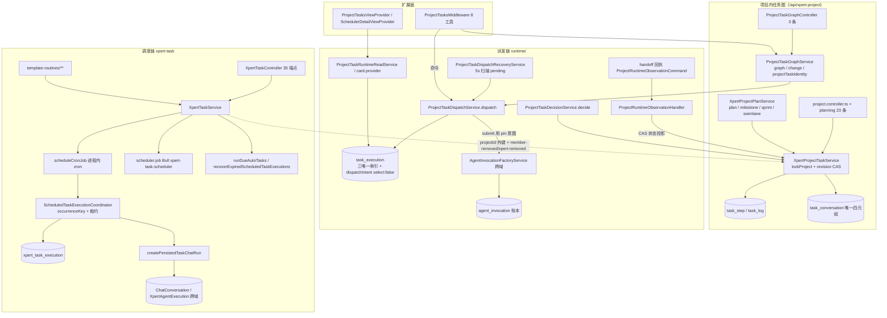

# 项目与任务协作域 · ② 任务·计划·调度子专家 · 架构（01-架构）

**本文引用的文件**

- [packages/server-ai/src/xpert-project/project.module.ts](file://packages/server-ai/src/xpert-project/project.module.ts)
- [packages/server-ai/src/xpert-project/project.controller.ts](file://packages/server-ai/src/xpert-project/project.controller.ts)
- [packages/server-ai/src/xpert-project/project-planning.controller.ts](file://packages/server-ai/src/xpert-project/project-planning.controller.ts)
- [packages/server-ai/src/xpert-project/project-task-graph.controller.ts](file://packages/server-ai/src/xpert-project/project-task-graph.controller.ts)
- [packages/server-ai/src/xpert-project/project-task-plan.schema.ts](file://packages/server-ai/src/xpert-project/project-task-plan.schema.ts)
- [packages/server-ai/src/xpert-project/dto/project-task.dto.ts](file://packages/server-ai/src/xpert-project/dto/project-task.dto.ts)
- [packages/server-ai/src/xpert-project/services/project-task.service.ts](file://packages/server-ai/src/xpert-project/services/project-task.service.ts)
- [packages/server-ai/src/xpert-project/services/project-task-graph.service.ts](file://packages/server-ai/src/xpert-project/services/project-task-graph.service.ts)
- [packages/server-ai/src/xpert-project/services/project-task-ownership.ts](file://packages/server-ai/src/xpert-project/services/project-task-ownership.ts)
- [packages/server-ai/src/xpert-project/services/project-task-step.service.ts](file://packages/server-ai/src/xpert-project/services/project-task-step.service.ts)
- [packages/server-ai/src/xpert-project/services/project-task-types.ts](file://packages/server-ai/src/xpert-project/services/project-task-types.ts)
- [packages/server-ai/src/xpert-project/services/project-task-progress.ts](file://packages/server-ai/src/xpert-project/services/project-task-progress.ts)
- [packages/server-ai/src/xpert-project/services/project-plan.service.ts](file://packages/server-ai/src/xpert-project/services/project-plan.service.ts)
- [packages/server-ai/src/xpert-project/runtime/project-task-dispatch.service.ts](file://packages/server-ai/src/xpert-project/runtime/project-task-dispatch.service.ts)
- [packages/server-ai/src/xpert-project/runtime/project-task-dispatch.command.ts](file://packages/server-ai/src/xpert-project/runtime/project-task-dispatch.command.ts)
- [packages/server-ai/src/xpert-project/runtime/project-task-dispatch.schema.ts](file://packages/server-ai/src/xpert-project/runtime/project-task-dispatch.schema.ts)
- [packages/server-ai/src/xpert-project/runtime/project-task-decision.service.ts](file://packages/server-ai/src/xpert-project/runtime/project-task-decision.service.ts)
- [packages/server-ai/src/xpert-project/runtime/project-task-runtime-read.service.ts](file://packages/server-ai/src/xpert-project/runtime/project-task-runtime-read.service.ts)
- [packages/server-ai/src/xpert-project/runtime/project-task-runtime-context.service.ts](file://packages/server-ai/src/xpert-project/runtime/project-task-runtime-context.service.ts)
- [packages/server-ai/src/xpert-project/runtime/project-task-runtime.handlers.ts](file://packages/server-ai/src/xpert-project/runtime/project-task-runtime.handlers.ts)
- [packages/server-ai/src/xpert-project/runtime/project-task-runtime.errors.ts](file://packages/server-ai/src/xpert-project/runtime/project-task-runtime.errors.ts)
- [packages/server-ai/src/xpert-project/runtime/project-task-specification.ts](file://packages/server-ai/src/xpert-project/runtime/project-task-specification.ts)
- [packages/server-ai/src/xpert-project/runtime/project-task-evidence.ts](file://packages/server-ai/src/xpert-project/runtime/project-task-evidence.ts)
- [packages/server-ai/src/xpert-project/runtime/project-task-invocation-view.ts](file://packages/server-ai/src/xpert-project/runtime/project-task-invocation-view.ts)
- [packages/server-ai/src/xpert-project/runtime/project-task-card.provider.ts](file://packages/server-ai/src/xpert-project/runtime/project-task-card.provider.ts)
- [packages/server-ai/src/xpert-project/runtime/project-task-dispatch-recovery.service.ts](file://packages/server-ai/src/xpert-project/runtime/project-task-dispatch-recovery.service.ts)
- [packages/server-ai/src/xpert-project/runtime/project-runtime-observation.handler.ts](file://packages/server-ai/src/xpert-project/runtime/project-runtime-observation.handler.ts)
- [packages/server-ai/src/xpert-project/entities/project-task.entity.ts](file://packages/server-ai/src/xpert-project/entities/project-task.entity.ts)
- [packages/server-ai/src/xpert-project/entities/project-task-step.entity.ts](file://packages/server-ai/src/xpert-project/entities/project-task-step.entity.ts)
- [packages/server-ai/src/xpert-project/entities/project-task-log.entity.ts](file://packages/server-ai/src/xpert-project/entities/project-task-log.entity.ts)
- [packages/server-ai/src/xpert-project/entities/project-task-execution.entity.ts](file://packages/server-ai/src/xpert-project/entities/project-task-execution.entity.ts)
- [packages/server-ai/src/xpert-project/entities/project-task-conversation.entity.ts](file://packages/server-ai/src/xpert-project/entities/project-task-conversation.entity.ts)
- [packages/server-ai/src/xpert-project/entities/project-plan.entity.ts](file://packages/server-ai/src/xpert-project/entities/project-plan.entity.ts)
- [packages/server-ai/src/xpert-project/entities/project-milestone.entity.ts](file://packages/server-ai/src/xpert-project/entities/project-milestone.entity.ts)
- [packages/server-ai/src/xpert-project/entities/project-sprint.entity.ts](file://packages/server-ai/src/xpert-project/entities/project-sprint.entity.ts)
- [packages/server-ai/src/xpert-project/entities/project-swimlane.entity.ts](file://packages/server-ai/src/xpert-project/entities/project-swimlane.entity.ts)
- [packages/server-ai/src/xpert-project/plugins/project-tasks/constants.ts](file://packages/server-ai/src/xpert-project/plugins/project-tasks/constants.ts)
- [packages/server-ai/src/xpert-project/plugins/project-tasks/project-tasks.middleware.ts](file://packages/server-ai/src/xpert-project/plugins/project-tasks/project-tasks.middleware.ts)
- [packages/server-ai/src/xpert-project/plugins/project-tasks/project-tasks.capability.ts](file://packages/server-ai/src/xpert-project/plugins/project-tasks/project-tasks.capability.ts)
- [packages/server-ai/src/xpert-project/views/project-tasks.provider.ts](file://packages/server-ai/src/xpert-project/views/project-tasks.provider.ts)
- [packages/server-ai/src/xpert-task/xpert-task.module.ts](file://packages/server-ai/src/xpert-task/xpert-task.module.ts)
- [packages/server-ai/src/xpert-task/xpert-task.controller.ts](file://packages/server-ai/src/xpert-task/xpert-task.controller.ts)
- [packages/server-ai/src/xpert-task/xpert-task.service.ts](file://packages/server-ai/src/xpert-task/xpert-task.service.ts)
- [packages/server-ai/src/xpert-task/xpert-task.entity.ts](file://packages/server-ai/src/xpert-task/xpert-task.entity.ts)
- [packages/server-ai/src/xpert-task/scheduled-task-execution.entity.ts](file://packages/server-ai/src/xpert-task/scheduled-task-execution.entity.ts)
- [packages/server-ai/src/xpert-task/scheduled-task-execution.coordinator.ts](file://packages/server-ai/src/xpert-task/scheduled-task-execution.coordinator.ts)
- [packages/server-ai/src/xpert-task/scheduler.job.ts](file://packages/server-ai/src/xpert-task/scheduler.job.ts)
- [packages/server-ai/src/xpert-task/template-routines/template-routines.handler.ts](file://packages/server-ai/src/xpert-task/template-routines/template-routines.handler.ts)
- [packages/server-ai/src/xpert-task/views/scheduler-detail.provider.ts](file://packages/server-ai/src/xpert-task/views/scheduler-detail.provider.ts)
- [packages/contracts/src/schedule.ts](file://packages/contracts/src/schedule.ts)
- [packages/contracts/src/ai/xpert-task.model.ts](file://packages/contracts/src/ai/xpert-task.model.ts)

## 目录

1. [子域职责与边界](#1-子域职责与边界)
2. [两套任务体系的分工](#2-两套任务体系的分工)
3. [与 ① 的共享文件交叉引用](#3-与--的共享文件交叉引用)
4. [目录结构与分层](#4-目录结构与分层)
5. [依赖关系](#5-依赖关系)
6. [关键不变量](#6-关键不变量)
7. [架构总览](#7-架构总览)
8. [结论](#8-结论)

章节来源：[project-task.service.ts](file://packages/server-ai/src/xpert-project/services/project-task.service.ts)（关键符号：XpertProjectTaskService）、[xpert-task.service.ts](file://packages/server-ai/src/xpert-task/xpert-task.service.ts)（关键符号：XpertTaskService）

## 1. 子域职责与边界

**做什么**：① 项目内任务图的读写与图语义（`XpertProjectTaskService`、`ProjectTaskGraphService`、`projectTaskIdentity`）；② 任务步骤与步骤日志（`xpert_project_task_step`、`xpert_project_task_log`）；③ 执行派发运行时 `runtime/**`（派发意图固化、Invocation 提交、回执投影、验收决策、读模型、补偿扫描、资源卡）；④ 计划族 `xpert_project_plan/_milestone/_sprint/_swimlane`（`XpertProjectPlanService`）；⑤ 独立任务体系 `xpert-task/**` 全部（任务 CRUD 与生命周期、三套调度机制、执行台账租约、自动任务、任务模板、日程便签、run-as 提案）；⑥ 项目任务插件与视图（`plugins/project-tasks/**`、`views/project-tasks.provider.ts`、`platform.scheduler` 视图与远程组件）。

**不做什么**：不拥有 Invocation 运行时账本与 `xpert_agent_execution`（归属 Agent 执行链，本域只 pin `invocationId` 与 `dispatchIntent`）；不实现模型推理与 Agent 运行时；不拥有会话与消息持久化（只写 `xpert_project_task_conversation` 链接与 `ChatConversation.taskId` 引用）；不拥有项目本体、成员、邀请、资源、准入与字典（归属 ① 项目本体与资源子专家）；不实现队列物理与 outbox 写入（`handoff/runtime-messaging`）。

**边界表达方式**：项目内任务行的 `invocationStatus`/`runtimeStartedAt`/`runtimeCompletedAt` 是**非持久化读投影**（实体注释逐字：「Read projection from the associated Invocation, never a second runtime ledger.」），本域不复刻第二本运行账本。

章节来源：[project-task-execution.entity.ts](file://packages/server-ai/src/xpert-project/entities/project-task-execution.entity.ts)（关键符号：XpertProjectTaskExecution.invocationStatus）、[project-task-runtime-read.service.ts](file://packages/server-ai/src/xpert-project/runtime/project-task-runtime-read.service.ts)（关键符号：ProjectTaskRuntimeReadService.get）

## 2. 两套任务体系的分工

| 维度 | 项目内任务图（`xpert_project_task*`） | 独立任务（`xpert_task*`） |
|---|---|---|
| 表与实体 | 5 表：task / step / log / execution / conversation | 6 表：`XpertTask` / `XpertTaskTemplate` / `AutoTask` / `AutoTaskTemplate` / `ScheduleNote` / `ScheduledTaskExecution` |
| 入口 | `ProjectTaskGraphController`（3 条）+ `project-planning.controller.ts` 的任务端点（由 `project.controller.ts` 继承） | `XpertTaskController`（35 条自声明端点，`@Controller()` 空前缀 + `RouterModule` 给 `/api/xpert-task`） |
| 身份与并发 | `unique(projectId,providerKey,sourceKey)` + `@VersionColumn` `revision` CAS | 无版本列；靠 occurrence 唯一索引 + 租约 + run-as 配置哈希 |
| 执行承载 | 派出 `AgentInvocation`，任务状态由回执单向投影 | 经 `XpertChatCommand` 建会话与执行记录，本域只持 `executionId`/`conversationId` |
| 调度 | 无自带调度器（由 Agent 侧发起派发） | Bull 一次性入队 + 进程内 cron + `@Cron` 扫描三套并存 |
| 面向场景 | 协作看板 / 依赖图 / 验收决策 | 定时、周期、自动化与模板例行 |
| 用户可见面 | `platform.project-tasks` 视图 + 8 个 Agent 工具 | `platform.scheduler` 视图 + `scheduler` 中间件 3 个工具 |

**耦合面只有四处（必须双边复核）**：① `XpertTask.projectId` 外键（`ManyToOne XpertProject`，`onDelete:'CASCADE'`）；② `xpert-project.member-removed` 事件（成员移除先批量 pause 任务再 emit，`xpert-task` 侧同步删除内存 cron job）；③ `xpert-project.xpert-removed` 事件（助手解绑时清 job）；④ HTTP 可见性查询（`findHttpAccessible` 以项目 owner/memberships 判定）。项目删除时的 `XpertTask.xpertId` 改写由 ① 的 `project.service.ts` 直接落库，亦属共享点。

章节来源：[xpert-task.entity.ts](file://packages/server-ai/src/xpert-task/xpert-task.entity.ts)（关键符号：XpertTask.project）、[project-task.entity.ts](file://packages/server-ai/src/xpert-project/entities/project-task.entity.ts)（关键符号：XpertProjectTask 的 unique 索引与 VersionColumn）、[xpert-task.controller.ts](file://packages/server-ai/src/xpert-task/xpert-task.controller.ts)（关键符号：XpertTaskController）

## 3. 与 ① 的共享文件交叉引用

以下 13 处同时被本子域与 ① 读写，任何一侧改动都要双边复核：

1. [project.module.ts](file://packages/server-ai/src/xpert-project/project.module.ts)：唯一装配点，控制器/provider/exports 混装两域。
2. [entities/project.entity.ts](file://packages/server-ai/src/xpert-project/entities/project.entity.ts)：① 的聚合根，② 的任务图/行锁以它为串行化锚点。
3. [entities/project.base.ts](file://packages/server-ai/src/xpert-project/entities/project.base.ts)：两域实体共同基类（`XpertProjectBaseEntity`：`projectId` + 软删）。
4. [project.controller.ts](file://packages/server-ai/src/xpert-project/project.controller.ts)：同一控制器既挂项目本体端点，也挂 `:id/plans|sprints|swimlanes` 计划端点。
5. [project-planning.controller.ts](file://packages/server-ai/src/xpert-project/project-planning.controller.ts)：abstract 父类，同时声明任务端点与计划端点，被 `XpertProjectController` 继承。
6. [project.service.ts](file://packages/server-ai/src/xpert-project/project.service.ts)：项目 CRUD + 代理 `getTasks`/`createTasks`/`updateTask`/`reorderTasks`/`linkTaskConversation`/`createTaskExecution`/`claimTaskExecution`。
7. [services/project-plan.service.ts](file://packages/server-ai/src/xpert-project/services/project-plan.service.ts)：计划族属 ②，却被 ① 的控制器注入（`overview`/`create` 均调用 `ensureDefaults`）。
8. [services/project-activity.service.ts](file://packages/server-ai/src/xpert-project/services/project-activity.service.ts)：两域都写 `project.*`/`task.*`/`plan.*` 活动。
9. [services/project-automation.service.ts](file://packages/server-ai/src/xpert-project/services/project-automation.service.ts)：旧版自动化，对两域发 `triggerEvent`，现已下线。
10. [guards/](file://packages/server-ai/src/xpert-project/guards)：`project-auth`/`project-feature`/`project`/`project-permission`/`project-owner` 两域共用准入。
11. [services/project-access.service.ts](file://packages/server-ai/src/xpert-project/services/project-access.service.ts) 与 [services/project-access-runtime.service.ts](file://packages/server-ai/src/xpert-project/services/project-access-runtime.service.ts)：运行时/插件侧共用授权 API（`listReadable`/`assertEdit`/`assertCanEdit`）。
12. [dto/project-workbench.dto.ts](file://packages/server-ai/src/xpert-project/dto/project-workbench.dto.ts)：工作台投影字段横跨项目本体与任务视图。
13. [project.subscriber.ts](file://packages/server-ai/src/xpert-project/project.subscriber.ts)：加载期回填 `ownerId`/`owner`，两域读项目时都会经过。

> **对侧清单**：[① 项目本体与资源子专家 §3](file://.module-experts/后端专题/项目与任务协作专家/sub-experts/项目本体与资源子专家/implementation/01-架构.md) 为「① 侧职责」的权威口径；本表为「② 侧职责」的权威口径，两张表**逐条同序**。

章节来源：[project.module.ts](file://packages/server-ai/src/xpert-project/project.module.ts)（关键符号：XpertProjectModule）、[project-planning.controller.ts](file://packages/server-ai/src/xpert-project/project-planning.controller.ts)（关键符号：XpertProjectPlanningController）、[project-access-runtime.service.ts](file://packages/server-ai/src/xpert-project/services/project-access-runtime.service.ts)（关键符号：ProjectAccessRuntimeService.listReadable）

## 4. 目录结构与分层

| 层 | 承载者 | 职责 |
|---|---|---|
| 控制器 | `ProjectTaskGraphController`（`graph`/`change`/`target`/`tasks`）、`project-planning.controller.ts` 的任务与计划端点、`XpertTaskController` | HTTP 校验 + 命令/服务转发，不含业务判定 |
| 服务 | `XpertProjectTaskService`、`ProjectTaskGraphService`、`XpertProjectPlanService`、`project-task-ownership.ts`、`project-task-types.ts`、`project-task-progress.ts` | 任务/步骤/执行/重排写路径，项目行锁唯一持有者 |
| 派发运行时 | `runtime/**` 12 个文件（见下） | 派发、决策、读模型、上下文、规格、证据、视图投影、错误码、handler、资源卡、补偿 |
| 任务插件 | `plugins/project-tasks/**`（middleware + capability + `tools/{create,list,update,runtime}.ts`） | Agent 中间件策略 `project-tasks`，8 个工具 |
| 视图 | `views/project-tasks.provider.ts`、`xpert-task/views/scheduler-detail.provider.ts`、`remote-components/**` | 视图清单、数据与动作；远程组件 iframe 入口 |
| 调度组件 | `scheduler.job.ts`、`xpert-task.service.ts` 的 `scheduleCronJob`/`runDueAutoTasks`/`recoverExpiredScheduledTaskExecutions`、`scheduled-task-execution.coordinator.ts`、`template-routines/**` | 三套调度机制 + 执行台账租约 |
| 实体 | `xpert-project/entities/project-{task,task-step,task-log,task-execution,task-conversation,plan,milestone,sprint,swimlane}.ts`、`xpert-task/*.entity.ts`（6 个） | 9 + 6 = 15 张表 |

**`runtime/` 文件逐个职责**：`project-task-dispatch.service.ts`（派发事务 + 提交 + 意图固化）、`project-task-dispatch.command.ts`（`DispatchProjectTaskCommand`/`GetProjectRuntimeTaskCommand` 等命令定义）、`project-task-dispatch.schema.ts`（持久化意图与 caller 的 zod 边界）、`project-task-decision.service.ts`（验收决策 + CAS）、`project-task-runtime-read.service.ts`（执行投影读模型，含 `control` 取消）、`project-task-runtime-context.service.ts`（caller → `AgentInvocationScope` 严格还原，群运行时走 `AuthorizeGroupTaskCallerCommand`）、`project-task-specification.ts`（规格快照 + `sha256:` digest）、`project-task-evidence.ts`（证据/评审报告/评审提示词与 `implementationEvidence`）、`project-task-invocation-view.ts`（Invocation → attempt 读投影）、`project-task-executor.ts`（`latestImplementationExecutor`，review 不改变实现身份）、`project-task-runtime.errors.ts`（10 个错误码 → 400/403/404/409）、`project-task-runtime.handlers.ts`（5 个 CQRS handler）、`project-task-card.provider.ts`（资源卡 `createCard`/`resolveMany`）、`project-task-dispatch-recovery.service.ts`（5s 补偿扫描）、`project-runtime-observation.handler.ts`（跨域回执唯一投影点）。

章节来源：[project-task-runtime.handlers.ts](file://packages/server-ai/src/xpert-project/runtime/project-task-runtime.handlers.ts)（关键符号：ProjectTaskRuntimeHandlers / DispatchProjectTaskHandler）、[project-task-runtime.errors.ts](file://packages/server-ai/src/xpert-project/runtime/project-task-runtime.errors.ts)（关键符号：ProjectTaskRuntimeErrorCode）、[project-task-graph.controller.ts](file://packages/server-ai/src/xpert-project/project-task-graph.controller.ts)（关键符号：ProjectTaskGraphController.graph / change / target）

## 5. 依赖关系

**出向（跨域）**：`xpert`（`Xpert` 实体、`PublishedXpertAccessService`、`XpertChatCommand`、项目当前助手版本解析、`GetXpertWorkflowQuery`）；`chat-conversation`（`ChatConversation`/`ChatConversationThread`、`ChatConversationUpsertCommand`）；`xpert-agent-execution`（`XpertAgentExecution`、`isExecutionStopped`、`XpertAgentExecutionUpsertCommand`）；`agent-invocation`（`AgentInvocationFactoryService`、`AgentInvocationEntity`、`agentInvocationId`）；`chat-group`（`AuthorizeGroupTaskCallerCommand`）；`connector`（连接器预检与可用性）；`handoff/runtime-messaging`（`ProjectRuntimeObservationCommand`、`RuntimeMessageAccessService.withActor`、`isRuntimeMessageBlocked`）；`@xpert-ai/plugin-sdk`（`ProjectTaskProviderRegistry`、`ProjectTasksRuntimeCapability`、`AgentInvocation`、中间件/视图提供者装饰器）；`@xpert-ai/server-core`（`TenantOrganizationAwareCrudService`、`RedisLockService`、`SchedulerRegistry`）；`@xpert-ai/contracts`（`schedule.ts` 的状态与频率枚举、`xpert-task.model.ts` 的幂等键常量）。

**入向**：`app.module.ts` 同时注册 `XpertProjectModule` 与 `XpertTaskModule`；`xpert-task.module.ts` 以 `forwardRef(() => XpertProjectModule)` 反向依赖项目域；`xpert` 域经 `xpert/template-setup` 派发 `TemplateRoutinesCommand`/`TemplateActivityCommand`；`plugin-resource`/`agent-evolution`/`connector`、`chat-conversation` 的会话投影与沙箱侧引用本域实体/服务与 `ProjectAccessRuntimeService`。

**同域内连线**：`ProjectTasksMiddleware` 不直改库，决策/派发/读一律经命令总线（`DispatchProjectTaskCommand`/`GetProjectRuntimeTaskCommand`）；`views/project-tasks.provider.ts` 依赖 `ProjectTaskGraphService` + `ProjectTaskRuntimeReadService` + `ProjectTaskDecisionService` 三者；`ProjectTaskDispatchRecoveryService` 依赖 `DataSource` + `ProjectTaskDispatchService` + `RuntimeMessageAccessService`。

章节来源：[project.module.ts](file://packages/server-ai/src/xpert-project/project.module.ts)（关键符号：XpertProjectModule 的 imports/exports）、[xpert-task.module.ts](file://packages/server-ai/src/xpert-task/xpert-task.module.ts)（关键符号：XpertTaskModule 的 forwardRef 与 BullModule.registerQueue）、[project-task-dispatch-recovery.service.ts](file://packages/server-ai/src/xpert-project/runtime/project-task-dispatch-recovery.service.ts)（关键符号：ProjectTaskDispatchRecoveryService.recover）

## 6. 关键不变量

1. **任务幂等键**：`xpert_project_task` 上 `@Index(['projectId','providerKey','sourceKey'], { unique: true })`，provider 投影任务按 `projectTaskIdentity(projectId, provider, key)` 的 sha256 派生稳定 UUID，跨次快照不重复建行。
2. **乐观锁**：`@VersionColumn({ default: 1 }) revision`；所有状态写入都以 `revision` 做 CAS（观察投影与决策服务均带 `revision` 条件），旧快照不得覆盖新版本。
3. **执行派发三唯一索引**：`IDX_project_task_execution_invocation(invocationId)`（unique）、`IDX_project_task_execution_dispatch(projectId,createdById,dispatchRequestId)`（unique）、`(taskId, sourceKey)`（unique）；`invocationId` 由 `agentInvocationId(scope, callId)` 派生，重放绝不新造 callId。
4. **`dispatchIntent` 为 `select: false`**：实体注释逐字「Server-only recovery intent; never serialize credentials, routing or configuration to task views.」——恢复器必须显式 `addSelect('attempt.dispatchIntent')`。
5. **任务↔会话唯一四元组**：`@Unique('UQ_project_task_conversation_relation', ['projectId','taskId','conversationId','relationType'])`，`relationType ∈ origin|discussion|execution|review`，`linkConversation` 先查后插幂等。
6. **调度 `runtimeState` 与 `status` 职责分离**：`XpertTask.status ∈ paused|archived|scheduled` 是排程状态；每次触发把幂等键（`XPERT_TASK_SCHEDULE_IDEMPOTENCY_KEY`）写进 `runtimeState`，运行不改变 `status`。
7. **执行台账幂等与租约**：`uq_xpert_task_execution_occurrence(taskId, occurrenceKey)` 保证「同一 occurrence 至多一次执行」；`(status, leaseExpiresAt)` 索引支撑过期租约接管（`attempt+1`），终态不再 claim。
8. **自动任务启用/停用**：`AutoTask.enabled` 默认 true，`frequency ∈ once|daily|weekly`；`runDueAutoTasks` 在 Redis 锁内取 `enabled=true AND nextRunAt<=now`，`once` 执行后置 `enabled=false, nextRunAt=null`。
9. **执行回执幂等**：回执投影只在「该 attempt 是最新尝试 + 非 provider 普通任务 + `projectedTaskRevision === task.revision` + 状态在允许集且规格 digest 未变」时用 CAS 推进任务状态，并把 `projectedInvocationRevision` 推到 Invocation 的 revision。
10. **属主列不可外部写**：`assertNativeExecutionInput` 拒绝 HTTP 侧写 `invocationId`/`dispatchState`/`dispatchRequestId`/`dispatchIntent`/`purpose`/`specificationSnapshot`/`attempt`；`assertOrdinaryTaskInput` 拒绝写 `providerKey`/`sourceKey`/`revision`/`predecessorIds`/`executions`/`decisions`/`conversations` 等投影列。

章节来源：[project-task.entity.ts](file://packages/server-ai/src/xpert-project/entities/project-task.entity.ts)（关键符号：XpertProjectTask.revision / predecessorIds / @Index）、[project-task-execution.entity.ts](file://packages/server-ai/src/xpert-project/entities/project-task-execution.entity.ts)（关键符号：IDX_project_task_execution_invocation / IDX_project_task_execution_dispatch / dispatchIntent）、[project-task-ownership.ts](file://packages/server-ai/src/xpert-project/services/project-task-ownership.ts)（关键符号：assertNativeExecutionInput）、[scheduled-task-execution.entity.ts](file://packages/server-ai/src/xpert-task/scheduled-task-execution.entity.ts)（关键符号：ScheduledTaskExecution.occurrenceKey）

## 7. 架构总览

图表来源：[project-task-dispatch.service.ts](file://packages/server-ai/src/xpert-project/runtime/project-task-dispatch.service.ts)（关键符号：ProjectTaskDispatchService.dispatch / submit）、[project-runtime-observation.handler.ts](file://packages/server-ai/src/xpert-project/runtime/project-runtime-observation.handler.ts)（关键符号：ProjectRuntimeObservationHandler.execute）、[scheduled-task-execution.coordinator.ts](file://packages/server-ai/src/xpert-task/scheduled-task-execution.coordinator.ts)（关键符号：ScheduledTaskExecutionCoordinator.claim）、[xpert-task.service.ts](file://packages/server-ai/src/xpert-task/xpert-task.service.ts)（关键符号：XpertTaskService.scheduleCronJob / createPersistedTaskChatRun）

章节来源：[project-task-dispatch.service.ts](file://packages/server-ai/src/xpert-project/runtime/project-task-dispatch.service.ts)、[scheduler.job.ts](file://packages/server-ai/src/xpert-task/scheduler.job.ts)（关键符号：TaskSchedulerProcessor.process）、[plugins/project-tasks/constants.ts](file://packages/server-ai/src/xpert-project/plugins/project-tasks/constants.ts)（关键符号：ProjectToolEnum）

## 8. 结论

本子域的结构主线是「一个项目内任务图 + 一个独立任务体系 + 一条贯穿两态的调度/派发链」。项目内任务靠 `providerKey` 快照身份、`revision` CAS 与执行账本三唯一索引把「任务」变成可重放的确定性对象；独立任务靠 `occurrenceKey` 唯一约束与租约把「周期执行」变成同一时段至多一次的持久事实；两者仅通过 `projectId` 外键与两个 `@OnEvent` 通道耦合，互不污染但必须双边复核。

需要长期守住四个支点：① 授权只经 `XpertProjectAccessService`/`ProjectAccessRuntimeService`；② 任务与执行写入只经带项目行锁 + `revision` CAS（或 owner+status 条件更新）的服务方法，且属主列拒绝外部写；③ 执行事实只认 Invocation，任务状态只由 `ProjectRuntimeObservationHandler` 单向投影、业务完成只由 `ProjectTaskDecisionService.decide` 显式确认；④ `dispatchIntent` 的 `select:false` 必须由恢复链显式 `addSelect`。

结构性风险集中在装配与历史包袱：控制器继承导致端点数虚高；`xpert-task` 无版本列且三套调度机制入口分散；`scheduler.job.ts` 的 `@Inject(JOB_REF)` 注入未使用；任务行与计划族之间只有裸 `planId`/`milestoneId` 字符串列而无外键与 `sprintId`/`swimlaneId`，泳道调度字段（`wipLimit`/`concurrencyLimit`/`agentRole`）目前仍是配置面语义。

章节来源：[project-task-graph.service.ts](file://packages/server-ai/src/xpert-project/services/project-task-graph.service.ts)（关键符号：projectTaskIdentity）、[project-plan.service.ts](file://packages/server-ai/src/xpert-project/services/project-plan.service.ts)（关键符号：XpertProjectPlanService.createSprint）、[project-task.entity.ts](file://packages/server-ai/src/xpert-project/entities/project-task.entity.ts)（关键符号：XpertProjectTask.planId / milestoneId）
