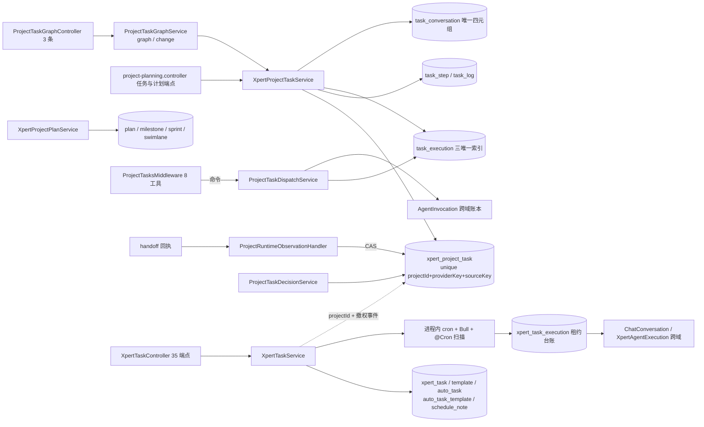
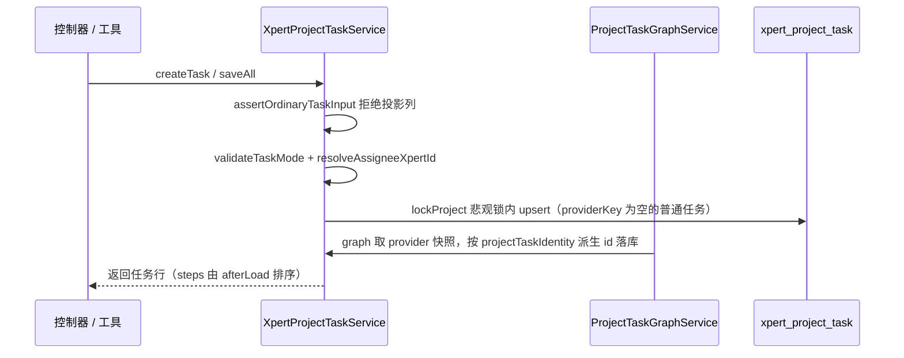
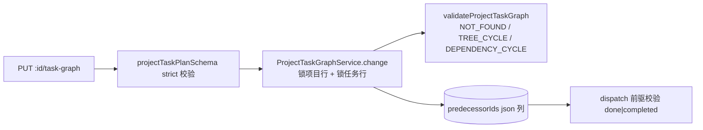
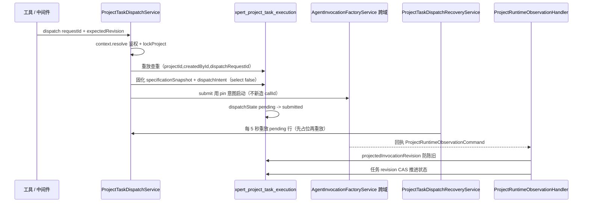
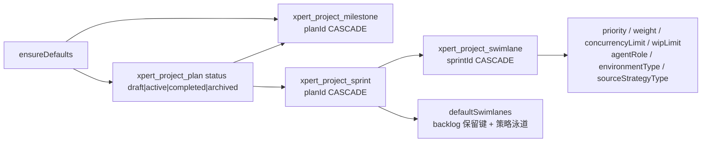
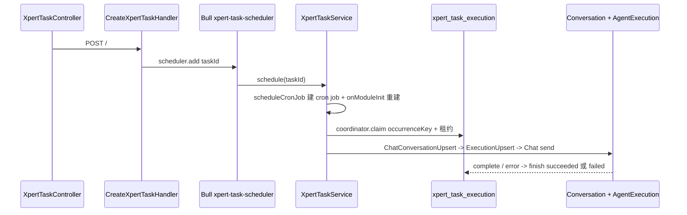
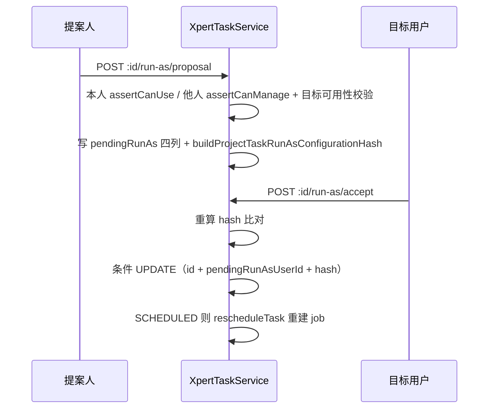

# 项目与任务协作域 · ② 任务·计划·调度子专家 · 数据流转（03-数据流转）

> 只读梳理。范围：`xpert_project_task*`（5 表）+ 计划族（4 表）+ `xpert-task/**`（6 表），合计 **15 张表**；HTTP 前缀 `/api/xpert-project` 与 `/api/xpert-task`。引用为仓库根相对路径；未能证实处标 `[推测]`。

**本文引用的文件**

- [xpert-project/project-task-graph.controller.ts](file://packages/server-ai/src/xpert-project/project-task-graph.controller.ts)
- [xpert-project/project-planning.controller.ts](file://packages/server-ai/src/xpert-project/project-planning.controller.ts)
- [xpert-project/services/project-task.service.ts](file://packages/server-ai/src/xpert-project/services/project-task.service.ts)
- [xpert-project/services/project-task-graph.service.ts](file://packages/server-ai/src/xpert-project/services/project-task-graph.service.ts)
- [xpert-project/services/project-task-ownership.ts](file://packages/server-ai/src/xpert-project/services/project-task-ownership.ts)
- [xpert-project/services/project-plan.service.ts](file://packages/server-ai/src/xpert-project/services/project-plan.service.ts)
- [xpert-project/runtime/project-task-dispatch.service.ts](file://packages/server-ai/src/xpert-project/runtime/project-task-dispatch.service.ts)
- [xpert-project/runtime/project-task-dispatch-recovery.service.ts](file://packages/server-ai/src/xpert-project/runtime/project-task-dispatch-recovery.service.ts)
- [xpert-project/runtime/project-task-decision.service.ts](file://packages/server-ai/src/xpert-project/runtime/project-task-decision.service.ts)
- [xpert-project/runtime/project-task-invocation-view.ts](file://packages/server-ai/src/xpert-project/runtime/project-task-invocation-view.ts)
- [xpert-project/runtime/project-runtime-observation.handler.ts](file://packages/server-ai/src/xpert-project/runtime/project-runtime-observation.handler.ts)
- [xpert-project/entities/project-task.entity.ts](file://packages/server-ai/src/xpert-project/entities/project-task.entity.ts)
- [xpert-project/entities/project-task-execution.entity.ts](file://packages/server-ai/src/xpert-project/entities/project-task-execution.entity.ts)
- [xpert-project/entities/project-task-conversation.entity.ts](file://packages/server-ai/src/xpert-project/entities/project-task-conversation.entity.ts)
- [xpert-project/entities/project-task-step.entity.ts](file://packages/server-ai/src/xpert-project/entities/project-task-step.entity.ts)
- [xpert-project/entities/project-task-log.entity.ts](file://packages/server-ai/src/xpert-project/entities/project-task-log.entity.ts)
- [xpert-project/entities/project-plan.entity.ts](file://packages/server-ai/src/xpert-project/entities/project-plan.entity.ts)
- [xpert-project/entities/project-milestone.entity.ts](file://packages/server-ai/src/xpert-project/entities/project-milestone.entity.ts)
- [xpert-project/entities/project-sprint.entity.ts](file://packages/server-ai/src/xpert-project/entities/project-sprint.entity.ts)
- [xpert-project/entities/project-swimlane.entity.ts](file://packages/server-ai/src/xpert-project/entities/project-swimlane.entity.ts)
- [xpert-project/plugins/project-tasks/project-tasks.middleware.ts](file://packages/server-ai/src/xpert-project/plugins/project-tasks/project-tasks.middleware.ts)
- [xpert-task/xpert-task.controller.ts](file://packages/server-ai/src/xpert-task/xpert-task.controller.ts)
- [xpert-task/xpert-task.service.ts](file://packages/server-ai/src/xpert-task/xpert-task.service.ts)
- [xpert-task/xpert-task.entity.ts](file://packages/server-ai/src/xpert-task/xpert-task.entity.ts)
- [xpert-task/auto-task.entity.ts](file://packages/server-ai/src/xpert-task/auto-task.entity.ts)
- [xpert-task/schedule-note.entity.ts](file://packages/server-ai/src/xpert-task/schedule-note.entity.ts)
- [xpert-task/scheduled-task-execution.entity.ts](file://packages/server-ai/src/xpert-task/scheduled-task-execution.entity.ts)
- [xpert-task/scheduled-task-execution.coordinator.ts](file://packages/server-ai/src/xpert-task/scheduled-task-execution.coordinator.ts)
- [xpert-task/scheduler.job.ts](file://packages/server-ai/src/xpert-task/scheduler.job.ts)
- [xpert-task/template-routines/template-schedule.ts](file://packages/server-ai/src/xpert-task/template-routines/template-schedule.ts)
- [handoff/runtime-messaging/runtime-message-access.service.ts](file://packages/server-ai/src/handoff/runtime-messaging/runtime-message-access.service.ts)
- [contracts/src/schedule.ts](file://packages/contracts/src/schedule.ts)
- [contracts/src/ai/xpert-task.model.ts](file://packages/contracts/src/ai/xpert-task.model.ts)

## 目录

1. [总览](#1-总览)
2. [链路一 任务图创建链](#2-链路一-任务图创建链)
3. [链路二 依赖与重排链](#3-链路二-依赖与重排链)
4. [链路三 派发与回执投影链](#4-链路三-派发与回执投影链)
5. [链路四 计划族层级链](#5-链路四-计划族层级链)
6. [链路五 独立任务调度与执行链](#6-链路五-独立任务调度与执行链)
7. [链路六 run-as 提案链](#7-链路六-run-as-提案链)
8. [链路七 自动任务链](#8-链路七-自动任务链)
9. [状态机汇总](#9-状态机汇总)
10. [已知风险](#10-已知风险)
11. [结论](#11-结论)

章节来源：[project-task.service.ts](file://packages/server-ai/src/xpert-project/services/project-task.service.ts)（关键符号：XpertProjectTaskService）、[xpert-task.service.ts](file://packages/server-ai/src/xpert-task/xpert-task.service.ts)（关键符号：XpertTaskService）

## 1. 总览

两条主链并列：**项目内任务链**以项目行为串行化锚点（`lockProject`），产出任务/步骤/日志/执行尝试/会话链接五张表；**独立任务链**以 `xpert_task` 行为主体，产出执行台账与跨域会话/执行记录。两链唯一交汇处是 `XpertTask.projectId` 与两个撤权事件。

图表来源：[project-task-graph.service.ts](file://packages/server-ai/src/xpert-project/services/project-task-graph.service.ts)、[project-task-dispatch.service.ts](file://packages/server-ai/src/xpert-project/runtime/project-task-dispatch.service.ts)、[xpert-task.service.ts](file://packages/server-ai/src/xpert-task/xpert-task.service.ts)

章节来源：[project-task-execution.entity.ts](file://packages/server-ai/src/xpert-project/entities/project-task-execution.entity.ts)（关键符号：IDX_project_task_execution_dispatch）、[scheduled-task-execution.entity.ts](file://packages/server-ai/src/xpert-task/scheduled-task-execution.entity.ts)（关键符号：ScheduledTaskExecution.occurrenceKey）

## 2. 链路一 任务图创建链

图表来源：[project-task.service.ts](file://packages/server-ai/src/xpert-project/services/project-task.service.ts)、[project-task-graph.service.ts](file://packages/server-ai/src/xpert-project/services/project-task-graph.service.ts)

- 幂等边界：`unique(projectId, providerKey, sourceKey)`；provider 巡检行的 id 由 `projectTaskIdentity(projectId, provider, key)` 的 sha256 派生，重放不新建行。
- 类型与归属：`type`（业务分类）与 `kind ∈ task|summary|milestone`（图结构）分离；`assigneeXpertId` 必须命中项目已挂助手，否则拒绝。
- 写保护：`assertOrdinaryTaskInput` 拒绝 `providerKey`/`sourceKey`/`revision`/`predecessorIds`/`planned*`/`estimatedDurationMs`/`diagnostic`/`executions`/`decisions`/`conversations` 等列；`progress` 走 0–100 校验。
- 状态不变量：任务有 `invocationId` 执行行时禁止直接写完成态（`DecisionRequired`）。

章节来源：[project-task-ownership.ts](file://packages/server-ai/src/xpert-project/services/project-task-ownership.ts)（关键符号：assertOrdinaryTaskInput）、[project-task.entity.ts](file://packages/server-ai/src/xpert-project/entities/project-task.entity.ts)（关键符号：XpertProjectTask.providerKey / sourceKey / kind）

## 3. 链路二 依赖与重排链

- 依赖写入：`PUT :id/task-graph` → `ProjectTaskGraphController.change` → `projectTaskPlanSchema` 校验（`taskId` + `expectedRevision` + `predecessorIds`/`parentTaskId`/计划时间）→ `ProjectTaskGraphService.change` 事务内锁项目行 + 锁任务行，按 `id` 重建 `predecessorIds`。
- 图校验：`validateProjectTaskGraph` 拒绝跨项目引用（`NOT_FOUND`）、包含环（`TREE_CYCLE`）、依赖环（`DEPENDENCY_CYCLE`）；`forecastProjectTasks` 负责延期传播与汇总行日期上卷（summary 不额外累加时长）。
- 重排：`XpertProjectTaskService.reorder` 只改 `order`/`column`；`batchUpdate` 在同一事务内按 `projectId + id` 批量写。
- 派发侧消费：`ProjectTaskDispatchService.dispatch` 要求全部前驱状态属于 `done|completed`，否则抛 `Dependencies`。

图表来源：[project-task-graph.controller.ts](file://packages/server-ai/src/xpert-project/project-task-graph.controller.ts)、[project-task-graph.service.ts](file://packages/server-ai/src/xpert-project/services/project-task-graph.service.ts)

章节来源：[project-task-graph.service.ts](file://packages/server-ai/src/xpert-project/services/project-task-graph.service.ts)（关键符号：ProjectTaskGraphService.change / toProjectTaskNode）、[project-task-graph.controller.ts](file://packages/server-ai/src/xpert-project/project-task-graph.controller.ts)（关键符号：ProjectTaskGraphController.graph / change）

## 4. 链路三 派发与回执投影链

图表来源：[project-task-dispatch.service.ts](file://packages/server-ai/src/xpert-project/runtime/project-task-dispatch.service.ts)、[project-task-dispatch-recovery.service.ts](file://packages/server-ai/src/xpert-project/runtime/project-task-dispatch-recovery.service.ts)、[project-runtime-observation.handler.ts](file://packages/server-ai/src/xpert-project/runtime/project-runtime-observation.handler.ts)

- 幂等三件套：`invocationId` 唯一、`(projectId,createdById,dispatchRequestId)` 唯一、`(taskId,sourceKey)` 唯一；重放比对 `sameInvocationData` 全量不一致即 `Conflict`。
- 规格绑定：`specificationSnapshot.digest = sha256(规范化标题/描述/requirements/排序步骤)`，提交前与决策前都要复算比对。
- 读投影不落库：`invocationStatus`/`runtimeStartedAt`/`runtimeCompletedAt` 由 `projectTaskInvocationView` 从 Invocation 派生；id 或 scope 不匹配时降级 `queued`/`unknown`。
- 补偿分类：`dispatch_blocked`（`isRuntimeMessageBlocked` 判定，终态不再重试）与 `dispatch_unavailable`（60 s 后重试）；重放前经 `RuntimeMessageAccessService.withActor` 还原 actor。

章节来源：[project-task-dispatch.service.ts](file://packages/server-ai/src/xpert-project/runtime/project-task-dispatch.service.ts)（关键符号：ProjectTaskDispatchService.dispatch / submit / intent）、[project-task-invocation-view.ts](file://packages/server-ai/src/xpert-project/runtime/project-task-invocation-view.ts)（关键符号：projectTaskInvocationView）、[project-task-decision.service.ts](file://packages/server-ai/src/xpert-project/runtime/project-task-decision.service.ts)（关键符号：ProjectTaskDecisionService.decide）

## 5. 链路四 计划族层级链

图表来源：[project-plan.service.ts](file://packages/server-ai/src/xpert-project/services/project-plan.service.ts)、[project-swimlane.entity.ts](file://packages/server-ai/src/xpert-project/entities/project-swimlane.entity.ts)

- 层级表达：无 `@Tree`，靠显式 FK（`planId`/`sprintId`）+ `relations` 读取；plan/sprint/milestone/swimlane 的删除由 `onDelete:'CASCADE'` 承担。
- 默认族：`ensureDefaults` 建 `Default plan`（active/board/order 0）+ `Uncategorized` 里程碑；simple 模式只允许这两个保留对象。
- 策略固化：`createSprint` 按 `strategyType` 生成默认泳道并写入 `sourceStrategyType`；`updateSprint` 拒绝改 `strategyType`。
- 与任务的连接：任务行只有裸 `planId`/`milestoneId` 字符串列，**没有 FK、也没有 `sprintId`/`swimlaneId`**；泳道调度字段目前是配置面语义。
- 状态无自动迁移：四张表的状态均由 API 直接赋值，代码内没有自动推进逻辑 `[推测]`（在当前实现中未见到相应写入路径）。

章节来源：[project-plan.service.ts](file://packages/server-ai/src/xpert-project/services/project-plan.service.ts)（关键符号：XpertProjectPlanService.ensureDefaults / createSprint / defaultSwimlanes）、[project-task.entity.ts](file://packages/server-ai/src/xpert-project/entities/project-task.entity.ts)（关键符号：XpertProjectTask.planId / milestoneId）

## 6. 链路五 独立任务调度与执行链

图表来源：[xpert-task.service.ts](file://packages/server-ai/src/xpert-task/xpert-task.service.ts)、[scheduler.job.ts](file://packages/server-ai/src/xpert-task/scheduler.job.ts)、[scheduled-task-execution.coordinator.ts](file://packages/server-ai/src/xpert-task/scheduled-task-execution.coordinator.ts)

- 三套调度：Bull 只做一次性入队；进程内 cron 是主路径（`taskCronExpression` 优先 `schedule` 否则由 `options` 生成，`cronMinuteOccurrence` 保留延迟回调的原分钟边界）；`@Cron` 扫描负责恢复过期租约与自动任务到期扫描。
- 生命周期写点：`schedule → SCHEDULED + statusReason=null`；`pause → PAUSED`；`archive → ARCHIVED`；`unarchive → PAUSED` 且不排程；`softDeleteHttpTask = pause + softRemove`；`recoverHttpTask` 只软恢复、不重建 job。
- 台账：`uq_xpert_task_execution_occurrence(taskId, occurrenceKey)` + `(status, leaseExpiresAt)` 索引；终态不再 claim，未过期租约不可抢，过期接管 `attempt+1`；`finish` 清租约并写 `lastError`/`failureCode`。
- 身份与幂等：每次触发把幂等键（`XPERT_TASK_SCHEDULE_IDEMPOTENCY_KEY`）写进 `runtimeState`；`status` 与 `runtimeState` 两列职责分离，运行不改变 `status`。
- 可见性双口径：HTTP 走 `findHttpAccessible`（项目成员校验），调度/恢复走 `findAll`/`findOne`。

章节来源：[xpert-task.service.ts](file://packages/server-ai/src/xpert-task/xpert-task.service.ts)（关键符号：XpertTaskService.scheduleCronJob / createPersistedTaskChatRun / resolveScheduledOccurrence / buildScheduleOccurrenceKey）、[template-schedule.ts](file://packages/server-ai/src/xpert-task/template-routines/template-schedule.ts)（关键符号：taskCronExpression / cronMinuteOccurrence）

## 7. 链路六 run-as 提案链

图表来源：[xpert-task.service.ts](file://packages/server-ai/src/xpert-task/xpert-task.service.ts)、[xpert-task.controller.ts](file://packages/server-ai/src/xpert-task/xpert-task.controller.ts)

- 提案前置：任务必须有 `projectId` + `xpertId`；目标必须是项目可用成员且连接器可用；目标不得等于当前 run-as。
- 两步确认：接受时只有被提名人本人可操作（否则 403），重算哈希不一致即 `ProjectTaskRunAsProposalChanged`，条件 UPDATE `affected !== 1` 再抛一次 `ProposalChanged`。
- 主动失效：`invalidatePendingRunAsProposalForConfigurationChange` 在 `updateTask` 时比较哈希，配置变更即清空四列。
- 执行期身份：统一取 `task.runAsUser ?? task.createdBy`；`schedule`/`create` 时的 actor 影响连接器预检与 OIDC 铸造（`act.sub='xpert_task'`，delegated user = `runAsUserId ?? createdById`）。

章节来源：[xpert-task.service.ts](file://packages/server-ai/src/xpert-task/xpert-task.service.ts)（关键符号：proposeProjectTaskRunAs / acceptProjectTaskRunAs / buildProjectTaskRunAsConfigurationHash / invalidatePendingRunAsProposalForConfigurationChange）

## 8. 链路七 自动任务链

- 触发：`@Cron('0 * * * * *') runDueAutoTasks` 在 Redis 锁 `scheduler:xpert-auto-task`（TTL 5 分钟）下取 `enabled=true AND nextRunAt<=now` 的前 20 条。
- 执行与排程回写：执行结束算 `nextRunAt`（按 `timeZone` 计算）；`frequency==='once'` 时 `enabled=false, nextRunAt=null`，`daily`/`weekly` 继续排程。
- 模板化：`AutoTaskTemplate` 提供内置 seed 与 `defaultParams`；`POST auto-tasks` 可从模板派生实例（`templateId` 关联）。
- 撤权联动：成员被移出项目时，① 侧先批量把该用户的 `XpertTask` 置 `PAUSED`，再 `emitAsync('xpert-project.member-removed')`，本域 `@OnEvent` 同步删除内存 cron job（`ARCHIVED` 行被跳过，避免复活已归档任务）。
- 模板例行：`TemplateRoutinesHandler` 用 `uuid v5([tenantId,userId,assistant.id,key])` 生成稳定 id，`pg_advisory_xact_lock` 串行化，先以 `PAUSED` 落库再切状态；`Import never schedules work`。

章节来源：[xpert-task.service.ts](file://packages/server-ai/src/xpert-task/xpert-task.service.ts)（关键符号：XpertTaskService.runDueAutoTasks / executeAutoTask / pauseProjectTasksForRemovedMember）、[auto-task.entity.ts](file://packages/server-ai/src/xpert-task/auto-task.entity.ts)（关键符号：AutoTask.enabled / frequency / nextRunAt）

## 9. 状态机汇总

- **项目任务（10 态）**：`todo|in_progress|review|paused|done|blocked|cancelled|pending|completed|failed`（列级 enum）。自动推进只允许三种映射（成功→`review`、失败→`blocked`、运行中且已开始→`in_progress`），且仅在 `todo/in_progress/review/blocked` 且 CAS 命中时提交；业务决策 accept→`done`、否则回 `todo` 并追加 `decisions`；`providerKey` 非空的行禁走通用状态写入。
- **任务步骤（4 态）**：`pending|running|done|failed`，默认 `pending`；全部 `done` 且任务无带 `invocationId` 的执行行时任务隐式 `done`。
- **执行尝试**：`status ∈ queued|running|succeeded|failed|cancelled` 默认 `queued`；派发位 `dispatchState ∈ pending|submitted`（`pending → submitted` 由提交 CAS 推进），`attempt` 单调递增，`projectedTaskRevision`/`projectedInvocationRevision` 记录已投影版本。
- **计划（4 态）**：`draft|active|completed|archived`，默认 `active`；视图枚举 `board|table|gantt|calendar|list` 默认 `board`。
- **里程碑（4 态）**：`planned|in_progress|completed|blocked`，默认 `planned`。
- **冲刺（4 态）**：`planned|running|review|done`，默认 `planned`；`strategyType` 默认 `software_delivery` 且创建后不可改。
- **泳道（2 态）**：`backlog|execution`，默认 `execution`；`wipLimit`/`concurrencyLimit` 默认 0、`weight` 默认 1、`agentRole` 默认 `planner`、`environmentType` 默认 `browser`。
- **独立任务 `status`（3 态）**：`paused|archived|scheduled`；`schedule` 置 `SCHEDULED` 并清 `statusReason`，`pause`/`archive` 先删 job，`unarchive` 落 `PAUSED` 且不排程。
- **自动任务**：`enabled`（布尔开关）+ `nextRunAt`（到期触发）；`frequency ∈ once|daily|weekly` 默认 `daily`；`once` 执行后自动停用。
- **调度执行台账（4 态）**：`pending|running|succeeded|failed`，默认 `pending`；`claim` 遇终态或未过期租约返回 null，过期接管 `attempt+1`；`finish` 在丢失租约时会对 FAILED 从 PENDING 补写一次（终态语义弱化）。
- **日程便签**：`type ∈ note|task` 默认 `note`，`status ∈ pending|done` 默认 `pending`。

章节来源：[project-task.entity.ts](file://packages/server-ai/src/xpert-project/entities/project-task.entity.ts)（关键符号：XpertProjectTask.status 枚举）、[project-task-execution.entity.ts](file://packages/server-ai/src/xpert-project/entities/project-task-execution.entity.ts)（关键符号：XpertProjectTaskExecution.dispatchState / status）、[project-sprint.entity.ts](file://packages/server-ai/src/xpert-project/entities/project-sprint.entity.ts)（关键符号：XpertProjectSprint.status）、[schedule.ts](file://packages/contracts/src/schedule.ts)（关键符号：ScheduleTaskStatus / TaskFrequency）、[schedule-note.entity.ts](file://packages/server-ai/src/xpert-task/schedule-note.entity.ts)（关键符号：ScheduleNote.status）

## 10. 已知风险

1. **两套任务模型并存**：`xpert_project_task`（provider 快照 + CAS + Invocation 派发）与 `xpert_task`（cron 排程 + 台账）的可见性、权限与状态机口径不同，只靠 `projectId` + 两个事件耦合，容易串写或误判「同一任务」。
2. **项目行悲观锁是全局串行点**：图快照、流程写、派发、决策、回执投影都在项目行锁内排队，热点项目上互为瓶颈。
3. **恢复链依赖 `select:false` 列**：`dispatchIntent` 默认不出现在查询里，任何漏加 `addSelect` 的修复/备份路径都会让补偿不可用（错误归为 `Invalid`）。
4. **`xpert-task` 无版本列**：run-as 与状态写入只能靠条件 UPDATE，缺少真正的版本号语义，并发下更难定位「谁覆盖了谁」。
5. **调度三套机制与学生态耦合**：创建时 `schedule` 被清空，而 `onModuleInit` 只重建 `options || schedule` 存在的任务；重启后若有任务两者皆空，将静默不再排程。
6. **读侧伪状态**：`SchedulerRegistry` 为本地内存，多实例/重启后取不到 cron job 会把返回 `status` 伪造成 `PAUSED`，与库内事实不一致。
7. **租约与 Redis 锁同 TTL（5 分钟）**：自动任务扫描锁过期与台账租约到期同刻，长批次可重叠。
8. **`dispatch_blocked` 是终态**：一旦被判定为 blocked，补偿不再重试，需要人工重新派发；错误归因依赖 `isRuntimeMessageBlocked` 的判定面。
9. **计划族与任务连接薄弱**：任务只有裸 `planId`/`milestoneId`，没有 `sprintId`/`swimlaneId`，泳道 `wipLimit`/`concurrencyLimit`/`agentRole` 与派发的实际联动尚未在数据流上闭合 `[推测]`。

章节来源：[project-runtime-observation.handler.ts](file://packages/server-ai/src/xpert-project/runtime/project-runtime-observation.handler.ts)（关键符号：ProjectRuntimeObservationHandler.execute）、[project-task-dispatch-recovery.service.ts](file://packages/server-ai/src/xpert-project/runtime/project-task-dispatch-recovery.service.ts)（关键符号：ProjectTaskDispatchRecoveryService.recover）、[scheduled-task-execution.coordinator.ts](file://packages/server-ai/src/xpert-task/scheduled-task-execution.coordinator.ts)（关键符号：ScheduledTaskExecutionCoordinator.finish）

## 11. 结论

本子域的数据流可用一句话概括：**项目内任务把「意图」钉在 `dispatchIntent`、把「规格」钉在 `specificationSnapshot.digest`、把「事实」钉在 Invocation 与 `revision` CAS 上；独立任务把「同一时段至多一次」钉在 `occurrenceKey` 唯一索引与租约上**。前者的一切写入都经过项目行锁，后者的一切执行都经过台账抢租与条件更新。

跨域写只有四处需要牢记：`ChatConversation`（经 `ChatConversationUpsertCommand` 写 `taskId`/`projectId`/`xpertId`）、`XpertAgentExecution`（经 Upsert 命令写 `RUNNING` 与用量）、`AgentInvocation`（本域只 pin id 与意图）、`xpert_project_task.status`（由跨域回执触发、本域落库）。除这四处外，任何直接改本域实体列的路径都应视为绕过不变量。

章节来源：[project-task-dispatch.service.ts](file://packages/server-ai/src/xpert-project/runtime/project-task-dispatch.service.ts)（关键符号：ProjectTaskDispatchService.intent）、[xpert-task.service.ts](file://packages/server-ai/src/xpert-task/xpert-task.service.ts)（关键符号：XpertTaskService.createPersistedTaskChatRun）、[handoff/runtime-messaging/runtime-message-access.service.ts](file://packages/server-ai/src/handoff/runtime-messaging/runtime-message-access.service.ts)（关键符号：RuntimeMessageAccessService.withActor）
