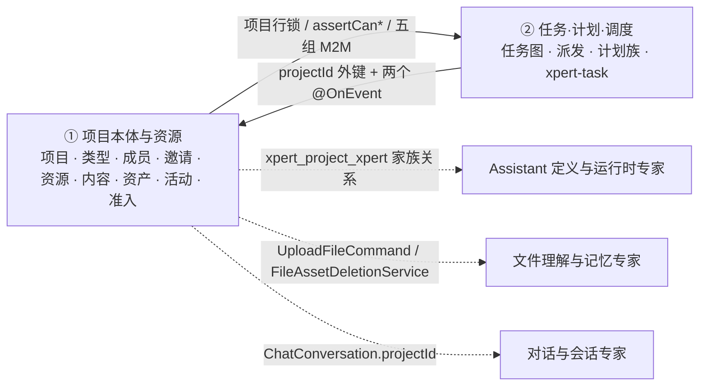

# 项目本体与资源子专家 —— C0 使用总览

> **资产基线**：`2026-10-16 · commit 80f5676fd`（批次 5 首专家），继承父域 [C0-使用总览.md](file://.module-experts/后端专题/项目与任务协作专家/C0-使用总览.md)。**范围**：`packages/server-ai/src/xpert-project/**` 的**项目本体与资源面**（项目 CRUD 与类型、成员、邀请、资源挂载、卷内容与文件、资产、活动流、自动化读面、四层准入）＋ `packages/server/src/business-area/**`；HTTP 前缀 `/api/xpert-project`、`/api/business-area`。任务图、计划族与 `xpert-task/**` 归 [子专家②](file://.module-experts/后端专题/项目与任务协作专家/sub-experts/任务计划与调度子专家/C0-使用总览.md)。未证实处标 `[推测]`。

**本文引用的文件**（相对仓库根，链接均为 `file://`）

- [packages/server-ai/src/xpert-project/project.controller.ts](file://packages/server-ai/src/xpert-project/project.controller.ts)
- [packages/server-ai/src/xpert-project/project-planning.controller.ts](file://packages/server-ai/src/xpert-project/project-planning.controller.ts)
- [packages/server-ai/src/xpert-project/project-invitation.controller.ts](file://packages/server-ai/src/xpert-project/project-invitation.controller.ts)
- [packages/server-ai/src/xpert-project/project-admin.controller.ts](file://packages/server-ai/src/xpert-project/project-admin.controller.ts)
- [packages/server-ai/src/xpert-project/project.service.ts](file://packages/server-ai/src/xpert-project/project.service.ts)
- [packages/server-ai/src/xpert-project/project.module.ts](file://packages/server-ai/src/xpert-project/project.module.ts)
- [packages/server-ai/src/xpert-project/project.subscriber.ts](file://packages/server-ai/src/xpert-project/project.subscriber.ts)
- [packages/server-ai/src/xpert-project/services/project-type.service.ts](file://packages/server-ai/src/xpert-project/services/project-type.service.ts)
- [packages/server-ai/src/xpert-project/services/project-access.service.ts](file://packages/server-ai/src/xpert-project/services/project-access.service.ts)
- [packages/server-ai/src/xpert-project/services/project-membership.service.ts](file://packages/server-ai/src/xpert-project/services/project-membership.service.ts)
- [packages/server-ai/src/xpert-project/services/project-invitation.service.ts](file://packages/server-ai/src/xpert-project/services/project-invitation.service.ts)
- [packages/server-ai/src/xpert-project/services/project-activity.service.ts](file://packages/server-ai/src/xpert-project/services/project-activity.service.ts)
- [packages/server-ai/src/xpert-project/services/project-automation.service.ts](file://packages/server-ai/src/xpert-project/services/project-automation.service.ts)
- [packages/server-ai/src/xpert-project/services/project-content.service.ts](file://packages/server-ai/src/xpert-project/services/project-content.service.ts)
- [packages/server-ai/src/xpert-project/services/project-xpert-binding.service.ts](file://packages/server-ai/src/xpert-project/services/project-xpert-binding.service.ts)
- [packages/server-ai/src/xpert-project/guards/project.guard.ts](file://packages/server-ai/src/xpert-project/guards/project.guard.ts)
- [packages/server-ai/src/xpert-project/entities/project.entity.ts](file://packages/server-ai/src/xpert-project/entities/project.entity.ts)
- [packages/server/src/business-area/business-area.service.ts](file://packages/server/src/business-area/business-area.service.ts)

## 目录

1. [定位](#定位)
2. [何时找这个子专家](#何时找这个子专家)
3. [能力清单表](#能力清单表)
4. [边界](#边界)
5. [已知问题与常见坑](#已知问题与常见坑)
6. [延伸阅读](#延伸阅读)

## 定位

本子专家负责 **「项目是什么、谁能用、挂了什么资源、发生过什么」**：`XpertProject` 聚合根与项目类型/应用安装解析（`XpertProjectTypeService`）、成员与 token 邀请（`XpertProjectMembershipService` / `XpertProjectInvitationService`）、四层准入（`guards/**` + `XpertProjectAccessService` / `ProjectAccessRuntimeService`）、资源挂载（五组 M2M + 助手家族归一 `XpertProjectXpertBindingService`）、卷内容与资产索引（`XpertProjectContentService` / `XpertProjectWorkspaceFilesService` / `XpertProjectAssetService`）、活动流（`XpertProjectActivityService`）、旧版自动化只读遗留面，以及平台级业务领域字典（`BusinessAreaService`）。

**一句话口径**：`xpert_project` 行既是业务记录与资源挂载点，也是全子域**唯一的悲观锁锚点**（`XpertProjectTaskService.lockProject`、`transferOwnership`、`ProjectResourceCardService.attach` 共用）；授权判定收敛在两个入口——HTTP/请求上下文走 `XpertProjectAccessService`，插件与跨域走 `ProjectAccessRuntimeService`；持久面共 9 张表（`xpert_project`、`_membership`、`_invitation`、`_activity`、`_asset`、`_automation`、`_automation_run`、弃用的 `_file`/`_vcs`，其中 `_file`/`_vcs` 未注册 `forFeature`）＋ 旁挂 `business_area`。

章节来源：[project.service.ts](file://packages/server-ai/src/xpert-project/project.service.ts)（关键符号：XpertProjectService.createProject / addXpert / ensureManagedProject）、[project-access.service.ts](file://packages/server-ai/src/xpert-project/services/project-access.service.ts)（关键符号：resolveAccess / assertCanPurge）、[project-xpert-binding.service.ts](file://packages/server-ai/src/xpert-project/services/project-xpert-binding.service.ts)（关键符号：normalize / contains）

## 何时找这个子专家

- 要**改项目管理与生命周期**：`create/update/archive/duplicate/exportProject/importProject/deleteProject/softRemoveProject`，以及 `purge`（要求 `owner` + `archived` + 无在途文件）。
- 要**改项目类型与应用安装**：`catalog/list/resolve/classification/forCreate/forConversation/forEnsure/entry`、`PluginApplicationInstallation` 反查出的 `applicationInstallationId`、`projectTypeSnapshot` 的固化与读取口径。
- 要**改成员与角色**：`add/updateRole/transferOwnership/remove/replaceMembers/interveneAsOrganizationAdministrator`；owner 不入成员表、移除成员前先批量暂停其 `XpertTask`。
- 要**改邀请**：`invite` 的「同项目同邮箱复用同一行 + 轮换 `tokenHash`」、`accept` 的幂等分支与「过期先落库再抛错」、`decline/revoke`、`@Interval(60_000)` 的 legacy 补偿扫描。
- 要**改资源挂载**：`xperts` 的家族归一（`normalize`/`contains`/`resolveCurrentById`）、`toolsets`/`knowledges` 的事后追加语义、`attachments` 的 `GetOwnedStorageFileQuery` 拥有权校验。
- 要**改卷内容、工作区文件与资产索引**：`project.md`、`skills/`、`isGovernedPath`、技能安装与 symlink 逃逸防护；`save/uploadToFolder/delete` 的路径分流；`createAsset` 的 `(projectId, path)` upsert 与 `list/tree/countProjectAssets`。
- 要**改活动流与工作台总览**：`record` 的写点、`sanitizeActivityPayload` 递归脱敏、`overview` 的六路 `Promise.all` 聚合。
- 要**改准入与权限**：四层守卫链、`@ProjectPermission` 元数据、`assertCanRead/Use/Edit/Manage/Purge`、`archived` 与 `owner` 语义、插件侧 `ProjectAccessRuntimeService`。
- 要**改业务领域字典**：`business_area` closure-table 树、`validateParent` 环检测、写端点 `RoleGuard` + `@Roles(SUPER_ADMIN, ADMIN)`。
- 要**排查**「邀请链接无效 / 邮箱不匹配 / 已过期」、「归档后仍能编辑」、「purge 400」、「文件仍在 processing 导致删不掉」。

章节来源：[project.controller.ts](file://packages/server-ai/src/xpert-project/project.controller.ts)（关键符号：XpertProjectController.create / archive / listInvitations / uploadFile / createAsset）、[project-type.service.ts](file://packages/server-ai/src/xpert-project/services/project-type.service.ts)（关键符号：XpertProjectTypeService.catalog / classification / assertPlatformLifecycle）、[project-workspace-files.service.ts](file://packages/server-ai/src/xpert-project/services/project-workspace-files.service.ts)（关键符号：XpertProjectWorkspaceFilesService.save / uploadToFolder）

## 能力清单表

| 能力 | 入口 | 一句话 |
|---|---|---|
| 项目 CRUD 与生命周期 | `GET/POST/PUT /api/xpert-project`、`POST /:id/archive`、`PUT/DELETE /:id/soft`、`/:id/recover`、`DELETE /:id` | 归档后拒绝编辑；物理清除要求 `owner` + `archived` 且无在途文件 |
| 导入导出与复制 | `POST /import`、`GET /:id/export`、`POST /:id/duplicate` | 导出走 `ExportProjectCommand`，导入接受项目 DSL |
| 项目类型目录与分类快照 | `GET /types`、`GET /type-entry`；`XpertProjectTypeService.catalog/classification` | 类型只认当前已加载插件里的活体；`projectTypeSnapshot` 是创建瞬间固化的展示快照，绝不授权 |
| 成员与角色 | `GET/POST/PUT/PATCH/DELETE /:id/members*`；`XpertProjectMembershipService` | owner 不入成员表；移除前先批量 `pause` 该用户的 `XpertTask` |
| 邀请与管理员介入 | `/:id/invitations*`、`/invitations/accept`、`/decline`、`/:id/admin/intervene` | 明文 token 只回一次、库内仅 `tokenHash`；介入需组织级权限 + 非空 reason |
| 资源挂载（助手/工具集/知识库/附件/会话） | `/:id/xperts*`、`/:id/toolsets*`、`/:id/knowledges*`、`/:id/attachments*`、`GET /:id/conversations` | 助手按家族比较；创建时直选工具集/知识库被有意忽略 |
| 卷内容与技能 | `/:id/content/instructions`、`/:id/content/skills*` | 维护卷内 `project.md` 与 `skills/`；受管路径不能走普通文件 API |
| 工作区文件与资产索引 | `/:id/workspace/files*`、`/:id/files`、`/:id/file/upload`、`/:id/assets*` | 文件字节由 `UploadFileCommand` 落卷，项目侧只写资产行 + 活动 |
| 活动流与工作台总览 | `GET /:id/activities`、`GET /overview` | 写前递归剔除 `token/secret/password/prompt/authorization/apiKey` 键 |
| 旧版自动化（只读遗留） | `GET /:id/automations*` | 写路径全部 410 Gone；`triggerEvent()` 恒返回 `[]` |
| 准入门禁 | `guards/**` + `@ProjectPermission` + `XpertProjectAccessService` / `ProjectAccessRuntimeService` | 类级三守卫 + 方法级 Guard/OwnerGuard，唯一业务判定入口 |
| 业务领域字典 | `GET/POST/PUT/DELETE /api/business-area[/:id]` | closure-table 树；写端点需 `SUPER_ADMIN`/`ADMIN`，删除返回 202 |

章节来源：[project.controller.ts](file://packages/server-ai/src/xpert-project/project.controller.ts)（关键符号：create / update / archive / addMembers / inviteMember / addAttachments / listAssets / listAutomations）、[project-invitation.controller.ts](file://packages/server-ai/src/xpert-project/project-invitation.controller.ts)（关键符号：accept / decline）、[business-area.controller.ts](file://packages/server/src/business-area/business-area.controller.ts)（关键符号：BusinessAreaController.createArea / deleteArea）

## 边界

> `business_area`（业务领域字典，1 张 closure-table 表）为**旁挂字典**，归本子专家；父级 `C4-数据流向与消费.md` 将其列为「子域三」仅为分组便利，两者口径不冲突（以本子专家归类为权威）。

**做什么**：项目聚合根与类型解析、成员/邀请与四层准入、资源挂载（助手/工具集/知识库/附件）、卷内容与资产索引、活动流、旧版自动化读面、业务领域字典。

**不做什么（与子专家②及相邻专家域的分工）**

- **不含任务图、执行派发与验收决策**：`ProjectTaskGraphService`、`ProjectTaskDispatchService`、`ProjectTaskDecisionService`、`runtime/**` 全部归 [子专家②](file://.module-experts/后端专题/项目与任务协作专家/sub-experts/任务计划与调度子专家/C0-使用总览.md)。
- **不含计划族与 `xpert-task/**`**：plan/milestone/sprint/swimlane 与 `xpert_task*` 六表、三套调度机制（Bull 入队 + 进程内 cron + `@Cron` 扫描）归 ②。
- **不含 Assistant 定义与发布版本**：本子专家只持有 `xpert_project_xpert` M2M 与「当前版本」解析结果，可用性回落 `PublishedXpertAccessService` 与 `isSameXpertFamily`（→ Assistant 定义与运行时专家）。
- **不含会话与消息、文件字节与理解、队列投递**：只写链接与引用，经 `ChatConversationUpsertCommand`、`UploadFileCommand`、`FileAssetDeletionService` 跨域协作。
- **① 只提供、不接管的三件事**：`xpert_project` 行锁锚点、准入判定（`assertCan*`）、撤权事件 `emitAsync('xpert-project.member-removed')`（内存 cron job 清理由 ② 的 `@OnEvent` 完成）。

图表来源：[project.module.ts](file://packages/server-ai/src/xpert-project/project.module.ts)（关键符号：XpertProjectModule 的 imports / forwardRef / forFeature）、[project-invitation.controller.ts](file://packages/server-ai/src/xpert-project/project-invitation.controller.ts)（关键符号：accept / decline）、[project-content.service.ts](file://packages/server-ai/src/xpert-project/services/project-content.service.ts)（关键符号：XpertProjectContentService.initialize / isGovernedPath）

章节来源：[project.service.ts](file://packages/server-ai/src/xpert-project/project.service.ts)（关键符号：createProject / deleteProject / addAttachments）、[project-purge.service.ts](file://packages/server-ai/src/xpert-project/services/project-purge.service.ts)（关键符号：XpertProjectPurgeService.purge）、[project-membership.service.ts](file://packages/server-ai/src/xpert-project/services/project-membership.service.ts)（关键符号：remove / addLegacyMember）

## 已知问题与常见坑

1. **四层准入的判定次序不可绕过**：`@Public()` 只跳过全局 JWT 守卫；真正准入是类级 `XpertProjectAuthGuard → XpertProjectFeatureGuard → XpertProjectPermissionGuard` + `@ProjectPermission`，方法级再叠 `XpertProjectGuard`/`XpertProjectOwnerGuard`，最后是服务层断言。
   - 契约来源：[project.guard.ts](file://packages/server-ai/src/xpert-project/guards/project.guard.ts)、[project-access.service.ts](file://packages/server-ai/src/xpert-project/services/project-access.service.ts)。
2. **`projectTypeSnapshot` 是创建瞬间固化的展示快照**：源码注释逐字「display snapshots never authorize app execution」；`resolve()` 永远按当前已加载插件重解析，快照不能复活已下线类型，`projectTypeSnapshot` 也绝不授权应用执行。
   - 契约来源：[project-type.service.ts](file://packages/server-ai/src/xpert-project/services/project-type.service.ts)、[packages/contracts/src/ai/xpert-project.model.ts](file://packages/contracts/src/ai/xpert-project.model.ts)。
3. **`xpert_project_member` 已 `@deprecated` 但仍在双写**：注释逐字「Legacy relation. Use memberships and the Project membership API; no startup backfill is performed.」；`addLegacyMember`/`removeLegacyMember`/`syncLegacyMembership` 仍维护它，而授权**完全不读**该关系。
   - 契约来源：[project.entity.ts](file://packages/server-ai/src/xpert-project/entities/project.entity.ts)、[project-membership.service.ts](file://packages/server-ai/src/xpert-project/services/project-membership.service.ts)。
4. **M2M 挂载唯一性靠服务层幂等而非显式唯一索引**：五组 `@JoinTable` 为 TypeORM 隐式联接表，去重由 `normalize`/`contains`（家族级）、`existingAttachmentIds` 差集、`xpert_project_asset` 的 `@Index(['projectId','path'], { unique: true })` + `withDeleted` 复用共同保证；`[推测]` 隐式联接表在 DB 侧以复合主键去重。
   - 契约来源：[project.service.ts](file://packages/server-ai/src/xpert-project/project.service.ts)、[project-asset.service.ts](file://packages/server-ai/src/xpert-project/services/project-asset.service.ts)。
5. **邀请 token 的校验完全在服务层**：`XpertProjectInvitationController` 无项目守卫；`tokenHash` 为 `select: false` + `@Exclude`，查询必须显式 `.addSelect('invitation.tokenHash')`；过期时**先落 `status='expired'` 再抛错**，同项目同邮箱至多一条 pending 由部分唯一索引兜底。
   - 契约来源：[project-invitation.service.ts](file://packages/server-ai/src/xpert-project/services/project-invitation.service.ts)、[project-invitation.entity.ts](file://packages/server-ai/src/xpert-project/entities/project-invitation.entity.ts)。
6. **活动流的写入点是显式枚举的**：① 侧 6 处（`project.created`/`project.updated`/`project.archived`/`asset.created`/`automation.created`/`project.admin-intervened`），其中管理员介入在事务内直写仓储、**绕过 `sanitizeActivityPayload` 脱敏**。
   - 契约来源：[project-activity.service.ts](file://packages/server-ai/src/xpert-project/services/project-activity.service.ts)、[project-membership.service.ts](file://packages/server-ai/src/xpert-project/services/project-membership.service.ts)。
7. **自动化 `triggerEvent` 现状：整体下线**：`createAutomation`/`updateAutomation`/`removeAutomation`/`run` 全抛 `GoneException`（410），`triggerEvent()` 直接返回 `[]`，`@Cron('*/30 * * * * *')` 扫描器立即 `return`，processor 一律把 run 写成 `failed`——调用静默空转。
   - 契约来源：[project-automation.service.ts](file://packages/server-ai/src/xpert-project/services/project-automation.service.ts)、[project-automation-scheduler.service.ts](file://packages/server-ai/src/xpert-project/services/project-automation-scheduler.service.ts)。
8. **`forwardRef` 双向依赖必须同批发布**：`xpert-task.module.ts` 反向 `forwardRef(() => XpertProjectModule)`，项目模块对 `XpertModule`/`XpertAgentModule`/`SkillRepositoryModule` 也用 `forwardRef`；两端版本不一致时启动期 DI 报错或事件监听缺失。
   - 契约来源：[project.module.ts](file://packages/server-ai/src/xpert-project/project.module.ts)、[xpert-task.module.ts](file://packages/server-ai/src/xpert-task/xpert-task.module.ts)。
9. **卷与资产表是两步非事务写**：`uploadFile` 先写卷再写资产行（中间失败留下「有文件无索引」），`deleteFile` 只删卷目录**不删资产行**，`purge` 只清 `FileAsset` + 卷并让资产行靠 `projectId` 级联删除——数据不一致可长期存在。
   - 契约来源：[project-workspace-files.service.ts](file://packages/server-ai/src/xpert-project/services/project-workspace-files.service.ts)、[project-purge.service.ts](file://packages/server-ai/src/xpert-project/services/project-purge.service.ts)。

章节来源：[project-access.service.ts](file://packages/server-ai/src/xpert-project/services/project-access.service.ts)（关键符号：assertCanEdit / assertCanPurge）、[project-activity.service.ts](file://packages/server-ai/src/xpert-project/services/project-activity.service.ts)（关键符号：sanitizeActivityPayload）、[project-automation.service.ts](file://packages/server-ai/src/xpert-project/services/project-automation.service.ts)（关键符号：legacyProjectAutomationDisabled / triggerEvent）

## 延伸阅读

- 逐端点明细与错误码全集（含 4 条被注释的 VCS 路由口径）：父域 [implementation/05-接口.md](file://.module-experts/后端专题/项目与任务协作专家/implementation/05-接口.md)
- Recipe（建项目与类型快照 / 成员与 token 邀请 / 资源挂载 / 排障合集）：父域 [C2-使用流程.md](file://.module-experts/后端专题/项目与任务协作专家/C2-使用流程.md) Recipe 1 / 2 / 3 / 11
- 表结构与消费方（① 9 张表 + 5 组 M2M + `business_area`）：父域 [C4-数据流向与消费.md](file://.module-experts/后端专题/项目与任务协作专家/C4-数据流向与消费.md) 子域一 / 子域三
- 决策与逐字注释证据（四层准入、快照固化、legacy 成员、自动化下线）：父域 [C5-关键决策.md](file://.module-experts/后端专题/项目与任务协作专家/C5-关键决策.md) D2 / D5 / D8 / D11
- 本子专家端点分组、服务契约与准入契约表：[C1-能力契约.md](file://.module-experts/后端专题/项目与任务协作专家/sub-experts/项目本体与资源子专家/C1-能力契约.md)
- 实现层（项目创建链、成员与邀请链、准入实现、24 个 spec 与运行命令）：[01-架构.md](file://.module-experts/后端专题/项目与任务协作专家/sub-experts/项目本体与资源子专家/implementation/01-架构.md)、[02-实现.md](file://.module-experts/后端专题/项目与任务协作专家/sub-experts/项目本体与资源子专家/implementation/02-实现.md)、[03-数据流转.md](file://.module-experts/后端专题/项目与任务协作专家/sub-experts/项目本体与资源子专家/implementation/03-数据流转.md)、[06-测试.md](file://.module-experts/后端专题/项目与任务协作专家/sub-experts/项目本体与资源子专家/implementation/06-测试.md)

章节来源：[project.module.ts](file://packages/server-ai/src/xpert-project/project.module.ts)（关键符号：XpertProjectModule）、[business-area.service.ts](file://packages/server/src/business-area/business-area.service.ts)（关键符号：BusinessAreaService.validateParent）、[project.subscriber.ts](file://packages/server-ai/src/xpert-project/project.subscriber.ts)（关键符号：XpertProjectSubscriber.afterLoad）
