# 项目与任务协作子专家 ① · 项目本体与资源 · 架构

> 只读梳理（commit `80f5676fd`）。范围：`packages/server-ai/src/xpert-project/**` 的**项目本体与资源面**（项目 CRUD、类型与应用安装、成员、邀请、资源挂载、活动流、自动化、文件与资产、四层准入）＋ `packages/server/src/business-area/**`（旁挂字典）。**不含**项目内任务图与执行派发、计划族、`xpert-task/**`（归 ②）。引用为仓库根相对路径；未证实处标 `[推测]`。

**本文引用的文件**

- [xpert-project/project.module.ts](file://packages/server-ai/src/xpert-project/project.module.ts)
- [xpert-project/project-access.module.ts](file://packages/server-ai/src/xpert-project/project-access.module.ts)
- [xpert-project/project.controller.ts](file://packages/server-ai/src/xpert-project/project.controller.ts)
- [xpert-project/project-planning.controller.ts](file://packages/server-ai/src/xpert-project/project-planning.controller.ts)
- [xpert-project/project-invitation.controller.ts](file://packages/server-ai/src/xpert-project/project-invitation.controller.ts)
- [xpert-project/project-admin.controller.ts](file://packages/server-ai/src/xpert-project/project-admin.controller.ts)
- [xpert-project/project.service.ts](file://packages/server-ai/src/xpert-project/project.service.ts)
- [xpert-project/project.subscriber.ts](file://packages/server-ai/src/xpert-project/project.subscriber.ts)
- [xpert-project/services/project-access.service.ts](file://packages/server-ai/src/xpert-project/services/project-access.service.ts)
- [xpert-project/services/project-access-runtime.service.ts](file://packages/server-ai/src/xpert-project/services/project-access-runtime.service.ts)
- [xpert-project/services/project-membership.service.ts](file://packages/server-ai/src/xpert-project/services/project-membership.service.ts)
- [xpert-project/services/project-invitation.service.ts](file://packages/server-ai/src/xpert-project/services/project-invitation.service.ts)
- [xpert-project/services/project-activity.service.ts](file://packages/server-ai/src/xpert-project/services/project-activity.service.ts)
- [xpert-project/services/project-automation.service.ts](file://packages/server-ai/src/xpert-project/services/project-automation.service.ts)
- [xpert-project/services/project-automation-scheduler.service.ts](file://packages/server-ai/src/xpert-project/services/project-automation-scheduler.service.ts)
- [xpert-project/services/project-automation.processor.ts](file://packages/server-ai/src/xpert-project/services/project-automation.processor.ts)
- [xpert-project/services/project-type.service.ts](file://packages/server-ai/src/xpert-project/services/project-type.service.ts)
- [xpert-project/services/project-content.service.ts](file://packages/server-ai/src/xpert-project/services/project-content.service.ts)
- [xpert-project/services/project-workspace-files.service.ts](file://packages/server-ai/src/xpert-project/services/project-workspace-files.service.ts)
- [xpert-project/services/project-purge.service.ts](file://packages/server-ai/src/xpert-project/services/project-purge.service.ts)
- [xpert-project/services/project-xpert-binding.service.ts](file://packages/server-ai/src/xpert-project/services/project-xpert-binding.service.ts)
- [xpert-project/services/project-creation.ts](file://packages/server-ai/src/xpert-project/services/project-creation.ts)
- [xpert-project/services/project-managed-provisioning.ts](file://packages/server-ai/src/xpert-project/services/project-managed-provisioning.ts)
- [xpert-project/services/project-initial-assistants.ts](file://packages/server-ai/src/xpert-project/services/project-initial-assistants.ts)
- [xpert-project/services/project-list-query.ts](file://packages/server-ai/src/xpert-project/services/project-list-query.ts)
- [xpert-project/services/project-resource-card.service.ts](file://packages/server-ai/src/xpert-project/services/project-resource-card.service.ts)
- [xpert-project/services/project-asset.service.ts](file://packages/server-ai/src/xpert-project/services/project-asset.service.ts)
- [xpert-project/services/project-file.service.ts](file://packages/server-ai/src/xpert-project/services/project-file.service.ts)
- [xpert-project/guards/project-auth.guard.ts](file://packages/server-ai/src/xpert-project/guards/project-auth.guard.ts)
- [xpert-project/guards/project-feature.guard.ts](file://packages/server-ai/src/xpert-project/guards/project-feature.guard.ts)
- [xpert-project/guards/project-permission.guard.ts](file://packages/server-ai/src/xpert-project/guards/project-permission.guard.ts)
- [xpert-project/guards/project.guard.ts](file://packages/server-ai/src/xpert-project/guards/project.guard.ts)
- [xpert-project/guards/project-owner.guard.ts](file://packages/server-ai/src/xpert-project/guards/project-owner.guard.ts)
- [xpert-project/guards/project-permission.decorator.ts](file://packages/server-ai/src/xpert-project/guards/project-permission.decorator.ts)
- [xpert-project/entities/project.entity.ts](file://packages/server-ai/src/xpert-project/entities/project.entity.ts)
- [xpert-project/entities/project.base.ts](file://packages/server-ai/src/xpert-project/entities/project.base.ts)
- [xpert-project/entities/project-membership.entity.ts](file://packages/server-ai/src/xpert-project/entities/project-membership.entity.ts)
- [xpert-project/entities/project-invitation.entity.ts](file://packages/server-ai/src/xpert-project/entities/project-invitation.entity.ts)
- [xpert-project/entities/project-activity.entity.ts](file://packages/server-ai/src/xpert-project/entities/project-activity.entity.ts)
- [xpert-project/entities/project-asset.entity.ts](file://packages/server-ai/src/xpert-project/entities/project-asset.entity.ts)
- [xpert-project/entities/project-file.entity.ts](file://packages/server-ai/src/xpert-project/entities/project-file.entity.ts)
- [xpert-project/entities/project-automation.entity.ts](file://packages/server-ai/src/xpert-project/entities/project-automation.entity.ts)
- [xpert-project/entities/project-automation-run.entity.ts](file://packages/server-ai/src/xpert-project/entities/project-automation-run.entity.ts)
- [business-area/business-area.entity.ts](file://packages/server/src/business-area/business-area.entity.ts)
- [business-area/business-area.service.ts](file://packages/server/src/business-area/business-area.service.ts)
- [business-area/business-area.module.ts](file://packages/server/src/business-area/business-area.module.ts)

## 目录

- [1. 子域职责与边界](#1-子域职责与边界)
- [2. 与任务子域的分工](#2-与任务子域的分工)
- [3. 跨子域共享文件清单](#3-跨子域共享文件清单)
- [4. 目录结构与分层](#4-目录结构与分层)
- [5. 依赖关系](#5-依赖关系)
- [6. 关键不变量](#6-关键不变量)
- [7. 架构总览](#7-架构总览)
- [8. 结论](#8-结论)

## 1. 子域职责与边界

**做什么**：① 项目聚合根与项目类型的全生命周期——`XpertProjectService.createProject`/`update`/`archive`/`duplicate`/`exportProject`/`importProject`/`deleteProject`/`softRemoveProject`/`ensureManagedProject`，`XpertProjectTypeService.catalog`/`list`/`resolve`/`classification`/`forCreate`/`forConversation`/`forEnsure`/`assertPlatformLifecycle`/`entry`；② 成员与邀请——`XpertProjectMembershipService.list`/`add`/`updateRole`/`transferOwnership`/`remove`/`replaceMembers`/`interveneAsOrganizationAdministrator`，`XpertProjectInvitationService.list`/`invite`/`accept`/`decline`/`revoke`；③ 四层准入——`guards/` 五件套 + `ProjectPermission` 装饰器 + `XpertProjectAccessService` / `ProjectAccessRuntimeService` 两个授权入口；④ 资源挂载——`XpertProject` 上五组 `@JoinTable`（助手 / 附件 / 工具集 / 知识库 + 已弃用 members）与 `XpertProjectXpertBindingService.normalize`/`contains`/`resolveCurrentById`；⑤ 卷内容与文件资产——`XpertProjectContentService`（`project.md`、`skills/`）、`XpertProjectWorkspaceFilesService`、`XpertProjectAssetService`、`XpertProjectPurgeService`；⑥ 活动流 `XpertProjectActivityService.record`；⑦ 已下线的项目自动化读面；⑧ `packages/server/src/business-area/**` 业务领域字典。

**不做什么**：不实现项目内任务图、执行派发与验收决策（`ProjectTaskGraphService`、`ProjectTaskDispatchService`、`ProjectTaskDecisionService`、`runtime/**`）；不持有计划族（plan/milestone/sprint/swimlane）；不持有 `xpert-task/**` 六表与三套调度机制；不拥有 Assistant 定义与发布版本（只存 `xpert_project_xpert` 关系并回落到 `PublishedXpertAccessService.getAccessiblePublishedXpert`）；不拥有会话、消息、Invocation、执行账本与向量存储。

**实体面（实测 9 + 1 张表）**：① 侧 9 张——`xpert_project`（`XpertProject`）、`xpert_project_membership`、`xpert_project_invitation`、`xpert_project_activity`、`xpert_project_asset`、`xpert_project_automation`、`xpert_project_automation_run`，以及**未注册进 `forFeature`** 的 `xpert_project_file` 与 `xpert_project_vcs`；另加 `business_area`（唯一 `@Tree('closure-table')` 表）＝ 10 张。`XpertProjectBaseEntity` 是 abstract 基类（`projectId` + `deletedAt`），无独立表。

章节来源：[project.service.ts](file://packages/server-ai/src/xpert-project/project.service.ts)（关键符号：XpertProjectService.createProject / archive / deleteProject / ensureManagedProject）、[project-type.service.ts](file://packages/server-ai/src/xpert-project/services/project-type.service.ts)（关键符号：XpertProjectTypeService.classification / forEnsure / assertPlatformLifecycle）、[project.base.ts](file://packages/server-ai/src/xpert-project/entities/project.base.ts)（关键符号：XpertProjectBaseEntity）

## 2. 与任务子域的分工

**归 ② 的面**：`entities/{project-task,project-task-step,project-task-log,project-task-execution,project-task-conversation,project-plan,project-milestone,project-sprint,project-swimlane}.ts`、`services/{project-task.service,project-task-step.service,project-plan.service,project-task-graph.service,project-task-ownership,project-task-types,project-task-progress}.ts`、`runtime/**`、`plugins/project-tasks/**`、`views/project-tasks.provider.ts`、`project-task-graph.controller.ts`，以及 `xpert-task/**` 全部。

**① 只提供、不接管的三件事**：
1. **串行化锚点**：② 的所有写入都走 `XpertProjectTaskService.lockProject` 对 `xpert_project` 行加 `pessimistic_write`；① 侧 `XpertProjectMembershipService.interveneAsOrganizationAdministrator`、`transferOwnership`、`ProjectResourceCardService.attach` 也用同一把行锁——即 `xpert_project` 行是全子域唯一的互斥资源。
2. **准入判定**：② 的控制器/工具不重复实现授权，统一调 `XpertProjectAccessService` 的 `assertCan*`；`XpertProjectGuard` 用反射读取 `XPERT_PROJECT_PERMISSION` 元数据后分派。
3. **撤权事件**：① 只 `emitAsync('xpert-project.member-removed')`（成员移除）与更新 `XpertTask` 状态；真正的内存 cron job 清理由 ② 的 `XpertTaskService` 在 `@OnEvent` 内完成。① 不感知调度器。

**契约方向**：② 读 `xpert_project` 只为取 `status`/`settings.managementMode`/`xperts`；① 不为 ② 建任何状态列。跨边界的唯一硬约束是 `projectId` 外键与 `xpert_project.xperts` 家族关系（`XpertProjectXpertBindingService.contains` 按 `isSameXpertFamily` 判定，而非版本 id 相等）。

章节来源：[project-task.service.ts](file://packages/server-ai/src/xpert-project/services/project-task.service.ts)（关键符号：XpertProjectTaskService.lockProject）、[project-membership.service.ts](file://packages/server-ai/src/xpert-project/services/project-membership.service.ts)（关键符号：XpertProjectMembershipService.remove）、[project-xpert-binding.service.ts](file://packages/server-ai/src/xpert-project/services/project-xpert-binding.service.ts)（关键符号：XpertProjectXpertBindingService.contains）

## 3. 跨子域共享文件清单

> **对侧清单**：[② 任务计划与调度子专家 §3](file://.module-experts/后端专题/项目与任务协作专家/sub-experts/任务计划与调度子专家/implementation/01-架构.md) 为「② 侧职责」的权威口径；本表为「① 侧职责」的权威口径，两张表**逐条同序**，改一处须同步另一处。

以下 13 处同时被 ①② 读写，任一侧改动都必须双边复核；下表列 ① 侧的实际职责。

| # | 文件 | ① 侧职责 | ② 侧用途 |
|---|---|---|---|
| 1 | `xpert-project/project.module.ts` | 装配 `XpertProjectController`/`Invitation`/`Admin` + ① 侧 12 个 service | 同模块装配任务图控制器与 `runtime/**` |
| 2 | `entities/project.entity.ts` | 聚合根 + 五组 M2M + 类型快照列 | 任务图/行锁的串行化锚点 |
| 3 | `entities/project.base.ts` | ① 侧 8 个实体共用基类 | ② 侧兄弟实体共用同基类 |
| 4 | `project.controller.ts` | 项目本体端点（成员/资源/内容/文件/资产/自动化） | 同控制器挂 `:id/plans\|sprints\|swimlanes` |
| 5 | `project-planning.controller.ts` | 被 ① 的 `XpertProjectController` 继承 | abstract 父类声明 task 端点与 plan 端点 |
| 6 | `project.service.ts` | 项目 CRUD/导入导出/附件/ensure | 代理 `getTasks`/`createTasks`/`updateTask`/`reorderTasks` 等 |
| 7 | `services/project-plan.service.ts` | 被 `XpertProjectController` 与 `overview` 注入 | 计划族实现归属 ② |
| 8 | `services/project-activity.service.ts` | 唯一写入口 `record` + `sanitizeActivityPayload` | 写 `task.*`/`plan.*`/`milestone.*` 活动 |
| 9 | `services/project-automation.service.ts` | 读面 + `GoneException` 写面 + `triggerEvent` | 原为 `task.*` 事件触发点，现整体下线 |
| 10 | `guards/**`（5 守卫 + 装饰器） | 两域共用的四层准入 | 任务图控制器同样复用 |
| 11 | `services/project-access.service.ts` / `project-access-runtime.service.ts` | 授权唯一入口（HTTP + 运行时/插件） | 工具/视图/插件侧准入 |
| 12 | `dto/project-workbench.dto.ts` | 工作台投影的项目本体字段 | 任务视图字段 |
| 13 | `project.subscriber.ts` | 加载期回填 `ownerId`/`owner` | ② 读项目行时同样经过该副作用 |

补充：`project.module.ts` 的 `forFeature` 共 26 个实体，其中 ① 侧注册 7 张（`xpert_project`、`_membership`、`_invitation`、`_activity`、`_asset`、`_automation`、`_automation_run`），② 侧注册 9 张，其余 10 个为跨域实体（`PluginApplicationInstallation`、`FileAsset`、`XpertAgentExecution`、`ChatConversation`、`XpertTask`、`User`/`UserOrganization`/`Organization`/`Feature`/`FeatureOrganization`）。

章节来源（13 项共享文件）：[project.module.ts](file://packages/server-ai/src/xpert-project/project.module.ts)（装配点）· [project.entity.ts](file://packages/server-ai/src/xpert-project/entities/project.entity.ts) · [project.base.ts](file://packages/server-ai/src/xpert-project/entities/project.base.ts) · [project.controller.ts](file://packages/server-ai/src/xpert-project/project.controller.ts) · [project-planning.controller.ts](file://packages/server-ai/src/xpert-project/project-planning.controller.ts) · [project.service.ts](file://packages/server-ai/src/xpert-project/project.service.ts) · [project-plan.service.ts](file://packages/server-ai/src/xpert-project/services/project-plan.service.ts) · [project-activity.service.ts](file://packages/server-ai/src/xpert-project/services/project-activity.service.ts) · [project-automation.service.ts](file://packages/server-ai/src/xpert-project/services/project-automation.service.ts) · [guards/index.ts](file://packages/server-ai/src/xpert-project/guards/index.ts) · [project-access.service.ts](file://packages/server-ai/src/xpert-project/services/project-access.service.ts) · [project-workbench.dto.ts](file://packages/server-ai/src/xpert-project/dto/project-workbench.dto.ts) · [project.subscriber.ts](file://packages/server-ai/src/xpert-project/project.subscriber.ts)

## 4. 目录结构与分层

- **控制器层（3 个归属 ①）**：`XpertProjectController`（`@Controller()` 空前缀 + `RouterModule.register([{ path: '/xpert-project', module: XpertProjectModule }])`，继承 `XpertProjectPlanningController`，共 96 条路由＝自身 73 + 继承 23，含 4 条被注释的 VCS 路由）；`XpertProjectInvitationController`（`@Controller('invitations')`，仅 2 条：`POST accept` / `POST decline`，**无项目守卫**）；`XpertProjectAdminController`（`@Post(':id/admin/intervene')`，`XpertProjectFeatureGuard` + `PermissionGuard` + `@Permissions(ORG_USERS_EDIT, ALL_ORG_EDIT)`）。
- **服务层（① 侧 15 个 service/函数模块）**：核心聚合 `XpertProjectService`；授权 `XpertProjectAccessService` / `ProjectAccessRuntimeService`；成员与邀请 `XpertProjectMembershipService` / `XpertProjectInvitationService`；类型 `XpertProjectTypeService`；内容与文件 `XpertProjectContentService` / `XpertProjectWorkspaceFilesService` / `XpertProjectAssetService` / `XpertProjectPurgeService`；活动与自动化 `XpertProjectActivityService` / `XpertProjectAutomationService` / `XpertProjectAutomationSchedulerService` / `XpertProjectAutomationProcessor`；纯函数模块 `services/project-creation.ts`、`project-managed-provisioning.ts`、`project-initial-assistants.ts`、`project-list-query.ts`。
- **准入层（`guards/`）**：`XpertProjectAuthGuard` → `XpertProjectFeatureGuard` → `XpertProjectPermissionGuard` 为类级三点；方法级再叠 `XpertProjectGuard` 与 `XpertProjectOwnerGuard`；`ProjectPermission`/`XPERT_PROJECT_PERMISSION` 提供元数据键 `'xpert-project:permission'`。
- **实体层（`entities/`）**：① 侧 9 张表 + 1 个 abstract 基类；`XpertProjectActivity`/`XpertProjectAsset`/`XpertProjectFile`/`XpertProjectAutomation`/`XpertProjectAutomationRun` 全部继承 `XpertProjectBaseEntity`。
- **薄模块 `XpertProjectAccessModule`**：无 controller，仅 `forFeature([XpertProject, XpertProjectMembership, Xpert])` + `CqrsModule`，导出 `ProjectAccessRuntimeService` / `XpertProjectXpertBindingService` / `XpertProjectAccessService`，供 sandbox / 对话域 / 文件域直接引入而不放大主模块装配环。
- **旁挂 `business-area`**：`BusinessAreaModule` 注册 `RouterModule.register([{ path: '/business-area', module: BusinessAreaModule }])`，1 控制器 + 1 服务 + 1 实体，与项目/任务无外键耦合。

章节来源：[project.controller.ts](file://packages/server-ai/src/xpert-project/project.controller.ts)（关键符号：XpertProjectController 的类级 @Public / @UseGuards / @ProjectPermission）、[project-invitation.controller.ts](file://packages/server-ai/src/xpert-project/project-invitation.controller.ts)（关键符号：XpertProjectInvitationController.accept / decline）、[project-admin.controller.ts](file://packages/server-ai/src/xpert-project/project-admin.controller.ts)（关键符号：XpertProjectAdminController.intervene）、[project-access.module.ts](file://packages/server-ai/src/xpert-project/project-access.module.ts)（关键符号：XpertProjectAccessModule）

## 5. 依赖关系

**出向（① → 外部）**：
- `@xpert-ai/server-core`：`TenantOrganizationAwareCrudService`（`XpertProjectService`/`XpertProjectActivityService`/`XpertProjectAssetService`/`XpertProjectAutomationService`/`BusinessAreaService` 的共同基类）、`ApiKeyOrClientSecretAuthGuard`、`RequestContext`、`PermissionGuard`/`Permissions`/`TransformInterceptor`、`User`/`UserOrganization`/`Organization`/`Feature`/`FeatureOrganization`、`EmailService`、`UserOrganizationService`、`RedisLockService`、`LOADED_PLUGINS`。
- `xpert`（Assistant 域）：`PublishedXpertAccessService.getAccessiblePublishedXpert`、`isSameXpertFamily`、`Xpert` 实体、`FindXpertQuery`、`XpertExportCommand`/`XpertDraftDslDTO`。
- `plugin-resource`：`PluginApplicationInstallation` 实体（`classification` 用它反查 `applicationInstallationId`）、`effectiveLoadedPlugins`、`ProjectTypeProviderRegistry`。
- `connector`：`ConnectorModule` + `ConnectorService.deleteProjectBindings`（硬删/软删项目的事务内调用）。
- `file-understanding`：`FileAsset` 实体、`FileAssetDeletionService.purgeProjectFile`、`GetOwnedStorageFileQuery`（附件拥有权校验）、`AttachFileToConversationCommand` + `ConversationFileLink`。
- `shared/volume`：`VOLUME_CLIENT`/`VolumeClient`/`VolumeHandle`/`VolumeSubtreeClient`/`isProjectGovernedContentPath`（项目卷 `catalog: 'projects'`）。
- `skill-repository`（`forwardRef`）：`SkillRepositoryModule`、`SkillRepositoryIndexModule`、`SkillRepositoryIndexService`、`SkillSourceProviderRegistry`（项目 skills 安装）。
- `chat-conversation`：`ChatConversation`、`ChatMessage`、`AssertChatConversationAccessQuery`、`bind-empty-conversation-project`、`FindChatConversationQuery`。
- `@xpert-ai/plugin-sdk` / `@xpert-ai/contracts`：`ProjectAccessRuntimeCapability` + `ProjectAccessApi`（`RuntimeCapabilityProvider` 标注）、`ProjectProvisioningApi`、`AIPermissionsEnum`、`TXpertProject*` 类型族。

**入向（外部 → ①）**：`app.module.ts` 注册 `XpertProjectModule`；`xpert.module.ts` 以 `forwardRef(() => XpertProjectModule)` 双向引用（`project-module-link.spec.ts` 断言两侧 `MODULE_METADATA.IMPORTS` 均含对方）；`sandbox`、`file-understanding`、`chat-conversation` 引入薄模块 `XpertProjectAccessModule`；`xpert-task` 监听 ① 的 `xpert-project.member-removed` 事件；`connector` 导出 `EVENT_XPERT_PROJECT_MEMBER_REMOVED` 常量（`'xpert-project.member-removed'`）作为跨域事件名契约。

章节来源：[project.module.ts](file://packages/server-ai/src/xpert-project/project.module.ts)（关键符号：XpertProjectModule 的 imports / forwardRef / exports）、[project-type.service.ts](file://packages/server-ai/src/xpert-project/services/project-type.service.ts)（关键符号：XpertProjectTypeService.catalog 的 effectiveLoadedPlugins / PluginApplicationInstallation）、[project-purge.service.ts](file://packages/server-ai/src/xpert-project/services/project-purge.service.ts)（关键符号：XpertProjectPurgeService.purge / FileAssetDeletionService）

## 6. 关键不变量

1. **四层准入的判定次序与失败行为**：`XpertProjectAuthGuard`（继承 `ApiKeyOrClientSecretAuthGuard`，先 `super.canActivate`，再拒绝 `principalType === 'client_secret'` 且 `clientSecretBindingType !== SecretTokenBindingType.USER_XPERT` 的主体 → `ForbiddenException`）→ `XpertProjectFeatureGuard`（先要求 `RequestContext.currentTenantId()`，再读环境开关 `toggleFeatures.FEATURE_XPERT`/`FEATURE_XPERT_PROJECT`，再读 `Feature.isEnabled`，再按 `organizationId` 查 `FeatureOrganization` 开关，缺 feature seed 时**放行**）→ `XpertProjectPermissionGuard`（无 `permission` 元数据即放行；无 `:id` 时退化为 `RequestContext.hasPermissions([permission])`；`XPERT_PROJECT_CREATE` 额外要求 `assertCanRead`）→ 方法级 `XpertProjectGuard`（按 `XPERT_PROJECT_PERMISSION` 分派 `assertCanManage`/`assertCanEdit`/`assertCanRead`）与 `XpertProjectOwnerGuard`（`assertCanRead` 后校验 `role === 'owner'`）。类级 `@Public()` 只跳过全局 JWT 守卫，不放行项目授权。
2. **`projectTypeSnapshot` 在创建瞬间固化**：`classification(ref)` 产出 `{applicationKey, projectTypeKey, applicationInstallationId, projectTypeSnapshot}`；快照仅承载展示元数据（`applicationTitle`/`title`/`binding`），源码注释逐字「display snapshots never authorize app execution」；`resolve()` 只认当前已加载插件目录，快照不能复活一个已下线的类型；`assertPlatformLifecycle` 用「实况类型或快照 binding 为 `entity`」两条任一即拒绝平台侧生命周期操作。
3. **`xpert_project_member` 已 `@deprecated` 但仍在双写**：`XpertProject.members` 标注「Legacy relation. Use memberships and the Project membership API; no startup backfill is performed.」；`addLegacyMember`/`removeLegacyMember`/`syncLegacyMembership` 仍维护它，邀请表另有 4 列 `legacyMembershipSync*` 补偿字段承担「持久化 outbox」。授权判定**完全不读**该关系（`resolveAccess` 只读 `ownerId` 与 `xpert_project_membership`）。
4. **M2M 挂载的唯一性靠服务层幂等而非显式唯一索引**：五组 `@JoinTable`（`xpert_project_member`、`xpert_project_xpert`、`xpert_project_attachment`、`xpert_project_toolset`、`xpert_project_knowledgebase`）为 TypeORM 隐式联接表，无显式实体与显式唯一约束声明；幂等由 `addXpert` 的 `normalize` + `contains`（家族级去重）、`addAttachments` 的 `existingAttachmentIds` 差集、`XpertProjectAssetService.createAsset` 的 `@Index(['projectId','path'], { unique: true })` + `withDeleted` 命中即 restore 复用共同保证。`[推测]` 隐式联接表在 DB 侧以复合主键去重，但仓库内无声明可证。
5. **邀请 token 的服务层校验**：`XpertProjectInvitationController` 无项目守卫，安全性全部落在 `XpertProjectInvitationService`——明文 token 只出现在链接与邮件中，库内仅存 `tokenHash`（`select: false` + `@Exclude({toPlainOnly: true})`，查询必须显式 `.addSelect('invitation.tokenHash')`）；`accept` 要求「当前用户是 `UserType.USER` 且 `emailVerified`」，事务内 `setLock('pessimistic_write')` 按 `tokenHash` + `tenantId` 定位，再校验 `normalizedEmail` 一致、`organizationId` 非空、状态与过期；过期时**先落 `status='expired'` 再抛错**；同租户同 email 已有 pending 时复用同一行并轮换 hash（部分唯一索引 `IDX_xpert_project_invitation_pending` 兜底）。
6. **活动流的写入点是显式枚举的**：唯一写入口 `XpertProjectActivityService.record`，落库前经 `sanitizeActivityPayload` 递归剔除键名命中 `/token|secret|password|prompt|authorization|apiKey/i` 的字段；① 侧正常写点 6 处——`project.created`（创建）、`project.updated`（更新）、`project.archived`（归档）、`asset.created`（创建资产，`void` fire-and-forget）、`automation.created`（创建自动化）、`project.admin-intervened`（组织管理员介入，在事务内直写 `XpertProjectActivity` 仓储）。读点两处：`list(projectId, take=50)` 与 `GET /:id/overview`（`take=20`）。

章节来源：[project-auth.guard.ts](file://packages/server-ai/src/xpert-project/guards/project-auth.guard.ts)（关键符号：XpertProjectAuthGuard.canActivate / SecretTokenBindingType.USER_XPERT）、[project-feature.guard.ts](file://packages/server-ai/src/xpert-project/guards/project-feature.guard.ts)（关键符号：XpertProjectFeatureGuard.canActivate / toggleFeatures.FEATURE_XPERT_PROJECT）、[project-permission.guard.ts](file://packages/server-ai/src/xpert-project/guards/project-permission.guard.ts)（关键符号：XpertProjectPermissionGuard.canActivate / RequestContext.hasPermissions）、[project-access.service.ts](file://packages/server-ai/src/xpert-project/services/project-access.service.ts)（关键符号：XpertProjectAccessService.resolveAccess / assertCanPurge）、[project-invitation.service.ts](file://packages/server-ai/src/xpert-project/services/project-invitation.service.ts)（关键符号：XpertProjectInvitationService.accept / hashProjectInvitationToken）、[project-activity.service.ts](file://packages/server-ai/src/xpert-project/services/project-activity.service.ts)（关键符号：XpertProjectActivityService.record / sanitizeActivityPayload）

## 7. 架构总览

```mermaid
flowchart TB
  subgraph CTRL["控制器层（前缀 /api/xpert-project）"]
    PC["XpertProjectController<br/>继承 XpertProjectPlanningController"]
    IVC["XpertProjectInvitationController<br/>invitations: accept / decline"]
    ADC["XpertProjectAdminController<br/>:id/admin/intervene"]
  end
  subgraph GRD["准入层 guards/"]
    G1["XpertProjectAuthGuard<br/>拒绝非交互式 client_secret"]
    G2["XpertProjectFeatureGuard<br/>env toggle + Feature/FeatureOrganization"]
    G3["XpertProjectPermissionGuard<br/>无 :id 时退化 hasPermissions"]
    G4["XpertProjectGuard<br/>按 XPERT_PROJECT_PERMISSION 分派"]
    G5["XpertProjectOwnerGuard<br/>role === owner"]
    DEC["ProjectPermission / XPERT_PROJECT_PERMISSION"]
  end
  subgraph SVC["服务层"]
    PS["XpertProjectService"]
    TY["XpertProjectTypeService"]
    MEM["XpertProjectMembershipService"]
    INV["XpertProjectInvitationService"]
    ACT["XpertProjectActivityService"]
    AST["XpertProjectAssetService"]
    CNT["XpertProjectContentService"]
    WSF["XpertProjectWorkspaceFilesService"]
    AUT["XpertProjectAutomationService<br/>写面 GoneException"]
    PUR["XpertProjectPurgeService"]
  end
  subgraph ACC["授权与绑定"]
    AS["XpertProjectAccessService"]
    ARS["ProjectAccessRuntimeService"]
    XB["XpertProjectXpertBindingService"]
  end
  subgraph ENT["实体（9 张表 + 1 abstract 基类）"]
    E1["xpert_project"]
    E2["xpert_project_membership"]
    E3["xpert_project_invitation"]
    E4["xpert_project_activity"]
    E5["xpert_project_asset"]
    E6["xpert_project_automation / _run"]
    E7["xpert_project_file / _vcs<br/>未注册 forFeature"]
  end
  subgraph EXT["跨域承载（归属其他专家域）"]
    XP["xpert: PublishedXpertAccessService"]
    CN["connector: deleteProjectBindings"]
    FU["file-understanding: FileAsset / FileAssetDeletionService"]
    PR["plugin-resource: PluginApplicationInstallation"]
    VOL["shared/volume: VOLUME_CLIENT（catalog=projects）"]
    SK["skill-repository: SkillRepositoryIndexService"]
    CV["chat-conversation: ChatConversation / ChatMessage"]
    ET["xpert-task: @OnEvent 消费撤权"]
  end
  PC --> PS
  PC --> TY
  PC --> MEM
  PC --> INV
  PC --> ACT
  PC --> AST
  PC --> CNT
  PC --> WSF
  PC --> AUT
  IVC --> INV
  ADC --> MEM
  G1 --> G2 --> G3 --> G4 --> G5
  G4 --> AS
  G3 --> AS
  AS --> E1
  AS --> E2
  ARS --> AS
  XB --> E1
  PS --> XB
  PS --> CNT
  PS --> TY
  PS --> CN
  MEM --> AS
  MEM -->|emitAsync member-removed| ET
  INV --> MEM
  INV --> E3
  PUR --> FU
  CNT --> VOL
  CNT --> SK
  WSF --> CNT
  WSF --> VOL
  AST --> E5
  TY --> PR
  PS -.xpert_project_xpert.-> XP
  CNT -.AttachFileToConversationCommand.-> FU
  PS -.ChatConversation.-> CV
```

图表来源：[project.controller.ts](file://packages/server-ai/src/xpert-project/project.controller.ts)（关键符号：XpertProjectController 构造函数注入的 12 个 service）、[project.module.ts](file://packages/server-ai/src/xpert-project/project.module.ts)（关键符号：XpertProjectModule.providers / exports）、[project-access.service.ts](file://packages/server-ai/src/xpert-project/services/project-access.service.ts)（关键符号：XpertProjectAccessService.assertCanRead）、[project-xpert-binding.service.ts](file://packages/server-ai/src/xpert-project/services/project-xpert-binding.service.ts)（关键符号：XpertProjectXpertBindingService.normalize）、[project-content.service.ts](file://packages/server-ai/src/xpert-project/services/project-content.service.ts)（关键符号：XpertProjectContentService.initialize）

## 8. 结论

① 的结构主线是「**一个聚合根 + 一层薄授权 + 五组 M2M**」。`XpertProject` 同时充当业务记录、资源挂载点、卷目录身份（`catalog: 'projects'` + `projectId`）和全子域的悲观锁锚点；授权被收敛到两个入口（`XpertProjectAccessService` 走 HTTP/请求上下文，`ProjectAccessRuntimeService` 走显式 `actor` 供插件与跨域复用），并由 `XpertProjectAccessModule` 这一无 controller 的薄模块承载，避免 sandbox / 对话域 / 文件域引入整个主模块。资源侧刻意分成三层语义：`xperts` 是家族关系（按 `isSameXpertFamily` 比较，读侧先 `normalize` 到当前版本）、`attachments` 是拥有权受校验的存储文件引用、`toolsets`/`knowledges` 是只增不隐的资源引用；内容（`project.md`、`skills/`）与资产索引（`xpert_project_asset`）则是两套并列的文件事实——前者落共享卷、后者落 DB 且以 `(projectId, path)` 唯一。

三处需要长期防守：① **双成员事实**——`xpert_project_member` 明确弃用却仍在 `addLegacyMember`/`removeLegacyMember` 双写，补偿逻辑寄居在邀请表的 4 个 `legacyMembershipSync*` 列与 `@Interval(60_000)` 扫描上；② **准入判定的复制**——权限判定在 `XpertProjectGuard`、`XpertProjectPermissionGuard`、`XpertProjectOwnerGuard`、`XpertProjectTypeService.entry`、`XpertProjectWorkspaceFilesService` 五处出现，任一处次序调整都可能让 `archived` 或 `owner` 语义漂移；③ **弃用面未迁出模块**——`XpertProjectFile`（`XpertProjectFileService` 全仓仅自引用）、`XpertProjectVCS`、Legacy 自动化（写面全 `GoneException`、扫描器空转、processor 只写 `failed`）三处仍留在目录与 `providers` 中，是路由统计与依赖分析的主要噪声源。新增能力应继续走「控制器只做取参与转发 + 服务层 `assertCan*` 前置 + 项目行锁/CAS」的既有骨架。

章节来源：[project.service.ts](file://packages/server-ai/src/xpert-project/project.service.ts)（关键符号：XpertProjectService.addXpert / deleteProject / softRemoveProject）、[project-automation.service.ts](file://packages/server-ai/src/xpert-project/services/project-automation.service.ts)（关键符号：XpertProjectAutomationService.triggerEvent / legacyProjectAutomationDisabled）、[project-file.service.ts](file://packages/server-ai/src/xpert-project/services/project-file.service.ts)（关键符号：XpertProjectFileService）、[business-area.service.ts](file://packages/server/src/business-area/business-area.service.ts)（关键符号：BusinessAreaService.validateParent）
