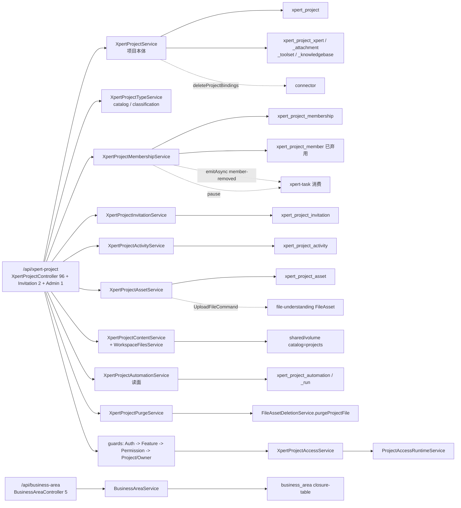
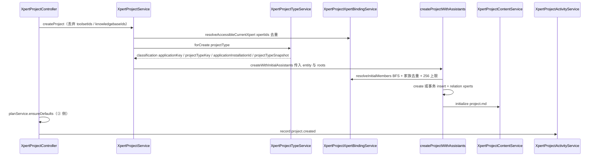
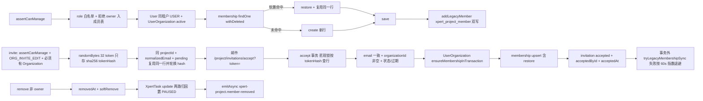
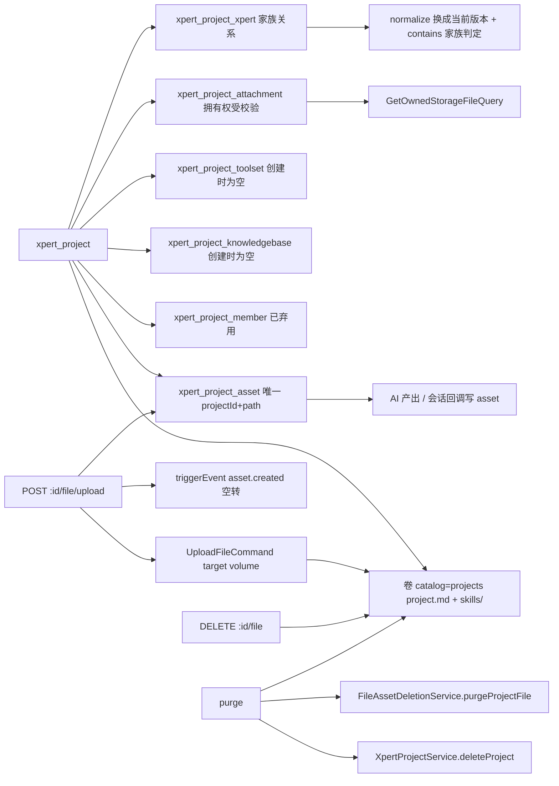
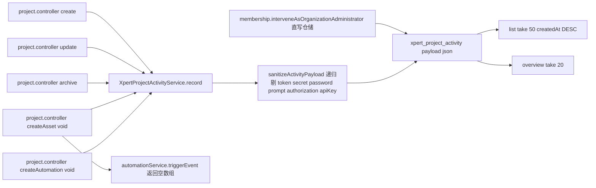
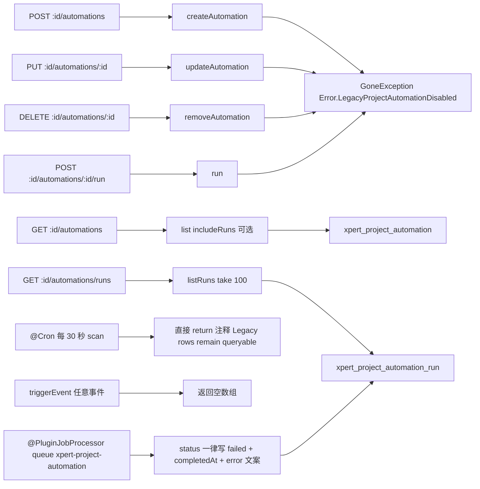
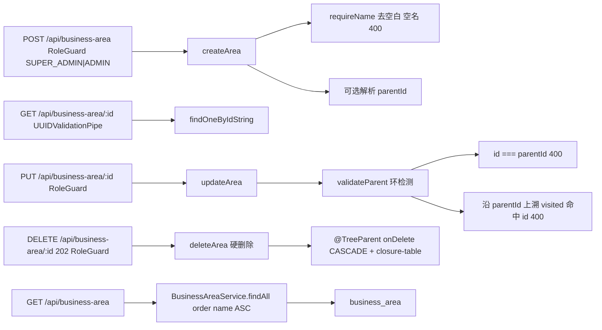

# 项目与任务协作子专家 ① · 项目本体与资源 · 数据流转

> 只读梳理（commit `80f5676fd`）。范围：① 侧 9 张项目表（其中 `xpert_project_file`、`xpert_project_vcs` 未注册 `forFeature`）＋ 4 张 M2M 联接表（`xpert_project_member` 已弃用）＋ `business_area` 1 张 closure-table 表；HTTP 前缀 `/api/xpert-project`、`/api/business-area`。引用为仓库根相对路径；未能证实处标 `[推测]`。

**本文引用的文件**

- [xpert-project/project.controller.ts](file://packages/server-ai/src/xpert-project/project.controller.ts)
- [xpert-project/project.service.ts](file://packages/server-ai/src/xpert-project/project.service.ts)
- [xpert-project/services/project-creation.ts](file://packages/server-ai/src/xpert-project/services/project-creation.ts)
- [xpert-project/services/project-type.service.ts](file://packages/server-ai/src/xpert-project/services/project-type.service.ts)
- [xpert-project/services/project-xpert-binding.service.ts](file://packages/server-ai/src/xpert-project/services/project-xpert-binding.service.ts)
- [xpert-project/services/project-initial-assistants.ts](file://packages/server-ai/src/xpert-project/services/project-initial-assistants.ts)
- [xpert-project/services/project-membership.service.ts](file://packages/server-ai/src/xpert-project/services/project-membership.service.ts)
- [xpert-project/services/project-invitation.service.ts](file://packages/server-ai/src/xpert-project/services/project-invitation.service.ts)
- [xpert-project/services/project-activity.service.ts](file://packages/server-ai/src/xpert-project/services/project-activity.service.ts)
- [xpert-project/services/project-asset.service.ts](file://packages/server-ai/src/xpert-project/services/project-asset.service.ts)
- [xpert-project/services/project-content.service.ts](file://packages/server-ai/src/xpert-project/services/project-content.service.ts)
- [xpert-project/services/project-workspace-files.service.ts](file://packages/server-ai/src/xpert-project/services/project-workspace-files.service.ts)
- [xpert-project/services/project-purge.service.ts](file://packages/server-ai/src/xpert-project/services/project-purge.service.ts)
- [xpert-project/services/project-automation.service.ts](file://packages/server-ai/src/xpert-project/services/project-automation.service.ts)
- [xpert-project/services/project-automation-scheduler.service.ts](file://packages/server-ai/src/xpert-project/services/project-automation-scheduler.service.ts)
- [xpert-project/services/project-automation.processor.ts](file://packages/server-ai/src/xpert-project/services/project-automation.processor.ts)
- [xpert-project/services/project-resource-card.service.ts](file://packages/server-ai/src/xpert-project/services/project-resource-card.service.ts)
- [xpert-project/services/conversation-project.service.ts](file://packages/server-ai/src/xpert-project/services/conversation-project.service.ts)
- [xpert-project/services/project-list-query.ts](file://packages/server-ai/src/xpert-project/services/project-list-query.ts)
- [xpert-project/entities/project.entity.ts](file://packages/server-ai/src/xpert-project/entities/project.entity.ts)
- [xpert-project/entities/project-membership.entity.ts](file://packages/server-ai/src/xpert-project/entities/project-membership.entity.ts)
- [xpert-project/entities/project-invitation.entity.ts](file://packages/server-ai/src/xpert-project/entities/project-invitation.entity.ts)
- [xpert-project/entities/project-asset.entity.ts](file://packages/server-ai/src/xpert-project/entities/project-asset.entity.ts)
- [xpert-project/entities/project-automation-run.entity.ts](file://packages/server-ai/src/xpert-project/entities/project-automation-run.entity.ts)
- [business-area/business-area.entity.ts](file://packages/server/src/business-area/business-area.entity.ts)
- [business-area/business-area.service.ts](file://packages/server/src/business-area/business-area.service.ts)

## 目录

- [总览与读写面](#总览与读写面)
- [链路一 项目创建链](#链路一-项目创建链)
- [链路二 成员与邀请链](#链路二-成员与邀请链)
- [链路三 资源挂载与文件资产链](#链路三-资源挂载与文件资产链)
- [链路四 活动流链](#链路四-活动流链)
- [链路五 自动化链（已下线）](#链路五-自动化链已下线)
- [链路六 business-area 字典链](#链路六-business-area-字典链)
- [状态机汇总](#状态机汇总)
- [本子域写 vs 跨域写](#本子域写-vs-跨域写)
- [已知风险](#已知风险)

## 总览与读写面

① 侧持久面共 10 张表：项目本体侧 7 张已注册（`xpert_project`、`xpert_project_membership`、`xpert_project_invitation`、`xpert_project_activity`、`xpert_project_asset`、`xpert_project_automation`、`xpert_project_automation_run`）＋ 2 张未注册的弃用表（`xpert_project_file`、`xpert_project_vcs`）＋ 字典表 `business_area`；此外 `xpert_project` 上声明了 5 组 `@JoinTable`（`xpert_project_member` 已弃用、`xpert_project_xpert`、`xpert_project_attachment`、`xpert_project_toolset`、`xpert_project_knowledgebase`），其中 4 组在用。**本子域不写** `xpert_project_task*`、`xpert_project_plan|milestone|sprint|swimlane`、`xpert_task*` 任何一行。

图表来源：[project.controller.ts](file://packages/server-ai/src/xpert-project/project.controller.ts)（关键符号：XpertProjectController）、[project.service.ts](file://packages/server-ai/src/xpert-project/project.service.ts)（关键符号：XpertProjectService）、[project-invitation.service.ts](file://packages/server-ai/src/xpert-project/services/project-invitation.service.ts)（关键符号：XpertProjectInvitationService.accept）、[business-area.service.ts](file://packages/server/src/business-area/business-area.service.ts)（关键符号：BusinessAreaService）

章节来源：[project.module.ts](file://packages/server-ai/src/xpert-project/project.module.ts)（关键符号：XpertProjectModule 的 TypeOrmModule.forFeature）、[project.entity.ts](file://packages/server-ai/src/xpert-project/entities/project.entity.ts)（关键符号：XpertProject 的 @JoinTable 五组）、[business-area.module.ts](file://packages/server/src/business-area/business-area.module.ts)（关键符号：BusinessAreaModule 的 RouterModule.register）

## 链路一 项目创建链

图表来源：[project.controller.ts](file://packages/server-ai/src/xpert-project/project.controller.ts)（关键符号：XpertProjectController.create）、[project.service.ts](file://packages/server-ai/src/xpert-project/project.service.ts)（关键符号：XpertProjectService.createProject）、[project-type.service.ts](file://packages/server-ai/src/xpert-project/services/project-type.service.ts)（关键符号：XpertProjectTypeService.forCreate / classification）、[project-creation.ts](file://packages/server-ai/src/xpert-project/services/project-creation.ts)（关键符号：createProjectWithAssistants）、[project-initial-assistants.ts](file://packages/server-ai/src/xpert-project/services/project-initial-assistants.ts)（关键符号：resolveInitialProjectAssistants）

- **写面**：`xpert_project` 一行（含 `applicationKey`/`projectTypeKey`/`applicationInstallationId`/`projectTypeSnapshot`），`xpert_project_xpert` 联接行 N 条，卷目录 + `project.md`，`xpert_project_activity` 一行，以及控制器侧逐个 `membershipService.add` 产生的 `xpert_project_membership` 行（**owner 不入成员表**）。
- **分类快照的不可逆点**：`applicationKey`/`projectTypeKey` 一旦落库即成为身份（`CK_project_type_identity` 约束两键同 NULL 或同非空）；`projectTypeSnapshot` 只是展示快照，`resolve()` 永远按当前已加载插件重解析，已下线类型不能靠快照复活。
- **幂等 provisioning 分支**：`ensureManagedProject` 用调用方传入的 `projectId` + `tenantId` + `organizationId ?? IsNull()` 三键查重，命中且 `ownerId === 当前用户` 则只回写 `name`/`status`/分类元数据并**显式丢弃 `xperts` 关系快照**（避免复活并发移除的助手），然后补跑 `initialize`。
- **会话首发分支**：`ConversationProjectService` 在 `chat_conversation` 行 `pessimistic_write` 锁内建项目 + 绑定助手 + 写 `conversation.projectId`（源文件注释：「call before applying the Assistant principal. The conversation row lock serializes first sends」）；项目名走 `settings.conversationBootstrap`，由 `ensureManagedProject` 侧一次性 `nameResolved = true`。
- **冲突出口**：事务内 insert 命中 `error.code === '23505'` 转 `Error.ProjectTypeConflict`；类型键非法/不可用分别抛 `Error.ProjectTypeInvalid` / `Error.ProjectTypeUnavailable`。

章节来源：[project.service.ts](file://packages/server-ai/src/xpert-project/project.service.ts)（关键符号：XpertProjectService.createProject / createWithInitialAssistants / ensureManagedProject）、[project-creation.ts](file://packages/server-ai/src/xpert-project/services/project-creation.ts)（关键符号：createProjectWithAssistants 的 23505 分支）、[project-managed-provisioning.ts](file://packages/server-ai/src/xpert-project/services/project-managed-provisioning.ts)（关键符号：ensureManagedProject 的 tenantId / organizationId 三键查重）、[conversation-project.service.ts](file://packages/server-ai/src/xpert-project/services/conversation-project.service.ts)（关键符号：ConversationProjectService.confirm / prepare）

## 链路二 成员与邀请链

图表来源：[project-membership.service.ts](file://packages/server-ai/src/xpert-project/services/project-membership.service.ts)（关键符号：XpertProjectMembershipService.add / remove / addLegacyMember）、[project-invitation.service.ts](file://packages/server-ai/src/xpert-project/services/project-invitation.service.ts)（关键符号：XpertProjectInvitationService.invite / accept / tryLegacyMembershipSync）

- **写面**：`xpert_project_membership`（`unique(projectId, userId)`，软删列 `deletedAt` + 业务列 `removedAt`）、`xpert_project_member`（弃用，双写）、`xpert_project_invitation`（含 4 个 legacy 补偿列与轮换后的 `tokenHash`）、`UserOrganization`（接受邀请时按需新建或激活）、`xpert_task`（移除成员时跨域暂停，只改 `status`/`statusReason`）。
- **幂等键**：`(projectId, userId)`（成员唯一）、`IDX_xpert_project_invitation_pending`（同项目同邮箱至多一条 pending）、`IDX_xpert_project_invitation_token`（`tokenHash` 唯一）。接受路径的幂等出口是「`status === 'accepted'` 且 `acceptedById === 当前用户`」→ 返回既有成员行。
- **锁**：`accept` 按 `tokenHash` 加 `pessimistic_write`；`interveneAsOrganizationAdministrator` 与 `transferOwnership` 锁 `xpert_project` 行（+ 成员行）；`add`/`updateRole` 不显式加锁，靠 `unique(projectId,userId)` 兜底。
- **状态先落库再抛错**：过期邀请在事务内先写 `status='expired'`，事务提交后统一抛 `BadRequestException`——即「拒绝」与「状态推进」都持久化。
- **补偿 outbox**：`tryLegacyMembershipSync` 把邀请行当作持久化 outbox，成功写 `legacyMembershipSyncedAt`，失败写 `legacyMembershipSyncAttempts`/`LastError`/`NextAttemptAt`（退避 `60s × 2^(attempts-1)`，上限 1 小时）。

章节来源：[project-membership.service.ts](file://packages/server-ai/src/xpert-project/services/project-membership.service.ts)（关键符号：XpertProjectMembershipService.add / remove / transferOwnership / syncLegacyMembership）、[project-invitation.service.ts](file://packages/server-ai/src/xpert-project/services/project-invitation.service.ts)（关键符号：XpertProjectInvitationService.accept / decline / revoke / retryPendingLegacyMembershipSyncs）、[project-membership.entity.ts](file://packages/server-ai/src/xpert-project/entities/project-membership.entity.ts)（关键符号：XpertProjectMembership / IDX_xpert_project_membership_unique）

## 链路三 资源挂载与文件资产链

图表来源：[project.entity.ts](file://packages/server-ai/src/xpert-project/entities/project.entity.ts)（关键符号：XpertProject 的 @JoinTable 五组）、[project-asset.service.ts](file://packages/server-ai/src/xpert-project/services/project-asset.service.ts)（关键符号：XpertProjectAssetService.createAsset）、[project-purge.service.ts](file://packages/server-ai/src/xpert-project/services/project-purge.service.ts)（关键符号：XpertProjectPurgeService.purge）、[project.controller.ts](file://packages/server-ai/src/xpert-project/project.controller.ts)（关键符号：XpertProjectController.uploadFile / deleteFile）

- **四类「资源」的语义差异**（不可混谈）：① 助手＝家族关系（`normalize` + `contains`，加同家族新版本不重复挂载）；② 附件＝指向 `StorageFile` 的引用（写入前逐个 `GetOwnedStorageFileQuery`，删除时额外 `StorageFileDeleteCommand`）；③ 工具集/知识库＝纯 ID 引用（创建时被 `void` 丢弃，永远事后追加）；④ 资产＝项目自有文件树索引。
- **资产 upsert 语义**：`createAsset` 以 `(projectId, path)` 为幂等键，`withDeleted: true` 命中即 `Object.assign` + `repository.recover` + `save`；`path` 缺省回落到 `name.trim()`，`name` 缺省回落 `'Untitled asset'`，`status` 缺省 `'available'`，`source` 缺省 `'upload'`。
- **上传链的两段式写**：`UploadFileCommand` 先写卷（`kind: 'volume'` + `catalog: 'projects'` + `projectId`），得到 `destination.url` 后**再**写 `xpert_project_asset`——两步非同事务；`getFileAssetDestination(asset, 'volume')` 非 `success` 即 `Error.ProjectFileUploadFailed`。
- **受管路径是一道硬边界**：`isGovernedPath` 为真时，`uploadFile` / `deleteFile` / `uploadToFolder` 一律拒绝，只能走 `:id/content/instructions` 与 `:id/content/skills*` 端点；`ProjectContentService` 侧还额外拒绝 symlink 逃逸（`ProjectContentIntegrityError` → 400）。
- **清理链的前置条件**：`purge` 要求「owner + archived + 项目已绑定请求方 `xpertId`」，且任一 `FileAsset.status ∈ uploaded|scanning|parsing|processing|queued` 即 400（`Error.ProjectPurgeBusy`）；随后逐文件 `purgeProjectFile` → `VolumeHandle.removePath`（`ENOENT` 容忍，越界由 `boundaryRoot` 拦住）→ `deleteProject`（**先 `connectorService.deleteProjectBindings`，再删行**）。

章节来源：[project.service.ts](file://packages/server-ai/src/xpert-project/project.service.ts)（关键符号：XpertProjectService.addXpert / addAttachments / delAttachment / deleteProject）、[project-xpert-binding.service.ts](file://packages/server-ai/src/xpert-project/services/project-xpert-binding.service.ts)（关键符号：XpertProjectXpertBindingService.normalize / contains）、[project-workspace-files.service.ts](file://packages/server-ai/src/xpert-project/services/project-workspace-files.service.ts)（关键符号：XpertProjectWorkspaceFilesService.save / uploadToFolder / delete）、[project-content.service.ts](file://packages/server-ai/src/xpert-project/services/project-content.service.ts)（关键符号：XpertProjectContentService.isGovernedPath / initialize）

## 链路四 活动流链

图表来源：[project-activity.service.ts](file://packages/server-ai/src/xpert-project/services/project-activity.service.ts)（关键符号：XpertProjectActivityService.record / sanitizeActivityPayload）、[project.controller.ts](file://packages/server-ai/src/xpert-project/project.controller.ts)（关键符号：XpertProjectController.create / createAsset / overview）、[project-membership.service.ts](file://packages/server-ai/src/xpert-project/services/project-membership.service.ts)（关键符号：interveneAsOrganizationAdministrator）

- **写面**：`xpert_project_activity` 一行，列为 `type`/`entityType`/`entityId`/`summary`/`payload(json)` + 基类 `tenantId`/`organizationId`/`projectId`/`createdById`。
- **两条写路径并存**：5 处经 `record`（脱敏），1 处（组织管理员介入）在事务内直写 `XpertProjectActivity` 仓储——**不脱敏**，但 payload 只含 `{actorId, reason, role}`。
- **写入时机**：`create`/`archive` 是 `await`（失败使请求失败），`createAsset`/`createAutomation` 是 `void`（fire-and-forget，失败静默）。
- **读面**：`list(projectId, take = 50)` 按 `createdAt DESC`；`overview` 用 `take = 20`，且只在传了 `projectId` 时才组装（未传则退化为 `findAllMy({take:25})` 的项目列表）。
- **实体列不含 actor**：contracts 类型里的活动 actor 在实体侧只有基类的 `createdById`（`[推测]` 若上层要求「操作者」字段需自行投影）。

章节来源：[project-activity.service.ts](file://packages/server-ai/src/xpert-project/services/project-activity.service.ts)（关键符号：XpertProjectActivityService.record / list / sanitizeActivityPayload）、[project.controller.ts](file://packages/server-ai/src/xpert-project/project.controller.ts)（关键符号：XpertProjectController.overview / createAsset / createAutomation）、[project-activity.entity.ts](file://packages/server-ai/src/xpert-project/entities/project-activity.entity.ts)（关键符号：XpertProjectActivity）

## 链路五 自动化链（已下线）

图表来源：[project-automation.service.ts](file://packages/server-ai/src/xpert-project/services/project-automation.service.ts)（关键符号：XpertProjectAutomationService.createAutomation / run / triggerEvent / listRuns / legacyProjectAutomationDisabled）、[project-automation-scheduler.service.ts](file://packages/server-ai/src/xpert-project/services/project-automation-scheduler.service.ts)（关键符号：XpertProjectAutomationSchedulerService.scan）、[project-automation.processor.ts](file://packages/server-ai/src/xpert-project/services/project-automation.processor.ts)（关键符号：XpertProjectAutomationProcessor.handle）

- **写面（现存唯一）**：`xpert_project_automation_run` 被 `XpertProjectAutomationProcessor.handle` 写成 `status='failed'` + `completedAt` + `error`（同一段禁用文案）；`xpert_project_automation` 表无任何写入方。
- **无新行产生**：`createAutomation` 抛 `GoneException`（HTTP 410），因此 `xpert_project_automation` 只可能有历史行；`run` 同样抛错，因此不会有新的 `_automation_run` 行由 API 产生。
- **`triggerEvent` 静默空转**：两处调用点（`createAsset`、`uploadFile`）拿到空数组后不做任何判断，因此「资产创建触发自动化」在当前版本**不会产生任何效果也不报错**。
- **保留读路径**：`list(projectId, {includeRuns})` 与 `listRuns(projectId, automationId?)` 仍可查历史；`overview` 的 `automations` 字段和 `GET :id/automations*` 两个端点仍可用。
- **扫描器空转但有成本**：`@Cron('*/30 * * * * *')` 仍会被调度框架触发（函数体立即 `return`），`redisLockService` 与 `PROJECT_AUTOMATION_LOCK_KEY`/`TTL` 注入已成死代码。

章节来源：[project-automation.service.ts](file://packages/server-ai/src/xpert-project/services/project-automation.service.ts)（关键符号：XpertProjectAutomationService.triggerEvent / list / listRuns）、[project-automation-scheduler.service.ts](file://packages/server-ai/src/xpert-project/services/project-automation-scheduler.service.ts)（关键符号：XpertProjectAutomationSchedulerService.scan / nextScheduleDate）、[project-automation.processor.ts](file://packages/server-ai/src/xpert-project/services/project-automation.processor.ts)（关键符号：XpertProjectAutomationProcessor.handle / runRepository.save）

## 链路六 business-area 字典链

图表来源：[business-area.entity.ts](file://packages/server/src/business-area/business-area.entity.ts)（关键符号：BusinessArea.@Tree / parent / children）、[business-area.service.ts](file://packages/server/src/business-area/business-area.service.ts)（关键符号：BusinessAreaService.createArea / updateArea / deleteArea / validateParent / requireName）

- **写面**：`business_area` 一行 + closure-table 的闭包行（由 TypeORM 维护，非显式实体）。
- **无外键耦合**：该表与 `xpert_project` / `xpert_project_task` **无任何 FK 或 ID 引用**；`BusinessArea` 只有 `type`/`name`/`parentId` 三列，`name` 建 `@Index()`（非唯一）。
- **权限梯度**：读端点无守卫（登录即可），写端点 `RoleGuard` + `@Roles(SUPER_ADMIN, ADMIN)`，删除返回 202。
- **删除是硬删**：`deleteArea` 只做存在性校验后 `this.delete(id)`，子节点清理由 `@TreeParent({ onDelete: 'CASCADE' })` 承担；**没有**「有子节点则拒绝」的软护栏。
- **跨包边界**：该模块在 `packages/server` 而非 `packages/server-ai`，因此测试必须切到 `packages/server/jest.config.ts`（见 06-测试）。

章节来源：[business-area.entity.ts](file://packages/server/src/business-area/business-area.entity.ts)（关键符号：BusinessArea.type / name / parentId / @Tree）、[business-area.service.ts](file://packages/server/src/business-area/business-area.service.ts)（关键符号：BusinessAreaService.findAll / createArea / updateArea / deleteArea / validateParent）、[business-area.controller.ts](file://packages/server/src/business-area/business-area.controller.ts)（关键符号：BusinessAreaController.createArea / updateArea / deleteArea）

## 状态机汇总

- **项目 `status`**：`'active' | 'deprecated' | 'archived'`（`TXpertProjectStatus`）。唯一代码内自动迁移是 `archive()` 显式写 `'archived'`；`update()` 不触碰 `status`，创建默认 `'active'`。失败/拒绝行为：`assertProjectWritable` 在 `'archived'` 时拒绝 edit/manage/owner 三类操作；`assertCanUse` 只拒 `'archived'`；`assertCanPurge` 要求「`owner` 且 `'archived'`」。**无反向迁移**（`recover` 只恢复软删行，不改 `status`）。
- **成员角色 `role`**：`'manager' | 'editor' | 'member'`（`TXpertProjectMemberRole`，列默认 `'member'`）。合法迁移由 API 直接赋值：`add`/`updateRole` 写白名单值；`transferOwnership` 把新 owner 的成员行 `softRemove`、把旧 owner 置 `'manager'`；`interveneAsOrganizationAdministrator` 一律写 `'manager'`。特例：`owner` 不是成员表的角色值——它由 `xpert_project.ownerId` 派生（`XpertProjectAccessService.resolveAccess` 优先判 owner）。移除走 `removedAt` + `deletedAt` 双软删，`add` 命中软删行会 `restore` 并复用。
- **邀请 `status`**：`'pending' | 'accepted' | 'declined' | 'revoked' | 'expired'`（列默认 `'pending'`）。已证实迁移：`pending → accepted`（`accept` 成功）、`pending → declined`（`decline`）、`pending → expired`（`accept` 发现 `expiresAt <= now`，**先落库再抛错**）、`pending → revoked`（`revoke`，要求 `assertCanManage` 且仅 pending）。**`accepted` 是终态**（再次 `accept` 走幂等分支返回既有成员行）；**同项目同邮箱至多一条 pending** 由部分唯一索引 `IDX_xpert_project_invitation_pending` 保证，因此 `invite` 重发是「复用同行 + 轮换 `tokenHash`」而不是新行。
- **自动化运行 `status`（已下线）**：列枚举 `'queued' | 'running' | 'succeeded' | 'failed' | 'cancelled'`，列默认 `'queued'`。但**唯一写入方把行一律写成 `'failed'`**（`XpertProjectAutomationProcessor.handle`），因此 `running`/`succeeded`/`cancelled` 在① 侧无写入方；`queued` 只可能作为历史行或其它未在本子域范围内的写入者残留（`[推测]`）。新周期化诉求一律迁 `xpert-task`。
- **资产 `status`（附）**：`'available' | 'processing' | 'failed'`（列默认 `'available'`）。`createAsset` 默认写 `'available'`；`'processing'`/`'failed'` 无① 侧写入点，只被 `purge` 读作「忙」判定（`purge` 额外读的是 `FileAsset.status` 的 `uploaded|scanning|parsing|processing|queued`）。

章节来源：[project.entity.ts](file://packages/server-ai/src/xpert-project/entities/project.entity.ts)（关键符号：XpertProject.status / ownerId）、[project-access.service.ts](file://packages/server-ai/src/xpert-project/services/project-access.service.ts)（关键符号：XpertProjectAccessService.assertCanPurge / assertProjectWritable）、[project-invitation.entity.ts](file://packages/server-ai/src/xpert-project/entities/project-invitation.entity.ts)（关键符号：XpertProjectInvitation.status / IDX_xpert_project_invitation_pending）、[project-automation-run.entity.ts](file://packages/server-ai/src/xpert-project/entities/project-automation-run.entity.ts)（关键符号：XpertProjectAutomationRun.status）、[project-asset.entity.ts](file://packages/server-ai/src/xpert-project/entities/project-asset.entity.ts)（关键符号：XpertProjectAsset.status / @Index projectId+path）

## 本子域写 vs 跨域写

| 列 / 事实 | 写入方 | 说明 |
|---|---|---|
| `xpert_project.*`（含 `projectTypeSnapshot`） | 本子域 | 只经 `XpertProjectService`；`archive` 是唯一自动状态迁移 |
| `xpert_project_membership.*` | 本子域 | `add`/`updateRole`/`transferOwnership`/`interveneAsOrganizationAdministrator`/`invite.accept` |
| `xpert_project_member.*` | 本子域（弃用列） | `addLegacyMember`/`removeLegacyMember`，`syncLegacyMembership` 由邀请补偿触发 |
| `xpert_project_invitation.*` | 本子域 | `invite` 轮换 token、`accept`/`decline`/`revoke` 改状态、`@Interval` 写补偿列 |
| `xpert_project_activity.*` | 本子域（两条路径） | `record`（脱敏）＋ 管理员介入事务内直写仓储（不脱敏） |
| `xpert_project_asset.*` | 本子域 | `createAsset` upsert；`removeAsset` 是软删 |
| `xpert_project_automation_run.*` | 本子域 processor | 只写 `'failed'` + `completedAt` + `error` |
| `business_area.*` + closure 行 | 本子域（旁挂包） | `BusinessAreaService` 硬删；closure 行由 TypeORM 维护 |
| 卷内容（`project.md`、`skills/`） | 本子域经 `shared/volume` | `XpertProjectContentService` 独占受管路径；`WorkspaceFilesService` 其余路径 |
| `StorageFile` M2M 关系行 | 本子域 | `addAttachments`（经 `GetOwnedStorageFileQuery` 校验）/ `removeAttachments` / `delAttachment` |
| `FileAsset` 行 | **跨域**（`file-understanding`） | 上传经 `UploadFileCommand` 创建；purge 只经 `FileAssetDeletionService.purgeProjectFile` 删除 |
| `xpert_task.status` / `statusReason` | 本子域触发、② 域执行 | `membership.remove` 直接 `XpertTask.update` 置 `PAUSED`；内存 cron job 清理由 ② 的 `@OnEvent` 完成 |
| `Connector` 项目绑定 | 本子域经跨域服务 | `deleteProjectBindings({projectId, tenantId}, manager)` 在删/软删项目**同一事务内**调用 |
| `ChatConversation.projectId` | 跨域（对话域）经本子域编排 | `ConversationProjectService` 在会话行锁内绑定；`ProjectResourceCardService` 写会话消息内容 |
| `xpert_project_task*` / `xpert_project_plan*` / `xpert_task*` | **不属于本子域** | 全部归 ②；本子域只读 `xperts`/`status` 等少量列 |

章节来源：[project.service.ts](file://packages/server-ai/src/xpert-project/project.service.ts)（关键符号：XpertProjectService.deleteProject / softRemoveProject / addAttachments）、[project-purge.service.ts](file://packages/server-ai/src/xpert-project/services/project-purge.service.ts)（关键符号：XpertProjectPurgeService.purge）、[project-membership.service.ts](file://packages/server-ai/src/xpert-project/services/project-membership.service.ts)（关键符号：XpertProjectMembershipService.remove 的 taskRepository.update 两路）、[conversation-project.service.ts](file://packages/server-ai/src/xpert-project/services/conversation-project.service.ts)（关键符号：ConversationProjectService.prepare）

## 已知风险

1. **成员事实双轨且无回填**：授权只读 `xpert_project_membership`，但 `xpert_project_member` 仍被双写；两表之间唯一的对账手段是邀请表的 4 个 `legacyMembershipSync*` 列与 60 秒扫描——**直接改成员表的历史数据不会被回填**，也不会被授权感知。
2. **`projectTypeSnapshot` 与实况类型可能分叉**：快照在创建瞬间固化，插件下线后 `resolve()` 抛 `Error.ProjectTypeUnavailable`；此时 `assertPlatformLifecycle` 的「快照 binding 为 entity 也拒绝」分支成为唯一防线，若快照缺 `binding` 则实况查不到会直接抛错（配置变更期间的项目编辑会 400）。
3. **自动化三处残留造成「功能存在」错觉**：`triggerEvent` 返回空数组、`scan` 空转、`handle` 只写 `failed`；客户端与 `overview` 仍能读到 `automations` 字段，容易误判为可用。
4. **卷与资产表的两步写非事务**：`uploadFile` 先写卷再写资产行，中间失败会留下「有文件无索引」；反向的 `deleteFile` 只删卷不删资产行，会留下「有索引无文件」。仓库内未见对账任务（`[推测]`）。
5. **`purge` 长串行链无回滚**：逐文件 `purgeProjectFile` → 删卷 → `deleteProject` 三步非事务（只有 `deleteProject` 内部带 Connector 清理事务）；中途失败会停在「文件已删、项目还在」的中间态，重试依赖 `assertCanPurge` 仍成立（因此必须有 `archived` + `owner`）。
6. **管理员介入活动不脱敏**：唯一绕过 `record` 的写入点（事务内直写 `XpertProjectActivity`），虽只写 `{actorId, reason, role}`，但脱敏约束从「服务级不变量」退化为「调用者自觉」。
7. **`project-invitation` 的 `tokenHash` 需显式 `addSelect`**：列是 `select: false`，任何「查邀请列表」的代码（如 `list`）都拿不到 hash——若某天需要按 token 反查邀请，忘记 `addSelect` 会表现为「邀请不存在」。
8. **`business_area` 删除无「有子节点」护栏**：`deleteArea` 是硬删除且靠 `onDelete: 'CASCADE'` 级联，误删父节点会静默带走整棵子树（closure 行随之删除），无软删或回收站。
9. **`[推测]` 邀请 `revoked` 语义单向**：`revoke` 后同名邮箱再次 `invite` 会新建行（因为部分唯一索引只约束 `status='pending'`），但历史 `revoked`/`declined`/`expired` 行永久累积，无清理策略。
10. **`XpertProjectFeatureGuard` 的「缺 seed 即放行」**：新装环境未完成 feature seeding 时项目 API 全量放行，仅靠环境变量 `toggleFeatures` 兜底；这是有意的可用性取舍，但在「环境开关为 true 且 seed 未完成」的窗口内，组织级关闭开关不生效。

章节来源：[xpert-project/services/project-membership.service.ts](file://packages/server-ai/src/xpert-project/services/project-membership.service.ts)（关键符号：XpertProjectMembershipService.addLegacyMember / remove）、[xpert-project/services/project-type.service.ts](file://packages/server-ai/src/xpert-project/services/project-type.service.ts)（关键符号：XpertProjectTypeService.resolve / assertPlatformLifecycle）、[xpert-project/services/project-automation.service.ts](file://packages/server-ai/src/xpert-project/services/project-automation.service.ts)（关键符号：XpertProjectAutomationService.triggerEvent）、[xpert-project/guards/project-feature.guard.ts](file://packages/server-ai/src/xpert-project/guards/project-feature.guard.ts)（关键符号：XpertProjectFeatureGuard.canActivate 的 seed 缺失放行分支）
